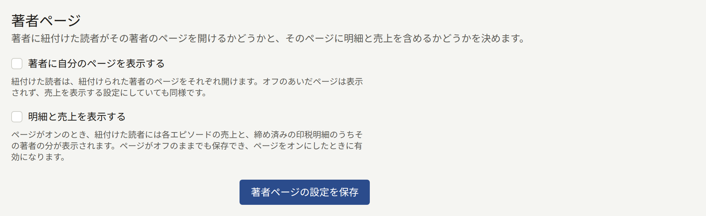

**管理**グループの**設定**は、3つのタブに分かれています。

- **基本情報**では、テナントが自分のサイトについて決める項目を設定します。
- **制限と保持**では、オペレーターが全テナントに共通で決めている値を、認められた範囲でテナントごとに変更します。
- **読者のアイコン**では、読者がアイコンとして表示できるものと、読者が選ぶためのアイコンを設定します。

どのタブも項目がカードにまとまっていて、保存ボタンはカードごとにあります。ボタンで保存されるのはそのカードの項目だけなので、1枚ずつ保存してから次のカードに進んでください。**設定**はスタッフの誰でも開けますが、保存できるのはテナント管理者だけです。編集担当と監査担当には、どのカードにも「この設定はテナント管理者のみ編集できます。現在は閲覧専用です。」と表示されます。

## 基本情報

### 公開サイト表示設定

サイトに表示する3つの文言を設定します。どれも空欄のままでかまいません。

- **Copyright表示**は、サイトの全ページとログイン画面の最下部に表示されます。
- **サイトの宣伝文句**は、ログイン画面、会員登録画面、パスワードの画面に表示される短い1行です。サイトのホームページへのリンクを共有したときの画像にも入ります([リンクのプレビュー](./2-branding.md#リンクのプレビュー)を参照)。
- **サイト説明文**は、サイトのフッターに表示され、検索エンジンやリンクのプレビューにもサイトの説明として渡されます。

文言は言語ごとに入力します。カードの**言語**には、[言語](#言語)で選んだ提供言語ごとにタブがあります。カードを開いたときは既定言語のタブが表示され、文言をまだ入力していない言語のタブには**(未追加)**と表示されます。**設定を保存**で保存されるのは開いているタブの3項目だけで、ほかの言語の文言は変わりません。保存しないままタブを切り替えると入力した内容は失われるので、切り替える前に保存してください。3項目をすべて空にして保存すると、その言語の文言は削除されます。

読者には、読者がサイトを表示している言語の文言が表示され、その言語の文言がなければ既定言語の文言が表示されます。ただし、文言を入力した言語では既定言語の文言で補うことはありません。タブで空欄にした項目は、空欄のまま表示されます。

### タイムゾーン

**タイムゾーン**は、管理画面と公開サイトで日時を表示し、入力を受け付けるときの基準です。シリーズやエピソードに入力した公開日時とバナーの掲載終了日時は、このタイムゾーンの時刻として扱われます。レポートと監査ログを日ごとに集計するときの区切りもこのタイムゾーンで決まり、印税の計算で月の売上を締める境目と、読者の年齢を数える日付も同様です。一覧は都市名や地域名を入力して絞り込めます。タイムゾーンを選んだら、**タイムゾーンを保存**で保存します。

タイムゾーンは最初の売上が発生する前に設定してください。後から変えると、まだ締めていない月の区切りがずれます。印税の計算ですでに締めた月は、締めたときのタイムゾーンのまま変わりません。

新しいテナントのタイムゾーンは、プラットフォームの既定のタイムゾーンです。オペレーターが変えていなければ`UTC`になります。

### 言語

**言語**では、読者に提供する言語と、サイトを最初に表示する言語を設定します。

**提供する言語**には、Publiraの翻訳がある日本語、English、한국어、简体中文、繁體中文のチェックボックスが並んでいます。読者がサイトを使える言語にチェックを入れてください。チェックを外した言語で書かれたページの翻訳は、削除されずに非表示になり、もう一度チェックを入れると再び表示されます([翻訳](./3-pages.md#翻訳)を参照)。

読者に見えるのはチェックを入れた言語だけです。サイトの**表示言語**メニューにも、サイトマップや検索エンジン向けの言語別リンクにも、その言語だけが並びます。チェックを外した言語のアドレスをブックマークや検索結果から開くと、同じページが既定言語で表示されます。

テナントのアプリもこの設定に従います。アプリには**表示言語**メニューがなく、読者の端末に設定されている言語を使います。端末の言語のうちサイトが提供している最初の言語で表示し、提供している言語が1つもなければ既定言語で表示します。

**既定言語**は、まだ言語を選んでいない人にサイトとこの管理画面が最初に使う言語です。すでに言語を選んだ読者やスタッフには、選んだ言語がそのまま使われます。既定言語は次の場面でも使われます。

- テナントが送るメールの言語(新しいスタッフへの招待メールを含む)
- 新しいページを最初に書く言語

既定言語は必ず提供されます。既定言語のチェックボックスはチェックが入ったまま外せず、チェックの入っていない言語を既定言語に選ぶと、その言語にもチェックが入ります。既定言語はオペレーターがテナントを作成するときに選んだもので、オペレーターがほかの言語も選んでいなければ、新しいテナントが提供する言語は既定言語だけです。**言語を保存**を選ぶと、既定言語と提供する言語の両方が保存されます。

### 読者のコメント

**コメントの公開方法**では、読者がエピソードにコメントできるかどうかと、コメントがほかの人に見えるようになる時期を決めます。

| 選択肢 | 動作 |
| --- | --- |
| **受け付けない** | エピソードのページにコメント欄が表示されず、コメントは投稿できません。新しいテナントはこの設定です |
| **すぐに公開する** | 投稿されたコメントは、その時点から誰でも読めます |
| **承認してから公開する** | モデレーターが**コメント**で承認するまで、コメントは投稿者にしか見えません([承認待ちのコメントの処理](../2-readers/2-comments.md#承認待ちのコメントの処理)を参照) |

**自動で非表示にする報告件数**では、スタッフの対応を待たずにコメントを非表示にするまでに、何人の読者からの報告が必要かを設定します。非表示になったコメントは**コメント**の[報告キュー](../2-readers/2-comments.md#通報されたコメント)に入り、スタッフが元に戻せます。投稿者には引き続き表示されます。初期値は`3`です。`0`にすると自動では非表示にならず、すべてモデレーターの判断に任されます。

シリーズのフォームでも、シリーズごとに**コメント**を設定できます。シリーズで選んだ設定は、ここでの設定より優先されます。**テナントの設定に従う**のままのシリーズには、ここで後から変更した内容も反映されます。設定は**コメントの設定を保存**で保存します。

### 著者ページ

2つのチェックボックスがあり、新しいテナントではどちらもオフです。**著者に自分のページを表示する**をオンにすると、著者に紐付けた読者はその著者のページを開けます。ページに何が表示されるかは[著者と読者アカウントの紐付け](../1-catalog/4-authors.md#著者と読者アカウントの紐付け)で説明します。オフのあいだは、2つ目のチェックボックスがオンでも、そのページは表示されません。

**明細と売上を表示する**をオンにすると、そのページに各エピソードの売上と、締め済みの印税明細のうちその著者の分が加わります。ページがオフのままでも保存でき、ページをオンにしたときに有効になります。ページがオンでこのチェックボックスがオフのとき、読者にはフォローしている人数と各エピソードの閲覧数、完読数は表示されますが、売上と明細は表示されません。

設定は**著者ページの設定を保存**で保存します。

### 年齢確認

シリーズには、**全年齢**、**R15**、**R18**のいずれかの**年齢制限**が付いています。**年齢の証明を求める年齢制限**では、この年齢制限をサイトがどこまで厳しく扱うかを決めます。

| 選択肢 | R15のシリーズ | R18のシリーズ |
| --- | --- | --- |
| **年齢を確認しない** | 読者が15歳以上であることを申告します | 読者が18歳以上であることを申告します |
| **R18のみ確認する** | 読者が15歳以上であることを申告します | 生年月日から18歳以上と確認できる読者だけが読めます |
| **R15とR18を確認する** | 生年月日から15歳以上と確認できる読者だけが読めます | 生年月日から18歳以上と確認できる読者だけが読めます |

新しいテナントは**年齢を確認しない**になっています。**全年齢**のシリーズは、どの設定でも制限されません。

申告では、読者が**15歳以上です**か**18歳以上です**を押し、ブラウザーがそのサイトでの申告を記憶します。年齢を証明するには、読者がログインし、アカウントに生年月日を保存している必要があります。生年月日は会員登録のときか、後から読者の設定画面で入力でき、一度保存すると読者自身では変更できません。生年月日を登録していない読者には**生年月日を登録する**が表示され、年齢が足りない読者には、その年齢では作品を読めないことが表示されます。生年月日を間違えて登録した読者から問い合わせがあれば、テナント管理者が**読者**にあるその読者のページで修正します。

設定は**年齢確認を保存**で保存します。

### 利用規約とプライバシーポリシー

**利用規約**と**プライバシーポリシー**には、テナントが公開しているページを1つずつ指定します。サイトとアプリには、指定したページへのリンクが表示されます。読者はアカウントを作成するときにこの2つに同意し、どちらかの新しいバージョンで同意を求めた場合は改めて同意します([新しいバージョンの公開](./3-pages.md#新しいバージョンの公開)を参照)。先にページを書いて公開してから([ページ](./3-pages.md#利用規約とプライバシーポリシー)を参照)、ここでそのページを選び、**利用規約とプライバシーポリシーを保存**を選びます。**なし**を選んだほうは未設定になります。

ここで指定したページを後からサイトで非公開にすると、そのページへのリンクがどこにもなくなったことがカードに表示され、会員登録でもそのページへの同意を求めなくなります。ページをもう一度公開するか、別のページを指定してください。

### 読者の新規登録

訪問者がサイトで読者アカウントを作成できるかどうかを設定します。新規登録を停止すると、新しい読者を受け入れずに、いまの読者へのサービスだけを続けられます。公開前に招待したグループだけにサイトを見せたいときや、望まない会員登録が大量に来ていて対処するあいだに使います。アカウントを持っている読者は、停止中もログイン、購入、閲覧を続けられます。

- **新しい読者を受け付ける**は、オフにするまでオンのままです。オフのあいだは、メールアドレスでの登録も、AppleやGoogleでの初回ログインによる登録もできず、誰もサイトでアカウントを作成できません。サイトの会員登録ページにはフォームの代わりに**新規登録を受け付けていません**と入力したメッセージが表示され、**ログイン**の画面でも、**新規登録**への案内の代わりに同じ表示が出ます。
- **新規登録の停止中に表示するメッセージ**には、訪問者に見せる文章を1000文字まで入力します。改行も含めて入力したとおりに表示されます。空欄にすると、サイトには「このサイトは現在、新しいアカウントの登録を受け付けていません。」と表示されます。メッセージは新規登録を再開しても残るので、次に停止したときにも同じ文章が表示されます。

設定は**新規登録の設定を保存**で保存します。停止しているあいだは、カードのスイッチの上に「新規登録を停止しています。再開するまで、メールアドレスでもAppleやGoogleでも、サイトで新しい読者アカウントは作成できません。」と表示されます。スイッチをオンに戻して保存すると、すぐに新規登録を再開します。

保存した操作は、[監査ログ](./8-audit-log.md)に**読者の新規登録の設定更新**として記録されます。

### 受け付けないメールアドレス

会員登録にもメールアドレスの変更にも使えないアドレスを設定します。該当するアドレスを使おうとした読者には「このサイトではこのメールアドレスは使えません。別のメールアドレスを入力してください。」と表示されます。

- **使い捨てメールのドメインを受け付けない**をオンにすると、使い捨てメールサービスのドメインを受け付けなくなります。ドメインの一覧はプラットフォームが管理していて、オペレーターが一覧を設定していなければ、オンにしても効果がないことがスイッチに表示されます。
- **受け付けないアドレスとドメイン**には、1つの欄に1件ずつ、1000件まで入力します。`@`を含むものは1つのアドレスとして扱われ、そのアドレスに`+tag`を付けたアドレスも受け付けなくなります。それ以外は`example.net`のようなドメインとして扱われ、そのサブドメインも受け付けなくなります。複数行を1つの欄に貼り付けると、行ごとに欄が分かれます。ワイルドカードは使えません。

設定は**受け付けないメールアドレスを保存**で保存します。保存した内容は、それ以降の会員登録とアドレスの変更から適用されます。該当するアドレスですでに会員登録している読者のアカウントは、そのまま使えます。

AppleやGoogleでのログインは、アドレスをAppleやGoogleが提供するので、この設定では拒否されません。このカードの内容は、テナント管理者にしか表示されません。

### クローラーの除外

サイトの`robots.txt`で、クローラーに取得しないよう求める対象を設定します。`robots.txt`に従うクローラーは、ここで除外したものを取得しなくなります。ただし、読者からは何も隠れず、`robots.txt`を無視するクローラーはすべてのページを取得できます。ページを非公開にする手段にはなりません。

- **サイト全体から除外するクローラー**には、Publiraが把握しているクローラーが、ページを取得する目的ごとに**AIの学習**、**AIアシスタント**、**画像検索**に分けて並んでいます。各クローラーは運営者が`robots.txt`用に公開しているトークンで示され、その下に運営者名が表示されます。チェックを入れたクローラーには、サイトのどのページも取得しないよう求めます。一覧はPubliraが決めていて、一覧にないクローラーは追加できません。
- **すべてのクローラーから除外するパス**には、`/drafts`のようなパスを1つの欄に1つずつ、100件まで入力します。パスは`/`で始め、その下にあるものもすべて対象になります。複数行を1つの欄に貼り付けると、行ごとに欄が分かれます。ワイルドカードは使えず、空白、`*`、`$`、`?`、`#`もパスに含められません。`/robots.txt`、`/sitemap.xml`、`/sitemap`は、クローラーがサイトを読むのに必要なので除外できません。

設定は**クローラーの除外を保存**で保存します。パスは末尾の`/`を取り除いて保存され、一覧ではアルファベット順に並びます。

保存した操作は、[監査ログ](./8-audit-log.md)に**クローラーの除外の更新**として記録されます。

### 検索エンジンの所有権確認

Google Search ConsoleとBing Webmaster Toolsで、サイトの所有者であることを確認するためのコードを設定します。設定したコードは、`<meta>`タグとしてサイトの全ページに追加されます。どちらのサービスでも**HTMLタグ**や**HTML Meta Tag**と呼ばれている確認方法です。

- **Google Search Console**には、サイトをURLプレフィックスプロパティとして追加したときにSearch Consoleが表示するタグを入力します。`<meta name="google-site-verification" content="…" />`のようなタグです。
- **Bing Webmaster Tools**には、Bing Webmaster Toolsが表示するタグを入力します。`<meta name="msvalidate.01" content="…" />`のようなタグです。

タグ全体を貼り付けても、`content`の値だけを貼り付けてもかまいません。保存されるのは値だけで、欄からカーソルを外すと値だけの表示に変わります。もう一方のサービスのタグを貼り付けると拒否されます。欄を空にすると、そのサービスのタグはサイトから削除されます。

**所有権確認のコードを保存**で保存してから、各サービスでサイトの確認を実行してください。

このカードの内容は、テナント管理者にしか表示されません。保存した操作は、[監査ログ](./8-audit-log.md)に**検索エンジンの所有権確認の更新**として記録されます。

## 制限と保持

**制限と保持**には、2つのフォームがあります。

- **コミュニティの上限**では、1人の読者がどのくらいの頻度で操作できるかを設定します。対象は、コメントの投稿と報告、エピソードの評価、お問い合わせフォームからの送信、ビューアーのレイアウトの保存、通知設定の保存です。同じコメントを続けて投稿しようとした読者を拒否する時間も、ここで設定します。
- **保持期間**では、取り下げられたコメント、コンテンツイベント、日次と週次のランキングのスナップショットを、削除するまでどのくらい残すかを設定します。

どちらのフォームも、項目のグループごとに**プラットフォームの既定値を使う**のチェックボックスがあり、最初はチェックが入っています。横には、オペレーターが設定している値が表示されます。既定値を使っているあいだは、オペレーターが後から変えた値がテナントにもそのまま適用されます。テナント独自の値にするには、チェックを外して値を入力し、**コミュニティの上限を保存**か**保持期間を保存**でフォームを保存します。プラットフォームの値に戻すときは、もう一度チェックを入れて保存します。

- コミュニティの上限は、プラットフォームの値より厳しくすることしかできません。回数を減らすか、同じコメントとみなす時間を長くします。緩い値を保存しようとすると、どの設定が問題かを示すメッセージとともに拒否されます。オペレーターが後からプラットフォームの上限をテナントの値より厳しくした場合は、プラットフォームの上限が適用されます。
- 保持期間は、プラットフォームの既定値より長くも短くもでき、1日から36500日の範囲で設定します。ただし、**コンテンツイベント**だけは下限が30日で、それより短い期間は拒否されます。サイトのおすすめを、直近の丸28日分のコンテンツイベントから作っているためです。

フォームを開いたあとに別の誰かが同じフォームを保存していた場合は、「このページを開いている間に、別の場所でこの設定が変更されました。ページを再読み込みしてから、もう一度入力してください。」と表示され、保存は拒否されます。

それぞれの上限と記録が何を表すか、保持期間を過ぎて削除するときに何が残るかは、オペレーター向けの[プラットフォーム全体の既定値とポリシー](../../3-operations/9-platform-policies.md#コミュニティ)で説明しています。このタブで保存した操作は、[監査ログ](./8-audit-log.md)に**コミュニティの上限更新**と**保持期間更新**として記録されます。

## 読者のアイコン

### 読者のアイコンの設定

**読者が表示できるもの**では、読者が名前の横に表示するアイコンとして何を使えるかを決めます。アイコンは、読者のコメントとアカウントに表示されます。

| 選択肢 | 動作 |
| --- | --- |
| **自分の画像をアップロード** | 読者は好きな画像をアップロードできます。新しいテナントはこの設定です |
| **プリセットから選択** | 読者は[プリセットのアイコン](#プリセットのアイコン)から1つを選びます。画像はアップロードできません |
| **アイコンなし** | どの読者もアイコンを表示できず、サイトでは全員に無地の輪郭が表示されます |

設定は**読者のアイコンの設定を保存**で保存します。**プリセットから選択**か**アイコンなし**を保存すると、その設定で使えないアイコンは削除されるので、保存の前に「読者のアイコンを削除しますか？」と確認されます。

- **プリセットから選択**では、読者がアップロードした画像がすべて削除されます。プリセットを選んでいた読者のアイコンは残ります。
- **アイコンなし**では、読者が表示しているアイコンがすべて削除されます。

続けるときは**保存して削除**を選びます。この確認は、カードに保存済みとして表示されている設定にかかわらず表示されます。ページを開いたあとに、別のテナント管理者が設定を変えているかもしれないためです。削除したアイコンは元に戻せないので、後でアイコンを使える設定に戻したときは、読者がそれぞれアイコンを選び直すことになります。**自分の画像をアップロード**では何も削除されないので、確認なしで保存されます。

### プリセットのアイコン

**プリセットから選択**のときに読者が選べるアイコンで、50個まで登録できます。プリセットはどの設定のときでも追加できます。プリセットが1つもないと読者は何も選べないので、**プリセットから選択**に切り替える前に登録しておいてください。

追加するには、**アイコン画像**で10MB以下のJPEG、PNG、WebPのいずれかの画像を選び、**アイコンを追加**を選びます。画像は中央から正方形に切り抜かれ、その正方形が128 × 128 px以上である必要があります。登録したプリセットは、サイトでアイコンを表示するときと同じ形で、保存されたサイズとともに表示されます。

削除するには、プリセットの下の**削除**を選び、確認でもう一度**削除**を選びます。そのアイコンを選んでいた読者はアイコンがない状態になり、別のアイコンを選ぶまで無地の輪郭が表示されます。

このタブで保存した操作は、[監査ログ](./8-audit-log.md)に**読者のアイコンの設定更新**、**読者のアイコンのプリセット追加**、**読者のアイコンのプリセット削除**として記録されます。
