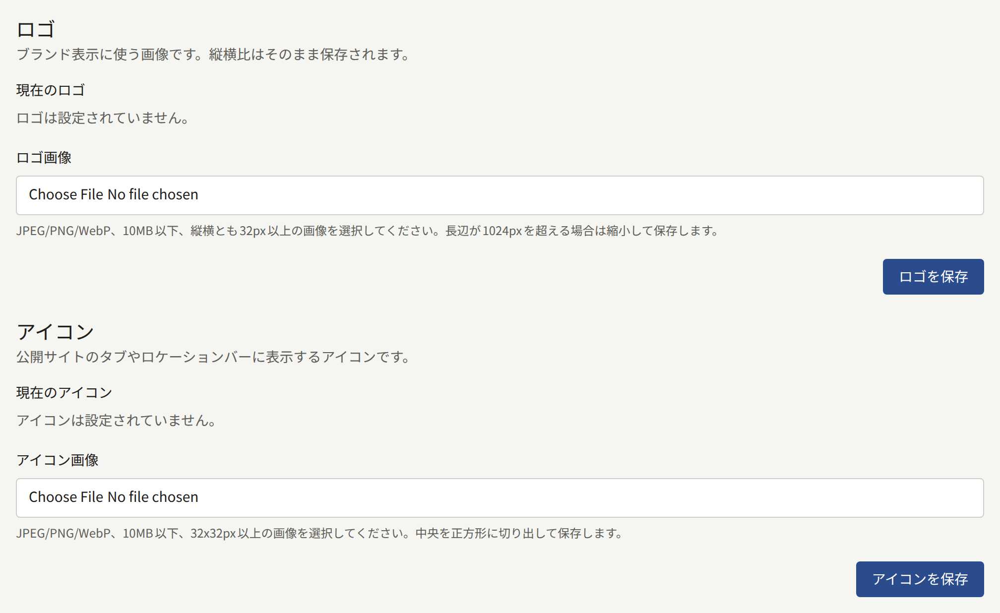
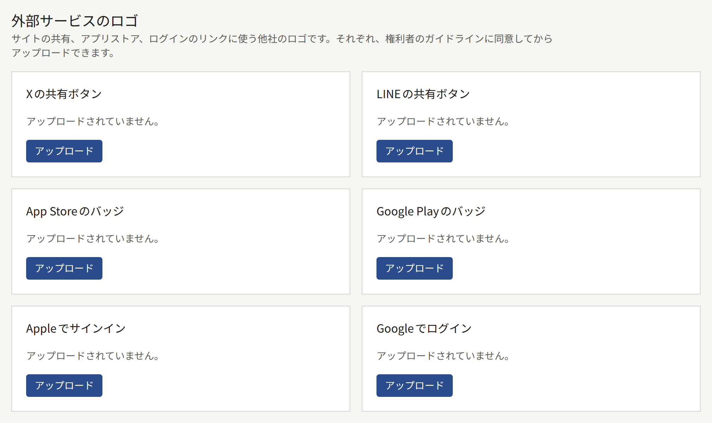
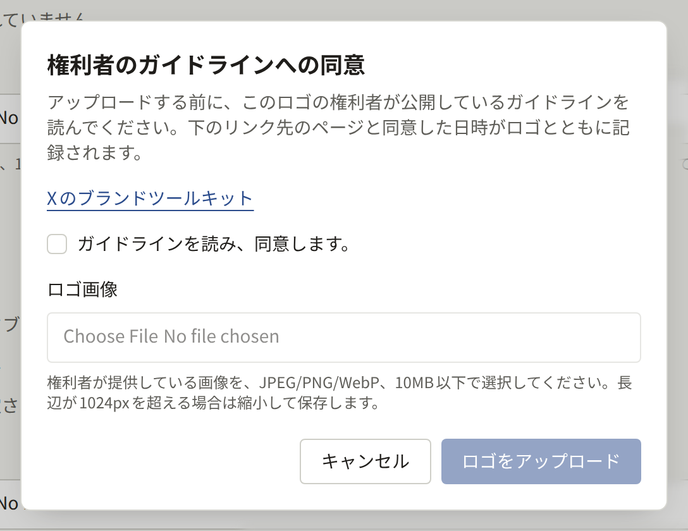
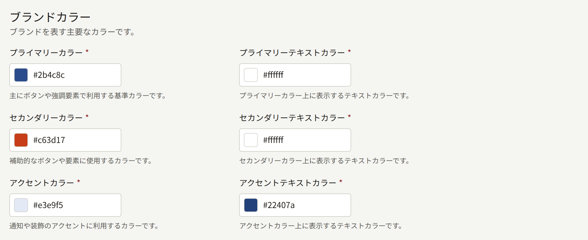
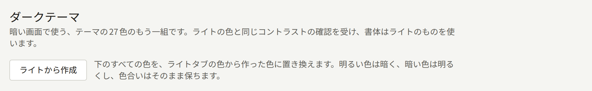
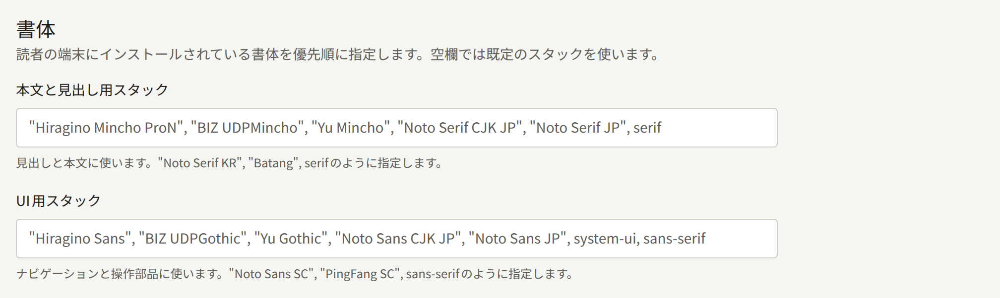
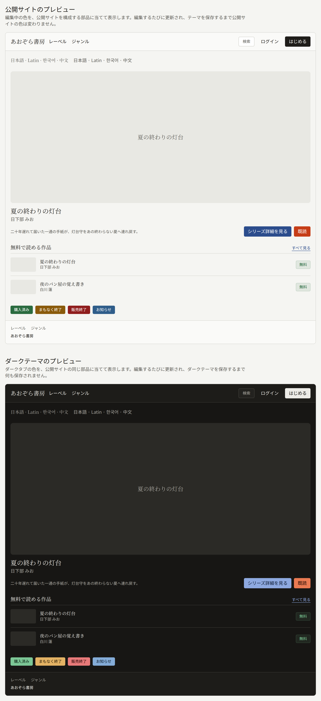

**管理**グループの**ブランディング**では、サイトの見た目を決めます。ヘッダーのロゴ、ブラウザーのタブに出るアイコン、ログインフォームの横の画像、他社のロゴ、色、文字の書体です。画面には**ロゴ**、**アイコン**、**ログイン画面の画像**、**外部サービスのロゴ**と、テーマの色と書体があり、その隣にダークテーマがあります。どれも個別に保存するもので、1つを保存してもほかは変わりません。

ブランディングを変更できるのはテナント管理者だけです。編集担当と監査担当にも同じ画面が表示されますが、操作はできません。

## ロゴ、アイコン、ログイン画面の画像

3つとも、10MB以下のJPEG、PNG、WebPの画像をアップロードできます。ロゴとアイコンはPNGで保存されるので、背景の透明な部分は透明なまま残ります。ログイン画面の画像は、JPEGならJPEGのまま、それ以外はPNGで保存されます。

|  | **ロゴ** | **アイコン** | **ログイン画面の画像** |
| --- | --- | --- | --- |
| 表示される場所 | サイトとこの管理画面の全ページの上部に、サイト名の代わりに表示されます。テナントのアプリでは、作品一覧の画面で名前の代わりに表示されます | ブラウザーのタブとアドレスバーに表示されます。読者がサイトをホーム画面に追加したときの、スマートフォンのアイコンにもなります | 幅1024px以上の画面では、サイトのログイン画面と会員登録画面でフォームの横に表示されます。それより狭い画面ではフォームだけが表示されます。テナントのアプリではログイン画面に表示され、幅840px以上の画面ではフォームの横に、それより狭い画面ではフォームの上に表示されます |
| 形 | アップロードしたままの形です | 中央から正方形に切り抜かれます | アップロードしたままの形で保存されます。フォームの横や上の領域はウィンドウに合わせて形が変わるため、サイトとアプリは領域を埋めるように切り抜いて表示します |
| 大きさ | 幅か高さが1024pxを超える画像は縮小されます。縮小後も縦横とも32px以上必要です | 32×32px以上が必要です。512×512pxより大きい画像は縮小されます | 幅か高さが2560pxを超える画像は縮小されます。縮小後も短い辺が512px以上必要です |
| 設定しない場合 | サイトにはテナント名が表示されます | ブラウザーの既定のアイコンが表示されます | サイトでもアプリでも、その領域はテーマの色で塗られます |

**ロゴ画像**、**アイコン画像**、**ログイン画面の画像ファイル**でファイルを選び、それぞれ**ロゴを保存**、**アイコンを保存**、**ログイン画面の画像を保存**を選びます。もう一度保存すると画像が置き換わります。**削除**を選んで確認すると、画像が削除されます。

アイコンには、マークを中央に置いた正方形の画像を使ってください。中央の正方形からはみ出た部分は切り取られます。ロゴには、マークの周りの余白が少ない画像を使ってください。サイトのヘッダーでは、ロゴは高さ32px、幅は最大144pxで表示されます。幅が高さの4.5倍より大きいロゴは、高さが32pxより低く表示されます。

ログイン画面の画像には、端が切り取られても見栄えが崩れない絵を使ってください。大事なものは中央近くに置き、読者に読んでもらう必要のある文字は入れないでください。ロゴやシリーズの画像がログイン画面の画像の代わりに使われることはありません。同じ絵を両方に使いたい場合は、ここにもアップロードしてください。

オペレーターがPubliraのオブジェクトストレージを設定していないと、3つのどれをアップロードしても「プラットフォームに画像の保存先がまだ設定されていないため、画像をアップロードできません。プラットフォームのオペレーターに設定を依頼してください。」と表示されて失敗します。オブジェクトストレージの設定は[オブジェクトストレージ](../../3-operations/5-object-storage.md)で説明しています。

テナントのメールには、3つのどれも使われません。メールはPublira独自の色で送られます。サイトへのリンクが共有されたときの画像にはロゴが使われますが、アイコンとログイン画面の画像は使われません([リンクのプレビュー](#リンクのプレビュー)を参照)。

## リンクのプレビュー

サイトのどのページのリンクも、チャットや投稿で共有すると画像付きで表示されます。「**リンクプレビュー(1200:630)**」の画像を設定したシリーズやエピソードでは、アップロードした画像がそのまま表示されます([シリーズ](../1-catalog/1-series.md#アイキャッチ画像)を参照)。それ以外のページと、この画像がないシリーズやエピソードでは、サイトが作るカードが表示されます。カードの内容は次のとおりです。

- そのページの名前が大きく表示されます。シリーズやエピソードのタイトル、レーベル、ジャンル、タグ、著者の名前、**ページ**で作ったページのタイトルです。エピソードのカードには、その上にシリーズのタイトルが入ります。レーベル、ジャンル、著者のカードには、それが属する一覧の名前が入ります。ホームページや、ランキングのように固有の名前がないページには、[設定](./1-settings.md)の**サイトの宣伝文句**が表示され、宣伝文句がなければサイト名が表示されます。
- 下部にロゴが表示されます。ロゴをアップロードしていなければ、代わりにサイト名が表示されます。
- 背景と文字にはライトの色が使われ、上端にプライマリーカラーの帯が入ります。

カードは、リンク先のページの言語で作られます。絵文字のようにサイトが描けない文字は画像から省かれますが、画像と一緒に共有されるタイトルには残ります。ロゴの変更、色の変更、シリーズ名の変更は、ページと同じようにカードにも反映されます。ただし、リンクを一度表示したサービスはそれぞれ画像のコピーを持っているため、しばらく前の画像が表示され続けることがあります。

## 外部サービスのロゴ

**外部サービスのロゴ**には、サイトの共有リンク、アプリストアへのリンク、ログインのリンクに使う他社のロゴを登録します。**Xの共有ボタン**、**LINEの共有ボタン**、**App Storeのバッジ**、**Google Playのバッジ**、**Appleでサインイン**、**Googleでログイン**の6つです。Publiraには、これらのロゴの画像は1つも含まれていません。ロゴはそれぞれの権利者のもので、権利者が使用条件を公開しています。テナントは、その条件に同意したうえで、権利者が配布している画像をアップロードします。

ロゴごとにカードがあります。何もアップロードしていないカードには「アップロードされていません。」と**アップロード**が表示されます。**アップロード**を選ぶとダイアログが開き、**Xのブランドツールキット**のような権利者のガイドラインのページへのリンクが表示されます。「ガイドラインを読み、同意します。」にチェックを入れるまで、**ロゴ画像**の項目と**ロゴをアップロード**は操作できません。チェックはダイアログを開いているあいだだけ有効です。差し替えも含め、アップロードのたびにチェックを入れ直す必要があります。

画像の条件は、最小サイズがないことを除いてサイトのロゴと同じです。10MB以下のJPEG、PNG、WebPで、PNGとして保存され、幅か高さが1024pxを超えると縮小されます。高さに比べて幅がかなり広いバッジもアップロードできます。サイトのロゴと同じく、オペレーターがオブジェクトストレージを設定していないあいだはアップロードできません。

ロゴをアップロードすると、カードにはそのロゴ、ガイドラインに同意した人と日時、**同意したガイドライン**へのリンクが表示されます。リンク先は、同意したときにダイアログが示していたページです。Publiraはこのページをロゴと一緒に記録します。そのため、今後のPubliraのリリースでダイアログのリンク先が別のページに変わっても、アップロード済みのロゴには同意したときのページが残ります。同意したアカウントが後で削除された場合は、アカウント名の代わりに削除されたことがカードに表示されます。**差し替え**では、改めて同意したうえで別の画像をアップロードします。**削除**を選んで確認すると、ロゴと同意の記録が削除されます。

アップロードしたXやLINEのロゴは、サイトの共有メニューにあるそのサービスの行の先頭に、行の文言と並べて表示されます。App StoreやGoogle Playのバッジは、アプリで販売しているエピソードで、そのストアのボタンの代わりに画像本来の縦横比で表示されます。AppleでサインインやGoogleでログインのロゴは、ログイン画面と会員登録画面にあるそのサービスのボタンの先頭に、画像本来の縦横比で、ボタンの文言と並べて表示されます。ロゴをアップロードしていない場所には、何もアップロードしていないときと同じく文言だけが表示されます。

Publiraは、アップロードされた画像に何が描かれているかを確認しません。画像が権利者の最新のものか、ガイドラインで認められた使い方になっているかは、テナントの責任で確認してください。

## テーマの色と書体

テーマには**ライト**、**ダーク**、**プレビュー**の3つのタブがあります。**ライト**には色と書体が、**ダーク**にはダークテーマの色があります。

### 色

**ライト**タブには27色があります。それぞれ`#RRGGBB`の形式で入力するか、横の色見本で選びます。色は次の4つのグループに分かれています。

- **ブランドカラー**には、**プライマリーカラー**、**セカンダリーカラー**、**アクセントカラー**と、それぞれの上に載せるテキストの色があります。ボタンなどの強調にはプライマリーカラーが使われます。
- **背景とテキストのカラー**には、ページの背景とテキストの色があります。ページの上に重ねるサーフェス、カード、ポップオーバー、控えめな領域の色と、それぞれのテキストの色もここにあります。
- **UI要素カラー**には、枠線、入力欄、キーボードのフォーカスがある操作部品を示すリングの色があります。
- **ステータスカラー**には、成功、警告、エラー、情報の各通知の色と、それぞれのテキストの色があります。

それぞれの色と、その上に載せるテキストの色は、コントラスト比を4.5:1以上にする必要があります。通常のテキストに対するWCAG AAの基準です。これに満たない組み合わせは保存できず、「テキストを読みやすくするため、色の組み合わせを確認してください。」の下に、その組み合わせのコントラスト比が表示されます。枠線、入力欄、フォーカスリングの色は、上にテキストを載せないため確認の対象外です。

### ダークテーマ

**ダーク**タブには、暗い画面用に、同じ27色がもう1組あります。グループの分け方も同じです。コントラスト比4.5:1の確認も同じように行われます。ダークテーマには独自の書体がなく、**ライト**タブの書体が使われます。**ダークテーマを保存**はライトの色とは別にダークテーマを保存するボタンで、どちらを保存してももう一方は変わりません。

作成されたばかりのテナントにはダークテーマがありません。ダークテーマを保存するまで、タブには「ダークテーマは保存されていません。」と表示され、各項目には保存済みのライトの色から作った色が入っています。この色を調整してそのまま保存できます。

**ライトから作成**を選ぶと、タブのすべての色が、**ライト**タブの色から作った色に置き換わります。**ライト**タブでまだ保存していない色も元になります。それぞれの色は色相を保ったまま明るさが反転するので、背景は暗く、テキストは明るくなり、ブランドカラーの淡い色は濃い色になります。反転した結果コントラスト比が4.5:1に満たない組み合わせは、テキストが白か黒になります。そのため、作った色はそのまま保存できます。最初からやり直したいときは、もう一度**ライトから作成**を選びます。

ダークテーマを保存した後は、**ダークテーマを保存**の横の**削除**を選んで確認すると、ダークテーマを削除できます。削除すると、タブにはライトの色から作った色が再び表示されます。

ダークテーマがないあいだ、サイトの色は1組だけです。ダークテーマを保存すると、読者の端末がダークモードのときにはサイトがダークテーマで表示されるようになります。サイトのヘッダーには**テーマ**が加わり、読者は**ライト**、**ダーク**、**システム設定に合わせる**から選べます。この選択は読者のブラウザーに保存され([サイトが読者のブラウザーに保存するもの](./3-pages.md#サイトが読者のブラウザーに保存するもの)を参照)、どのページもその設定で開きます。

テナントのアプリは、読者の端末がダークモードのときにダークテーマで表示されます。ダークテーマがない場合、アプリのダークモードの色は、ダークテーマを保存する前と同じく**プライマリーカラー**から作られます。

### 書体

**書体**には次の2つの項目があります。

- **本文と見出し用スタック**には、タイトルと本文の書体を指定します。
- **UI用スタック**には、ナビゲーションと操作部品の書体を指定します。

どちらも、`"Noto Serif KR", "Batang", serif`のように、CSSと同じ書き方でフォントファミリー名をカンマで区切って並べます。読者の端末は、一覧のうち端末に入っている最初の書体を使います。フォントはダウンロードされないので、読者の端末にある書体を指定し、一覧の最後は`serif`か`sans-serif`にしてください。空欄にすると、Publiraの既定の一覧が使われます。既定の一覧は項目のプレースホルダーとして表示されていて、日本語の書体が優先されています。日本語以外の文字の読者に向けたサイトでは、その文字の書体を先頭に指定してください。

テナントのアプリは、テーマの色は使いますが、書体は使いません。

### プレビューと保存

**ライト**タブを編集しているあいだは、管理画面そのものが編集中の色で表示されるので、保存する前に色を確かめられます。管理画面はライトの色で表示されるため、ダークテーマを確かめられるのはプレビューだけです。**プレビュー**タブでは、サイトを構成する部品がライトの色で表示されます。ヘッダー、注目のシリーズ、エピソードの一覧、バッジ、フッターと、日本語、ラテン文字、韓国語、中国語のテキストを両方のスタックで1行ずつ表示したものです。その下の**ダークテーマのプレビュー**には、同じ部品が**ダーク**タブの色で表示されます。プレビューには、ロゴ、アイコン、ログイン画面の画像は表示されません。

**テーマを保存**を選ぶまで、サイトには何も反映されません。保存すると、読者のブラウザーとサイトのキャッシュが新しいテーマを読み込むにつれて、1分半ほどで読者に新しいテーマが表示されます。

管理画面には、テーマをPubliraの既定値に戻すボタンはありません。各色の既定値は、作成されたばかりのテナントの項目に表示されている値です。変更する前に控えておいてください。
