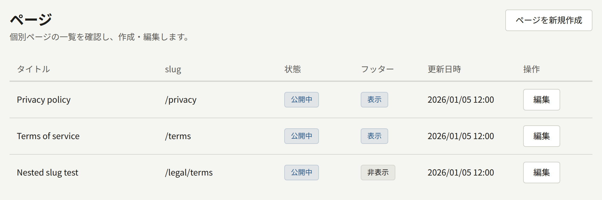
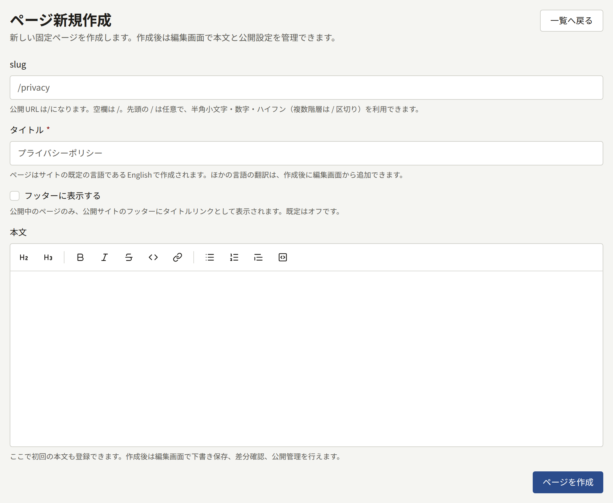
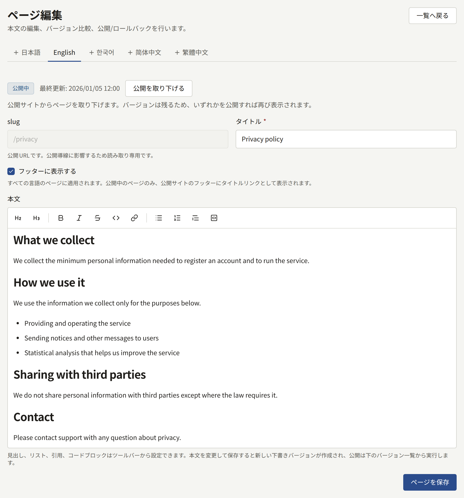
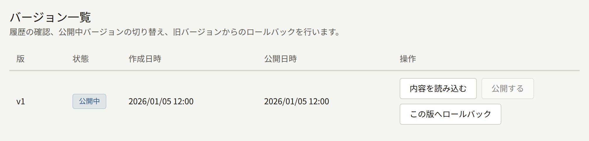

**サイト**の下にある**ページ**には、出版社がサイトのために書くページがあります。利用規約、プライバシーポリシー、出版社の紹介ページ、投稿ガイドラインなど、シリーズではないものすべてです。ページはリッチテキストエディターで書き、バージョンとして保存し、サイトの各言語に翻訳できます。

テナント管理者と編集担当は、ページを作成、編集、公開、翻訳できます。監査担当は、何も変更せずにページを開くことができます。

## ページの作成

**ページを新規作成**を選び、次の項目を入力します。

- **slug**：サイト上でのページのアドレスです。`privacy`なら`https://comics.example.com/privacy`で、`legal/terms`なら`https://comics.example.com/legal/terms`でページが公開されます。半角小文字、数字、ハイフンを使い、階層のあるパスでは各部分を`/`で区切ります。ページへのリンクが壊れてしまうため、ページを作成した後はslugを変更できません。ログインページやアカウントのページなど、サイト自体が使うパスは受け付けられません。
- **タイトル**：ページの上部と、ページへのリンクが表示されるすべての場所に表示されます。ページはサイトの既定言語で作成されます。
- **フッターに表示する**：ページが公開されると、サイトのすべてのページのフッターにそのページのタイトルが並びます。後から編集画面で変更できます。
- **本文**：ページの本文の最初のバージョンで、[執筆と公開](#執筆と公開)で説明するエディターで書きます。空欄のままにして、次の画面で書くこともできます。

**ページを作成**を選ぶと、ページが下書きとして作成され、その編集画面が開きます。バージョンを公開するまで、サイトには何も表示されません。

ページは削除できません。読まれる必要がなくなったページは、後で説明するとおり、代わりに公開を取り下げます。

## 執筆と公開

編集画面では、ページの本文を、書いたとおりに書式が反映されて表示されるエディターで扱います。その上のツールバーは、選択したテキスト、またはカーソルのある段落に書式を設定します。**見出し**、**小見出し**、**太字**、**斜体**、**取り消し線**、**コード**、**リンク**、**箇条書き**、**番号付きリスト**、**引用**、**コードブロック**です。**リンク**はアドレスを尋ね、何も選択していない場合はアドレス自体をリンクとして挿入します。エディターにMarkdownを入力すると、入力したそばから書式が反映されます。たとえば行頭の`## `は見出しに、`- `は箇条書きになります。

本文はMarkdownとして保存されます。エディターができる前にMarkdownで書かれた本文も、表、タスクリスト、画像を含めてエディターで開け、編集してもそれらは保たれます。脚注とHTMLは編集すると保たれず、プレーンテキストとして保存し直されます。

**ページを保存**は、変更したタイトルと**フッターに表示する**をすぐに保存します。変更した本文は新しい**下書き**のバージョンとして保存され、読者には見えません。保存によって公開されることはありません。

**フッターに表示する**は翻訳ごとではなくページ全体の設定なので、どの言語のタブで変更しても、すべての言語で変わります。フッターには保存のすぐ後に反映され、ページが公開されているあいだ表示されます。

**バージョン一覧**には、ページのすべてのバージョンが`v1`、`v2`のように番号付きで並び、それぞれの状態が表示されます。読者に見えているバージョンは**公開中**、それ以外は**過去公開**か**下書き**です。それぞれのバージョンでは、次の操作ができます。

- **公開する**：そのバージョンを、それまで公開していたバージョンの代わりに読者に見えるバージョンにします。
- **内容を読み込む**：そのバージョンの本文をエディターに戻し、そこから続きを書けるようにします。
- **この版へロールバック**：そのバージョンの本文を新しい下書きにコピーします。古い文章をサイトに戻すには、その下書きを公開します。

ページに2つ以上のバージョンがあれば、**差分確認**で、任意の2つのバージョンのあいだで追加・削除されたMarkdownの行を確認できます。

ページの状態の横にある**公開を取り下げる**は、ページをサイトから取り下げます。バージョンは残り、そのどれかを公開するとページがサイトに戻ります。

公開した変更は、すぐにサイトに反映されます。

## 翻訳

編集画面には、サイトが提供する言語ごとに**言語**の下のタブがあり、提供する言語はテナント管理者が[**設定**](./1-settings.md#言語)で選びます。サイトが提供をやめた言語の翻訳にはタブがありませんが、翻訳は残っており、その言語の提供を再開すると、翻訳がそのままの状態でタブが戻ります。そのような翻訳は読者にも表示されません。そのため、サイトが提供をやめた言語でしか公開されていないページは、その言語のどれかの提供が再開されるか、サイトが提供する言語でページが公開されるまで、サイトとサイトマップから外れます。独自の翻訳がない言語には「**（未追加）**」と表示され、その言語でサイトを閲覧している読者には、別の言語のページが、そのことを示す注記とともに表示されます。翻訳を追加するには、そのタブを開いてタイトルを入力し、**翻訳を追加**を選びます。それから、上で説明したとおりに本文を書いて公開します。

翻訳ごとに独自のタイトル、バージョン、公開中のバージョンがあるため、1つの翻訳への修正は、ほかの翻訳でも同じ修正をするまでそちらには反映されません。**この翻訳を削除**で翻訳を削除できますが、最後の1つは削除できません。

## 利用規約とプライバシーポリシー

Publiraには、法務文書のための特別な種類のページはありません。利用規約とプライバシーポリシーは通常のページで、テナント管理者が**設定** › **利用規約とプライバシーポリシー**でそれを指定します。

1. ここでそれぞれのページを作成して公開します。読者が自分の言語で読めるようにする場合は、サイトが提供する言語ごとに作成して公開します。
2. **設定**で、それらを**利用規約**と**プライバシーポリシー**として選び、**利用規約とプライバシーポリシーを保存**を選びます。

それ以降は、次のようになります。

- サイトとアプリは、フッターに表示するかどうかにかかわらず、両方のページにリンクします。
- 会員登録フォームには、2つのページへのリンクの上に「以下の内容を読み、同意します。」が表示され、これにチェックを入れないとアカウントを作成できません。AppleやGoogleで初めて会員登録する読者には、**新規登録を完了**で同じ同意が表示されます。
- テナントは、それぞれの読者が各ページのどの公開バージョンにいつ同意したかを記録します。

指定したものの公開されていないページについては、会員登録で同意を求めません。ページを1つも指定していなければ、会員登録で同意を一切求めません。

### 新しいバージョンの公開

どちらかのページの新しいバージョンを公開すると、それ以降に新しい読者が同意する内容が変わります。公開した時点で会員登録フォームを開いていた読者の会員登録は、「同意するページが更新されました。内容を読み、あらためて同意してください。」と表示されて拒否されるため、表示されていない文章に誰かが同意することはありません。

すでにアカウントを持っている読者に新しいバージョンへの同意を求めるかどうかは、公開するときに選びます。どちらのページでも、テナント管理者が**公開する**を選ぶと先に確認があり、2つの公開方法が示されます。

- **公開して読者に同意を求める**：このバージョンへの同意をすべての読者に求めます。読者が同意する内容が変わる場合に選びます。
- **同意を求めずに公開**：誤字やリンク切れの修正のような訂正としてバージョンを公開します。以前のバージョンに同意した読者には、改めて同意を求めません。

編集担当の**公開する**は、常に同意を求めずに公開します。**バージョン一覧**では、公開時に読者に同意を求めたバージョンの状態の下に、**読者に同意を依頼**と表示されます。

同意を求められた読者は、次にログインした状態でサイトのページを開いたときに、「下記のページが更新されました。アカウントを引き続き利用するには、内容を読んで同意してください。」と表示される画面に送られます。この画面には変更されたページへのリンクがあり、「以下の内容を読み、同意します。」にチェックを入れるよう求めます。**同意して続ける**は、表示されたバージョンへの同意を記録して読者を元のページに戻し、別のバージョンが同意を求めるまで、読者が改めて同意を求められることはありません。同意するまでは、サイトや自分が持っているエピソードは引き続き読めますが、エピソードの購入、コメント、シリーズのフォローなど、アカウントでできることの大半は拒否されます。同意したくない読者は、ログアウトするか、**設定**でアカウントを削除できます。

同意を求めるかどうかは、翻訳ごとに判断されます。別の言語のページに同意していて、その翻訳が変わっていない読者には同意を求めません。そのため、すべての言語に当てはまる変更は、翻訳ごとのタブで**公開して読者に同意を求める**を選んで公開します。

アプリでも同意を求めます。アプリにログインしている読者には、アプリを開いたとき、アプリに戻ってきたとき、または同意していないためにアプリが何かを拒否されたときにすぐ、アプリのほかの画面の代わりに同じ画面が表示されます。この画面には同じページへのリンクがあり、同意する代わりに**サインアウト**と**アカウントを削除**も選べます。**同意して続ける**を選ぶと、アプリで元いた場所に戻ります。アプリとサイトのどちらで同意しても両方に有効なので、読者が同意を求められるのは1回だけです。

### サイトが読者のブラウザーに保存するもの

プライバシーポリシーでは、サイトが読者のブラウザーに何を保存するかを説明します。以下は、サイトが設定するCookieとブラウザーのストレージのすべてなので、推測せずにポリシーに記載できます。Cookieの名前は、どのPubliraのサイトでも同じです。

| Cookie | 設定されるとき | 保存する内容 | 保持期間 |
| --- | --- | --- | --- |
| `publira_web_storefront_auth` | 読者がログインしたとき | サイトだけが持つ鍵で暗号化された読者のセッション | セッションが終わるまで。ログインから1日後、または読者がログアウトしたとき |
| `publira_web_storefront_signup_pending_email`、`publira_web_storefront_reset_password_email`、`publira_web_storefront_resend_verification_email` | 読者が会員登録フォームを送信したとき、パスワードの再設定を依頼したとき、または確認リンクの再送を依頼したとき | メッセージの送信先のメールアドレス。ページのアドレスに含めずに、次のページでそのアドレスを示すためのもの | 1分 |
| `publira_web_storefront_sign_in` | 読者が**Appleで続ける**または**Googleで続ける**を選んだとき | 進行中のログインの情報を暗号化したもの。AppleやGoogleからの応答の照合に使います | 10分、または応答が届くまで |
| `publira_web_storefront_sign_up` | AppleやGoogleで初めてログインする読者に**新規登録を完了**が表示されたとき | AppleやGoogleから返された読者の情報を暗号化したもの。読者が規約に同意するまで保持します | 4分 |
| `publira_web_storefront_dismissed_announcement` | 読者が**このお知らせを閉じる**を選んだとき | 閉じたお知らせの識別子 | 1年 |
| `publira_resolved_locale` | 訪問時に、Cookieにまだサイトの既定言語が保存されていない場合 | `en`のようなサイトの既定言語のコード。読者に関する情報は含みません | 1年 |
| `publira_web_storefront_view_actor` | ログインしていない読者がシリーズやエピソードを開いたとき。サイトが先に同意を求める場合は、同意のバナーで同意した後 | 閲覧数を数えるためだけのランダムな識別子。アカウントには結び付かず、サイトの何かがこれによって個人向けに変わることもありません | 180日 |
| `publira_web_storefront_analytics_consent` | 読者が同意のバナーで**同意する**または**同意しない**を選んだとき。このバナーは、**外部連携** › **Googleタグ**の**読者の同意**が**先に読者に尋ねる**のときだけ表示されます | 回答（`granted`または`denied`）のみ | 6か月 |

| ブラウザーのストレージ | 設定されるとき | 保存する内容 | 保持期間 |
| --- | --- | --- | --- |
| `localStorage`の`publira.age-rating.confirmation.<tenant ID>` | 年齢制限のあるシリーズやエピソードを開く前に、読者が**15歳以上です**または**18歳以上です**で年齢を確認したとき | 確認した最も高い年齢制限（`r15`または`r18`） | 読者がサイトのデータを消去するまで |
| `localStorage`の`publira.theme` | 読者がサイトのヘッダーの**テーマ**で**ライト**、**ダーク**、**システム設定に合わせる**のいずれかを選んだとき。**テーマ**はテナントにダークテーマがあるときだけ表示されます | 選択（`light`、`dark`、`system`のいずれか） | 読者がサイトのデータを消去するまで |
| `sessionStorage`の`publira.wide-viewer` | 読者がエピソードのビューアーをウィンドウの幅まで広げたとき、または元に戻したとき | ビューアーを広げているかどうか | タブを閉じるまで |
| プッシュ通知の購読 | 読者が**設定**で**ブラウザ通知**をオンにし、ブラウザー自身の確認で通知を許可したとき | ブラウザーのプッシュサービスがサイトの通知を届ける宛先 | 読者が通知をオフにするか、ログアウトするまで |
| サイトのService Worker | プッシュ通知の購読と同じとき | サイトの通知を表示するスクリプト。ページも読者に関する情報も保持しません | 読者がサイトのデータを消去するまで。通知をオフにするかログアウトすると購読は終了し、Service Workerは届けるものがないまま残ります |

これらはどれも、サイト自身以外のどこにも送られません。後で説明するGoogleタグを読み込まない限り、サイトは、独自のCookieを設定したり読者について知ったりできる他社のものを何も読み込みません。そのため、ポリシーには次のような文でそのことを記載できます。「当サイトが保存するのは、ここに記載したCookieとブラウザーのストレージだけであり、それらの内容を他社に送ることはありません。」

読者のブラウザーが他社に接続するのは、読者がそれを必要とする操作をしたときだけです。**Appleで続ける**や**Googleで続ける**を選ぶとログインのためにAppleやGoogleに移動し、**Xで共有**や**LINEで共有**を選ぶとそれらのサービスが開きます。また、ブラウザーの通知は、読者のブラウザーを作っている会社のプッシュサービスを通じて届きますが、そのサービスが内容を読めないように暗号化されています。

この一覧は、Publira自身が保存するものを対象にしています。[Googleタグ](../8-google-tag.md)で説明しているとおり、**外部連携** › **Googleタグ**でGoogle AnalyticsまたはGoogle Tag ManagerのIDを入力すると、読者がログイン、会員登録、パスワードの再設定、アカウント設定の変更を行うページを除くすべてのページで、Googleのタグが読み込まれます。このタグは独自のCookieを持ち込み、収集した情報をGoogleまたはサーバーサイドのTag Managerコンテナに送ります。コンテナが発火させるすべてのタグも同様です。プライバシーポリシーでは、Google自身のドキュメントと、コンテナ内の各タグのドキュメントをもとに、それらも記載する必要があります。
