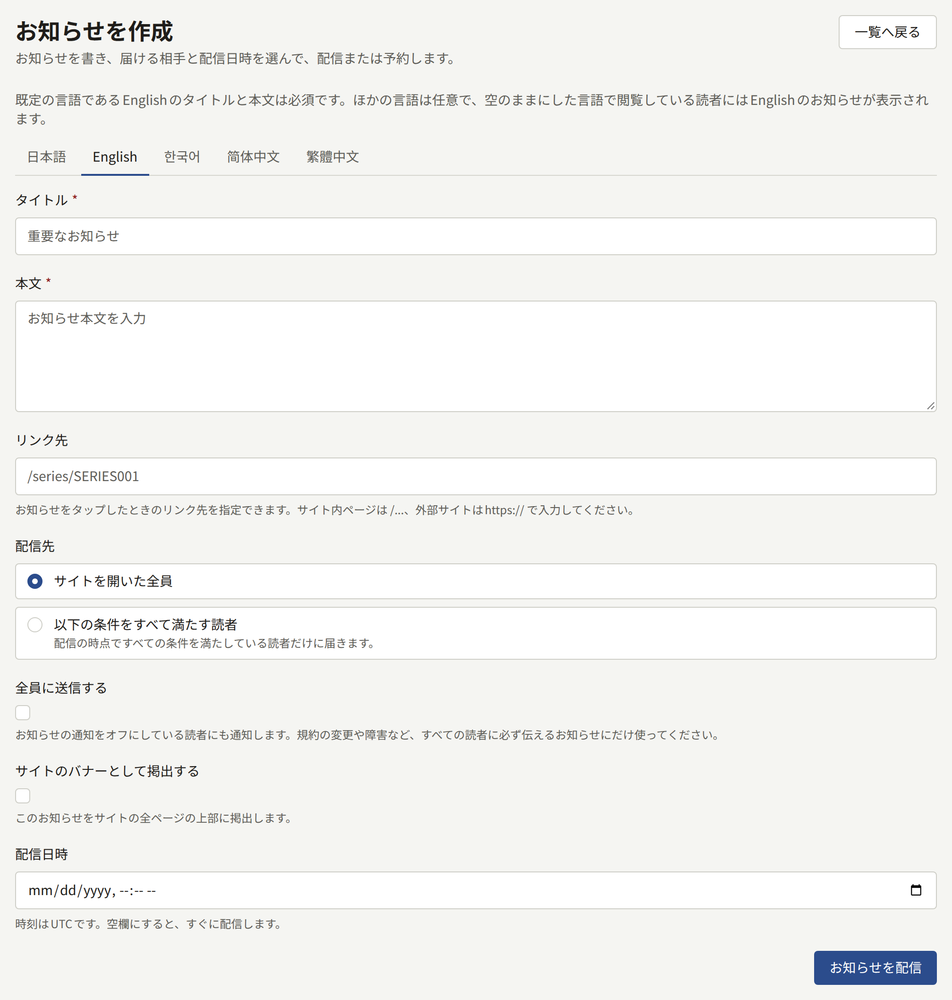
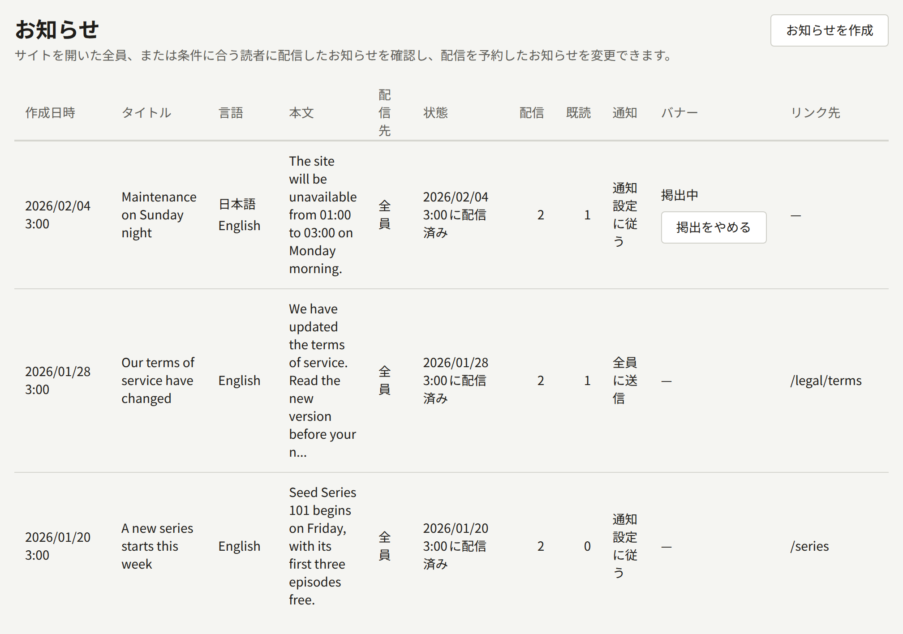

**サイト**グループの**お知らせ**を使うと、出版社からすべての読者に一斉に知らせを届けられます。新しいシリーズの開始、規約の変更、メンテナンスの予定などに使います。お知らせはサイトの**お知らせ**ページに並び、読者の通知にも届きます。特定のシリーズのフォロワーのように、条件で選んだ読者だけに宛てることもできます([受け取る読者を選ぶ](#受け取る読者を選ぶ)を参照)。そのうち1件だけは、サイトとアプリの全ページの上部にバナーとして表示することもできます。

テナント管理者と編集担当は、お知らせの作成、予約中のお知らせの変更と削除、バナーの取り下げができます。監査担当は一覧を見ることしかできません。

## お知らせの作成

**お知らせを作成**を選び、次の項目を入力します。

- **タイトル**と**本文**は、サイトが提供している言語ごとのタブで入力します。タイトルは120文字まで、本文はプレーンテキストで2000文字までです([複数の言語で書く](#複数の言語で書く)を参照)。
- **リンク先**には、読者がお知らせを開いたときの移動先を指定します。入力は任意です。このサイトのページなら`/series/SERIES001`や`/legal/terms`のように`/`から、ほかのサイトなら`https://`か`http://`から書きます。
- **配信先**では、**サイトを開いた全員**(初期状態)か、**以下の条件をすべて満たす読者**を選びます([受け取る読者を選ぶ](#受け取る読者を選ぶ)を参照)。
- **全員に送信する**をオンにすると、通知設定でお知らせをオフにしている読者も含め、アカウントを持つすべての読者に通知します。初期状態ではオフです([全員に送信する](#全員に送信する)を参照)。
- **サイトのバナーとして掲出する**をオンにすると、お知らせが全ページの上部にも表示されます([サイトのバナー](#サイトのバナー)を参照)。
- **配信日時**には、お知らせを配信する日時を指定します。入力は任意で、空欄にするとすぐに配信します([配信の予約](#配信の予約)を参照)。

**お知らせを配信**を選ぶと、その場で配信されます。**配信日時**を入力すると、ボタンは**お知らせの配信を予約**に変わり、お知らせはその日時に配信されます。配信したお知らせは編集も削除もできないので、配信される前に内容をよく確認してください。

## 配信の予約

お知らせは、すぐに配信せず、配信する日時を指定することもできます。たとえば金曜日に書いたお知らせを、月曜日の9時に配信できます。**配信日時**に日時を入力して、**お知らせの配信を予約**を選びます。日時はテナントのタイムゾーンで、未来の日時を指定します。バナーの**掲出を終える日時**は、配信する日時より後にします。

指定した日時までは配信が予約された状態で、読者には見えません。サイトの**お知らせ**ページにもアプリにも表示されず、読者に通知も届かず、バナーも表示されません。一覧の**状態**の列には、その日時に配信予定であることが表示されます。この間は、テナント管理者と編集担当がその列の**編集**を選び、日時を含めて内容をすべて変更して**保存**できます。**削除**を選んで確認すると、お知らせを削除できます。**配信日時**を空欄にして保存すると、その場で配信されます。

指定した日時から1分ほどのうちに、お知らせはその時点で作成したお知らせと同じように配信されます。読者に通知が届き、**お知らせ**ページとアプリに表示され、バナーも表示されます。読者には、書いた日時ではなく配信された日時の順に、ほかのお知らせと並んで表示されます。条件付きのお知らせも、このときに受け取る読者が判定されます。配信された後は、編集も削除もできません。

## 複数の言語で書く

フォームには、サイトが提供している言語ごとにタブがあり、タブ名はその言語で書かれています。フォームを開くと、サイトの既定言語のタブが表示されます。タブがあるのは**設定**の[言語](./1-settings.md#言語)で選んだ言語だけで、サイトが提供していない言語のタブはありません。

- 既定言語の**タイトル**と**本文**は必須です。空欄にした言語でサイトを見ている読者には、既定言語のお知らせが表示されます。
- ほかの言語のタブは任意です。入力する場合は**タイトル**と**本文**の両方を、入力しない場合は両方とも空欄にします。

**お知らせを配信**を選ぶと、入力したすべての言語を含むお知らせが1回だけ送信されます。配信した後に言語を追加することはできないので、翻訳はすべて配信前に書いておいてください。

一覧には各お知らせのタイトルが既定言語で表示され、**言語**の列には、そのお知らせを書いた言語がすべて表示されます。

## 全員に送信する

お知らせが読者の通知やメールに届くのは、その読者が通知設定でお知らせを受け取るようにしている場合だけです。お知らせをオフにしている読者には、キャンペーンの知らせも届きません。**全員に送信する**をオンにすると、通知設定に関係なく、アカウントを持つすべての読者に通知し、メールアドレスを確認済みのすべての読者にメールを送ります。プッシュ通知は、お知らせのプッシュ通知をオンにしている読者にだけ届きます。規約の変更や障害のように、すべての読者に必ず見てもらう必要がある知らせに限って使ってください。

一覧の**通知**の列には、各お知らせの送り方が表示されます。**全員に送信する**を使ったお知らせには**全員に送信**、使わなかったお知らせには**通知設定に従う**と表示されます。

## 受け取る読者を選ぶ

お知らせは、すべての読者ではなく、条件に合う読者だけに宛てることもできます。**配信先**で**以下の条件をすべて満たす読者**を選び、**条件を追加**から条件を選びます。条件ごとに入力欄のある行が追加され、**外す**を選ぶとその条件を取り除けます。使える条件は次のとおりです。

- **シリーズをフォローしている**は、**シリーズ**で選んだシリーズを読者がフォローしていることです。
- **シリーズのエピソードを購入している**は、**シリーズ**で選んだシリーズのエピソードを読者が購入していることです。1話ずつの購入、巻での購入、まとめ買いのいずれも含みます。返金や取り消しになった購入は含みません。
- **サブスクリプション**は、**プラン**で選んだプランか**すべてのプラン**について、読者のサブスクリプションが有効であること(**契約中**。お試し期間中、有効、更新の支払いが遅れている場合が当たります)か、サブスクリプションが終了していて有効なものを持っていないこと(**契約が終了した**)です。
- **一度も購入していない**は、読者がサイトで一度も購入したことがないことです。決済サービスのテストモードでの購入は含みません。
- **読んでいない期間**は、**日数**に入力した日数以上、読者がエピソードを開いていないことです。一度も開いたことがない読者も含みます。
- **登録してからの期間**は、読者が登録してから**日数**に入力した日数以内であることです。
- **言語**は、サイトが提供している言語のうち選んだ言語で読者がサイトを使っていることです。最後にサイトを見た言語かアプリを使った言語で判定し、一度も言語を選んでいない読者はサイトの既定言語で判定します。
- **アプリのプッシュ通知を登録している**は、サイトのアプリを入れたスマートフォンを読者がプッシュ通知に登録していることです。

日数は1から3650までです。それぞれの条件は1回ずつ使えるため、追加した条件は選択肢に出なくなります。条件を組み合わせると、すべての条件に合う読者だけがお知らせを受け取ります。

すべての行を入力すると、条件に合う読者の数をフォームが数えて**12人に届きます**のように表示し、条件を変えるたびに数え直します。これはその時点の人数で、目安にすぎません。受け取る読者はお知らせの配信時にあらためて判定され、人数を数えられなかった場合でもお知らせは配信できます。

条件があるあいだは、**全員に送信する**と**サイトのバナーとして掲出する**がオフになり、オンにできません。そのことはフォームにも表示されます。条件をすべて外すと、また使えるようになります。

一覧の**配信先**の列には、各お知らせの宛先が表示されます。すべての読者に宛てたお知らせには**全員**、条件付きのお知らせには「条件2件」のように条件の数が表示されます。

条件は、お知らせを配信した時点で1回だけ判定されます。たとえば1日後にシリーズをフォローした読者のように、配信の後で条件に合うようになった読者には届きません。配信の後で条件に合わなくなった読者も、受け取ったお知らせはそのまま残ります。

条件付きのお知らせは、条件に合う読者それぞれの通知設定に従って届きます。また、次のようには扱われません。

- サイトのバナーとして掲出されることはありません。バナーはすべての訪問者に表示されるためです。
- **全員に送信する**で送ることはできません。すべての読者に必ず見てもらう必要がある知らせを、条件で一部の読者から外すことはできないためです。
- ログインしていない訪問者と、そのお知らせが届いていないログイン中の読者には、**お知らせ**ページにもアプリにも表示されません。そのお知らせのページを開いても、**ページが見つかりません**と表示されます。

## 読者に表示される場所

- サイトでは、ヘッダーから開く**お知らせ**ページに、すべての読者に宛てたお知らせが新しい順に並びます。このページは誰でも読めます。ログインしている読者には、自分に届いた条件付きのお知らせもほかのお知らせの間に並び、ログインしている間はほかと同じように開けます。タイトルを選ぶと、そのお知らせだけのページが開きます。ログインしている読者には、まだ読んでいないお知らせがわかるように表示されます。
- 通知では、アカウントを持つ読者のうち、通知設定でお知らせを受け取るようにしている読者に「新しいお知らせ」が届き、そこからお知らせを開けます。**全員に送信する**で送ったお知らせは、アカウントを持つすべての読者に届きます。条件付きのお知らせは、条件に合う読者にだけ届きます。
- メールでは、メールアドレスを確認済みの読者のうち、通知設定でお知らせをメールで受け取るようにしている読者に、お知らせのタイトルと**お知らせ**ページへのリンクが書かれたメールが届きます。**全員に送信する**で送ったお知らせは、メールアドレスを確認済みのすべての読者に届きます。
- プッシュ通知では、通知設定でお知らせをブラウザー通知で受け取るようにしている読者にはそのブラウザーへ、アプリで受け取るようにしている読者にはスマートフォンへ届きます。通知のタイトルは、その読者の言語で書かれたお知らせのタイトルです。開くとそのお知らせが表示されます。どちらの設定も初期状態ではオフなので、何も保存していない読者には届かず、**全員に送信する**でもオンにはなりません。
- アプリでは、**お知らせ**の画面に同じお知らせが並び、既読かどうかの表示もサイトと同じです。

お知らせは、読者ごとにその読者の言語で表示されます。サイトではサイトを見ている言語、アプリではアプリの表示言語です。その言語でお知らせを書いていなければ、既定言語のお知らせが、どの言語で表示しているかを示す注記付きで表示されます。

## サイトのバナー

**サイトのバナーとして掲出する**をオンにして作成したお知らせは、ログインしているかどうかに関係なく、すべての訪問者に表示されます。表示される場所は、サイトの全ページのヘッダーの上と、アプリの作品一覧の画面の上部です。サイトでは、バナーを選ぶとお知らせの**リンク先**に、リンク先がなければそのお知らせのページに移動します。訪問者はバナーを閉じることができ、閉じたバナーはそのブラウザーでは閉じたままになります。

一度に表示されるバナーは、掲出中のお知らせのうち最も新しい1つだけです。新しいバナーを作成すると、その掲出が終わるまで前のバナーは表示されなくなります。

バナーは、終わりを指定しなければ、取り下げるまで掲出され続けます。掲出を終える方法は次の2つです。

- バナーのチェックボックスの下にある**掲出を終える日時**に日時を入力すると、その日時にバナーが取り下げられます。日時はテナントのタイムゾーンで、未来の日時を入力します。
- 一覧の**バナー**の列にある**掲出をやめる**を選ぶと、すぐにバナーが取り下げられます。

どちらの方法でも、取り下げられるのはバナーだけです。お知らせ自体は**お知らせ**ページと読者の通知に残ります。
