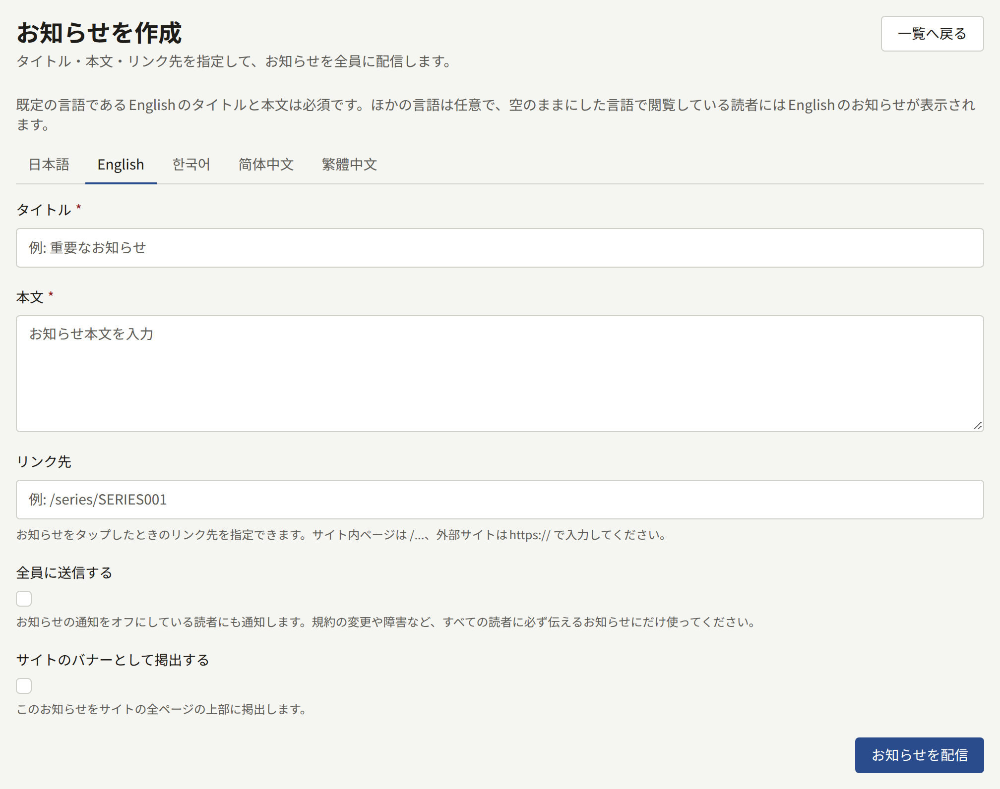
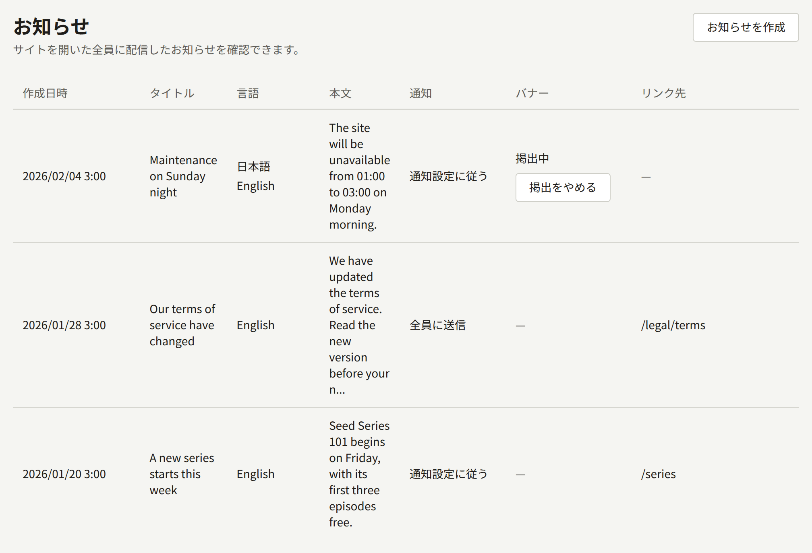

**サイト**の下にある**お知らせ**は、出版社がすべての読者に一度に何かを伝える手段です。新しいシリーズ、規約の変更、メンテナンスの時間帯などです。それぞれのお知らせは、サイトの**お知らせ**ページに並び、読者の通知に届けられます。また、一度に1つのお知らせを、サイトとアプリのすべてのページの上部にバナーとして表示することもできます。

テナント管理者と編集担当は、お知らせを作成し、バナーを取り下げることができます。監査担当が見られるのは一覧だけです。

## お知らせの作成

**お知らせを作成**を選び、次の項目を入力します。

- **タイトル**と**本文**：サイトが提供する言語ごとのタブで入力します。タイトルは120文字まで、本文はプレーンテキストで2000文字までです。[複数の言語で書く](#複数の言語で書く)を参照してください。
- **リンク先**（任意）：お知らせを開いた読者の移動先です。このサイトのページなら`/series/SERIES001`や`/legal/terms`のように`/`で始め、ほかのサイトなら`https://`か`http://`で始めます。
- **全員に送信する**（既定ではオフ）：アカウントを持つすべての読者に通知します。通知設定でお知らせをオフにしている読者も含みます。[全員に送信する](#全員に送信する)を参照してください。
- **サイトのバナーとして掲出する**：お知らせを、すべてのページの上部にも表示します。[サイトのバナー](#サイトのバナー)を参照してください。

**お知らせを配信**を選ぶと、すぐに配信されます。お知らせには下書きがなく、配信後に予約、編集、削除はできないため、配信する前に読み返してください。

## 複数の言語で書く

フォームには、サイトが提供する言語ごとに、その言語で名前を示したタブがあり、サイトの既定言語のタブで開きます。言語は**設定**の[言語](./1-settings.md#言語)で選んだもので、サイトが提供していない言語にはタブがありません。

- 既定言語の**タイトル**と**本文**は必須です。空欄にした言語で閲覧している読者には、既定言語のお知らせが表示されます。
- ほかのタブは任意です。**タイトル**と**本文**の両方を入力するか、両方を空欄にします。

**お知らせを配信**は、書いたすべての言語を含めて、お知らせを1回送信します。配信後にお知らせに言語を追加することはできないため、配信する前にすべての翻訳を書いてください。

一覧には、それぞれのお知らせのタイトルが既定言語で表示され、**言語**の列には書いたすべての言語が示されます。

## 全員に送信する

お知らせが読者の通知やメールに届くのは、その読者の通知設定がお知らせをそこで受け取るようになっている場合だけです。そのため、オフにしている読者はキャンペーンについて知ることがありません。**全員に送信する**は、そうした設定にかかわらず、アカウントを持つすべての読者に通知し、メールアドレスを確認済みのすべての読者にメールを送ります。規約の変更や障害など、すべての読者が見る必要のある告知のためにとっておいてください。

一覧の**通知**の列には、それぞれのお知らせがどのように送られたかが表示されます。**全員に送信**か、このオプションを使わずに送ったお知らせの場合は**通知設定に従う**です。

## 読者に表示されるもの

- **サイトでは**、ヘッダーの**お知らせ**ページに、すべてのお知らせが新しい順に並び、誰でも読めます。それぞれのタイトルから、お知らせ専用のページが開きます。ログインしている読者には、まだ読んでいないお知らせがわかります。
- **通知では**、通知設定でお知らせを受け取るようになっている、アカウントを持つすべての読者に「新しいお知らせ」が届き、そこからお知らせに移動できます。**全員に送信する**で送ったお知らせは、アカウントを持つすべての読者に届きます。
- **メールでは**、確認済みのアドレスを持ち、通知設定でお知らせをメールで受け取るようになっているすべての読者に、お知らせのタイトルと**お知らせ**ページへのリンクを記載したメールが届きます。**全員に送信する**で送ったお知らせは、確認済みのアドレスを持つすべての読者に届きます。お知らせがプッシュ通知で送られることはありません。
- **アプリでは**、**お知らせ**の画面に同じお知らせが、同じ既読の印とともに並びます。

読者には、それぞれのお知らせがその読者の言語で表示されます。サイトでは閲覧している言語、アプリではアプリの表示言語です。その言語で書いていない場合は、既定言語のお知らせが、表示している言語を示す注記とともに表示されます。

## サイトのバナー

**サイトのバナーとして掲出する**を付けて作成したお知らせは、ログインしているかどうかにかかわらずすべての訪問者に対して、サイトのすべてのページのヘッダーの上と、アプリの作品一覧の画面の上部に表示されます。サイトでは、バナーのリンクはお知らせの**リンク先**に、リンク先がなければお知らせ専用のページに移動します。訪問者はバナーを閉じることができ、閉じるとそのブラウザーでは閉じたままになります。

一度に表示されるバナーは1つだけで、バナーをまだ掲出している最も新しいお知らせのものです。そのため、新しいバナーを作成すると、新しいバナーが取り下げられるまで、前のバナーは表示されなくなります。

バナーは、終了を指定しない限り、取り下げるまで掲出され続けます。

- バナーのチェックボックスの下にある**掲出を終える日時**は、テナントのタイムゾーンでのその日時にバナーを取り下げます。未来の日時でなければなりません。
- 一覧の**バナー**の列にある**掲出をやめる**は、すぐにバナーを取り下げます。

どちらの方法でも、お知らせは**お知らせ**ページと読者の通知に残ります。なくなるのはバナーだけです。
