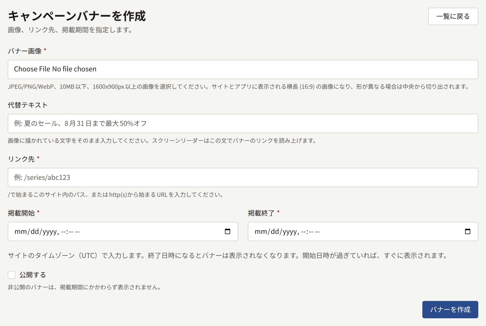
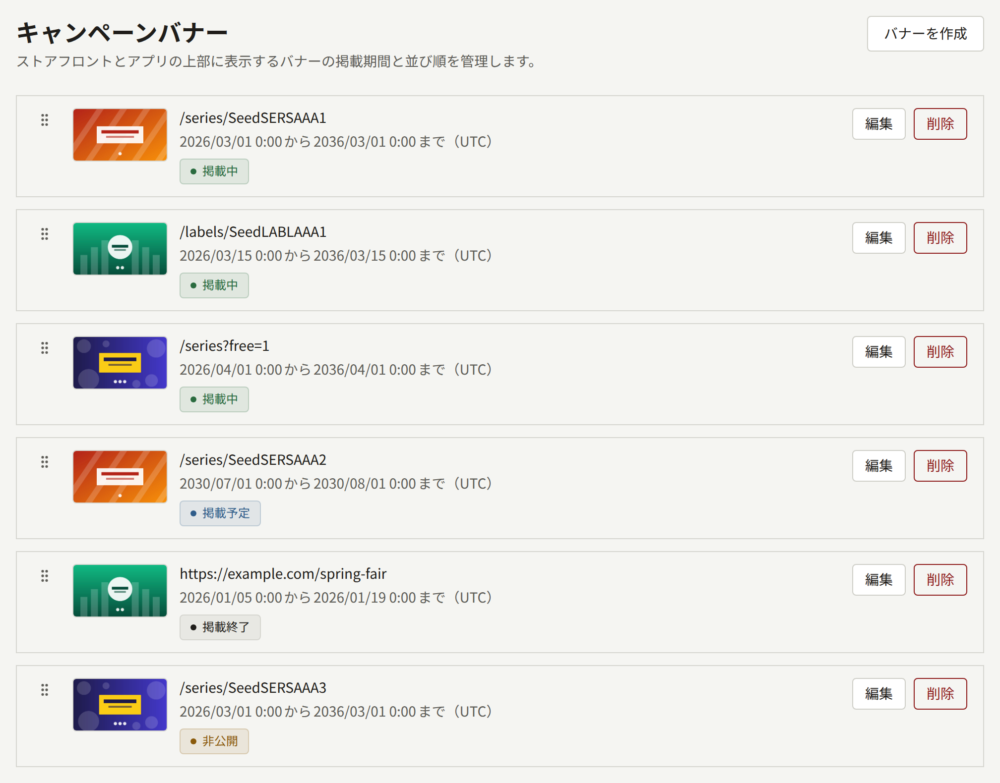

**サイト**グループの**キャンペーンバナー**を使うと、キャンペーンを自分から探しに来ない読者にも見てもらえます。シリーズの割引、新連載の開始、ほかのサイトで開催するフェアなどの告知に使います。バナーはリンク付きの画像で、設定した期間だけ表示されます。掲載中のバナーは、サイトではトップページの上部に、アプリでは作品一覧の画面の上部に表示されます。

バナーはお知らせとは違い、読者の通知には届かず、読者が閉じることもできず、表示されるのは上の2つの画面だけです。すべての読者に知らせを届けたい場合や、全ページの上部に1行の文章を出し続けたい場合は、[お知らせ](./4-announcements.md)を使ってください。

テナント管理者と編集担当は、バナーの作成、変更、並べ替え、削除ができます。監査担当は、一覧を見て**表示**でバナーを開けますが、変更はできません。

## バナーの作成

**バナーを作成**を選び、次の項目を入力します。

- **バナー画像**には、10MB以下で1600 × 900ピクセル以上のJPEG、PNG、WebPの画像を選びます([画像](#画像)を参照)。
- **代替テキスト**には、`Summer sale, up to 50% off through August 31`のように、画像に描かれている文字を255文字まで入力します。スクリーンリーダーは画像の中の文字を読めないので、代わりにこの文字列をバナーのリンク名として読み上げます。入力は任意ですが、代替テキストのないバナーは、リンク先でしかほかのバナーと見分けられません。
- **リンク先**には、読者がバナーを開いたときの移動先を2048文字まで入力します。このサイトのページなら`/series/SERIES001`や`/labels/LABEL001`のように`/`から、ほかのサイトなら`https://`か`http://`から書きます。
- **掲載開始**と**掲載終了**には、バナーを掲載する期間をテナントのタイムゾーンで入力します。タイムゾーンは2つの項目の下の注記に表示されています([掲載期間](#掲載期間)を参照)。
- **公開する**では、バナーを表示するかどうかを決めます。新しいバナーは非公開の状態で作られます([公開](#公開)を参照)。

**バナーを作成**を選ぶと、バナーの画面が開きます。**基本情報**タブでは代替テキスト、リンク先、掲載期間、**公開する**を、**画像**タブでは画像を変更できます。

## 画像

サイトとアプリのバナーの帯には、「**横長(16:9)**」の画像を切り抜かずにそのまま表示します。アップロードした画像はこの形に整えられ、1920 × 1080の画像のように帯に合わせて作った画像は全体がそのまま使われます。ほかの形の画像は、中央から切り抜かれます。切り抜いた結果は、**画像**タブの**比率別画像**にある「**横長(16:9)**」の枠で確認できます。その横にある**縦長(3:4)**、**正方形(1:1)**、「**リンクプレビュー(1200:630)**」の枠は最初は空で、どこにも表示されません。

帯に映る範囲を変えるには、「**横長(16:9)**」の枠で**枠を調整する**を選びます。別の画像に替えるときは、**差し替える**でその枠に1600 × 900ピクセル以上の画像をアップロードします。**アイキャッチ画像**に新しい画像をアップロードして**画像を更新**を選んでも画像は置き換わり、ほかに画像が入っていた枠は空になります。バナーには必ず画像が必要なので、画像は削除できません。枠について詳しくは、シリーズのページの[アイキャッチ画像](../1-catalog/1-series.md#アイキャッチ画像)の説明を参照してください。

スマートフォンでは帯が画面の幅いっぱいに表示されるので、画像の中の文字はその大きさでも読めるようにしてください。文字の違う画像に替えたときは、**基本情報**タブで**代替テキスト**も書き直してください。

## 掲載期間

**掲載開始**と**掲載終了**は、[設定](./1-settings.md#タイムゾーン)で選んだテナントのタイムゾーンの日時として扱われ、一覧の掲載期間もこのタイムゾーンで表示されます。バナーは掲載開始の時刻から掲載終了の時刻まで掲載され、掲載終了の時刻ちょうどにはもう表示されていません。あるバナーの掲載終了と次のバナーの掲載開始を同じ時刻にすれば、すき間なく切り替えられます。

- 掲載終了は掲載開始より後にします。
- 新しいバナーの掲載終了は未来の日時にします。掲載開始がすでに過ぎていれば、公開した時点で掲載が始まります。
- バナーを編集するときも、掲載期間を変えるなら掲載終了は未来の日時にします。掲載期間を変えなければこの制限はないので、掲載が終わったバナーでも、期間を設定し直さずに非公開にしたり、リンク先を変えたりできます。

サイトとアプリは、バナーを読み込むたびに掲載期間と現在の時刻を比べるので、読者がどこにいてもバナーは同じ時刻に切り替わります。サイトは一度描画した内容を、次のワーカーの実行で破棄されるまで表示し続けるので、通常は設定した時刻から1分以内に切り替わります。掲載期間が始まってもバナーが表示されない場合や、終わっても表示されている場合は、インストールのオペレーターが[定期ジョブとメンテナンスジョブ](../../3-operations/10-scheduled-jobs.md)で説明しているジョブを確認できます。

## 公開

**公開する**では、バナーを表示するかどうかを決めます。非公開のバナーは掲載期間に関係なく表示されないので、準備ができるまで非公開にしておけば、前もってバナーを用意できます。**基本情報**タブで**公開する**のチェックを外して**バナーを更新**を選ぶと、バナーはすぐに表示されなくなります。

一覧には、各バナーの現在の状態が表示されます。

| 状態         | 意味                                           |
| ------------ | ---------------------------------------------- |
| **掲載中**   | 公開されていて、現在が掲載期間内です           |
| **掲載予定** | 公開されていて、掲載期間がまだ始まっていません |
| **掲載終了** | 公開されていて、掲載期間が終わっています       |
| **非公開**   | 公開されていません。掲載期間は関係ありません   |

各行の先頭にはバナーの代替テキストと、その下にリンク先が表示されます。代替テキストがないバナーは、リンク先だけが表示されます。

## 並び順

サイトとアプリには、掲載中のバナーが一覧の順に表示されます。新しく作成したバナーは一覧の最後に加わります。バナーを移動するには、ハンドルをドラッグするか、ハンドルにフォーカスを合わせて矢印キーで動かします。並び順は、バナーをドロップした時点で保存されます。

ほかの人が同時に一覧を並べ替えていた場合は、「ほかの場所でバナーの並び順が変更されました。ページを再読み込みしてからもう一度お試しください。」と表示され、移動は保存されません。

## バナーの削除と50件の上限

バナーの行にある**削除**を選んで確認すると、バナーとその画像が削除され、サイトでもすぐに表示されなくなります。

テナントが持てるバナーは、掲載が終わったものも含めて50件までです。50件ある状態で新しいバナーを作成しようとすると、「登録できるキャンペーンバナーの上限に達しています。掲載が終了したバナーを削除してから、もう一度お試しください。」と表示されて作成できません。掲載が終わったバナーはどこにも表示されないので、削除しても読者に見えるものは何も変わりません。

## 読者に表示されるもの

- サイトでは、掲載中のバナーがトップページの上部、ページの最初に並ぶ作品の上に表示されます。バナーが1件なら1枚の帯として表示され、2件以上なら読者がスワイプやスクロールで切り替える帯になります。帯の下には**前のキャンペーン**と**次のキャンペーン**のボタンと、`1 / 3`のような番号が表示されます。最後のバナーの次は最初のバナーに戻り、帯が自動で切り替わることはありません。幅の広い画面では、帯の両端に前後のバナーの一部が見えます。
- アプリでは、同じバナーが作品一覧の画面の上部、サイトのバナーがあればその下で、作品の棚より上に表示されます。2件以上なら、読者がスワイプで切り替えるページになり、次のバナーの端が見えます。アプリがバナーを読み込むのは、作品一覧の画面を最初に表示したときと、読者が画面を下に引いて更新したときです。
- 読者がバナーを開くと、サイトではリンク先に移動します。リンク先がサイト内のページなら、読者が使っている言語のままで表示されます。アプリでは、シリーズやレーベルのようにアプリに専用の画面があるページならその画面を、テナントが公開しているページならアプリのページ画面を開きます。それ以外のリンク先はブラウザーで開きます。

掲載中のバナーがなければ、サイトにもアプリにも帯は表示されず、帯のための余白も空きません。
