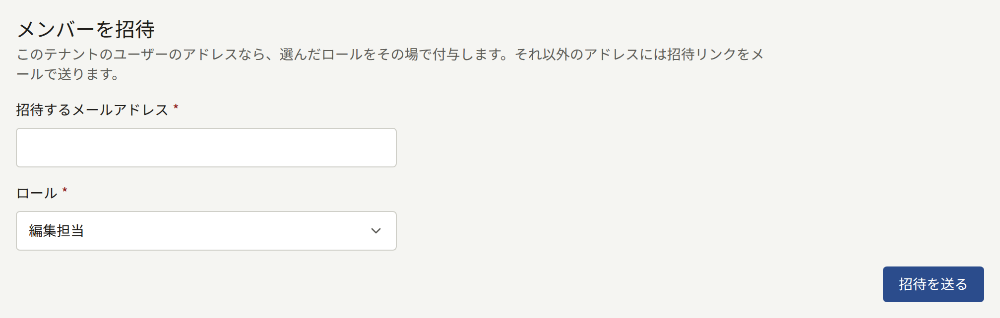
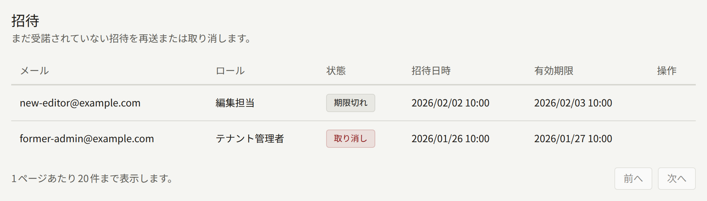
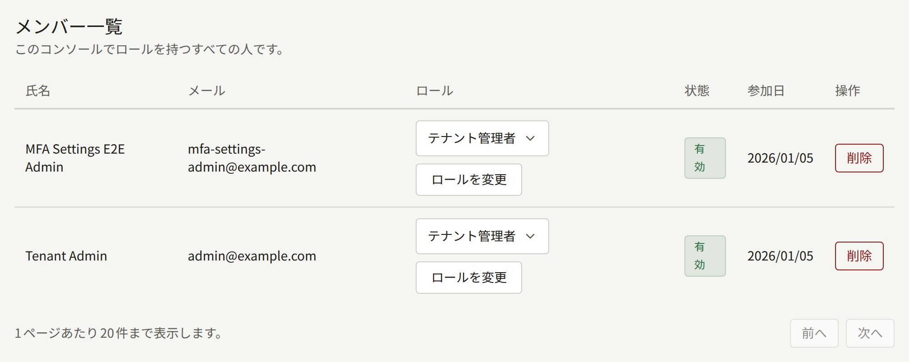

**管理**グループの**メンバー**には、この管理画面にログインできる人が全員並びます。テナント管理者は、ここでスタッフを招待し、ロールを変更し、不要になったスタッフを外します。この画面はテナント管理者にしか表示されません。

スタッフは、テナントのサイトのアカウントに管理画面のロールが付いたものです。スタッフは、サイトで使っているのと同じメールアドレスとパスワードで管理画面にログインします。ロールを外しても、サイトのアカウントはそのまま残ります。オペレーターの立場からの説明は[テナントのスタッフ](../../3-operations/3-tenant-staff.md#メンバーとユーザー)にあります。

## ロール

| ロール | できること |
| --- | --- |
| **テナント管理者** | この画面を含む、管理画面のすべての操作 |
| **編集担当** | 作品、サイトのページとお知らせの管理と、コメントのモデレーション |
| **監査担当** | 編集担当が扱う内容とテナントの設定の閲覧。変更はできません |

各ロールでできることの一覧は[テナント管理画面](../index.md#ロール)にあります。テナント管理者の人数は最小限にしてください。テナント管理者は、テナントの決済とメールの認証情報の差し替え、読者のアカウントの停止と削除、スタッフの変更ができます。

## メンバーの招待

**メンバーを招待**で、**招待するメールアドレス**にアドレスを入力し、**ロール**を選んで**招待を送る**を選びます。**ロール**の初期値は**編集担当**です。**テナント管理者**にする必要がある場合だけ、意識して選び直してください。

- **サイトにまだアカウントがないアドレス**には、選んだロールへの招待メールが、テナントの既定言語で送られます。招待された人がメールのリンクを開くとこの管理画面に移動し、**お名前**と**パスワード**を入力して**招待を承諾する**を選びます。その後は、そのロールで管理画面にログインできます。リンクの有効期限は24時間です。
- **サイトにアカウントがすでにあるアドレス**には、その場でロールが付与され、メールは送られません。ロールを持っているアカウントでも、この方法でテナント管理者にすることはできます。その場合は、元のロールがテナント管理者に置き換わります。それ以外のロールにする場合、管理画面は受け付けずに**メンバー一覧**へ案内するので、後で説明する方法でロールを変更してください。

**招待**には招待が並び、それぞれが付与する**ロール**と、**招待中**、**承諾済み**、**取り消し**、**期限切れ**のどれかの状態が表示されます。招待中の招待では、**再送**を選ぶと新しいリンクを付けてメールを送り直し、リンクの有効期限はそこから24時間になります。**招待を取り消す**を選ぶと招待を取り消せます。再送しても取り消しても、以前のリンクは使えなくなります。期限切れや取り消しになった招待をやり直す場合や、招待中の招待のロールを変えたい場合は、同じアドレスを正しいロールでもう一度招待します。

招待メールは、プラットフォームのメールサーバーから送られます。テナント独自のメールサーバーを設定している場合は、そちらから送られます([メール](./7-email.md)を参照)。招待メールが届かない場合は、まず招待した相手の迷惑メールフォルダーを、次にテナントのメールの設定を確認してください。

## ロールの変更

**メンバー一覧**で、メンバーの**ロール**の列から新しいロールを選び、**ロールを変更**を選びます。変更は、そのメンバーが管理画面で次に操作したときから適用されます。すでに管理画面を開いている場合も同じです。

## メンバーの削除

メンバーの行の**削除**を選び、確認で**削除**を選ぶと、そのメンバーのロールがすべて外れます。そのメンバーは、次に操作したときから管理画面を使えなくなります。アカウントは読者のアカウントとしてサイトに残り、購入や閲覧の履歴もそのままです。

サイトでの閲覧もできないようにする場合は、**読者**にあるそのメンバーのページで、アカウントを停止するか削除します。このページには、一覧のメンバーの名前から移動できます。停止と削除でそれぞれ何が残るかは、[読者アカウント](../2-readers/1-accounts.md)で説明しています。

## 最後のテナント管理者

常に誰かがスタッフを管理できるように、テナントで最後の有効なテナント管理者は、降格も削除もできません。これは自分自身の場合も同じです。先にほかの人をテナント管理者にしてください。

それでも最後のテナント管理者が退職したり、アカウントにログインできなくなったりした場合は、オペレーターが別の人にロールを付与できます。手順は[管理者のいないテナントの復旧](../../3-operations/3-tenant-staff.md#管理者がいなくなったテナントを復旧する)で説明しています。

## 記録される内容

招待、再送、取り消し、承諾、ロールの変更、削除は、すべて操作したテナント管理者とともに[監査ログ](./8-audit-log.md)に記録されます。招待とその再送や承諾、ロールの変更では、付与するロールも記録されます。
