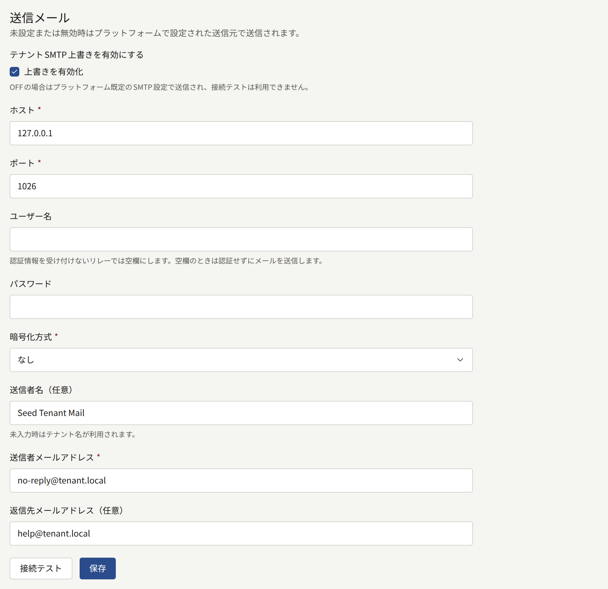
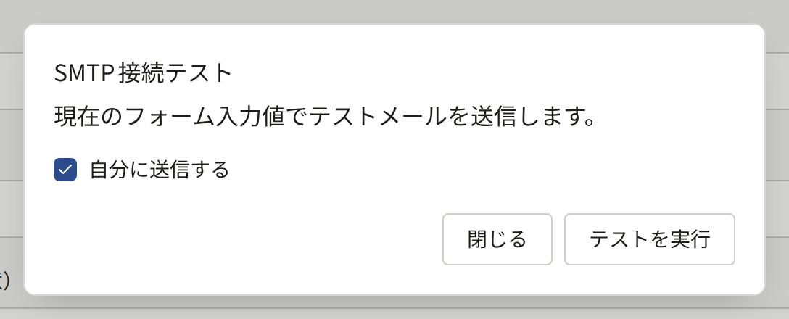
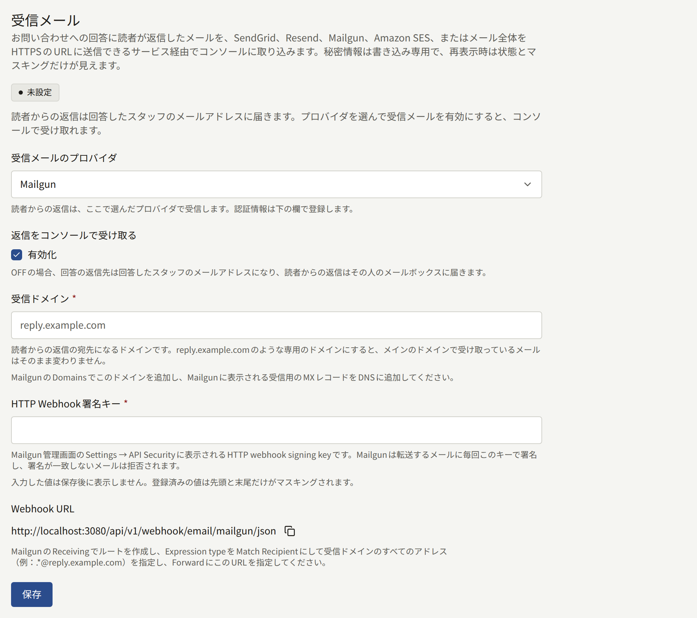

テナントは、読者とスタッフにメールを送ります。アドレスの確認、パスワードの再設定、購入の領収書、招待、お問い合わせへの返信などです。テナント管理者がテナント独自のサーバーを設定するまでは、これらはすべて、プラットフォームのメールサーバーから、オペレーターが選んだプラットフォームのアドレスで送られます。**外部連携** › **メール情報**を使うと、代わりに出版社独自のSMTPサーバーから、出版社のドメインのアドレスで送られるようになります。

この画面が表示されるのはテナント管理者だけです。オペレーターが事前に許可しておく必要はありません。

## 送信されるメール

テナント独自のサーバーを有効にすると、テナントが送るすべてのメールがそのサーバーから送られます。

- 読者宛て：会員登録の確認、パスワードの再設定とパスワードが変更されたことの通知、メールアドレス変更の確認とアドレスが変更されたことの通知、すでにアカウントのあるアドレスで誰かが会員登録しようとしたことの通知。
- サイトでエピソードを購入した読者宛て：シリーズとエピソード、支払った価格、購入日時、閲覧期限のあるエピソードではいつまで読めるかを記載し、読者の購入履歴へのリンクを付けた領収書。
- 読者のお問い合わせへの返信。
- スタッフ宛て：新しいテナント管理者への招待、管理画面のパスワードの再設定とメールアドレスの変更、新しいお問い合わせの通知（テナント管理者に送られます）。

お知らせやその他の通知は、メールではなく、サイトとアプリで読者に届きます。

## 始める前に

出版社のメールを管理している人から、次のものを受け取っておきます。

- SMTPサーバーのホスト名とポート、そして接続の最初からTLSを使うのか（通常はポート465）、STARTTLSを使うのか（通常はポート587）。
- サーバーのユーザー名とパスワード。サーバーが認証情報なしでメールを中継する場合は不要です。
- メールの送信元にするアドレス。サーバーがそのアドレスとして送信することを許可されている必要があります。ドメインのSPFレコードとDKIMレコードがそのサーバーを含むようにしてください。そうしないと、読者のメールサービスがテナントのメールを迷惑メールに振り分ける可能性が高くなります。

## 設定方法

1. **外部連携** › **メール情報**を開き、**送信メール**のセクションで、**テナントSMTP上書きを有効にする**の下の**上書きを有効化**にチェックを入れます。その下の項目が開きます。
2. 次の項目を入力します。
   - **ホスト**と**ポート**。
   - **ユーザー名**と**パスワード**（サーバーへのログインが必要な場合）。プラットフォームのアドレスを信頼するリレーのように、認証情報を受け付けないリレーでは、**ユーザー名**を空欄にします。この場合、メールはログインせずに送られ、パスワードは保存されません。ユーザー名のないパスワードは受け付けられません。
   - **暗号化方式**：**TLS**、**STARTTLS**、**なし**のいずれかです。**TLS**と**STARTTLS**はどちらもTLS 1.2以降を必要とし、**STARTTLS**は、サーバーがSTARTTLSに対応していない場合、暗号化せずに送るのではなく失敗します。**なし**は、プライベートネットワーク経由で接続するサーバーにだけ選んでください。
   - **送信者メールアドレス**：メールの送信元のアドレスで、`noreply@comics.example.com`のようなものです。
   - **送信者名（任意）**：読者にそのアドレスの横に表示される名前で、通常はサイト名です。空欄にすると、テナントのメールでも接続テストでもテナント名が使われます。
   - **返信先メールアドレス（任意）**：読者の返信の宛先で、サポート用のアドレスなどです。空欄にすると、返信は送信者のアドレスに届きます。お問い合わせへの返信では、代わりにその返信独自の返信先アドレスが使われます。
3. **接続テスト**を選び、**テストを実行**を選びます。テストでは、フォームの値を保存せずに使ってメッセージを送ります。宛先は自分のアドレスで、**自分に送信する**のチェックを外せば別のアドレスにもできます。テストに失敗した場合は、判別できる範囲で、どの段階で失敗したかが表示されます。接続、TLSまたはSTARTTLS、ログイン、サーバーによる宛先の拒否、サーバーの応答の遅延です。
4. **保存**を選びます。テナントが次に送るメールから、新しいサーバーを経由します。





保存したパスワードが再び表示されることはありません。項目にはパスワードが保存されていることが示され、**変更する**で置き換えられます。**変更する**の後で欄を空にしたまま保存すると、パスワードが削除されます。テナントを認証情報を受け付けないリレーに切り替えるときはこの方法を使います。パスワードのないユーザー名は受け付けられないため、**ユーザー名**も空にしてください。

## 動作しなくなったとき

テナント独自のサーバーを有効にした後は、テナントのメールがプラットフォームのサーバーに切り替わって送られることはありません。サーバーがメールを拒否したり、サーバーに接続できなかったりした場合、プラットフォームはしばらくのあいだ間隔を広げながら再試行し、その後そのメールの送信をあきらめます。失敗は管理画面のどこにも報告されません。確認メールやパスワード再設定のメールが届かないと読者から言われたら、保存済みの設定で**接続テスト**をもう一度実行してください。

プラットフォームのメールサーバーに戻すには、**上書きを有効化**のチェックを外して**保存**を選びます。それ以外の設定は、再び有効にするときのために残ります。

保存はすべて[監査ログ](./8-audit-log.md)に**メール設定更新**として、テストは成功したかどうかにかかわらずすべて**SMTP接続テスト**として記録されます。テナントのメールについてのオペレーター側の説明は、[メール](../../3-operations/6-email.md#テナント独自のsmtpアカウント)にあります。

## お問い合わせへの返信に対する読者の返信

お問い合わせへの回答は、メールで読者に届きます。テナントが独自にメールを受信するまでは、回答の返信先アドレスは回答したスタッフのアドレスになるため、読者が返信するとその人のメールボックスに届き、管理画面にはその返信が届きません。**外部連携** › **メール情報**の**受信メール**のセクションを使うと、SendGrid、Resend、Mailgun、Amazon SES、あるいはCloudflare Email Routingや出版社独自のPostfixサーバーのように、メール全体をHTTPSのURLに送信できる任意のメールサービスやサーバーを通じて、そうした返信を、回答したお問い合わせの下で管理画面に取り込めます。

### 始める前に

- SendGrid、Resend、Mailgunのアカウント、メールを受信できるリージョンでAmazon SESを使えるAWSアカウント、または受信した各メールを独自のコードに渡せるメールサービスかサーバー（Cloudflare Email RoutingやPostfixサーバー）。
- DNSを変更できる返信用のドメイン。`reply.comics.example.com`のようなものです。そのMXレコードをプロバイダーに向けるため、そのドメイン宛てのメールはほかのどのメールボックスにも届かなくなります。専用のサブドメインを使えば、出版社のメインのドメインがすでに受信しているメールはそのまま変わりません。
- インターネットから到達できるサイト。プロバイダーは、それぞれの返信をサイト自身のドメインに送信します。サイトの前にIP許可リスト、ログインの確認、ボット対策のチャレンジがある場合は、[Webhook](../../2-deployments/4-edge/index.md#webhook)でオペレーター向けに説明しているとおり、これらのリクエストを通す必要があります。

### 設定方法

1. **外部連携** › **メール情報**を開きます。**受信メール**のセクションで、**受信メールのプロバイダ**でプロバイダーを選び、**返信をコンソールで受け取る**の下の**有効化**にチェックを入れ、返信用のドメインを**受信ドメイン**に入力します。
2. プロバイダーを設定します。セクションには、サイトのドメイン上の**Webhook URL**が、コピーするボタンとともに表示されます。
   - **SendGrid**：長いランダムな文字列を自分で作り、**Webhookトークン**に入力します。DNSで、ドメインのMXレコードを優先度10で`mx.sendgrid.net`に向けます。SendGridの**Settings** › **Inbound Parse**でドメインを追加し、`<token>`をトークンに置き換えた**Webhook URL**を送信先のURLにします。SendGridは何にも署名しないため、URLに含まれるトークンが、サイトがSendGridからのリクエストをほかからのリクエストと見分ける手段になります。
   - **Resend**：**API Keys**で**Full access**のAPIキーを作成し、**APIキー**に入力します。返信はこのキーを使ってResendから読み取られます。**Domains**でドメインを追加して受信を有効にし、Resendに表示されるMXレコードをDNSに追加します。**Webhooks**で、`email.received`イベントに**Webhook URL**を追加し、Resendに表示されるその署名シークレット（`whsec_…`）を**Webhook署名シークレット**に入力します。
   - **Amazon SES**：長いランダムな文字列を自分で作って**Webhookトークン**に入力し、メールの発行先にするSNSトピックのARNを**SNSトピックARN**に入力します。AWSでドメイン、トピック、受信ルールを設定してから保存し、後の[Amazon SESで受信する](#amazon-sesで受信する)で説明しているとおり、トピックを**Webhook URL**にサブスクライブします。
   - **Raw MIME over HTTPS**：長いランダムな文字列を自分で作り、**Webhookトークン**に入力します。ドメインのMXレコードを、メールを受信するサービスかサーバーに向け、そこからドメイン宛てのすべてのメールを、変更せずにそのまま、コンテンツタイプ`message/rfc822`で、`<token>`をトークンに置き換えた**Webhook URL**に送信させます。その際、メールの配送先アドレスを`X-Envelope-To`ヘッダーに入れます。読者側の転送やエイリアスによって、返信の**To**にお問い合わせ自体のアドレスが含まれないことがよくあり、そのような場合でもこのヘッダーで照合できます。後の[Cloudflare Email Routing](#cloudflare-email-routingから生のメールを送信する)と[Postfix](#postfixから生のメールを送信する)では、これらをすべて行います。
   - **Mailgun**：**Settings** › **API Security**から**HTTP webhook signing key**をコピーし、**HTTP Webhook署名キー**に入力します。Mailgunは送信するすべての返信にこのキーで署名し、署名が一致しない送信は拒否されます。サブアカウントのドメインでは、サブアカウントのキーとプライマリーアカウントのキーのどちらも使えます。**Domains**でドメインを追加し、Mailgunに表示される受信用のMXレコードをDNSに追加します。**Receiving**で、式の種類を**Match Recipient**にし、`.*@reply.comics.example.com`のようにドメインのすべてのアドレスを対象とする受信者を指定したルートを作成し、**Forward**にチェックを入れて、表示されているとおりの、`/json`で終わる**Webhook URL**を指定します。Mailgunがメール全体に署名して送信するのはそのように終わるURLに対してだけで、それ以外のURLへの送信は拒否されます。MailgunのEUリージョンのアカウントでも、手順は同じです。
3. **保存**を選びます。セクションが**利用可能**になり、**返信先アドレス**として、`contact+*@`の後にドメインが続くアドレスが表示されます。それ以降の回答では、読者にこの形式のアドレス（`*`はお問い合わせのID）に返信するよう求め、返信はそのお問い合わせの下に表示されます。



セクションが**利用可能**になるまで、回答では回答したスタッフのアドレスが使われ続け、セクションにもそう表示されます。**未設定**は何も保存されていないこと、**無効**は設定は保存されているが**有効化**のチェックが外れていること、**設定不足**は有効になっているが、ドメインかプロバイダーに必要な認証情報が欠けていることを表します。

トークンとキーは、保存すると二度と表示されません。それぞれの項目にはマスクされた値が表示され、**変更する**で置き換えられます。別のプロバイダーを選んで保存すると、前のプロバイダー用に保存されていた認証情報は削除されます。

返信の受信をやめるには、**有効化**のチェックを外して**保存**を選びます。次の回答から再びスタッフのアドレスが使われ、設定は再び有効にするときのために残ります。保存はすべて[監査ログ](./8-audit-log.md)に**受信メール設定更新**として記録されます。

### Amazon SESで受信する

Amazon SESはドメイン宛てのメールを受信し、それぞれを受信ルールに渡します。ルールはメールの通知をAmazon SNSのトピックに発行し、トピックはHTTPSのサブスクリプションを通じてそれを**Webhook URL**に届けます。SNSはすべての配信に署名しますが、どのAWSアカウントでも独自のトピックをこのURLにサブスクライブできるため、サイトはURLに含まれるトークンと、配信元のトピックも確認します。

SESがメールを受信できるのは一部のAWSリージョンだけで、[Email receiving endpoints](https://docs.aws.amazon.com/general/latest/gr/ses.html#ses_inbound_endpoints)に一覧があります。以下のドメイン、トピック、ルールにはそのいずれかのリージョンを使ってください。バケットは別のリージョンにあってもかまいません。

1. SESの**Identities**で、受信ドメインを検証します。DNSで、そのMXレコードを優先度10で`inbound-smtp.<region>.amazonaws.com`（`inbound-smtp.us-east-1.amazonaws.com`など）に向けます。
2. SNSで、`publira-inbound`のような標準トピックを作成します。そのARNを、管理画面の**SNSトピックARN**に入力します。
3. SESの**Email receiving**で、アクティブなルールセットに、受信ドメインを受信者の条件とするルールを作成し、次のいずれかのアクションを指定します。
   - **Deliver to Amazon S3 bucket**：**SNS topic**でSNSトピックを選びます。SESはそれぞれのメールをバケットに書き込んでその場所をトピックに伝え、サイトはそこからメールを読み取ります。こちらを使ってください。SESが受信する40MBまでのどのサイズの返信でも扱えます。[Giving permissions to Amazon SES for email receiving](https://docs.aws.amazon.com/ses/latest/dg/receiving-email-permissions.html)で説明しているとおり、バケットのポリシーでSESによる書き込みを許可する必要があります。**Message encryption**はチェックを外したままにしてください。チェックを入れると、SESがそれぞれのメールをクライアント側で暗号化し、サイトはそれを復号できません。次に、IAMで、アクセスキーを持ち、バケットのオブジェクトに対する`s3:GetObject`を許可するポリシーを付けたユーザーを作成し、そのキーを**AWSアクセスキーID**と**AWSシークレットアクセスキー**に入力します。サイトにそのバケットだけを読み取らせるには**S3バケット**を入力し、バケットがトピックとは別のリージョンにある場合は**S3バケットのリージョン**を入力します。
   - **Publish to Amazon SNS topic**：トピックと、エンコーディング**Base64**を指定します。Base64なら、どの文字セットのメールも送られたとおりに保たれます。メールは通知の中に含まれて届くため、バケットもアクセスキーも不要ですが、SESは150KBを超えるメールをすべてバウンスします。画像や添付ファイルのある返信は、すぐにこのサイズを超えます。
4. 管理画面で**保存**を選びます。サブスクリプションは、SNSが確認のリクエストをサイトに送ったときに確認されます。サイトが確認するのは、保存しているトークンとトピックに対するものだけです。
5. SNSで、プロトコルを**HTTPS**とし、`<token>`をトークンに置き換えた**Webhook URL**をエンドポイントとするサブスクリプションをトピックに作成します。**Enable raw message delivery**はチェックを外したままにしてください。SNSの署名で包まれていない配信は拒否されます。サブスクリプションは1分以内に**Confirmed**になります。**Pending confirmation**のままの場合は、管理画面でトークンとトピックを確認して保存し、サブスクリプションで**Request confirmation**を選びます。

手順3のユーザーのIAMポリシーの例です。`publira-inbound-mail`をバケットの名前に置き換えてください。

```json
{
  "Version": "2012-10-17",
  "Statement": [
    {
      "Effect": "Allow",
      "Action": "s3:GetObject",
      "Resource": "arn:aws:s3:::publira-inbound-mail/*"
    }
  ]
}
```

バケットが、書き込まれたものを既定でKMSキーで暗号化する場合は、そのキーに対する`kms:Decrypt`も追加します。

サイトが受け取れない配信（サイトが停止しているあいだや、バケットからメールを読み取れないあいだの`5xx`）は、SNSが20秒間隔で3回再試行し、その後破棄されます。サブスクリプションに[配信ポリシー](https://docs.aws.amazon.com/sns/latest/dg/sns-message-delivery-retries.html)を設定すると、最長1時間まで再試行を続けられ、デッドレターキューを使うと破棄されたものを保持できます。いずれの場合も、S3アクションが書き込んだメールはバケットに残ります。

### Cloudflare Email Routingから生のメールを送信する

Cloudflare Email RoutingはそれぞれのメールをEmail Workerに渡し、Email Workerがそれを**Webhook URL**に送信します。受信ドメインのDNSはCloudflare上にある必要があります。

1. Email Routingで、受信ドメインのルーティングを有効にします。`reply.comics.example.com`のようなサブドメインは**Settings** › **Subdomains**で追加します。CloudflareがMXレコードを自動で追加します。同じ設定で**Subaddressing**を有効にし、`contact+<message ID>@`宛てのメールが`contact@`のルールに届くようにします。
2. Email Routingの宛先アドレスに、スタッフのメールボックスを追加して検証します。これは、サイトがその時点で受け取れなかった返信のためのものです。
3. 下のコードでWorkerを作成します。`inbound:<token>@`の部分を除いた**Webhook URL**を変数`WEBHOOK_URL`に、トークンをシークレット`WEBHOOK_TOKEN`に、スタッフのメールボックスを変数`FALLBACK_ADDRESS`に設定します。
4. Email Routingのルーティングルールで、受信ドメインにカスタムアドレス`contact`を作成し、アクションを**Send to a Worker**、宛先を作成したWorkerにします。

```js
export default {
  async email(message, env) {
    let status;
    try {
      const response = await fetch(env.WEBHOOK_URL, {
        body: await new Response(message.raw).arrayBuffer(),
        headers: {
          Authorization: `Basic ${btoa(`inbound:${env.WEBHOOK_TOKEN}`)}`,
          "Content-Type": "message/rfc822",
          "X-Envelope-To": message.to,
        },
        method: "POST",
      });
      if (response.ok) {
        return;
      }
      status = response.status;
    } catch {
      // The site did not answer.
    }
    if (status === 400) {
      message.setReject("The site could not read this mail");
      return;
    }
    try {
      await message.forward(env.FALLBACK_ADDRESS);
    } catch {
      message.setReject(
        `The reply could not be delivered (${status ?? "no answer"})`
      );
    }
  },
};
```

`message.to`は、`+<message ID>`を含む、メールの配送先アドレスです。

Cloudflareでは、Email Workerから送信者に後で再試行するよう求める方法がありません。メールの拒否は恒久的なもので、読者にはバウンスが返ります。そのため、このWorkerは、サイトが読み取れるメールではないとして拒否したメールだけを拒否します。サイトが応答しない場合や、メールを受け取れない場合（サイトが停止しているあいだの`5xx`や、管理画面に保存したトークンとWorkerのトークンが異なるあいだの`401`）は、Workerはメールをスタッフのメールボックスに転送し、返信は管理画面ではなくそこで読まれます。転送にも失敗した場合にだけ、メールを拒否します。サイトが受け付けた後に破棄するメール（お問い合わせを示していないメールや、**有効化**のチェックが外れているあいだに届いたメールなど）は、受け付けたものとして応答され、ほかのどこにも届きません。

### Postfixから生のメールを送信する

受信ドメインのメールを受信するPostfixサーバーは、`pipe`トランスポートを通じて、`curl`でそれぞれのメールを送信できます。ドメインのMXレコードをサーバーに向け、**Webhook URL**をトークンとトークンを除いたURLに分けて、次のスクリプトを`/usr/local/bin/publira-inbound`として保存します。

```sh
#!/bin/sh
# Posts the mail on standard input for the recipient named as $1, and tells
# Postfix whether a failure is worth retrying.
status=$(curl --silent --output /dev/null --write-out '%{http_code}' \
  --max-time 60 --user 'inbound:<token>' \
  --header 'Content-Type: message/rfc822' \
  --header "X-Envelope-To: $1" \
  --data-binary @- \
  https://comics.example.com/api/v1/webhook/email/mime)
case "$status" in
  2??) exit 0 ;;
  400) exit 65 ;; # EX_DATAERR: not a mail the site can read; bounce it
  *) exit 75 ;;   # EX_TEMPFAIL: keep it queued and try again later
esac
```

Postfixは、コマンドが`curl`の終了コードのような未知のステータスで終了したメールをバウンスするため、スクリプトはPostfixが知っている2つのステータスで応答します。バウンスするのは、サイトがメールではないとして拒否した送信だけです。それ以外の場合（応答がない場合、サイトが停止しているあいだの`5xx`、管理画面に保存したトークンとスクリプトのトークンが異なるあいだの`401`）は、メールはキューに残り、Postfixはキューの保持期間が切れるまで再試行します。スクリプトにはトークンが含まれているため、トランスポートのユーザーだけが読めるようにしてください。`chown nobody /usr/local/bin/publira-inbound`と`chmod 700 /usr/local/bin/publira-inbound`です。

`/etc/postfix/master.cf`にトランスポートを追加します。

```text
publira   unix  -       n       n       -       -       pipe
  user=nobody argv=/usr/local/bin/publira-inbound ${recipient}
```

次に、`${recipient}`が1つのアドレスを表すように1回の送信で受信者を1人にして、ドメインのメールをこのトランスポートに送るよう、`/etc/postfix/main.cf`に次のように設定します。

```text
relay_domains = reply.comics.example.com
transport_maps = hash:/etc/postfix/transport
publira_destination_recipient_limit = 1
```

さらに`/etc/postfix/transport`に次のように設定します。

```text
reply.comics.example.com  publira:
```

`postmap /etc/postfix/transport`と`postfix reload`を実行します。
