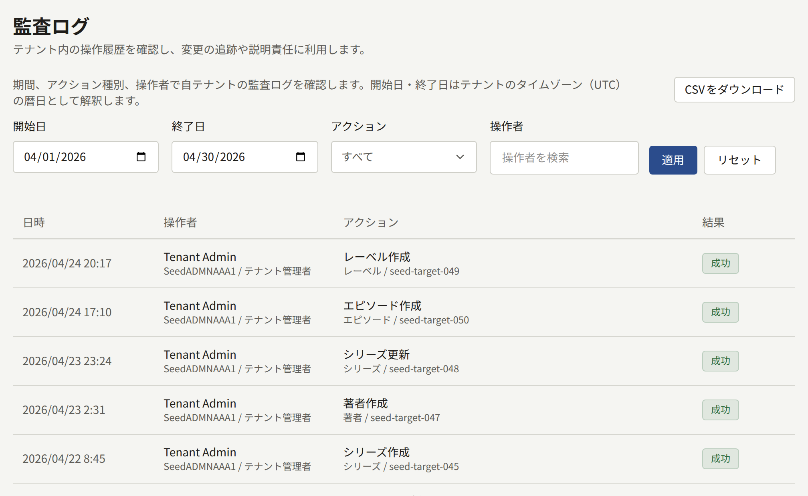

**管理**の下にある**監査ログ**は、スタッフが管理画面で行ったことについてのテナントの記録です。誰が何をいつ変更し、それが成功したかどうかがわかります。誰が読者を停止したか、誰が決済の設定を変更したか、メンバーにいつロールが付与されたか、といった疑問に答えられます。この画面が表示されるのはテナント管理者だけです。

## ログの見方

それぞれのエントリーには、次の内容が表示されます。

- **日時**：テナントのタイムゾーンで表示されます。
- **操作者**：スタッフのメンバーと、その公開ID、そして操作時に持っていたロールです。**自動処理**は、十分な数の読者が報告したためにコメントが非表示になった場合のように、プラットフォームが自動で行った操作を示します。
- **アクション**：その下に、操作の対象の種類とIDが表示され、理由を記録するアクションではその理由も表示されます。
- **結果**：**成功**または**失敗**です。2段階認証によるログインでのコードの誤りや、届かなかったメールサーバーのテストのように、失敗した試みも記録されます。

エントリーは新しい順に、1ページに20件ずつ並びます。一覧を絞り込むには、**開始日**と**終了日**（テナントのタイムゾーンでの日単位）、**アクション**、**操作者**を設定して**適用**を選びます。**リセット**でこれらをクリアします。

エントリーが削除されることはありません。その後アカウントが削除されたスタッフのメンバーについても、エントリーにはその名前と公開IDが残ります。

## ログのダウンロード

フィルターの横にある**CSVをダウンロード**は、表示している期間、**アクション**、**操作者**のエントリーを、古い順に1つのCSVファイルとして保存します。ファイル名は、`audit-log-<tenant>-2026-04-01--2026-04-30.csv`のように、テナントの公開IDと期間から付けられます。1つのファイルで扱えるのは最大366日です。**終了日**がない場合、期間は今日までです。**開始日**がない場合、期間は**終了日**（または今日）までの366日です。それより長い期間や、**開始日**が**終了日**より後の期間は、絞り込むまでダウンロードできません。

列と、表計算ソフトがテキストとして開けるようにするためのファイルのエンコード方法は、[ログのエクスポート](../../3-operations/12-security/3-audit-logs.md#ログのエクスポート)で説明しています。ダウンロードもそれぞれログに**監査ログのCSVダウンロード**として記録されるため、誰がどの期間のコピーを取得したかがログでわかります。

## 記録される内容

| 分野 | 記録されるもの |
| --- | --- |
| 作品 | シリーズ、エピソード、巻、著者、著者の役割、レーベル、ジャンルの作成と変更、巻の販売開始・販売停止・並べ替え、ある言語でのシリーズとエピソードのタイトルの削除、著者の役割とジャンルの削除、それらの画像のアップロード、無料公開期間と待てば無料の変更 |
| サイト | ページの作成と変更、そのバージョンの作成・公開・ロールバック、その翻訳の追加と削除、ページの公開の取り下げ、お知らせの作成とそのバナーの取り下げ、キャンペーンバナーの作成・変更・並べ替え・削除とその画像のアップロード |
| コメント | コメントの承認・削除・復元・完全削除、報告による自動削除、報告の承認または却下 |
| 読者 | 読者の停止・復元・削除、その生年月日の変更またはクリア、そのアイコンの削除、アクセスチケットの発行と取り消し、購入の返金の申請と実行。お問い合わせの対応済み・再開・担当者の割り当て・メモの追加・回答 |
| 印税 | 締めの設定の変更、月の締め、明細のCSVでのダウンロード |
| アナリティクス | **売上**、**読者の反応**、**離脱**からのレポートのCSVでのダウンロード |
| 監査ログ | 対象期間付きの、ログのCSVでのダウンロード |
| スタッフ | メンバーの招待、招待の再送・取り消し・承諾、ロールの変更、メンバーの削除 |
| ブランディング | テーマの変更と、ロゴ、アイコン、ログインフォームの横の画像、外部サービスのロゴのアップロードと削除 |
| 設定 | **基本情報**タブでは、公開サイト表示設定、タイムゾーン、既定言語、読者のコメント、年齢確認、利用規約とプライバシーポリシー、受け付けないメールアドレス。**制限と保持**では、コミュニティの上限と保持期間。そして、読者がアイコンとして表示できるものと、プリセットのアイコンの追加と削除 |
| 外部連携 | メールの設定とそのテスト、決済プロバイダの設定、**販売先**、モバイルプッシュの認証情報、**アプリリンク**に指定したアプリ、ログインのプロバイダー、Googleタグ |
| 2段階認証 | スタッフによる設定、無効化、リカバリーコードの再発行、2段階認証またはリカバリーコードを使ったログイン |

メンバーが自分のメールアドレスを変更してもエントリーは残らず、読者がサイトで行うことも記録されません。

オペレーターがプラットフォーム管理画面や`publiractl`からテナントに対して変更したこと（テナントのドメインや管理者のロールなど）は、このログではなく、プラットフォーム管理画面独自のログに記録されます。
