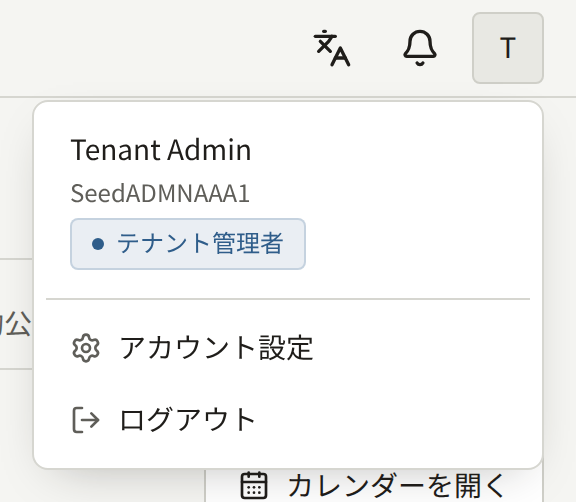
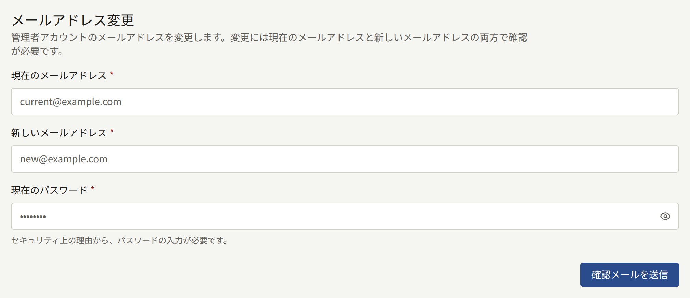
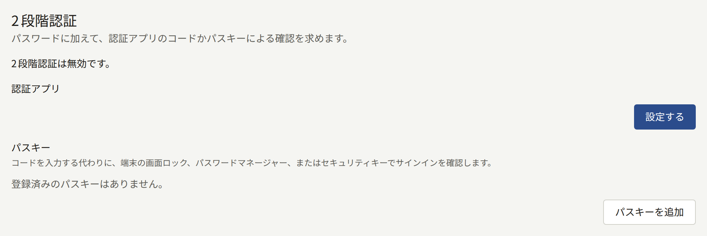
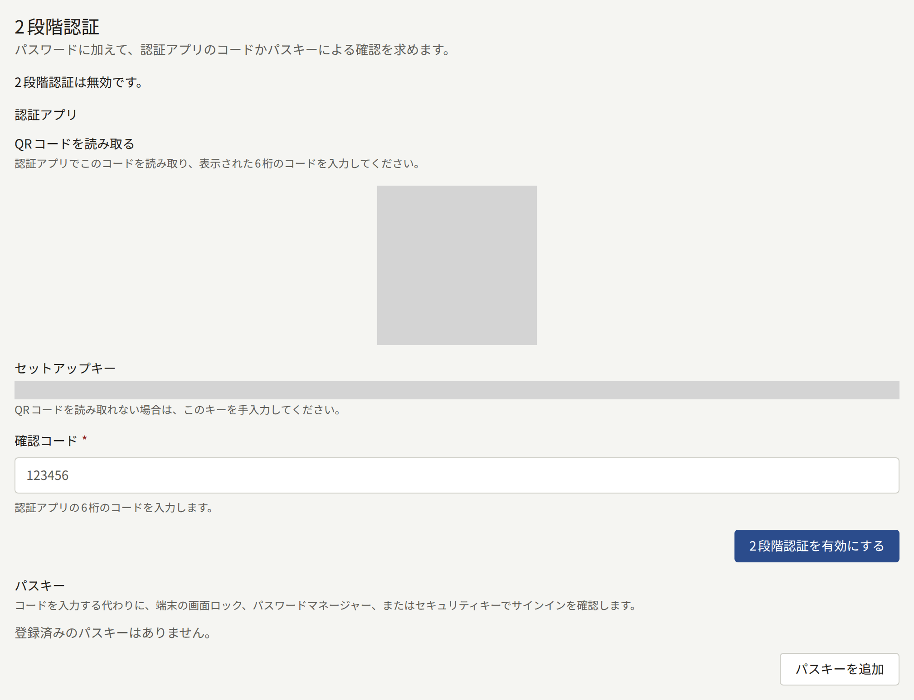
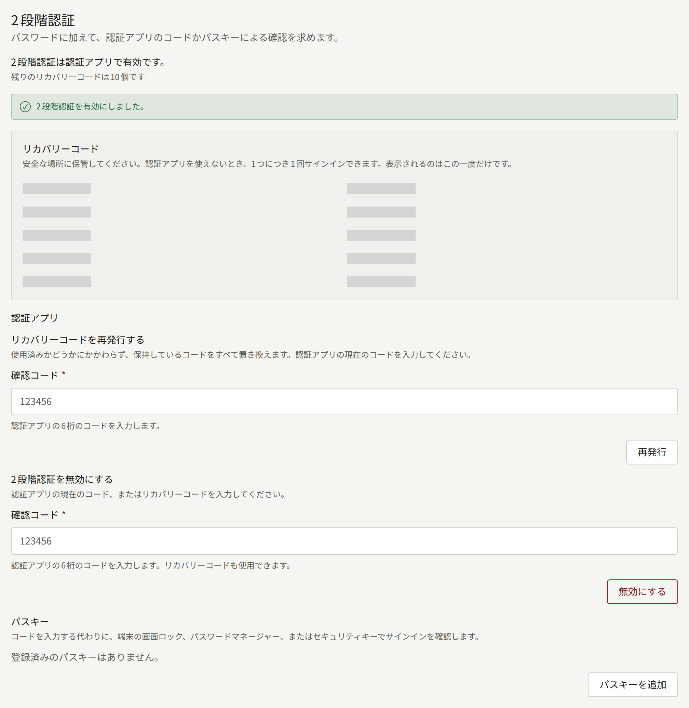

スタッフは、ロールに関係なく全員が、自分の管理画面のアカウントを**アカウント設定**で管理します。**アカウント設定**は管理画面の上部にあるアカウントメニューから開き、**メールアドレス変更**と**2段階認証**の2つのカードがあります。

管理画面には、パスワードを変更する画面がありません。パスワードを変えるときは、ログアウトしてからログイン画面の**パスワードを忘れた場合**を使うと、新しいパスワードを設定するためのリンクがメールで届きます。

## メールアドレスの変更

**メールアドレス変更**で、**現在のメールアドレス**、**新しいメールアドレス**、**現在のパスワード**を入力し、**確認メールを送信**を選びます。

確認メールは、現在のアドレスと新しいアドレスの両方に送られます。変更するには、両方のメールのリンクを、それぞれ24時間以内に開きます。現在のアドレスでも確認するのは、パスワードだけを知った人にアカウントを自分のアドレスへ移されないようにするためです。両方のリンクを開くまでは、今までのアドレスでログインします。両方を開くと新しいアドレスでログインするようになり、古いアドレスには、アドレスが変更されたことを知らせるメールが届きます。

読者のものも含め、テナントのほかのアカウントで使われているアドレスは、新しいアドレスにできません。変更をもう一度申し込むと前の申し込みは取り消され、そのリンクは使えなくなります。

管理画面のアカウントはサイトのアカウントでもあるので、変更はサイトにも反映されます。

## 2段階認証

2段階認証を有効にすると、パスワードの後にもう1つの確認を求められるので、パスワードが盗まれてもそれだけではログインできません。2つ目の確認には、スマートフォンの認証アプリのコードか、パスキーを使います。認証アプリは、多くのパスワードマネージャーに組み込まれている認証機能も含め、QRコードを読み取れるものならどれでも使えます。パスキーは、端末の画面ロック、パスワードマネージャー、セキュリティキーのどれかで解除するもので、何も入力しなくて済みます。

**2段階認証**カードには、**認証アプリ**と**パスキー**の欄があります。どちらか一方だけでも両方でも使え、どちらが有効になっているかはカードの一番上の行に表示されます。どちらか1つでも設定していれば、2段階認証は有効です。

オペレーターは、インストールのすべてのテナント管理者に2段階認証を必須にできます。必須にすると、2段階認証を設定していないテナント管理者は、パスワードを入力した直後に設定を求められ、設定するまで管理画面を使えません。**2段階認証**のカードには「このテナントは管理者に2段階認証を必須にしています。」と表示されます。設定には、認証アプリとパスキーのどちらを使ってもかまいません([パスキーでのログイン](#パスキーでのログイン)を参照)。編集担当と監査担当には必須になりませんが、自分で有効にすることはできます。

### 認証アプリの設定

1. **認証アプリ**で**設定する**を選びます。
2. 認証アプリでQRコードを読み取ります。読み取れない場合は、横に表示されている**セットアップキー**を手で入力します。
3. アプリに表示された6桁のコードを**確認コード**に入力し、**2段階認証を有効にする**を選びます。
4. 認証アプリが最初に設定した2段階目の手段なら、管理画面に10個の**リカバリーコード**が表示されます。表示されるのはこの1回だけなので、パスワードマネージャーや紙など、スマートフォン以外の場所に保管してください。

設定した後は、ログインするたびにアプリのコードを求められます。コードはパスワードを入力してから5分以内に入力し、5回間違えるとアカウントが15分間ロックされます。

### パスキーの追加

1. **パスキー**で**パスキーを追加**を選びます。
2. ブラウザーに管理画面用のパスキーの作成を求められるので、端末の画面ロック、パスワードマネージャー、セキュリティキーのどれかで確認します。
3. パスキーが最初に設定した2段階目の手段なら、認証アプリのときと同じく、管理画面に10個の**リカバリーコード**が表示されます。表示されるのはこの1回だけなので、同じように保管してください。
4. **パスキーの名前**で、端末名やパスワードマネージャー名など、パスキーの保存先がわかる**名前**を入力し、**保存**を選びます。**スキップ**を選ぶと、名前は付きません。

パスキーの一覧には、各パスキーの名前、追加した日時、最後にログインに使った日時が表示され、**名前を変更**で名前を変えられます。パスキーは、スマートフォンに1つ、セキュリティキーに1つのように複数追加でき、どれでもログインできます。同期するパスワードマネージャーに保存したパスキーは、ほかの端末にも自動で届くので、追加は1回で済みます。

すでにこのアカウントのパスキーを保存している認証器には、2つ目のパスキーを作れません。ブラウザーが作成を拒否し、管理画面にもそのことが表示されます。

### パスキーの削除

パスキーの横の**削除**を選んで確認すると、そのパスキーでは管理画面にログインできなくなります。ただし、パスキー自体は端末やパスワードマネージャーに残るので、不要ならそちらでも削除してください。

最後のパスキーを削除したときに認証アプリも設定していなければ、2段階認証は無効になり、リカバリーコードも使えなくなります。オペレーターがテナント管理者に2段階認証を必須にしている場合、テナント管理者は最後の2段階目の手段を削除できないので、先に別のパスキーを追加するか、認証アプリを設定してください。

### パスキーでのログイン

パスキーは**アカウント設定**でもログイン時でも追加でき、追加するとパスワードを入力した後の画面で使えるようになります。オペレーターがテナント管理者に2段階認証を必須にしていて、まだ設定していない場合は、パスワードの後の画面に**認証アプリを設定**と**パスキーを設定**が表示されます。**パスキーを設定**を選ぶとブラウザーが管理画面用のパスキーを作成するので、端末の画面ロック、パスワードマネージャー、セキュリティキーのどれかで確認してください。その後、認証アプリのときと同じく10個の**リカバリーコード**が表示され、保管すると管理画面に進みます。

それ以降、パスワードの後の画面には、まず**パスキーを使う**が表示されます。これを選び、ブラウザーに求められたらパスキーを解除すると、コードを入力せずにログインできます。**代わりにコードを入力**を選ぶと、認証アプリのコードかリカバリーコードを入力する欄が表示されます。**代わりにパスキーを使う**を選ぶと元に戻ります。2段階目の手段がパスキーしかない場合、このリンクは**代わりにリカバリーコードを入力**になります。

パスキーにもコードと同じく5分の制限時間があり、管理画面が受け付けなかったパスキーは、コードの入力ミスと同じくロックまでの回数に数えられます。ブラウザーがパスキーを使えないと応答したとき、確認を閉じたり時間切れになったりしたとき、管理画面が認識できないパスキーだったときは、それぞれ画面にメッセージが表示されます。どの場合も、ワンクリックでコードの入力欄に切り替えられます。

パスキーは、管理画面がテナントのドメインかその配下(`admin.<domain>`など)にあればテナントのドメインに、そうでなければ管理画面自体のホストに結び付きます。オペレーターがテナントのドメインを変更したり、管理画面をテナントのドメインの配下に移したり配下から外したりすると、それまでに作成したパスキーは管理画面で使えなくなります。認証アプリも設定していれば、認証アプリかリカバリーコードでログインしてください。パスキーが唯一の2段階目の手段だった場合は、パスワードだけでログインできます。ただし、オペレーターが2段階認証を必須にしているテナント管理者は、改めて2段階認証の設定を求められます。

### リカバリーコード

リカバリーコードは、スマートフォンやパスキーを保存した端末が手元にないときに、認証アプリやパスキーの代わりに1回だけ使えるコードです。アプリのコードを求める欄に入力するか、パスキーでログインする場合は**代わりにリカバリーコードを入力**を選んで入力します。使うと、残りのコードの数が表示されます。10個のコードは、認証アプリとアカウントのすべてのパスキーで共通です。

**リカバリーコードを再発行する**を使うと、新しいコードが10個発行され、それまでのコードは使ったかどうかに関係なくすべて使えなくなります。再発行にリカバリーコードは使えません。認証アプリを設定していれば、このボタンは**認証アプリ**の欄にあり、アプリのコードの入力を求められます。2段階目の手段がパスキーしかなければ**パスキー**の欄にあるので、**パスキーで再発行**を選び、ブラウザーに求められたらパスキーのどれかを解除します。管理画面がパスキーを受け付けなかったときはコードは発行されず、手元のコードもそのまま使えますが、この失敗もコードの入力ミスと同じくロックまでの回数に数えられます。リカバリーコードを使った後でスマートフォンやパスキーが手元に戻ったときや、コードを誰かに見られたかもしれないときは、再発行してください。

### 2段階認証を無効にする

**認証アプリ**の欄にある**2段階認証を無効にする**を使うと、アプリのコードかリカバリーコードと引き換えに、認証アプリの設定が解除されます。パスキーは削除されないので、パスキーがあれば2段階認証はパスキーで有効なままです。完全に無効にするには、パスキーもすべて削除します。オペレーターがテナント管理者に2段階認証を必須にしている場合、パスキーを残さずに無効にしたテナント管理者は、次にログインするときに改めて設定を求められます。

### 端末の買い替えと紛失

認証アプリを入れたスマートフォンを買い替えるときは、先に古いスマートフォンのコードでログインし、2段階認証を無効にしてから、新しいスマートフォンで有効にし直してください。認証アプリによっては、アプリ自体の機能でコードを新しいスマートフォンに移せるものもあります。

パスキーを保存した端末を買い替えるときは、先に新しい端末でパスキーを追加し、古い端末のパスキーを一覧から削除してください。同期するパスワードマネージャーに保存したパスキーは、パスワードマネージャーと一緒に移るので、何もしなくてかまいません。

端末をなくしたときは、別のパスキー、認証アプリ、リカバリーコードのうち、手元に残っている手段でログインします。ログインしたら、なくした端末のパスキーを削除するか、その端末に入っていた認証アプリの設定を解除して、なくした端末が自分の2段階目の手段として扱われないようにしてから、新しい端末を追加します。端末を拾った人がログインするにはパスワードも必要ですが、削除しておけば2段階目まで進まれることもありません。

2段階目の手段もリカバリーコードもすべて失うと、管理画面にログインできなくなります。パスワードを使っても、ほかのスタッフに頼んでも、アカウントの2段階認証は外せません。インストールのオペレーターなら外せるので、依頼してください([テナントのスタッフ](../../3-operations/3-tenant-staff.md#2段階認証を失った場合)を参照)。外してもらったら、パスワードでログインし、2段階認証を設定し直します。

2段階認証の設定、パスキーの登録と名前の変更と削除、2段階認証の無効化、リカバリーコードの再発行と、コードやパスキーやリカバリーコードを使った各ログインは、テナントの[監査ログ](./8-audit-log.md)に記録されます。
