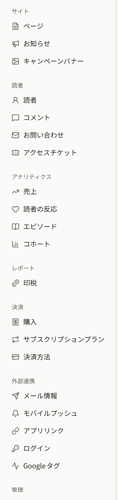

作成されたばかりのテナントのサイトには、ほとんど何もありません。言語とタイムゾーンはオペレーターが選んだまま、色はPubliraの既定のままで、ロゴもページもなく、コメントも受け付けていません。管理画面に入れるのも、オペレーターが招待した管理者だけです。このセクションでは、テナント管理者がこのサイトを出版社のサイトに仕上げる手順を説明します。

使う画面の大半は、サイドバーの**管理**グループにあります。サイトのページ、お知らせ、キャンペーンバナーは**サイト**グループにあり、テナント独自のメールサーバーは**外部連携** › **メール情報**で設定します。

サイトは、オペレーターがテナントを作成した時点からそのドメインで公開されています。作業のあいだサイトを隠しておく設定は管理画面にないので、早くにドメインを見つけた読者には、そのときまでに保存した内容がそのまま見えます。サイトを告知するのは、次の作業を終えてからにしてください。

## 最初に行う作業

1. 管理画面からまだ求められていなければ、アカウントメニューの**アカウント設定**で自分の2段階認証を有効にします([自分のアカウント](./9-your-account.md)を参照)。
2. **設定**で言語とタイムゾーンを確認します。管理画面とサイトの日付は、すべてこのタイムゾーンで表示されます([設定](./1-settings.md#タイムゾーン)を参照)。
3. **ブランディング**で、ロゴ、ブラウザーのアイコン、色、書体を設定してサイトの見た目を整えます([ブランディング](./2-branding.md)を参照)。
4. **ページ**で利用規約とプライバシーポリシーを書いて公開し、**設定** › **利用規約とプライバシーポリシー**でそのページを選びます。読者は会員登録のときに、この2つに同意することになります([ページ](./3-pages.md#利用規約とプライバシーポリシー)を参照)。
5. 残りの基本情報を設定します。サイトのフッターとログイン画面の文言、読者がコメントできるかどうか、年齢の証明を求める年齢制限、会員登録に使えないメールアドレスを決めます([設定](./1-settings.md)を参照)。
6. テナントのメールをどのメールサーバーから送るかを決めます。**外部連携** › **メール情報**でテナント独自のサーバーを設定するまでは、プラットフォームのメールサーバーから送られます([メール](./7-email.md)を参照)。
7. **メンバー**でほかのスタッフを招待します([メンバー](./6-members.md)を参照)。

作品、決済、AppleとGoogleでのログイン、Googleタグ、アプリの設定は、それぞれ別のページで説明しています。このセクションと同じテナント管理画面のセクションにある[作品の公開](../1-catalog/index.md)、[エピソードの販売](../4-selling-episodes.md)、[AppleとGoogleでのログイン](../7-sign-in.md)、[Googleタグ](../8-google-tag.md)と、[モバイルアプリ](../../5-mobile-app/index.md)を参照してください。

## ロールごとにできること

このセクションで説明する設定は、テナント管理者がすべて変更できます。編集担当が変更できるのは、サイトのページ、お知らせ、キャンペーンバナーです。それ以外の画面は、編集担当と監査担当には開けても保存できないか、表示されません。

| 画面 | テナント管理者 | 編集担当 | 監査担当 |
| --- | --- | --- | --- |
| **ページ**、**お知らせ**、**キャンペーンバナー** | 変更できる | 変更できる | 閲覧のみ |
| **ブランディング**、**設定** | 変更できる | 閲覧のみ | 閲覧のみ |
| **メンバー**、**監査ログ**、**外部連携** › **メール情報** | 変更できる | 表示されない | 表示されない |
| **アカウント設定** | 自分のアカウントのみ | 自分のアカウントのみ | 自分のアカウントのみ |

## このセクションのページ

- [設定](./1-settings.md)では、サイトの文言、タイムゾーン、既定言語、読者のコメント、年齢確認、利用規約とプライバシーポリシー、受け付けないメールアドレス、テナントが厳しくできるコミュニティの上限と保持期間、読者がアイコンとして表示できるものを設定します。
- [ブランディング](./2-branding.md)では、ロゴ、アイコン、テーマカラー、書体を設定し、プレビューで確認します。
- [ページ](./3-pages.md)では、サイト独自のページとそのバージョンや翻訳を管理し、読者が同意する利用規約とプライバシーポリシーを用意します。
- [お知らせ](./4-announcements.md)では、すべての読者に向けたお知らせと、サイトの全ページの上部に表示するバナーを掲載します。
- [キャンペーンバナー](./5-campaign-banners.md)では、サイトのトップページとアプリの作品一覧の上部に出す画像バナーの掲載期間と並び順を設定します。
- [メンバー](./6-members.md)では、スタッフの招待、ロールの変更、削除を行います。
- [メール](./7-email.md)では、テナント独自のSMTPサーバーからメールを送る設定と、お問い合わせへの回答に対する読者の返信を管理画面で受け取る設定をします。
- [監査ログ](./8-audit-log.md)では、スタッフの操作のうち管理画面が記録するものを説明します。
- [自分のアカウント](./9-your-account.md)では、自分のメールアドレスの変更と2段階認証の設定をします。
