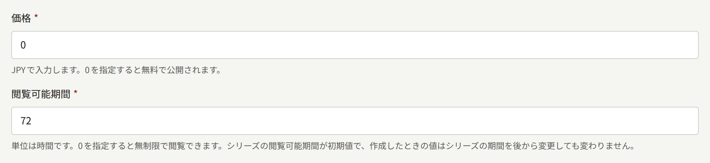
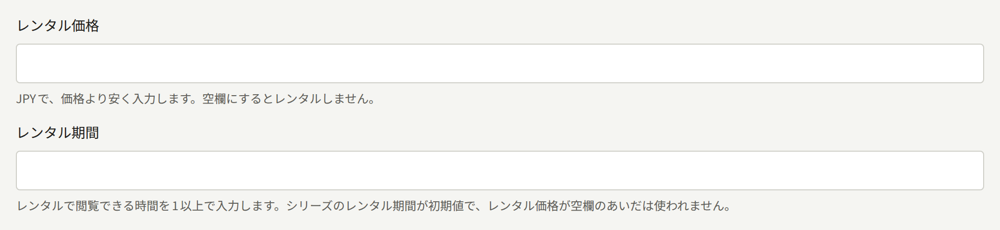
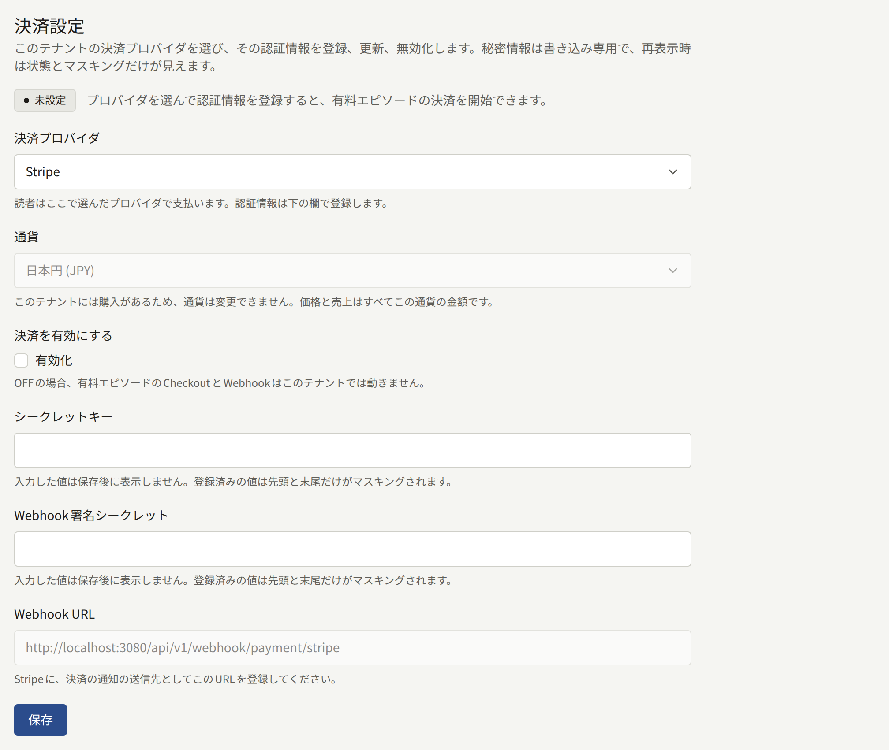
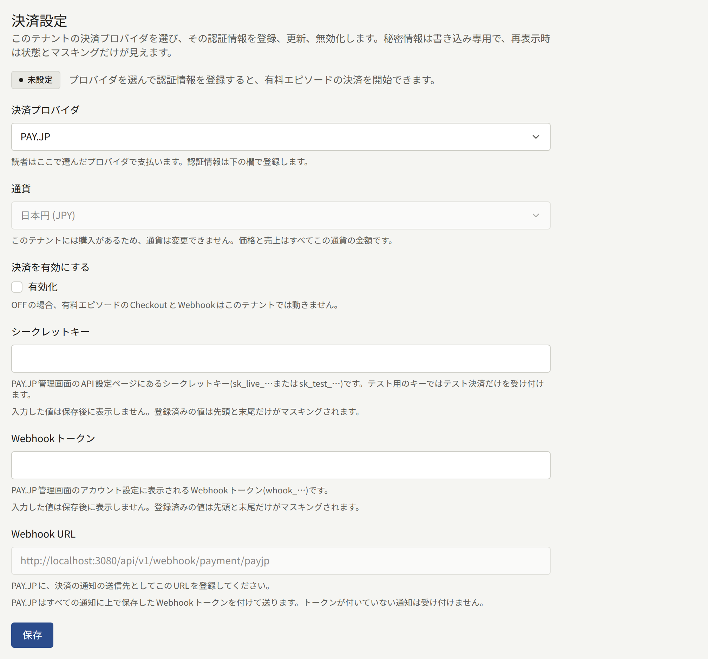
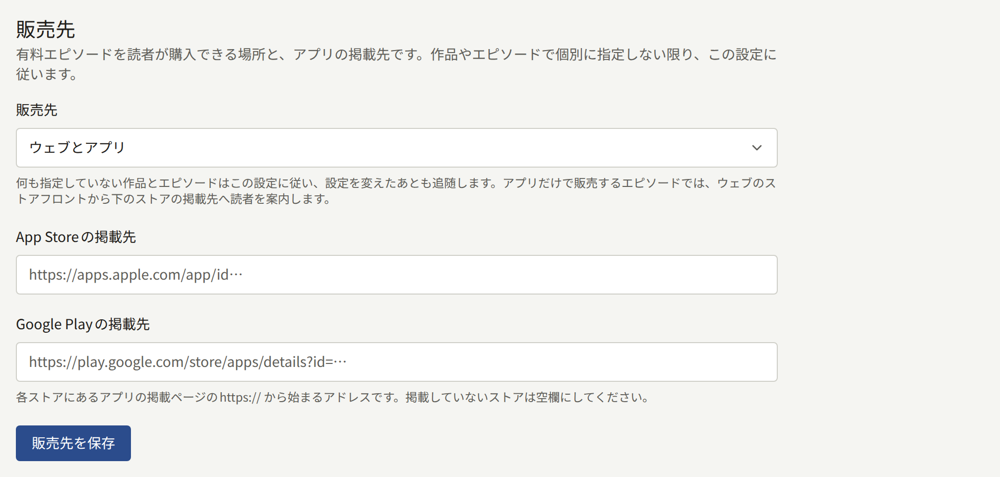
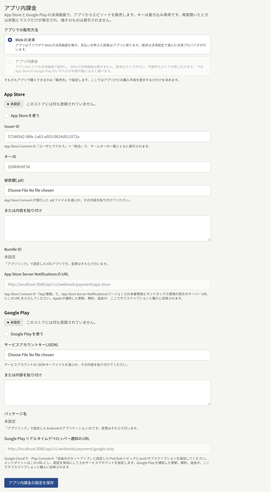
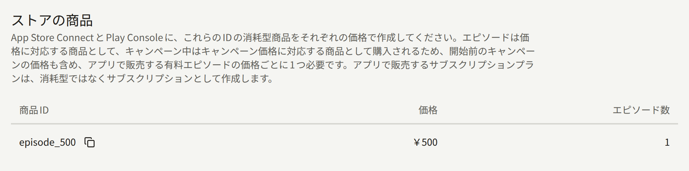

サイトでエピソードを販売するには、3つの設定がかみ合っている必要があります。テナント管理画面で付けるエピソードの価格、決済プロバイダのアカウント、そして読者が支払ったことを決済プロバイダからPubliraに知らせるWebhookです。読者への請求は決済プロバイダが行いますが、エピソードが読めるようになるのはWebhookで通知が届いたときだけです。3つのうちどれかが誤っていると、代金は受け取ったのにエピソードはロックされたまま、という状態になります。このページでは3つを設定する順に説明し、最後にテスト購入で3つがかみ合っていることを確かめます。

テナントのアプリでは、サイトと同じ決済プロバイダで販売するか、App StoreとGoogle Playの決済で販売するかを選べます。ストアの決済なら決済プロバイダは不要で、購入はPubliraがストアに問い合わせて検証します。選び方は[アプリでの販売](#アプリでの販売)で説明します。アプリだけで、ストアの決済を使って販売するテナントは、決済プロバイダの節を読み飛ばしてかまいません。

**決済** › **決済方法**での作業はすべて**テナント管理者**が行います。編集担当と監査担当にはこの画面は表示されません。エピソードの価格は、そのエピソードを作成する人が設定します。

## 読者がエピソードを購入するまで

### 価格と閲覧可能期間

エピソードの**価格**と**閲覧可能期間**は、まずエピソードの作成フォームで入力します。

- **価格**はテナントの通貨で入力します。どの通貨かは欄に表示されています。小数はその通貨の桁数までで、500円なら`500`、4.99米ドルなら`4.99`と入力します。`0`なら無料エピソード、それ以外の値なら有料エピソードになります。
- **閲覧可能期間**は、購入してからエピソードを読める時間数です。`0`にすると期限なく読めます。

有料エピソードはレンタルでも販売できます。レンタルは、**価格**より安い金額で、期間を限って読めるようにする販売方法です。**閲覧可能期間**の下の2つの欄で設定し、**レンタル価格**に金額が入っているエピソードだけをレンタルできます。

- **レンタル価格**は**価格**と同じくテナントの通貨で入力し、**価格**より低い金額にします。このため無料エピソードはレンタルできません。レンタルしない場合は空欄にします。
- **レンタル期間**は、レンタルしてからエピソードを読める時間数で、`1`以上を指定します。**レンタル価格**が空欄のあいだは使われません。

レンタル価格が**価格**以上のときと、**レンタル価格**だけ入力して**レンタル期間**が空のときは、フォームが保存を受け付けず、直すべき欄を示します。レンタルを設定しても買い切りの販売はなくなりません。レンタルした読者も、そのエピソードを購入できます。

4つの欄はどれも、エピソードの編集画面の**価格と閲覧可能期間**であとから変更できます。手順は[エピソード](./1-catalog/2-episodes.md#価格と閲覧可能期間の変更)にあります。価格を変えずに期間限定で安く売るには、エピソードに[キャンペーン価格](./1-catalog/2-episodes.md#キャンペーン価格)を予約します。変更は保存後の購入から適用され、すでに済んだ購入やレンタルは、支払った価格も期限もそのままです。新しいエピソードの**閲覧可能期間**と**レンタル期間**には、シリーズの**閲覧可能期間**と**レンタル期間**が初期値として入ります。シリーズで一度設定しておけば、以後に作成するエピソードには、フォームで変えない限り同じ期間が入ります。シリーズの期間を変えても、作成済みのエピソードは変わりません。

### 購入と閲覧

有料エピソードでは、サイトに価格と**このエピソードを購入**が表示されます。レンタルできるエピソードでは代わりに、価格で買い切る「**¥500で購入**」と、レンタル価格でレンタル期間だけ読める「**72時間レンタル(¥300)**」のように、2つのボタンがそれぞれの金額付きで表示されます。ログインしている読者がどちらかを選ぶと、決済プロバイダの決済ページに移動します。支払うとエピソードのページに戻り、支払いを確認中と表示されます。エピソードが読めるようになるのは、決済プロバイダからの支払いの通知がPubliraに届いたときで、通常は数秒で届きます。決済ページから戻っただけでは読めるようになりません。

購入したエピソードは次のように扱われます。

- 購入が記録された時点から、閲覧可能期間(レンタルならレンタル期間)の間読めます。
- 読者のアカウントの**購入済み一覧**に、購入かレンタルかの区別とともに表示されます。レンタルには残り時間も表示されます。期間が終わったものは**購入履歴**に表示されます。
- 同じアカウントであれば、どこで購入したかにかかわらず、サイトでもテナントのアプリでも読めます。
- 読める期間中は購入し直せません。閲覧可能期間が終われば、再び購入できます。レンタル中の読者は買い切りの購入はできますが、レンタルが終わるまでは再びレンタルできません。

**購入済み一覧**の**CSVでダウンロード**を選ぶと、一覧にあるすべての購入を、ほかのページの分や返金済みのものも含めて1つのCSVファイルに保存できます。テナントのアプリでは、**購入済み一覧**の**CSVで書き出す**が同じファイルを作成して端末の共有シートに渡すので、読者はそこから保存したり送信したりできます。

読者がサイトで購入したテナントのコインのパックは、**購入履歴**に表示されます。名前は`1,100 Points (including 100 bonus)`のように、付与されたコインの数にテナントが決めたコインの呼び名を付けたものです。支払った金額と、返金されたかどうかもあわせて表示されます。パックを購入しても読めるようになるものはなく、閲覧可能期間もありません。コインにはコイン自体の有効期限があります。CSVでは`item`列が`coin_pack`になり、付与されたコインの数がボーナス分も含めて`coins`と`bonus_coins`に入ります。

### コインでの支払い

テナントが独自のコインを販売している場合は、有料エピソードにコインでの価格も付きます。コインを販売できるのは、プラットフォームがテナントにコインの発行を認めていて、テナントが[コイン](./9-coins.md)で説明するとおりコインを有効にしている場合です。コインでの価格は、価格をコイン1枚あたりの価値で割り、端数を切り上げた枚数です。キャンペーン価格で販売している間はキャンペーン価格をもとにし、レンタルの価格も同じように計算します。サイトでは、ログインしている読者に手持ちのコインの数がテナントの呼び名で表示されます。コインが足りていれば**300ポイントで購入**のようなボタンが表示され、押すと決済ページを経ずにその場でエピソードが読めるようになります。

コインが足りない読者には、購入の横に、不足分を補える販売中のパックのうちいちばん小さいものが、その価格、コインを使える日数、テナントが設定した表示項目とともに表示されます。パックを購入すると決済プロバイダの決済ページに移動し、支払うとエピソードのページに戻ります。決済プロバイダの通知でコインが付与されたら、読者はそのコインでエピソードの代金を支払います。不足分を補えるパックが販売されていない場合は、代わりに読者のコインのページへのリンクが表示されます。アプリだけで販売するエピソードは、サイトでコインを使って購入できません。

コインで支払ったエピソードも、ほかの購入と同じように扱われます。閲覧可能期間(レンタルならレンタル期間)の間読めて、**購入済み一覧**には価格の代わりに使ったコインの数が表示されます。CSVでは`price`が`0`になり、使ったコインの数が`coins_spent`に入ります。

**マイページ**には、テナントのコインの呼び名を見出しにした欄があり、読者のコインの残高と、いちばん早く失効する分の期限、コインのページへのリンクが表示されます。コインのページには、販売中のパックがそれぞれの価格とコインを使える日数とともに並び、その下にテナントが設定した表示項目があります。コインの追加、使用、取り消し、失効の履歴もすべて、ページを分けて表示されます。このページでパックを購入した読者は、支払い後にこのページに戻ります。プラットフォームとテナントのどちらかでコインが無効になっている間は、ここに挙げたものはどれも表示されません。

### シリーズの残りのエピソード

読者は、シリーズの有料エピソードのうちまだ持っていないものを、1回の決済でまとめて購入することもできます。シリーズのページでは、エピソード一覧の上に、対象の話数と合計金額を示した「**残りの5話を¥2,250で購入**」のようなボタンが表示されます。テナントのアプリのシリーズ画面にも同じボタンがあります。まとめて購入したエピソードは、1話ずつ購入した場合と同じく、それぞれの閲覧可能期間の間読めます。

合計金額は、各エピソードの価格の合計からシリーズの**まとめ買い割引**を差し引いた額です。[キャンペーン価格](./1-catalog/2-episodes.md#キャンペーン価格)が付いたエピソードは、キャンペーン期間中はその価格で計算します。**まとめ買い割引**はシリーズのフォームで、`99`までの整数のパーセントで設定します([シリーズ](./1-catalog/1-series.md#まとめ買い割引)を参照)。割り引かずに合計額で販売するなら`0`にします。新しいシリーズの初期値も`0`です。割引があると、1話ずつ購入するよりいくら安くなるかが表示され、決済ページにもエピソードと並んで割引が表示されます。割引後の金額は、通貨の最小単位未満を切り捨てます。割り引いた結果、支払う金額が残らない場合は、まとめて購入できません。割引の変更は次の決済から適用され、変更前に決済ページを開いていた読者は、そのページに表示された金額を支払います。

### 無料公開期間と待てば無料

価格は、ほかに読む手段がないときに読者が支払う金額です。エピソードを読めるようにする仕組みはほかに2つあり、どちらかでエピソードを読める読者には、サイトは購入を表示しません。

- **無料公開期間**はエピソードに設定します。指定した2つの日時の間は、ログインしているかどうかに関係なく誰でもエピソードを読めます。期間が終わると再び価格が適用されます。それより前の購入はそのまま残り、閲覧可能期間は無料公開期間中も減っていきます。シリーズの[公開後に無料](./1-catalog/1-series.md#公開後に無料)のルールを使うと、シリーズの各有料エピソードに、公開から決まった日数が過ぎた時点でこの期間が追加されます。
- **待てば無料**はシリーズに設定します。ログインしている読者にはそれぞれ無料チケットが渡され、チケット1枚でシリーズの有料エピソード1話を**エピソードを読める時間**の間読めます。チケットを使ってから**次のチケットまでの時間**が経つと、新しいチケットが渡されます。**チケットで読めない最新話の数**を設定すると、最新のエピソードはチケットで読めず、購入する読者のために残しておけます。無料公開期間中のエピソードと、読者がすでに読めるエピソードには、チケットを使えません。

スタッフが**アクセスチケット**で発行する[アクセスチケット](./2-readers/4-access-tickets.md)でも、支払いなしでエピソードを読めます。エピソードにクレジットされている著者はそのエピソードを無料で読め、購入は表示されません。テナントの[スタッフ](../3-operations/3-tenant-staff.md#メンバーとユーザー)は、3つのロールのどれであっても、ロールを持つアカウントでサイトかアプリにログインしていれば、公開中のすべてのエピソードを無料で読めます。

## 決済プロバイダの選択

テナントがサイトで支払いを受け付ける決済プロバイダは、一度に1つだけです。**決済** › **決済方法**の**決済設定**で選びます。

| 決済プロバイダ | 読者が使える支払い方法 |
| --- | --- |
| Stripe | Stripeダッシュボードでアカウントに対して有効にした支払い方法で、カードやコンビニ決済などがあります。コンビニ決済のように支払いがあとになる方法で購入した場合は、支払いが完了した時点でエピソードが読めるようになります。 |
| PAY.JP | カードです。すべての支払いで3Dセキュア認証を行います。 |

支払いはテナントの通貨で受け付けます。通貨は同じフォームの**通貨**で選び、管理画面でもサイトやアプリでも、すべての価格をこの通貨で入力し、表示します。選べるのは、選んだ決済プロバイダが請求に使える通貨です(PAY.JPは円のみ)。設定を保存するまでは、Publiraのオペレーターが決めたプラットフォームの既定の通貨が選ばれています。通貨は最初の販売より前に決めてください。購入が1件でもあると、すべての価格と売上がその通貨の金額になるので、**通貨**は変更できなくなります。

フォームの横に表示される状態で、設定がどこまで済んでいるかがわかります。

- **未設定**は、決済プロバイダをまだ選んでいない状態です。
- **設定不足**は、決済は有効になっているものの、決済プロバイダに必要な認証情報が足りず、請求できない状態です。
- **無効**は、認証情報は保存されているものの、**決済を有効にする**がオフになっている状態です。
- **利用可能**は、読者が購入できる状態です。

**利用可能**になるまでは、有料エピソードには価格が表示されるだけで、購入する手段がありません。読者には、現在サイトでは購入できないと表示されます。別の決済プロバイダを選んで保存すると、それまでの決済プロバイダの認証情報は削除されます。

以下の設定は、まず決済プロバイダのテスト用のキーで行います。[本番前のテスト](#本番前のテスト)の手順でテスト購入が通ってから、本番用のキーに置き換えてください。

### Stripe

Stripeダッシュボードで次の作業をします。

1. APIキーのページで**シークレットキー**をコピーします。テスト用のキーは`sk_test_`、本番用のキーは`sk_live_`で始まります。
2. Webhookエンドポイントを追加します。URLは、**決済設定**でStripeを選ぶと管理画面に表示される**Webhook URL**で、テナントのサイトのドメインを使った`https://<tenant-domain>/api/v1/webhook/payment/stripe`です。イベントは次の7つを選びます。テナントがサブスクリプションプランを販売する場合は、[サブスクリプションプラン](./5-subscription-plans.md#始める前に)に挙げる3つも選びます。
   - `checkout.session.completed`
   - `checkout.session.async_payment_succeeded`
   - `checkout.session.expired`
   - `charge.refunded`
   - `refund.updated`
   - `charge.dispute.created`
   - `charge.dispute.closed`
3. エンドポイントを開き、`whsec_`で始まる**署名シークレット**をコピーします。

続いて、管理画面の**決済設定**で次の作業をします。

1. **決済プロバイダ**でStripeを選びます。
2. **シークレットキー**と**Webhook署名シークレット**を入力します。
3. **決済を有効にする**の**有効化**にチェックを入れ、**保存**を選びます。

Stripeでは、テストモードと本番モードのWebhookエンドポイントは別々で、署名シークレットもそれぞれにあります。本番用のキーに切り替えるときは、本番モードでもエンドポイントを追加し、その署名シークレットを本番用のシークレットキーと一緒に入力してください。

#### プロモーションコード

読者はStripeの決済ページでプロモーションコードを入力できます。コードはStripeダッシュボードで、シークレットキーと同じアカウントとモードのクーポンに対して作成します。管理画面での設定は不要で、エピソードと巻の決済ではいつでもコードを使えます。ただし、まとめ買い割引の付いたシリーズの残りのエピソードの決済では使えません。Stripeが1回の決済に適用する割引は1つだけだからです。

購入には、コードの割引を差し引いた、読者が実際に支払った金額が記録されます。読者の**購入履歴**に表示される金額も、全額返金で返す金額も、エピソードの著者の印税の対象になる売上も、この金額です。価格の全額を割り引くコードなら、支払いなしでエピソードが読めるようになり、返金するものはありません。PAY.JPの決済ではプロモーションコードを使えません。

### PAY.JP

PAY.JPのダッシュボードで次の作業をします。

1. API設定のページで**シークレットキー**をコピーします。テスト用のキーは`sk_test_`、本番用のキーは`sk_live_`で始まります。テスト用のキーで受け付けられるのはテスト決済だけです。
2. アカウント設定で、`whook_`で始まる**Webhookトークン**をコピーします。
3. **決済設定**でPAY.JPを選ぶと管理画面に表示される**Webhook URL**(`https://<tenant-domain>/api/v1/webhook/payment/payjp`)を、PAY.JPが通知を送るURLとして登録します。本番に切り替える前に、本番モードでも登録してください。

続いて、管理画面の**決済設定**で次の作業をします。

1. **決済プロバイダ**でPAY.JPを選びます。
2. **シークレットキー**と**Webhookトークン**を入力します。
3. **決済を有効にする**の**有効化**にチェックを入れ、**保存**を選びます。

PAY.JPの通知には署名がありません。Publiraは、Webhookトークンが含まれている通知を本物と判断し、含まれていない通知は拒否します。Webhookトークンはシークレットキーと同じように秘密にしてください。

### 支払ってもエピソードが読めるようにならない場合

決済プロバイダのダッシュボードには、Webhookへの配信ごとに、Publiraが返したステータスが表示されます。ステータスから原因を1つに絞れます。

| ステータス | 原因 | 対処 |
| --- | --- | --- |
| 2xx | 通知は受け付けています。ただし、受け付けた通知のすべてでエピソードが読めるようになるわけではありません。Stripeはコンビニ決済の場合、読者が支払う前に`checkout.session.completed`を送ります。エピソードが読めるようになるのは、支払い後に届く`checkout.session.async_payment_succeeded`を受け取ったときです | ダッシュボードでイベントの種類と支払いの状態を確認します。支払いが完了しているのにエピソードがロックされたままなら、読者が別のアカウントで購入した可能性があります。 |
| 400 | 管理画面に入力した署名シークレットかWebhookトークンが、決済プロバイダ側の値と一致していません | 決済プロバイダが送信に使っているエンドポイントの値を入力します。 |
| 404 | URLのパスが、どの決済プロバイダも指していません | 管理画面に表示されるURLをそのまま登録します。 |
| 503 | 決済が**利用可能**になっていないか、URLが選んだものとは別の決済プロバイダを指しています | 上の設定を済ませます。配信は決済プロバイダが再試行します。 |
| 配信なし | Webhookが登録されていないか、テストと本番のもう一方のモードに登録されています | キーと同じモードで登録します。 |

どちらの決済プロバイダも、失敗した配信をしばらく再試行し、ダッシュボードから再送することもできます。設定を直したあとに通知が届けば、その支払いで購入したエピソードが読めるようになります。

## エピソードの販売先

同じ画面の**販売先**では、読者が有料エピソードをどこで購入できるかを決めます。**販売先**の選択肢は次の3つです。

- **ウェブとアプリ**では、サイトとテナントのアプリの両方で販売します。
- **ウェブのみ**では、サイトだけで販売します。アプリではWebサイトで販売中と表示され、サイトで購入すればアプリでも読めます。
- **アプリのみ**では、アプリだけで販売します。サイトではアプリで販売中と表示され、アプリで購入した読者はサイトでも読めます。サイトには、**App Storeの掲載先**と**Google Playの掲載先**に入力した各ストアのアプリのページへのリンクも表示されます。

**販売先**はシリーズやエピソードごとにも設定できます。設定していないエピソードはシリーズの設定に、設定していないシリーズはテナントの設定に従い、それらがあとで変わればその変更にも従います。エピソードを販売するのは、そのエピソードを表示する場所だけです。

この選択肢があるのはアプリストアの事情のためです。AppleとGoogleは、アプリでデジタルコンテンツを販売する方法についてそれぞれルールを定め、アプリがルールに従っているかを審査し、ストアを通じた販売から手数料を取ります。次の節で説明するストアの決済を使ってアプリで販売するテナントは、アプリで購入されたすべてのエピソードについてこの手数料を払います。**ウェブのみ**にすれば、そのシリーズはサイトだけで販売できます。アプリを持たないテナントや、アプリでは販売しないテナントは、すべてのエピソードで**ウェブのみ**を選びます。

## アプリでの販売

アプリで販売できるエピソードをテナントのアプリがどう販売するかは、**アプリ内課金**の節の**アプリでの販売方法**で選びます。

- **Webの決済**では、スマートフォンのブラウザーでサイトの決済を開き、上で設定した決済プロバイダで支払ってもらいます。支払いが済むと、読者はエピソードに戻ります。
- **アプリ内課金**では、App StoreとGoogle Playの決済画面で販売します。読者への請求はストアが行い、ストアが手数料を差し引きます。上で設定した決済プロバイダは使いません。

**アプリ内課金**を使う場合、アプリには[決済プロバイダの選択](#決済プロバイダの選択)で説明した決済プロバイダは要りません。アプリはストアで購入し、Publiraがストアに問い合わせてその購入を検証します。

**アプリのみ**で販売するエピソードについて、サイトがアプリで販売中と表示してストアへのリンクを出すのは、アプリがそのエピソードを実際に販売できるときだけです。**Webの決済**なら決済プロバイダが、**アプリ内課金**ならいずれかのストアが**利用可能**になっている必要があり、リンクは**利用可能**なストアの掲載先にだけ表示されます。それまでは、サイトはエピソードの価格を表示し、購入を受け付けられないと読者に伝えます。**ウェブとアプリ**で販売するエピソードは、決済プロバイダが**利用可能**ならサイトで購入できます。決済プロバイダが**利用可能**でなく、アプリでは販売できるときは、サイトは**アプリのみ**のエピソードと同じように扱います。

**アプリ内課金**を選べるのは、少なくとも1つのストアが**利用可能**になってからです。ストアを**利用可能**にするには、**App Storeを使う**か**Google Playを使う**をオンにしてキーを入力し、**外部連携** › **アプリリンク**でアプリを指定します。

アプリは各エピソードを、価格にちなんだ名前のストアの商品として購入します。300円のエピソードなら`episode_300`です。そのため、ストアで販売できるのは商品を用意した価格だけです。[キャンペーン価格](./1-catalog/2-episodes.md#キャンペーン価格)で販売している間はキャンペーンの価格を使い、500円から300円に値下げしているエピソードは`episode_300`として購入され、300円として記録されます。画面下部の**ストアの商品**には、アプリが販売するすべての価格について、必要な商品IDが並びます。予約中や販売中のキャンペーンの価格も含まれ、エピソードの数は付いている価格ごとに数えます。App Store ConnectとPlay Consoleで、各商品IDをその価格の消耗型の商品として作成してください。一覧に新しい価格が現れたら、そのつど商品を追加します。キャンペーンの価格は予約した時点で一覧に現れるので、開始前に商品を用意できます。

販売中のコインのパックも、`coins_`にパックのIDを続けた商品IDで、付与するコインとボーナスコインの数とともにこの一覧に並びます。同じ手順で、パックの価格の消耗型の商品として作成してください。ストアに表示される商品名はPubliraから送るものではなく、App Store ConnectとPlay Consoleで付けた名前です。各パックの商品名には、アプリを掲載しているすべての言語で、テナントが決めたコインの呼び名を使ってください。

その下の**サブスクリプションプラン**には、**App Storeの商品ID**か**Google Playの商品ID**を指定した[サブスクリプションプラン](./5-subscription-plans.md#プランの作成)が並びます。プランごとに期間ごとの料金とストアごとの商品IDが表示され、商品を指定していないストアには**販売しない**と表示されます。プランは消耗型の商品ではありません。App Store Connectではサブスクリプショングループの中に自動更新サブスクリプションとして、Play Consoleでは基本プランを付けた定期購入として、プランの料金と請求の間隔で作成してください。IDはプランで入力し、一覧はそれに従います。

各ストアで必要な設定は、Publiraが購入の検証に使うキーから、ストアのテスト用購入者を使ったテストまで、アプリ自体の設定とあわせて[アプリ内課金とログイン](../5-mobile-app/5-purchases-and-sign-in.md#アプリでのエピソードの販売)で説明しています。App StoreのサンドボックスやPlayのライセンステスターによる購入でもエピソードは読めるようになりますが、テストとして記録され、印税明細とコンテンツの統計には含まれません。

読者がアプリに保存したエピソードは、アプリが最後にオンラインで開いてから最大7日間、その端末ではネットワークなしで開けます。そのため、返金しても保存済みのエピソードはすぐには読めなくならず、この7日間のうちに読めなくなります。次にアプリがオンラインでそのエピソードを開いた時点で、エピソードはロックされ、端末から削除されます。詳しくは[オフライン閲覧](../5-mobile-app/7-offline-reading.md#有料のエピソードをオフラインで読める7日間)を参照してください。

## 返金

サイトでの購入は、管理画面か、StripeやPAY.JPのダッシュボードで返金します。管理画面での手順は[管理画面からの返金](#管理画面からの返金)にあります。アプリでの購入はAppleかGoogleが返金します。どの場合も、Publiraから読者には通知しません。

全額返金すると、読者はそのエピソードを読めなくなります。購入は読者の**購入履歴**に**返金済み**として残り、読者はエピソードをもう一度購入できます。一部返金では、その支払いへの返金の合計が読者の支払った金額に達するまで、エピソードは読めるままです。ただし、エピソードの著者の印税の対象になる売上は減ります。

返金は、購入と同じ経路でPubliraに届きます。

| 購入した場所 | 返金の届き方 |
| --- | --- |
| StripeとPAY.JP | 上で設定したWebhookで通知が届きます。Stripeのエンドポイントに`charge.refunded`が必要なのはこのためです。決済プロバイダが受け付けた返金が、読者のカードが解約されていたなどの理由であとから失敗することもあります。その場合も通知が届き(Stripeでは`refund.updated`)、成立している返金の合計が読者の支払った金額に届かなければ、読者は再びエピソードを読めるようになります。 |
| App Store | 管理画面の**App Store**の節に表示される**App Store Server NotificationsのURL**に通知が届きます。このURLは、App Store Connectで本番用とサンドボックス用の両方のサーバーURLとして登録します。 |
| Google Play | 管理画面の**Google Play**の節に表示される**Google Playリアルタイムデベロッパー通知のURL**に、Pub/Subのpushサブスクリプションを通じて通知が届きます。設定は[アプリ内課金とログイン](../5-mobile-app/5-purchases-and-sign-in.md#アプリ内課金のために各ストアで必要な設定)で説明します。Publiraはこれとは別に1時間ごとに過去30日分のGoogle Playの無効化された購入を取得し、通知が届かなかった返金も反映します。通知を設定していないと、返金された購入でも最大1時間はエピソードを読めることがあります。この取得は`publira worker`が行います。`publira worker`はオペレーターが常に動かしておくプロセスです([構成の概要](../2-deployments/1-overview.md)を参照)。 |

取り消す対象の購入より先に返金が届いた場合は、返金を保持しておき、購入が記録された時点で適用します。

### 管理画面からの返金

**決済** › **購入**には、テナントの購入が新しい順に並び、読者のメールアドレス、シリーズ、エピソード、購入日(テナントのタイムゾーン)で絞り込めます。**表示**を選ぶと一覧の横に購入の詳細が開き、読者が支払った金額と支払った場所、これまでに返金した金額が表示されます。この画面はテナント管理者にだけ表示されます。

コインのパックの購入は、付与されたコインの数にテナントの既定の言語のコインの呼び名を付けて表示されます。シリーズは付かないので、シリーズやエピソードで絞り込むと一覧から外れます。返金の方法はほかの購入と同じですが、常に全額を返金するので、金額は入力しません。パックのコインは、決済プロバイダから全額返金か、支払いへの異議申し立ての通知が届くまで、読者の手元に残ります。通知が届くと、パックの残りのコインは取り消されます。読者がすでに使った分は未払いとして記録され、次に購入するパックから差し引かれます。使ったコインで支払ったエピソードは読めるままで、それぞれの購入には、使ったコインの価値の分が返金として表示されます。

コインで支払ったエピソードの購入では、ほかの購入なら決済プロバイダ名が表示される場所に**コインで支払い**と表示されます。価格には使ったコインの価値が表示され、[著者に支払う印税](./6-reports-and-royalties.md#著者に支払う額)の対象となる売上もこの金額です。読者には、価格ではなく使ったコインの数が表示されます。

**返金**を選んで理由を入力すると、読者が支払いに使った決済プロバイダに、**返金する金額**に入力したテナントの通貨の金額の返金を依頼します。理由は返金とあわせて監査ログに記録されます。金額の初期値は返金できる残りの全額です。金額を変えると、エピソードが読者に読めるまま残るのか、読めなくなるのかがダイアログに表示されます。

- **残りの全額**を返金すると、読者はその時点でエピソードを読めなくなります。購入は、決済プロバイダからWebhookで返金の通知が届くまで**返金依頼済み**、届いたあとは**返金済み**と表示されます。決済プロバイダが返金を拒否した場合や、受け付けたあとで返金が失敗した場合は、読者は再びエピソードを読めるようになります。
- **それより少ない金額**なら、読者はエピソードを読めるままです。購入は、決済プロバイダから返金の通知が届くまで、金額を添えて**返金依頼済み**と表示されます。通知が届くと**一部返金**と表示され、その金額がこれまでの返金額に加わります。それまでは同じ金額でしか返金し直せないので、依頼が決済プロバイダに届かなかったときは同じ金額でもう一度返金します。決済プロバイダが返金を拒否した場合は、依頼は取り消されます。通知が届いたあとで残りを返金すると、上と同じようにエピソードは読めなくなります。

アプリでの購入と、読者がカード会社に異議を申し立てた購入、テナントが今は使っていない決済プロバイダで支払われた購入は、管理画面から返金できません。読者が支払った場所で返金してください。コインで支払った購入も、決済を伴わないので返金できません。代金を受け取ったのはパックの購入なので、パックを返金すれば代金が返ります。

## 異議申し立て

読者がStripeでの支払いについてカード会社に異議を申し立てると、Stripeが同じWebhookで知らせます。Stripeのエンドポイントに`charge.dispute.created`が必要なのはこのためです。カード会社があとでどう判断するかにかかわらず、異議が申し立てられた時点で読者はエピソードを読めなくなります。購入は読者の**購入履歴**に**取り消し済み**として残ります。異議申し立てへの対応はStripeダッシュボードで行い、管理画面での作業はありません。

カード会社の判断によって変わるのは印税明細だけです。判断の結果は`charge.dispute.closed`で印税明細に反映されます。

- テナントに有利な判断が出た場合は、支払いがテナントに残るので、購入は売上のままです。読者がエピソードを読めない状態は変わりません。
- テナントに不利な判断が出た場合は、支払いが読者に戻るので、全額返金と同じく購入は売上から外れます。購入した月がすでに締められているときは、[締め後の返金](./6-reports-and-royalties.md#締めたあとの返金)と同じように、次の明細で調整として差し引かれます。

## 途中で離脱した決済

支払わずに決済ページを離れた読者は、いつでも購入をやり直せます。放置された決済の期限切れをStripeが知らせると、読者が次に購入するときには、期限切れのページではなく新しい決済ページが開きます。Stripeのエンドポイントに`checkout.session.expired`が必要なのはこのためです。

## 決済プロバイダとの照合

印税明細と**売上**が数えるのは、Publiraが記録した購入だけです。通知が届かなかった支払いや、どの購入とも結びつかなかった返金、アプリが確定しなかったストアでの購入があると、これらの数字は決済プロバイダやストアが実際に請求した金額と食い違います。照合は、テナントの日付で区切った期間について両者を比べ、相手側のどれとも結びつかない明細をすべて一覧にします。決済プロバイダとストアの記録は**決済** › **決済方法**に保存した認証情報で読み取り、記録にも購入にも変更は加えません。一覧の明細にどう対応するかは、決済プロバイダのダッシュボードや管理画面で判断してください。

期間を照合すると、テナントで**利用可能**になっている照合先ごとに1件ずつ実行されます。照合先は、決済プロバイダとApp Store、Google Playです。ワーカーは数秒以内に実行を始め、照合先の期間中の記録を読み終えると完了します。取引の多いテナントで長い期間を照合すると、しばらく時間がかかります。同じ期間をもう一度照合すると、前回の結果は置き換えられます。ただし、前回の実行がまだ終わっていなければそのまま続きます。

照合先の記録は、それぞれ次のように読み取ります。

- **Stripe**では、アカウントの残高取引を読み、購入に記録したPaymentIntentで突き合わせます。[サブスクリプションプラン](./5-subscription-plans.md)の請求の支払いは購入ではないので、照合から外します。
- **PAY.JP**では、アカウントの支払いフローと、それに対する返金を読みます。
- **App Store**では、期間中にApp Storeで購入した顧客ごとに取引履歴を読みます。Appleは顧客ごとの履歴しか持たず、アプリ全体の一覧は持たないので、アプリがすべての購入を記録しそこねた顧客の支払いは照合では見つかりません。
- **Google Play**では、期間中のGoogle Playでの購入を注文とあわせて1件ずつ読み、Google Playの無効化された購入も読みます。Google Playはこれ以外の購入を一覧にせず、無効化された購入も30日分しか持たないので、アプリが記録しそこねた購入は、その期間内に返金されたときにだけ見つかります。

照合で一覧になる明細は次のとおりです。

- **購入のない支払い**は、照合先が受け取ったのに購入が記録されていない支払いです。通知がPubliraに届かなかった支払いはこれにあたります。明細には照合先での支払いのIDが表示されるので、照合先のダッシュボードで探せます。IDはStripeではPaymentIntent、PAY.JPでは支払いフロー、App Storeでは取引、Google Playでは購入トークンのIDです。
- **支払いのない購入**は、期間中の購入のうち、照合先に記録がないものです。
- **金額の食い違い**は、購入とその支払いとで、金額や通貨、返金した金額が一致しないものです。ストアは読者の国の通貨で請求するので、ストアについては、テナントの通貨で請求したときだけ金額を比べ、それ以外は返金されたかどうかだけを比べます。
- **保留中の返金**と**保留中の異議申し立て**は、どの購入とも結びつかないまま届き、期間の始まりより前から購入を待っている返金や異議申し立てです。購入が記録されれば、[返金](#返金)で説明したようにその時点で適用されるので、待ち続けているものは記録されなかった購入があることを示しています。

購入の日時はPubliraが購入を記録した日時で、支払いから通知が届くまでの分だけ遅れます。そのため、照合先の記録は期間の前後1日を含めて読みます。期間の最終日の夜遅くに受け取った支払いも、翌朝に記録された購入と突き合わさります。期間の外にある明細は、どちらの側のものも一覧になりません。

決済プロバイダのテストモードやストアのサンドボックスでの支払いは、テストの購入とだけ突き合わせ、本番の明細とは分けて一覧にします。保留中の返金と異議申し立てにはモードの区別がないので、本番の明細として一覧にします。

### 購入のダウンロード

期間中の購入は、経理のためにCSVでダウンロードできます。期間中の購入1件ごとに1行、期間中の日付の返金1件ごとに1行が入り、どの行にも購入に記録された決済プロバイダやストアのIDが付きます。全額返金はPubliraに届いた日時の行になります。一部返金にはそれ自体の日付がないので、購入した期間の行として入ります。コインで支払った購入と、支払いなしで付与した購入は、読者に請求していないのでファイルに入りません。ダウンロードは、そのたびに**監査ログ**に記録されます。

## 本番前のテスト

読者が支払えるようにする前に、決済プロバイダのテスト用のキーで設定全体をテストしてください。いちばん誤りやすいのはWebhookで、正しく動くかは実際に購入してみないとわかりません。

決済プロバイダのテストモードでの購入でもエピソードは読めるようになりますが、テストとして記録され、印税明細とコンテンツの統計には含まれません。読者に届く領収メールには、テストモードでの購入なので料金は請求されていないと書かれています。管理画面ではエピソードを削除できないので、テストは専用のシリーズで行い、終わったらそのシリーズを非表示にしてください。

1. 上の手順で、決済プロバイダを**テスト用**のシークレットキーで設定し、Webhookをテストモードで登録します。**決済設定**が**利用可能**になっていることを確認します。
2. テスト用のシリーズを、表示先を**Webとアプリ**か**Webのみ**にして作成し、すぐに公開します。そのシリーズに、**価格**を`100`、**閲覧可能期間**を`1`などにしたエピソードを作成し、すぐに公開して、サイトで販売する設定にします。
3. サイトに、管理画面のロールを持たない読者アカウントでログインし、エピソードを開いて**このエピソードを購入**を選びます。
4. テスト用のカードで支払います。`4242 4242 4242 4242`は、有効期限を未来の任意の日付に、セキュリティコードを任意の3桁にすれば、どちらの決済プロバイダでも使えます。PAY.JPではこのあとテスト用の3Dセキュアの画面が表示されるので、そこで結果を選びます。
5. エピソードのページに戻ったら、読めるようになるまで待ち、**購入済み一覧**に表示されていることを確認します。1分たっても読めるようにならない場合は、決済プロバイダのダッシュボードで配信を確認します([支払ってもエピソードが読めるようにならない場合](#支払ってもエピソードが読めるようにならない場合)を参照)。
6. **決済** › **購入**で購入を返金するか、決済プロバイダのダッシュボードで支払いを全額返金して、返金もPubliraに届くことを確かめます。エピソードを再読み込みすると再びロックされ、**このエピソードを購入**が表示されるはずです。

購入と返金の両方を確認できたら、テスト用のシリーズの**表示先**を**表示先なし**にします。続いて、テスト用のシークレットキーを本番用に置き換え、Webhookを本番モードで登録し、その署名シークレットかWebhookトークンを入力して保存します。

アプリ内課金のテストには、ストアが用意するテスト用購入者を使います([購入のテスト](../5-mobile-app/5-purchases-and-sign-in.md#購入のテスト)を参照)。この購入もテストとして記録されます。
