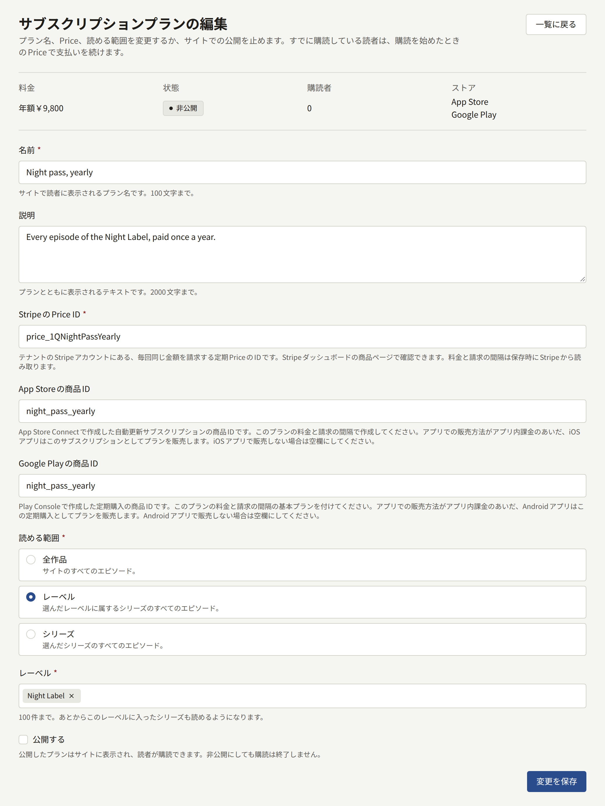
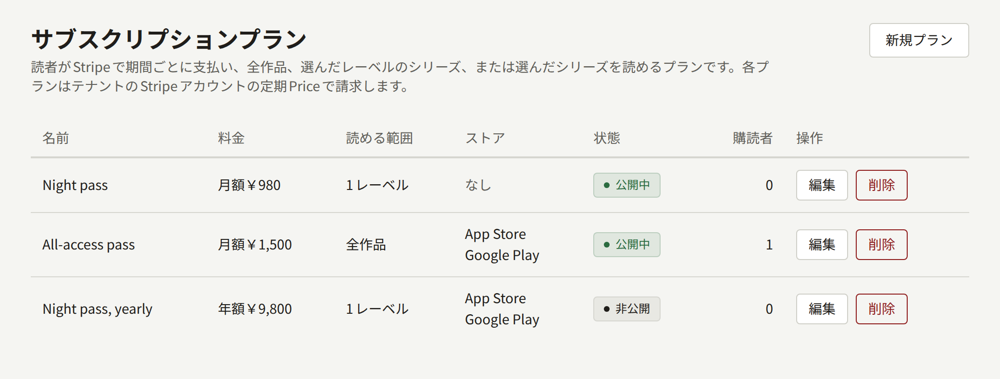

サブスクリプションプランを購読した読者は、Stripeで期間ごとに代金を支払い、プランの対象のエピソードを1話ずつ買わずにすべて読めます。プランを販売するには、エピソードの販売と同じ3つの設定がかみ合っている必要があります。テナントのStripeアカウントにある定期のPriceと、そのPriceを指定したテナント管理画面のプラン、読者の購読や支払い、更新、支払いの遅れ、解約をStripeからPubliraに知らせるWebhookです。請求はStripeが行いますが、プランのエピソードを読めるようにしたり読めなくしたりするのはWebhookの通知だけです。3つのどれかが誤っていると、代金を受け取ったのにエピソードがロックされたままになったり、支払いをやめた読者が読み続けられたりします。このページでは3つの設定を順に説明し、最後にテスト購読で3つがかみ合っていることを確かめます。

どのプランもサイトでStripeを通じて販売し、PAY.JPで支払いを受け付けているテナントはプランを作成できません。テナントのアプリがApp StoreとGoogle Playで販売するサブスクリプションをプランに指定することもできます。詳しくは[プランの作成](#プランの作成)で説明します。テナントのアプリが**Webの決済**で販売している場合、プランを購読したい読者はアプリからサイトのプランのページに案内されます。詳しくは[アプリ内課金とログイン](../5-mobile-app/5-purchases-and-sign-in.md#アプリでのエピソードの販売)を参照してください。

**決済** › **サブスクリプションプラン**は**テナント管理者**が使う画面で、編集担当と監査担当には表示されません。

## 始める前に

テナントがStripeで支払いを受け付けていて、**決済** › **決済方法**の**決済設定**が**利用可能**になっている必要があります。設定の手順は[エピソードの販売](./4-selling-episodes.md#stripe)にあります。管理画面は、そこに保存したシークレットキーのStripeアカウントから各プランのPriceを読み取るので、**利用可能**になるまではプランを保存できません。

StripeのWebhookエンドポイントには、エピソードの販売に必要な7つのイベントのほかに、次の4つのイベントが必要です。

- `customer.subscription.updated`は、サブスクリプションの更新、支払いの遅れ、解約の予約、プランの変更があったときに送られます。
- `customer.subscription.deleted`は、サブスクリプションが終了したときに送られます。
- `invoice.payment_failed`は、Stripeが更新の代金を回収できなかったときに送られます。
- `invoice.paid`は、Stripeがサブスクリプションの請求書の支払いを受けたときに、初回にも更新のたびにも送られます。

最初の3つがないと、サブスクリプションは決済の支払い時に記録されたきりで、その後のStripeでの変化が反映されません。更新の支払いが済んだ読者でも、支払った期間が終わるとエピソードを読めなくなり、解約した読者はその日まで読み続けられます。`invoice.paid`がないと支払いが記録されないので、プランの収入はどの売上の数値にも印税の明細にも含まれません。詳しくは[支払いから著者に支払う額](#支払いから著者に支払う額)で説明しています。イベントを追加する前の支払いは、あとからも記録されません。4つのイベントはテストモードのエンドポイントに追加し、本番に切り替える前に本番モードのエンドポイントにも追加してください。

## StripeでのPriceの作成

Stripeダッシュボードで、シークレットキーと同じアカウントとモードを開き、次の作業をします。

1. プラン用の商品を商品カタログに追加します。商品名は、Stripeが決済ページと請求書で読者に表示する名前になります。
2. 商品に、毎回同じ金額の**継続**の価格を付け、請求期間を選びます。請求期間は毎日、毎週、毎月、毎年のほか、3か月ごとのようなカスタムの期間も選べます。
3. 価格を開き、`price_`で始まるIDをコピーします。

管理画面が受け付けるのは、期間ごとに決まった金額を請求するPriceだけです。1回限りの価格や、使用量ベースや従量制の価格、段階制の価格、顧客が金額を決める価格は受け付けません。アーカイブされたPriceも受け付けません。プランはPriceに設定された金額、通貨、請求期間で請求し、サイトもプランの料金をその通貨で表示するので、Priceはテナントの通貨で作成してください。StripeではPriceの金額を変更できません。請求する金額を変えるには、[プランの変更、非公開、削除](#プランの変更非公開削除)で説明するとおり、新しいPriceを作成してそのIDをプランに入力します。

テストモードと本番モードのPriceは別のもので、IDもそれぞれ違います。本番用のキーに切り替えるときは、[本番前のテスト](#本番前のテスト)で説明するとおり、本番モードでPriceを作成し直し、そのIDをプランに入力してください。

### カスタマーポータル

購読者は、サイトの**支払いの管理**から開くStripeのカスタマーポータルで、カードを変更したり解約したりします。カスタマーポータルはテナント自身のStripeダッシュボードの請求の設定で構成するもので、管理画面には設定項目がありません。Stripeがポータルを開くには構成が必要です。テストモードと本番モードのそれぞれで、ポータルの設定を開いて保存してください。この設定では、読者が解約できるかどうかと、解約がすぐに有効になるか、支払った期間の終わりに有効になるかを選びます。

ポータルでは、読者が別の商品の価格に切り替えられるようにもできます。テナントの別のプランが請求しているPriceに切り替えた読者は、以後そのプランの購読者として記録され、そのプランの対象を読めるようになります。ポータルで選べるようにするのは、いずれかのプランが請求しているPriceだけにしてください。どのプランも請求していないPriceに切り替えた読者は、購読していたプランのまま、新しい価格で支払います。

## プランの作成

**決済** › **サブスクリプションプラン**で**新規プラン**を選び、フォームに入力して**プランを作成**を選びます。

- **名前**は、サイトで読者に表示されるプランの名前です。100文字まで入力できます。
- **説明**は、プランと一緒に表示される書式なしのテキストです。2000文字まで入力できます。
- **StripeのPrice ID**には、上でコピーした`price_`で始まるIDを入力します。プランの料金と請求の間隔は保存のときにStripeから読み取り、管理画面にはStripeに設定されているとおりに表示します。
- **App Storeの商品ID**と**Google Playの商品ID**には、テナントのアプリがそれぞれのストアでプランを販売するときのサブスクリプションを指定します。どちらも空欄のままにできます。アプリがストアでプランを販売するのは、**アプリでの販売方法**が**アプリ内課金**のあいだで、かつプランにそのストアの商品を指定している場合だけです。ストアの商品はプランの料金と請求の間隔で作成します。App Store Connectでは自動更新サブスクリプションとして、Play Consoleでは基本プランを付けた定期購入として作成してください。手順は[アプリ内課金のために各ストアで必要な設定](../5-mobile-app/5-purchases-and-sign-in.md#アプリ内課金のために各ストアで必要な設定)で説明します。管理画面はIDをストアに確認しません。商品のないIDを指定すると最初の購入で失敗し、アプリはそのプランを販売していないものとして表示します。
- **読める範囲**では、プランで読めるエピソードを決めます。
  - **全作品**では、サイトのすべてのエピソードを読めます。
  - **レーベル**では、選んだレーベル(100件まで)に属するシリーズのすべてのエピソードを読めます。あとからそのレーベルに入ったシリーズも対象になります。
  - **シリーズ**では、選んだシリーズ(100件まで)のすべてのエピソードを読めます。
- **公開する**にチェックを入れると、プランがサイトに表示され、読者が購読できるようになります。提供を始める前に準備だけしておくなら、チェックを外したままにします。

入力したIDで期間ごとに決まった金額を請求するPriceがStripeにない場合や、別のプランがすでにそのPriceで請求している場合は、フォームが直すべき欄を示します。プランはそれぞれ専用のPriceで請求するので、同じ金額のプランを2つ作るなら、Stripeにも2つ目のPriceが必要です。ストアの商品IDも同じように1つのプラン専用です。別のプランがすでに使っている商品IDや、ストアで使えない文字を含む商品IDを入力すると、フォームはその欄を示します。App Storeの商品IDに使えるのは英字と数字、アンダースコア、ピリオドです。Google Playの商品IDに使えるのは英小文字と数字、アンダースコア、ピリオドで、先頭は英小文字か数字にします。テナントの決済プロバイダがStripeで、かつ決済が有効になっていない限り、フォームはどのプランも受け付けません。テナントが持てるプランは20件までです。

## プランの一覧

**決済** › **サブスクリプションプラン**には、すべてのプランが作成した順に並びます。各プランには、期間ごとの料金、読める範囲、プランを販売するアプリの**ストア**、**公開中**か**非公開**か、**購読者**の数が表示されます。購読者とは、そのプランのサブスクリプションの支払いが済んでいる読者と、更新の代金をStripeがまだ回収しようとしている読者です。**編集**を選ぶとプランのフォームが開き、フォームの上に料金、状態、購読者の数、ストアが表示されます。

## プランの変更、非公開、削除

プランの**名前**、**説明**、**読める範囲**の変更は、すべての購読者にすぐに反映されます。保存した時点から、各購読者が読めるのは変更後の読める範囲のエピソードです。

**StripeのPrice ID**を変更すると、それ以降に購読する読者の料金が変わります。すでに購読している読者は購読を始めたときのPriceで支払いを続け、プランもそのままです。その読者が支払う金額を変えるには、Stripeダッシュボードでその読者のサブスクリプションを変更してください。

**公開する**のチェックを外すと、プランはサイトの一覧から消え、ロックされたエピソードでも案内されなくなります。非公開にしてもサブスクリプションは終了しません。購読者はそれぞれが解約するまでプランの対象を読み続け、Stripeも請求を続けます。テナント側から購読を終わらせるには、Stripeダッシュボードで解約してください。

**削除**できるのは、誰も購読したことのないプランだけです。現在または過去に読者が購読したプランは、読者が何に支払ったかの記録として残すので、管理画面は削除の代わりに非公開にするよう求めます。読者の直近の決済の対象になったプランも、支払いが済んだかどうかにかかわらず同じです。

## プランで読めるもの

サブスクリプションの購読者は、プランの対象のエピソードをサイトとテナントのアプリで読めます。読めるのは、Stripeがサブスクリプションを正常な状態と報告していて、現在の期間が終わっていない間です。正常な状態とは次の2つです。

- **有効**またはトライアル中で、期間が続いている状態。期間の終わりでの解約を予約したサブスクリプションも、その日までは読めます。
- **期日超過**で、回収できなかった更新の代金をStripeが再び回収しようとしている状態。読者がカードを直すための猶予期間です。猶予の長さはテナントのStripeの請求の設定にある再試行のスケジュールで決まります。Stripeが回収をあきらめたあとにサブスクリプションを解約にするか未払いにするかも、この設定で決まります。

解約済み、未払い、一時停止中のサブスクリプションと、初回の支払いが完了しなかったサブスクリプションでは、何も読めません。

購読者が別に購入したエピソードは購入としても一覧に表示され、サブスクリプションが終わったあとも閲覧可能期間の間は読めます。読者が一度に購読できるプランは1つです。

## 支払いから著者に支払う額

Stripeがプランについて受け取った支払いは、初回も更新も、`invoice.paid`の通知がPubliraに届いた時点で記録されます。支払いは、購入とは別に、支払われた日のテナントの売上として数えます。Stripeダッシュボードで返金すると、その日から差し引きます。

支払いの対象の期間が終わる月の印税の明細では、その期間中に購読者が読み終えたプランのエピソードに支払いを配分し、各エピソードの分をそのエピソードの著者にそれぞれの取り分で支払います。購読者がどれも読み終えなかった支払いは誰にも配分せず、出版社のものになります。配分のしかたと、締めたあとの返金の差し引き方は[レポートと印税](./6-reports-and-royalties.md#サブスクリプションの支払い)で説明しています。

## 読者に表示されるもの

サイトのプランのページ`https://<tenant-domain>/plans`には公開中のプランが並び、期間ごとの料金と説明、プランの対象のうちサイトに表示されているレーベルや作品が表示されます。読者がこのページに来る入り口は2つあります。公開中のプランの対象になっているロックされたエピソードに購入と並んで表示される**購読する**と、**マイページ**の**プランを見る**です。サイトのほかの場所にはこのページへのリンクがないので、読者にプランを案内する場所には自分でリンクを置いてください。

1. 読者がプランの**購読する**を選びます。ログインしていない読者には、代わりに**ログインして購読する**が表示されます。すでにプランを購読している読者には、どのプランを購読しているかが表示され、**マイページ**に案内されます。
2. Stripeの決済ページで支払います。エピソードの購入と同じく、プロモーションコードを持っていれば使えます。支払わずにページを離れるとプランのページに戻り、料金は請求されていないと表示されます。
3. 支払いが済むと**マイページ**に戻ります。**マイページ**には、お礼とともに、支払いが確認されしだいプランが表示されるという案内が出ます。プランのエピソードはWebhookの通知がPubliraに届いた時点で読めるようになり、通常は数秒で届きます。

以後、**マイページ**のいちばん上に**ご利用中のプラン**が表示されます。プランの名前のほか、サブスクリプションの状態に応じて、次の更新日、解約後に終了する日、手続きが必要な支払い、終了したことのいずれかが表示されます。**支払いの管理**を選ぶとStripeのカスタマーポータルが開き、読者はカードの更新、請求書の確認、解約ができます。ポータルでの変更は、Webhookを通じてサイトに反映されます。

**決済設定**が**利用可能**でない間は、プランのページに現在は購読を受け付けていないと表示され、ロックされたエピソードにもプランは表示されません。決済プロバイダとしてPAY.JPを選ぶと、Stripeの認証情報は削除されます。サイトはプランの販売をやめ、販売済みのサブスクリプションについてのStripeの通知も拒否するようになりますが、Stripeはそれらの読者への請求を続けます。PAY.JPに切り替える前に、Stripeダッシュボードでそれらのサブスクリプションを解約してください。

読者のアカウントを削除すると、Stripeのサブスクリプションはその場で解約され、支払い済みの期間の分は返金されません。詳しくは[読者アカウント](./2-readers/1-accounts.md#読者の削除)を参照してください。

## サブスクリプションの状態がStripeと合わない場合

購入の場合と同じく、StripeダッシュボードでWebhookエンドポイントの配信を見れば原因がわかります。ステータスの意味は[支払ってもエピソードが読めるようにならない場合](./4-selling-episodes.md#支払ってもエピソードが読めるようにならない場合)で説明しています。サブスクリプションに特有の原因は次の3つです。

### 支払ったのにマイページにプランが表示されない

`checkout.session.completed`の配信が失敗しています。原因を直して配信を再送すると、サブスクリプションが記録され、エピソードが読めるようになります。

### 更新、解約、支払いの失敗がマイページに反映されない

エンドポイントが`customer.subscription.updated`、`customer.subscription.deleted`、`invoice.payment_failed`を送っていません。これらのイベントを追加してください。Publiraは、サブスクリプションについての通知が届くたびに、そのサブスクリプションの情報をすべてStripeから読み直します。次に通知が届いた時点で、各サブスクリプションは最新の状態になります。

### 支払いが売上の数値にも印税の明細にも含まれない

エンドポイントが`invoice.paid`を送っていないか、その配信が失敗しています。イベントを追加し、失敗した配信を再送してください。通知が何度届いても、支払いは1回だけ記録されます。

## 本番前のテスト

読者が購読できるようにする前に、Stripeのテストモードで設定全体をテストしてください。Webhookが動いているかは実際に購読してみないとわからず、その後のStripeでの変化が反映されるかは実際に解約してみないとわかりません。

1. 上の手順で、Stripeを**テスト用**のシークレットキーで設定し、テストモードのエンドポイントに11個のイベントをすべて追加します。**決済設定**が**利用可能**になっていることを確認します。
2. テストモードで定期のPriceを作成し、カスタマーポータルの設定を保存します。
3. [エピソードの販売のテスト](./4-selling-episodes.md#本番前のテスト)と同じように、表示先を**Webとアプリ**か**Webのみ**にしたテスト用のシリーズを作成して、すぐに公開します。そのシリーズに有料エピソードを作成し、すぐに公開して、サイトで販売する設定にします。
4. テスト用のPriceを使い、そのシリーズを読めるプランを、**公開する**にチェックを入れて作成します。
5. サイトに、管理画面のロールを持たない読者アカウントでログインします。スタッフは公開中のすべてのエピソードを無料で読めるので、スタッフのアカウントではエピソードに購入も購読も表示されません。有料エピソードを開き、**購読する**を選びます。
6. プランのページで**購読する**を選び、テスト用のカード`4242 4242 4242 4242`で支払います。有効期限は未来の任意の日付、セキュリティコードは任意の3桁でかまいません。
7. **マイページ**に戻ったら、**ご利用中のプラン**にプランと次の更新日が表示されるまで待ち、エピソードを開きます。購入しなくても読めるはずです。1分たってもプランが表示されない場合は、[サブスクリプションの状態がStripeと合わない場合](#サブスクリプションの状態がstripeと合わない場合)で説明するとおり、Stripeダッシュボードで配信を確認します。
8. **支払いの管理**を選び、ポータルでサブスクリプションを解約します。**マイページ**に戻ると、**ご利用中のプラン**に解約が反映され、終了する日が表示されます。ポータルがすぐに解約する設定なら、終了したと表示されます。サブスクリプションがまだ続いている場合はStripeダッシュボードでも解約し、エピソードを再読み込みします。エピソードが再びロックされていれば成功です。

テストが成功したら、テスト用のプランの**公開する**のチェックを外し、テスト用のシリーズの**表示先**を**表示先なし**にします。テスト用のプランには購読者の履歴があるので削除できず、非公開のまま一覧に残ります。続いて、テスト用のシークレットキーを本番用に置き換え、11個のイベントをすべて選んだ本番モードのエンドポイントを追加し、その署名シークレットを入力して保存します。本番モードでもプランのPriceを作成し、カスタマーポータルの設定を保存してから、読者に購読してもらうプランを本番用のPriceで作成します。
