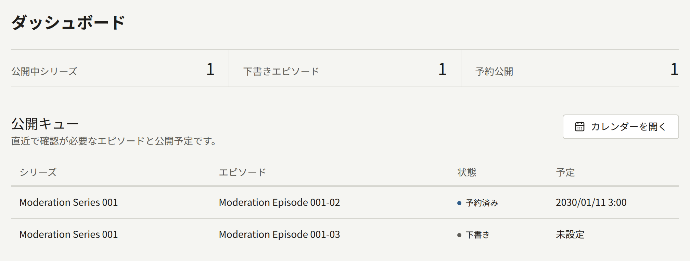
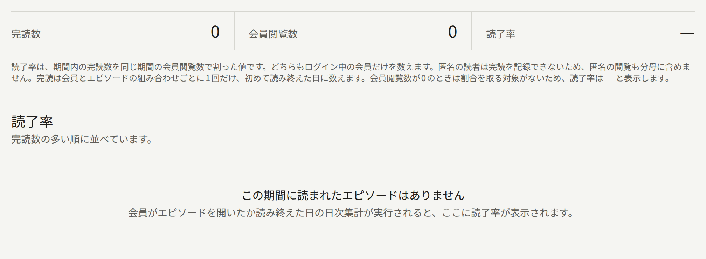
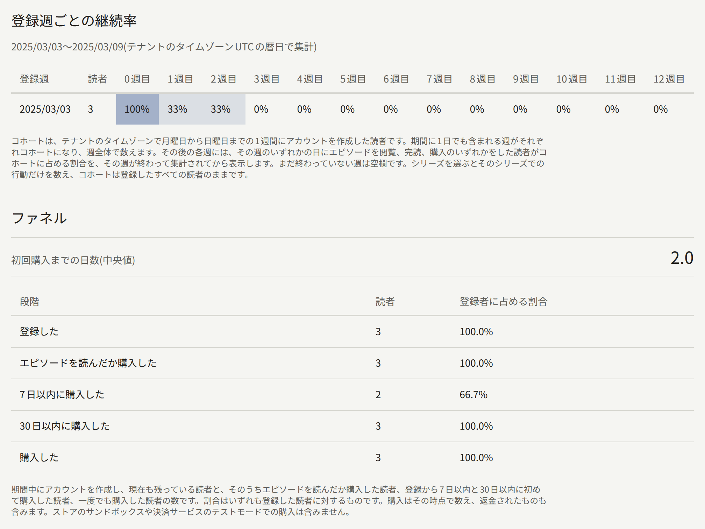
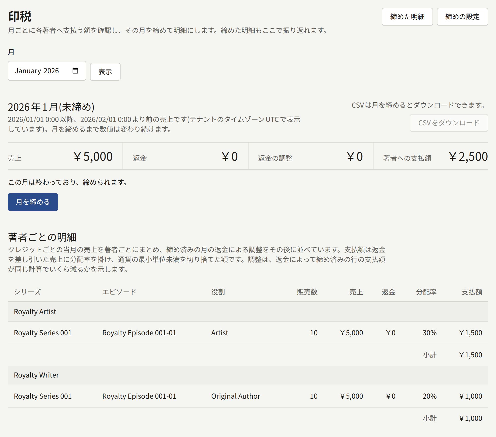
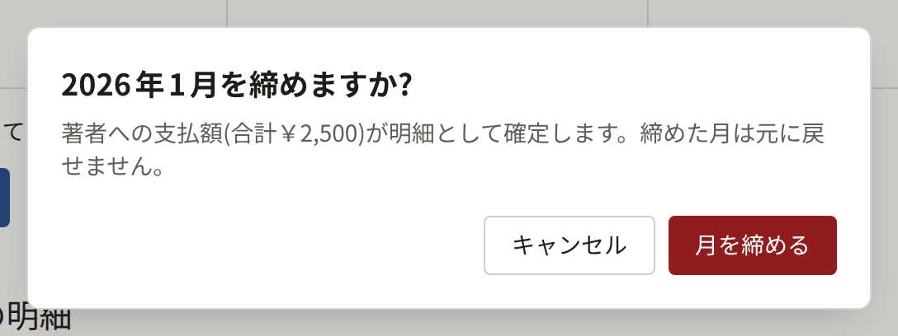
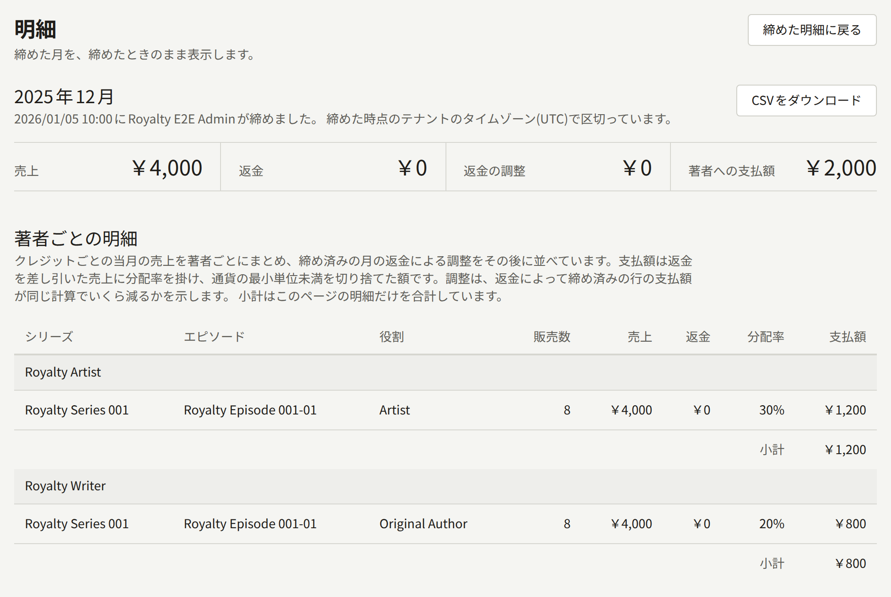
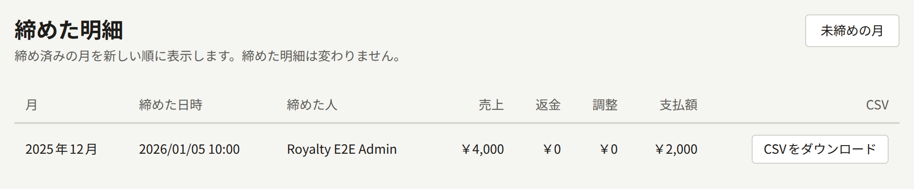
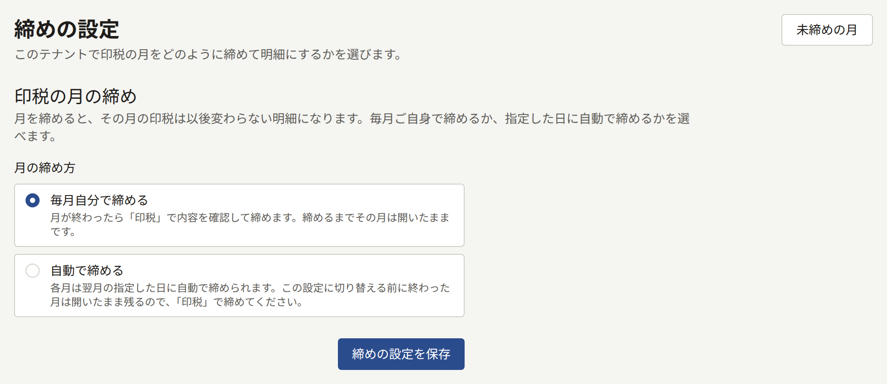

管理画面には、サイトでの出来事を数字で確認できる画面がいくつかあります。**ダッシュボード**では、作品の公開がどこまで進んでいるかがわかります。**アナリティクス**の**売上**では何が売れたか、**読者の反応**では各シリーズが読者にどれだけフォローされ、読まれ、リアクションされたかがわかります。同じく**エピソード**では会員が各エピソードをどこまで読んだかと、読者がどのページで離れたか、**コホート**では週ごとに登録した読者がその後も訪れているかと、そのうち何人が購入したかがわかります。**レポート**の**印税**では、1か月の売上についてテナントが各著者に支払う額を計算し、その月を締めて、あとから変わることのない明細にします。

**ダッシュボード**、**読者の反応**、**エピソード**、**コホート**は、スタッフ全員に表示されます。**売上**と**印税**の画面、**コホート**の**ファネル**が表示されるのは**テナント管理者**だけです。レポートや明細のCSVのダウンロード、月の締め、締め方の変更も、**テナント管理者**だけができます。ほかのスタッフには、これらの画面と操作は表示されません。

## 販売や閲覧がどの日に数えられるか

これらの画面が集計に使う日付は、すべてテナントのタイムゾーンでの日付です。タイムゾーンは**設定** › **基本情報** › **タイムゾーン**で設定します。一度も設定していないテナントでは、Publiraの既定のタイムゾーンを使います。既定のタイムゾーンはオペレーターが決めます。1日はそのタイムゾーンの午前0時から次の午前0時まで、1か月は初日の00:00から翌月の初日の00:00までです。たとえば東京で4月1日の08:30に行われた販売は、`Asia/Tokyo`のテナントでは4月の販売になります。`UTC`のテナントでは、その時点はまだ3月31日の23:30なので、3月の販売になります。

- 販売は、購入が記録された時点で数えます。コンビニ決済のようにあとから支払われる方法では、支払いが完了した時点です。
- 閲覧は、会員がエピソードを開いた日か、読み終えた日で数えます。
- フォローはフォローした時点で数え、読者がフォローを外した時点か、アカウントを削除した時点で終わります。
- 明細は、その月を区切ったときのタイムゾーンをそのまま使い、月の下に「**締めた時点のテナントのタイムゾーン(UTC)で区切っています。**」のように表示します。

明細を締めたあとでタイムゾーンを変えても、その明細は締めたときのままです。その次の月は、明細が終わった時点、つまり古いタイムゾーンの午前0時に始まり、新しいタイムゾーンの午前0時に終わります。2つの午前0時のあいだに行われた販売は、古いタイムゾーンで属していた月に1回だけ数えます。それ以降の月は、新しいタイムゾーンの午前0時から午前0時までです。**読者の反応**と**エピソード**は日次統計を使いますが、日次統計ですでに集計した日は集計し直しません。タイムゾーンの変更は、次に集計する日から反映されます。**売上**と、**読者の反応**のフォロワーは、販売やフォローそのものから集計するので、すぐに新しいタイムゾーンで数えます。

## ダッシュボード

管理画面の最初の項目である**ダッシュボード**は、作品の公開状況をまとめた画面です。販売や閲覧の状況は表示しません。3つの数値は期間を区切らず、テナント全体を数えます。

| 数値                 | 数えるもの                           |
| -------------------- | ------------------------------------ |
| **公開中シリーズ**   | 公開されているシリーズ               |
| **下書きエピソード** | 下書きとして保存されているエピソード |
| **予約公開**         | 公開日時がまだ来ていないエピソード   |

**公開キュー**には、それらのエピソードが最大10件表示されます。予約済みのエピソードが公開日時の近い順に先に並び、そのあとに下書きが新しい順に並びます。**予定**はテナントのタイムゾーンで表示され、日時を決めていない下書きでは**未設定**と表示されます。横にある**カレンダーを開く**を選ぶと[カレンダー](./1-catalog/2-episodes.md#公開予定の確認)が開き、予約済みと公開済みのすべてのエピソードを公開日ごとに確認できます。

画面は、スタッフがシリーズやエピソードを保存するとすぐに更新されます。予約済みのエピソードが自動で公開されたときも更新され、そのエピソードはキューから外れます。

## アナリティクス

**売上**、**読者の反応**、**コホート**、エピソードの離脱は、テナントの日付で区切った期間について集計します。期間は**開始日**と**終了日**で選び、**適用**を押します。指定できる期間は最長366日です。期間を選ばない場合は昨日までの28日間が対象になり、日付の下の行に期間とタイムゾーンが表示されます。**リセット**を押すと、この28日間に戻ります。

各画面の上部には期間の合計と日ごとのグラフがあり、その下に表があります。表の行は**日別**、**シリーズ別**、**エピソード別**から選べます。列の見出しを選ぶとその列で並べ替わり、もう一度選ぶと逆順になります。期間、行の種類、並び順はすべてページのアドレスに含まれるので、ブックマークやリンクから同じレポートを開けます。

日次統計を使う数値は、その日が終わってから反映されます。`publira worker`は、テナントのタイムゾーンで午前0時を過ぎたあと、1時間ごとの次の処理でその日を集計します。このため、今日の閲覧は明日になってから表示されます。`publira worker`が止まっているあいだは新しい日が集計されず、再び動き出すと、集計できなかった日の分をさかのぼって集計します。`publira worker`を動かし続ける方法は[構成の概要](../2-deployments/1-overview.md)で説明しています。

### 売上

**売上**では、期間内に売れたものをテナントの通貨で確認できます。

| 数値 | 数えるもの |
| --- | --- |
| **購入数** | 期間内の購入の数で、返金されたものも含みます |
| **総売上** | それらの購入で支払われた金額 |
| **返金額** | それらの購入について読者に返った金額で、返金と、テナントが負けた異議申し立ての分です |
| **純売上** | **総売上**から**返金額**を引いた、テナントの手元に残った金額 |

グラフは日ごとの純売上です。販売は行われた日に数え、その販売で読者に返った金額は、どれだけあとで返った場合でも販売と同じ日から差し引きます。このため、一度表示された日の数値があとから下がることがあり、売れた額より返った額が多い日はグラフで0より下に描かれます。結論の出ていない異議申し立ては、テナントが負けるまで何も差し引きません。巻やシリーズの残りのエピソードの購入は、読めるようになった各エピソードの販売としては、価格のうちそのエピソードの分で数えます。この分は、印税明細で計上されるのと同じ額です。シリーズの販売としては、価格全体で数えます。テナントの現在の通貨とは違う通貨で支払われた購入は、どの数値にも含まれません。テナントのコインで支払われたエピソードは、そのコインに支払われた金額の販売として数えます。これも印税明細で計上されるのと同じ額です。コインのパックの購入はどの数値にも含まれず、その代金はコインが使われるたびに数えます。パックが全額返金されたり、パックの支払いに異議が申し立てられたりした場合は、使われたコインによる販売から差し引きます。**売上**は購入そのものから集計するので、たった今行われた販売もすでに含まれています。

### 読者の反応

**読者の反応**では、期間内にテナントのシリーズが読者にどれだけフォローされ、読まれ、リアクションされたかを確認できます。

| 数値 | 数えるもの |
| --- | --- |
| **フォロワー** | 期間の終わりにフォローしている読者の数です。フォローはした時点ですぐに数え、読者がフォローを外すかアカウントを削除すると終わります |
| **閲覧数** | シリーズのページとそのエピソードが閲覧された回数です。ログインしているかどうかにかかわらず、すべての読者の閲覧を数えます |
| **完読数** | 会員がシリーズのエピソードを初めて読み終えた回数 |
| **リアクション** | 読者がエピソードのリアクションを押し、そのエピソードへの読者のスコアが増えた回数 |

グラフは各日の終わりのフォロワー数です。**シリーズ別**にはすべてのシリーズが並び、期間内に増えたフォローと終わったフォロー、**評価**、**評価した読者**が表示されます。**評価**と**評価した読者**は期間内のものではありません。シリーズのページに表示されるのと同じ現在の評価で、これまでに集まったすべてのリアクションをもとにしています。誰も評価していないシリーズには`—`と表示されます。

### エピソード

**エピソード**では、会員が開いたエピソードをどれだけ読み終えたかを確認できます。ほかの画面でどの期間を表示していても、この画面の数値は、テナントのタイムゾーンで昨日までの直近28日間が対象です。タイトルの下の行に日付とタイムゾーンが表示されます。

| 数値 | 数えるもの |
| --- | --- |
| **完読数** | 会員がエピソードを読み終えた数です。何度読み直しても、会員1人につきエピソードごとに1回、初めて読み終えた日に数えます |
| **会員閲覧数** | ログインしている会員がエピソードを開いた回数です。1人の会員が1つのエピソードを開いた回数は、時計の30分単位(毎時0分から29分までと、30分から59分まで)で1回と数えます。同じ30分のうちに開き直しても増えませんが、10:29に開いて10:30にもう一度開くと2回になります |
| **読了率** | **完読数**を**会員閲覧数**で割った値です。閲覧がない場合は`—`と表示されます |

数えるのはログインしている会員だけです。ログインしていない読者は読み終えたことを記録できないので、その閲覧も数えません。会員がどうやってエピソードを読んだかは関係なく、購入したエピソードも、チケットで読んだエピソードも、無料のエピソードも同じように数えます。購入しただけで読んでいなければ、何も数えません。

**読了率**の一覧には、期間内に読まれたエピソードが完読数の多い順に、1ページ20件ずつ並びます。上部の合計は、どのページを表示していても期間全体の値です。

#### 離脱

**読了率**の一覧でエピソードを選ぶと、そのエピソードの**離脱**が開きます。期間内に読者がエピソードのどこまで読み進めたかを、ページごとに確認できます。

| 数値                     | 数えるもの                             |
| ------------------------ | -------------------------------------- |
| **読者**                 | 最初のページに到達した読者             |
| **最後のページまで到達** | エピソードの最後のページに到達した読者 |
| **ページ数**             | 現在のエピソードのページ数             |

グラフは最初のページから最後のページに向かって階段状に下がります。表には、ページごとに、そのページに到達した読者の数、それが最初のページに到達した読者に占める割合、そのページで離れた読者の数が表示されます。そのページで離れた読者とは、そのページには到達したものの、次のページには到達しなかった読者です。**ここで離脱**で並べ替えると、離れた読者がいちばん多いページが先頭に来ます。読者は、1日の終わりの時点でエピソード内の読書位置があったページで数えます。このため、期間内に何日か読んだ読者は、日ごとに1回ずつ数えます。最後のページより後ろにあり「**(削除済み)**」と表示されるページは、エピソードからページを削除する前に到達されたページです。

### コホートとファネル

**コホート**では、期間内の各週に登録した読者のその後を追います。ここでいう読者は、テナントのサイトのアカウントです。スタッフ自身のアカウントは含みません。

**登録週ごとの継続率**には、期間に1日でも含まれる週ごとに1行があります。週はテナントのタイムゾーンで月曜日から日曜日までなので、最初の行が**開始日**より前から始まったり、最後の行が**終了日**よりあとまで続いたりすることがあります。各行には、週と、その週にアカウントが作成された読者の数が表示されます。**0週目**から**12週目**の列には、登録した週とそのあとの12週のそれぞれで、どこかの日にエピソードを閲覧したか、読み終えたか、購入した読者の割合が表示されます。1週のうちに何日訪れても、読者は1回と数えます。セルの色が濃いほど割合が大きいことを示します。週が表に反映されるのは、その週が終わって各日の集計が済んでからです。このため、進行中の週は空欄になります。誰も登録しなかった週の行には`—`と表示されます。

**シリーズ**でシリーズを選ぶと、そのシリーズの閲覧と購入だけを数えます。行は変わらず登録したすべての読者なので、割合は、その週の新しい読者のうちどれだけがそのシリーズに進んだかを示します。

**テナント管理者**に表示される**ファネル**では、期間内に登録した読者がどの段階まで進んだかを数えます。

| 段階 | 数えるもの |
| --- | --- |
| **登録した** | 期間内にアカウントが作成され、現在もアカウントが残っている読者 |
| **エピソードを読んだか購入した** | そのうち、集計済みのいずれかの日にエピソードを閲覧したか、読み終えたか、購入した読者 |
| **7日以内に購入した** | そのうち、アカウントの作成から7日未満で初めて購入した読者 |
| **30日以内に購入した** | 同じく、30日未満で初めて購入した読者 |
| **購入した** | そのうち、一度でも購入したことのある読者 |

**登録者に占める割合**は、各段階の数を**登録した**の数で割った値です。「**初回購入までの日数(中央値)**」は、購入した読者について、アカウントの作成から初回購入までの日数の中央値です。購入した読者が1人もいないあいだは`—`と表示されます。購入は行われた時点ですぐに数え、返金されたものも含みます。ストアのサンドボックスや決済プロバイダのテストモードでの購入は数えません。

削除されたアカウントは、所属する行とそれに基づくすべての数から、すぐに外れます。これらの画面が数える閲覧と購入は、Publiraが記録を始めた日から保存されています。**コホート**が追加されたリリースにアップグレードしたPubliraでは、アップグレードの時点で残っていたアナリティクスのイベントのうち、いちばん古い日から記録があります。それより前の週には、その週に登録した読者は表示されますが、その読者が何をしたかは表示されず、あとから埋まることもありません。

### レポートをCSVでダウンロードする

**売上**、**読者の反応**、**離脱**の表の横にある**CSVをダウンロード**を選ぶと、画面に表示されている期間のレポートを、表と同じ単位(日別、シリーズ別、エピソード別)でダウンロードできます。ファイルには、表をどう並べ替えていても、レポートのすべての行がレポート本来の順に入ります。日付は日付順、**売上**のシリーズやエピソードは純売上の多い順、**読者の反応**のシリーズはフォロワーの多い順、離脱のページはページ順です。**エピソード**の**読了率**と**コホート**はダウンロードできません。

ファイル名は、レポート、テナント、期間をもとに`revenue-by-series-<tenant>-2025-03-03--2025-03-09.csv`のように付きます。離脱では`drop-off-<tenant>-<episode>-<from>--<to>.csv`です。ファイルはUTF-8で、Excelで正しく読めるようにバイトオーダーマークを付けています。1行目がヘッダーで、その下にレポートの1行につき1行が続き、合計の行はありません。列は次のとおりです。

| レポート | 列 |
| --- | --- |
| 日別の売上 | `date`, `purchase_count`, `gross_amount`, `refunded_amount`, `net_amount`, `currency` |
| シリーズ別の売上 | `start_date`, `end_date`, `series_id`, `series_title`, `purchase_count`, `gross_amount`, `refunded_amount`, `net_amount`, `currency` |
| エピソード別の売上 | `start_date`, `end_date`, `series_id`, `series_title`, `episode_id`, `episode_title`, `purchase_count`, `gross_amount`, `refunded_amount`, `net_amount`, `currency` |
| 日別の読者の反応 | `date`, `follower_count`, `followed_count`, `unfollowed_count`, `view_count`, `complete_count`, `reaction_count`, `reaction_points` |
| シリーズ別の読者の反応 | `start_date`, `end_date`, `series_id`, `series_title`, `follower_count`, `followed_count`, `unfollowed_count`, `view_count`, `complete_count`, `reaction_count`, `reaction_points`, `rating_average`, `rating_count` |
| 離脱 | `start_date`, `end_date`, `episode_id`, `page_index`, `reader_count` |

`date`、`start_date`、`end_date`はテナントの日付で、`YYYY-MM-DD`形式です。`start_date`と`end_date`はダウンロードした期間を表し、すべての行で同じ値です。金額は通貨の最小単位で、JPYなら円、USDならセントです。`currency`はテナントの通貨です。`rating_average`は小数1桁で、誰も評価していないシリーズでは`0.0`になります。`page_index`は最初のページを`0`として数え、`reader_count`はそのページに到達した読者の数です。タイトルはテナントの既定の言語で書き出されます。IDも書き出されるので、タイトルが変わっても、行がどのシリーズやエピソードのものかがわかります。スプレッドシートで数式として読まれてしまうセルは、テキストとして読まれるように書き出します。

レポートはダウンロードした時点で集計するので、今日を含む期間では、あとでダウンロードすると数値が変わることがあります。ダウンロードするたびに、**監査ログ**に**アナリティクスのCSVダウンロード**として記録されます。

## 印税

**印税**では、著者がクレジットされているエピソードの売上について、各著者に支払う額を月ごとに計算します。月は締めるまで開いたままで、販売、返金、取り分の変更があるたびに数値が変わります。月を締めると、以後変わることのない明細ができます。テナントはこの明細をもとに著者に支払います。Publiraが誰かに支払うことはなく、明細は支払うべき額の記録です。

### 著者に支払う額

著者には、クレジットされている各エピソードについて取り分が支払われます。取り分はクレジットごとに、エピソードの売上に対するパーセントで設定します。エピソードの取り分の合計を除いた残りは、出版社のものです。

- **シリーズのフォーム**では、**著者**の「**著者1の取り分**」などの欄で、各クレジットの取り分を設定します。ここでのクレジットは新しいエピソードを作成するときのひな形で、変更しても既存のエピソードはそのままです。
- **エピソードの画面**では、**著者**でそのエピソードのクレジットと取り分を変更し、**著者を保存**で保存します。
- **シリーズのエピソード一覧**では、**クレジット** › **取り分を設定**で、1つのクレジットの取り分を複数のエピソードでまとめて変更できます。

取り分は0から100パーセントで、小数点以下2桁まで指定できます。1つのエピソードの取り分の合計は100以下です。取り分を0にすると、著者をクレジットしたまま支払いなしにできます。編集担当も作品を編集するので、取り分を設定できます。

各クレジットの1か月の支払額は次のとおりです。

> (その月のエピソードの売上 − その売上への返金) × 取り分を、円やセントなどテナントの通貨の最小単位で切り捨てた額

1か月の売上に含まれるのは次のものです。

- サイトでStripeかPAY.JPを通じて行われたエピソードの購入。読者が支払った価格で数えます。
- そのエピソードを含む巻のサイトでの購入。読者が支払った価格のうち、そのエピソードの分を、エピソードの販売として数えます。価格は、購入が記録された時点の各エピソードの価格に比例して巻のエピソードに配分します。どのエピソードにも価格がない場合は均等に配分します。このため、価格の付いたエピソードがある巻では、無料のエピソードには配分がなく、販売もありません。配分は購入時に決まり、そのあとでエピソードの価格や巻の収録内容を変えても変わりません。巻の一部返金も同じ比率で配分し、各エピソードの分は切り捨てます。
- シリーズの残りのエピソードのサイトでの購入。読者が支払った価格のうち、各エピソードの分を、読めるようになった各エピソードの販売として数えます。各エピソードの分は、読者が決済を始めた時点で決まります。まとめ買い割引は、各エピソードの販売価格(キャンペーン中ならキャンペーン価格)に比例して配分するので、あとでエピソードの価格やシリーズの割引を変えても変わりません。プロモーションコードで読者の支払額が決済の価格より少なくなった場合は、各エピソードの分も同じ比率で減らします。一部返金は価格と同じ比率で配分し、各エピソードの分は切り捨てます。
- テナントのアプリでのApp StoreかGoogle Playを通じた購入。エピソードの価格で数えます。ストアの手数料は差し引きません。
- サイトかアプリでの、テナントのコインによるエピソードの購入。使ったコインに支払われた金額で数えます。パックのコイン1枚の価値は、ボーナスコインも含めて、読者がパックに支払った金額を等分した額です。つまりボーナスは、テナントが行う値引きにあたります。たとえば、100コインのボーナスを含む1,100コインのパックを1,000円で購入した場合、コイン1枚の価値は0.909円です。100コインのエピソードは、通貨の最小単位で切り捨てて90円の販売になります。支払いなしで付与されたコインの価値は0です。テスト購入のコインと、テナントの現在の通貨とは違う通貨で支払われたパックのコインも、価値は0です。販売の額はコインを使った時点で決まり、そのあとでパックを編集しても変わりません。

金額はすべてテナントの通貨で、締めた明細は締めたときの通貨のままです。別の通貨で支払われた購入が起きるのは、テナントが通貨を変更する前に始めた支払いを、読者がそのあとで完了した場合だけです。この購入でエピソードは読めるようになりますが、明細では販売になりません。

これ以外は販売ではありません。コインのパックの購入も販売ではなく、その代金は、コインが使われるたびにそのコインによる販売になります。アクセスチケット、**待てば無料**、無料公開期間、著者が自分のエピソードを読む場合は、販売なしでエピソードが読めます。App StoreのサンドボックスやPlayのライセンステスターによる購入と、StripeやPAY.JPのテスト用のキーで行った購入はテストなので、含みません。

全額返金された購入は、購入した月の売上から外れます。一部返金では販売は残り、返金額が**返金**として差し引かれます。どちらの場合も、購入した月がまだ締められていなければ、返金は返金した月ではなく購入した月に計上します。

Stripeの支払いに対する[異議申し立て](./4-selling-episodes.md#異議申し立て)で、読者のカード会社がテナントに不利な判断をした場合、その支払いは、Stripeが判断を知らせた時点から全額返金として扱います。月を締める前でも締めたあとでも同じです。結論の出ていない異議申し立てと、テナントに有利な判断が出た異議申し立てでは、販売はそのまま残ります。

コインのパックが全額返金されたり、異議を申し立てられたりすると、そのパックの使用済みのコインで支払った各購入について、そのコインの価値の分が返金されます。読者は読めるようになったエピソードをそのまま読めるので、各購入は販売として残り、その額が**返金**に入ります。購入に使ったコインがすべてそのパックのものなら価格の全額が、一部がほかのパックのものならそのパックの分が**返金**になります。ほかの返金と同じく、購入した月がまだ締められていなければその月に計上し、締めたあとなら次の明細から差し引きます。

### 締めたあとの返金

購入した月を締めたあとに記録された返金で、その月の明細を変えることはできません。代わりに、そのあとで締める次の明細から、調整行として差し引きます。調整行は、販売を計上した締め済みの行と同じ著者、シリーズ、エピソード、役割の行で、どの締め済みの月の調整かが示されます。調整行は、その月自体の行のあとに並びます。調整行の数値は変化分なので、販売の行で正の値になる項目は負の値になります。

- **販売数**は全額返金された購入の数をマイナスにしたもの、**売上**はその価格をマイナスにしたものです。
- **返金**は、まだ販売として残っている購入の返金額の変化分です。締めた時点で一部返金されていた購入が、そのあと全額返金された場合は負になります。その購入は、今度は**売上**のほうで差し引かれるためです。
- **支払額**は、返金によって締め済みの行の支払額から差し引く額です。締めた月に適用した取り分を使い、以前と同じように切り捨てて、残った売上から行の支払額を計算し直し、元の支払額との差を求めます。締めたあとで取り分を変えたり、著者をクレジットしたりしても、この額は変わりません。締め済みの行と調整行を合わせると、返金が締める前に記録されていた場合にその行で支払われていた額になります。行のすべての販売が返金されれば、合わせた支払額は0になります。

返金のどの部分も、差し引くのは1回だけです。ある締めのあとで一部返金され、次の締めのあとで全額返金された購入は、2回の調整で差し引きます。2回目の調整では1回目で差し引かなかった分を差し引き、明細を合わせるとその購入への支払いは0になります。

調整が繰り越されるのは、調整の対象の月よりあとの月だけです。順番を飛ばして、前の月より先に締めた月には、その前の月の返金は繰り越されません。前の月の返金は、両方を締めたあとに締める次の月に繰り越されます。ある月の調整がその月自体の売上を上回ると、その月の**著者への支払額**は負になります。著者の調整がその著者の販売の行を上回った場合も、その著者の小計は負になります。

### 未締めの月を確認する

**印税**を開くと、最新の締めた明細の翌月が表示されます。まだ1か月も締めていない場合は先月が表示されます。**月**で選んで**表示**を押せば、締めておらず、すでに始まっているほかの月も開けます。

**未締めの月**には、4つの合計が表示されます。

| 合計 | 内容 |
| --- | --- |
| **売上** | その月のすべての販売を価格で合計した額です。著者がクレジットされていないエピソードの販売も含みます |
| **返金** | それらの販売への返金 |
| **返金の調整** | 締めたあとに返金された締め済みの月の販売について、その月で差し戻す額で、[締めたあとの返金](#締めたあとの返金)で説明しています。各販売は1回だけ数え、0か負の額になります |
| **著者への支払額** | その月に著者へ支払う額で、調整を含む下の明細行の合計です。**売上**から**返金**と**返金の調整**を引いた残りは、出版社のものです |

**著者ごとの明細**では、その月の明細が著者ごとにまとめられます。その月に売れたエピソードのクレジットごとに1行があり、著者ごとに**小計**があります。各行には**シリーズ**、**エピソード**、クレジットの**役割**、**販売数**、**売上**、**返金**、**分配率**、**支払額**が表示されます。同じエピソードに2つの役割でクレジットされている著者には、役割ごとに行があります。調整行は、その著者のまとまりのなかでその月自体の行のあとに並び、エピソードの下に「**2025年12月分の返金の調整**」のように、どの締め済みの月の調整かが示されます。調整行も著者の**小計**に含まれます。

合計の上には、その月の状態が表示されます。

- 「**この月はまだ進行中です。**」と表示されている月は、テナントのタイムゾーンで最終日が終わると締められるようになります。
- 「**この月は終わっており、締められます。**」と表示されている月は、**月を締める**で締めます。
- 「**この月は2026/02/05に自動で締められます。**」のように表示されている月は、その日付に`publira worker`が締めます。管理画面から手動で締めることはできません。

### 月を締める前に

月を締めると、その時点の内容で確定し、そのあとに起きたことは反映されません。締める前に、次の点を確認してください。

- **クレジットと取り分**を確認します。明細では、エピソードが売れた時点ではなく、月を締めた時点の取り分を使います。締める前に取り分を変えると、その月全体が新しい取り分で支払われます。締めたあとに変えた場合、新しい取り分が使われるのは未締めの月だけです。
- **予定している返金**が済んでいるかを確認します。[締めたあとの返金](#締めたあとの返金)で説明するとおり、締めたあとに記録された返金は、締めた月ではなく次の明細から差し引かれます。著者にはいったんその販売の分が支払われ、あとの月の支払額から取り戻します。返金があるとわかっている場合は、購入した月に計上されるよう、返金を待ってから締めてください。
- **月が終わっていること**を確認します。最終日の遅い時間の販売は、テナントのタイムゾーンで数えます。テナントのタイムゾーンは、あなたのいる場所のタイムゾーンと違うことがあります。

月は順番に締めてください。管理画面が最新の明細の翌月を表示するのはこのためです。飛ばした月をあとで締めるには、**月**でその月を選ぶ必要があります。

### 月を締める

1. **レポート** › **印税**を開きます。表示されている月が、次に締める月です。
2. 「**この月は終わっており、締められます。**」と表示されていることを確認し、**著者ごとの明細**に目を通します。
3. **月を締める**を選びます。ダイアログに、確定する**著者への支払額**が表示されます。もう一度**月を締める**を選んで確定します。

締めると、管理画面にその月の**明細**が開きます。明細には「**2026/01/05 10:00にRoyalty E2E Adminが締めました。**」のように、締めた日時と締めた人が表示され、未締めの月と同じ合計と明細行が並びます。締めたことは**監査ログ**に**印税の月締め**として記録されます。

締めた明細では、著者、シリーズ、エピソード、役割の名前が締めた時点のまま残ります。そのあとで著者の名前を変えたり、取り分を編集したり、購入を返金したり、クレジットを削除したりしても、明細は変わりません。そのあとで記録された返金は、代わりに次の明細から差し引かれます。締めた月は、スタッフもオペレーターも開き直せません。あとで誤りが見つかった場合は、Publiraの外で、テナントが支払う額で調整してください。

**締めた明細**には、締めたすべての月が新しい順に並び、締めた日時、締めた人、合計が表示されます。自動で締めた月は、**締めた人**が`—`になります。

### 明細をCSVで書き出す

**CSVをダウンロード**で、締めた明細をダウンロードできます。**明細**の画面からも、**締めた明細**の各行からもダウンロードできます。未締めの月は数値がまだ変わるので、ダウンロードできません。

ファイル名は`royalties-<tenant>-<YYYY-MM>.csv`です。ファイルはUTF-8で、Excelで正しく読めるようにバイトオーダーマークを付けています。1行目がヘッダーで、その下に明細の1行につき1行が続き、合計の行はありません。列は次のとおりです。

| 列 | 内容 |
| --- | --- |
| `period` | 月(`YYYY-MM`形式) |
| `creator_id`, `creator_name` | 著者 |
| `role_id`, `role_name` | クレジットの役割。役割のないクレジットでは空です |
| `series_id`, `series_title` | シリーズ |
| `episode_id`, `episode_title` | エピソード |
| `sale_count` | 販売数 |
| `gross_amount` | 売上。単位は明細の通貨の最小単位で、JPYなら円、USDならセントです |
| `refunded_amount` | 売上への返金。単位は`gross_amount`と同じです |
| `share_percent` | 取り分。`12.50`のように小数2桁です |
| `payout_amount` | 支払額。単位は`gross_amount`と同じです |
| `currency` | `USD`のような明細の通貨。月を締めたときのテナントの通貨で、明細ではこの通貨の売上だけを数えます |
| `adjusted_period` | その月自体の販売の行では空です。調整行では、返金を差し戻す対象の締め済みの月が`YYYY-MM`形式で入り、金額は[締めたあとの返金](#締めたあとの返金)で説明した負の変化分になります |

名前は締めた時点のものです。IDも書き出されるので、名前が変わっても、行がどの著者やエピソードのものかがわかります。スプレッドシートで数式として読まれてしまうセルは、テキストとして読まれるように書き出します。同じ明細からは毎回同じファイルがダウンロードされ、ダウンロードするたびに**監査ログ**に**印税明細のCSVダウンロード**として記録されます。

### 月を自動で締める

**印税**の**締めの設定**で、月の締め方を選びます。

- **毎月自分で締める**が既定の設定です。テナント管理者が上の手順で締めるまで、月は開いたままです。
- **自動で締める**では、各月を翌月の**締め日**に締めます。締め日は、テナントのタイムゾーンで1日から28日のいずれかです。

**締めの設定を保存**を選ぶと、選んだ締め方が適用されます。変更は**監査ログ**に**印税の締めの設定更新**として記録されます。

自動の締めは、締め日の午前0時を過ぎてから、`publira worker`が最初に行う1時間ごとの処理で実行されます。**月を締める**とまったく同じように月を締め、**締めた人**には誰も記録しません。締め日に`publira worker`が止まっていた場合は、再び動き出したときに、締めるべき月を古い順に締めます。`publira worker`が動いていなければ、どの月も自動では締められません。

**自動で締める**は、選んだあとに終わる月から適用されます。切り替えた時点ですでに終わっている月は手動で締めるので、上の手順で**印税**から締めてください。自動で締める前には誰にも確認を求めないので、[月を締める前に](#月を締める前に)の確認ができるだけの余裕がある**締め日**を選んでください。取り分の修正は、締め日のあとではなく前に済ませてください。
