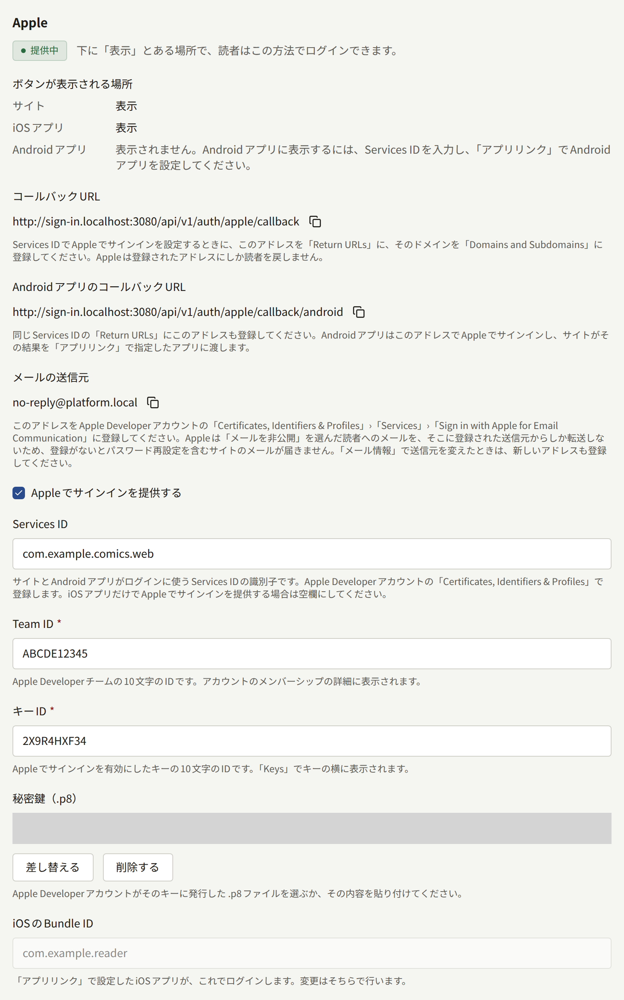
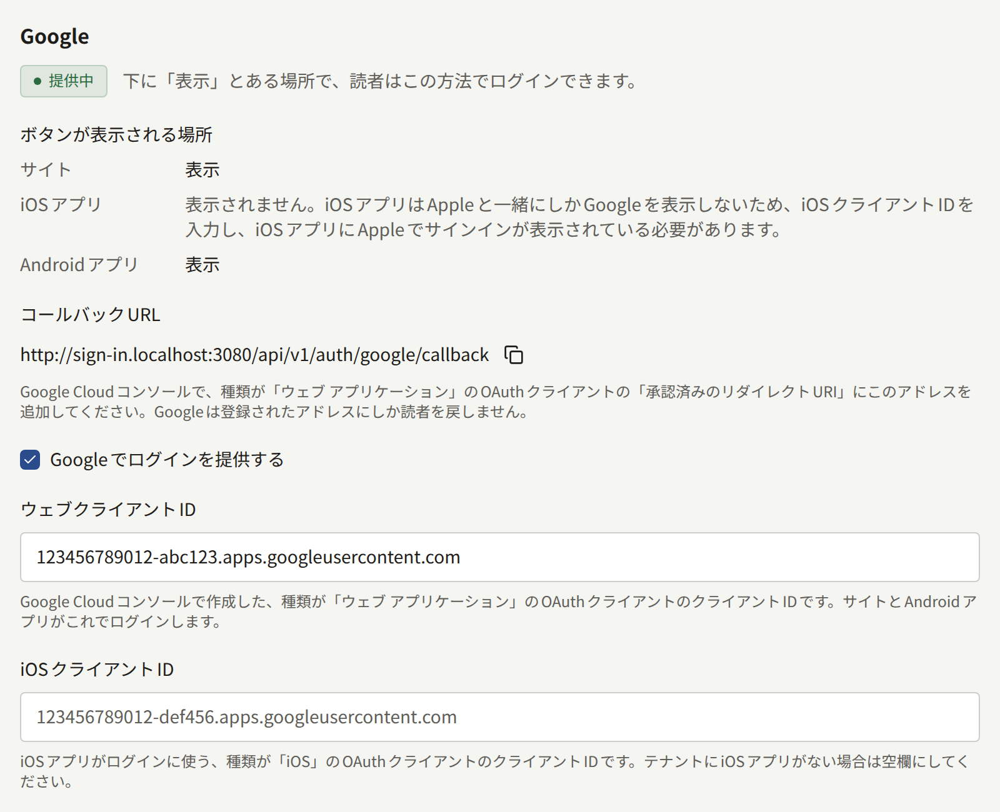

読者は、メールアドレスとパスワードでテナントのサイトにログインします。**外部連携** › **ログイン**を設定すると、そのフォームの横に**Appleで続ける**と**Googleで続ける**の2つのボタンが追加され、読者はすでに持っているアカウントで会員登録とログインができるようになります。このページでは、テナント管理者向けに、サイトで両方のプロバイダーを設定する手順を説明し、設定後に読者に何が見えるかを説明します。アプリも同じ設定を共有します。アプリだけに必要なものは[アプリ内課金とログイン](../5-mobile-app/5-purchases-and-sign-in.md#appleとgoogleでのログイン)にあります。

**ログイン**はテナント管理者にだけ表示され、保存のたびに**監査ログ**に**ログイン方法の設定更新**として記録されます。

## 始める前に

- **サイトが独自のドメインで、HTTPSで提供されていること。** AppleとGoogleが読者を戻すのは、事前に登録されたHTTPSのアドレスだけです。そのアドレスは管理画面のホストではなく、テナントの公開サイトのドメイン上にあります。
- **Appleでは、Apple Developer Programのメンバーシップ。** 読者がログイン先として目にすべき組織の名義のものです。テナントにアプリがある場合は、アプリを公開しているのと同じメンバーシップです。
- **Googleでは、Google Cloudのプロジェクト。** こちらも出版社が所有するものです。[プッシュ通知](../5-mobile-app/3-push-notifications.md)のために作成したFirebaseのプロジェクトはGoogle Cloudのプロジェクトなので、それを使えます。
- **テナントにアプリがある場合**は、[アプリリンク](../5-mobile-app/4-app-links.md)で説明するとおり、先に**外部連携** › **アプリリンク**を入力しておきます。Appleでサインインは、そこで指定したアプリを信頼します。

**外部連携** › **ログイン**を開き、開いたままにしておきます。各プロバイダーの節には、コピー用のボタンとともに**コールバックURL**が表示されます。以下の手順で、これをプロバイダーに登録します。このURLはサイトのドメインをもとに作られます。

| プロバイダー | コールバックURL                                          |
| ------------ | -------------------------------------------------------- |
| Apple        | `https://comics.example.com/api/v1/auth/apple/callback`  |
| Google       | `https://comics.example.com/api/v1/auth/google/callback` |

Appleの節には2つ目のアドレスとして**AndroidアプリのコールバックURL**が表示されます。これはAndroidアプリだけが使います。

後でオペレーターがテナントを別のドメインに移すと、これらのアドレスもそれに合わせて変わります。[テナント](../3-operations/2-tenants.md)でも触れているとおり、新しいアドレスを両方のプロバイダーに登録する必要があります。

## Appleでサインイン

Apple側のものはすべて、Apple Developerアカウントの**Certificates, Identifiers & Profiles**で作成します。

### Apple Developerアカウントで作成するもの

1. **Sign in with Appleを有効にしたApp ID。** **Identifiers**で、テナントのiOSアプリのApp IDを開くか、テナントにアプリがない場合は新しく登録し、**Sign in with Apple**の機能を有効にします。残りの2つの識別子はこのApp IDの下にまとめられ、AppleはこれをプライマリーApp IDと呼びます。
2. **Services ID。** **Identifiers**で、サイトの名前など読者の目に触れることのある説明と、`com.example.comics.web`のような識別子を付けてServices IDを登録します。そのServices IDで**Sign in with Apple**を有効にし、**Configure**を選びます。
   - **Primary App ID**：手順1のApp IDです。
   - **Domains and Subdomains**：`comics.example.com`のような、サイトのドメインだけです。
   - **Return URLs**：管理画面に表示されるAppleの**コールバックURL**です。テナントにAndroidアプリがある場合は、ここに**AndroidアプリのコールバックURL**も追加します。
3. **キー。** **Keys**で、**Sign in with Apple**を有効にし、同じプライマリーApp IDを設定したキーを登録します。表示される`.p8`ファイルをダウンロードします。Appleがこのファイルを提供するのは1回だけなので、安全な場所に保管してください。キーを失った場合は、新しいキーを登録して置き換えます。**Key ID**はキーの横に表示されます。
4. **Team ID。** アカウントのメンバーシップの詳細に表示されます。

### 管理画面での入力

**外部連携** › **ログイン**の**Apple**の節で、次のように入力します。

- **Services ID**：`com.example.comics.web`のような、Services IDの識別子です。サイトにAppleのボタンが表示されるのは、これが入力されている場合だけです。空欄にするのは、iOSアプリだけでAppleを提供する場合に限ります。
- **Team ID**と**キーID**：手順4と手順3の10文字のIDです。
- **秘密鍵（.p8）**：ダウンロードしたファイルを選ぶか、その内容を貼り付けます。
- **iOSのBundle ID**はここでは入力しません。**アプリリンク**で指定したiOSアプリが表示されます。

**Appleでサインインを提供する**をオンにし、**ログイン方法を保存**を選びます。

キーは読み出せません。後で開いたときには、キーが保存されていることだけが表示されます。**差し替える**で新しいキーに置き換え、**削除する**を選ぶと、保存したときにキーが削除されます。

## Googleでログイン

Google側のものはすべて、Google Cloudコンソールの出版社のプロジェクトで、**Google Auth Platform**の下に作成します。

### Google Cloudコンソールで作成するもの

1. **同意画面。** **ブランディング**で、読者がアカウントを選ぶときに表示される名前、サポート用のメールアドレス、**承認済みドメイン**にサイトのドメインを入力します。**対象**で**外部**を選び、どのGoogleアカウントでもログインできるようにして、アプリを本番環境に公開します。公開するまでは、そこに登録したテストユーザーしかログインできません。PubliraがGoogleに求めるのは読者の識別情報、メールアドレス、名前だけで、Googleはこれらを機密性の低いものに分類しているため、公開にあたってこれらの審査を待つ必要はありません。
2. **ウェブ アプリケーションのクライアント。** **クライアント**で、種類が**ウェブ アプリケーション**のOAuthクライアントを作成し、管理画面に表示されるGoogleの**コールバックURL**を**承認済みのリダイレクトURI**に追加します。**承認済みのJavaScript生成元**には何も入力しません。

Googleは新しいクライアントのクライアントシークレットを表示します。Publiraはこれを使わず、管理画面にも入力する欄はありません。

### 管理画面での入力

**外部連携** › **ログイン**の**Google**の節で、次のように入力します。

- **ウェブクライアントID**：ウェブ アプリケーションのクライアントのクライアントIDで、末尾が`.apps.googleusercontent.com`です。サイトにGoogleのボタンが表示されるのは、これが入力されている場合だけです。Androidアプリも同じクライアントでログインします。
- **iOSクライアントID**：iOSアプリだけが使う、iOSクライアントのクライアントIDです。テナントにiOSアプリがない場合は空欄にします。

**Googleでログインを提供する**をオンにし、**ログイン方法を保存**を選びます。

## 動作の確認

各プロバイダーの節には、その状態が表示されます。

| 状態 | 意味 |
| --- | --- |
| **提供中** | 有効で設定が揃っています。読者はこの方法でログインできます |
| **未完了** | 有効ですが、必要なものが不足しているため、読者には表示されません |
| **無効** | 保存されていますが、オフになっています |
| **未設定** | 何も保存されていません |

**提供中**のプロバイダーには、**ボタンが表示される場所**として、読者がそのボタンに出会う場所も表示されます。**サイト**、**iOSアプリ**、**Androidアプリ**です。それぞれに**表示**と表示されるか、その場所でボタンを表示するのにまだ必要なものが表示されます。

|  | Apple | Google |
| --- | --- | --- |
| サイト | **Services ID** | **ウェブクライアントID** |
| iOSアプリ | **アプリリンク**で指定したiOSアプリ | **iOSクライアントID**と、iOSアプリにAppleが表示されていること。アプリはAppleと一緒にしかGoogleを表示しないためです |
| Androidアプリ | **Services ID**と、**アプリリンク**で指定したAndroidアプリ | **ウェブクライアントID** |

そのため、プロバイダーが**提供中**でも、サイトには表示されないと示されることがあります。**Services ID**のないAppleや、**ウェブクライアントID**のないGoogleは、アプリだけに設定されています。アプリの**表示**は設定がそのアプリを対象にしていることを意味し、[アプリのページ](../5-mobile-app/5-purchases-and-sign-in.md#appleとgoogleでのログイン)で説明するとおり、アプリ自体もそれに合わせてビルドされている必要があります。iOSアプリでのGoogleは、ほかと比べてビルドへの依存が大きく、同じ**iOSクライアントID**でビルドしたアプリでしか表示されないため、その行には代わりに「**このiOSクライアントIDでビルドしたiOSアプリに表示されます。**」と表示されます。

変更は保存後まもなくサイトに反映されます。プライベートウィンドウでサイトのログインページを開き、**Appleで続ける**または**Googleで続ける**を選んでログインします。プロバイダー独自のエラーページに戻される場合は、たいていアドレスが一致していません。プロバイダーが報告するアドレスと**コールバックURL**を1文字ずつ比べてください。

## 読者に見えるもの

サイトの**ログイン**ページと会員登録ページでは、メールアドレスのフォームの下に、**または**で区切って**Appleで続ける**と**Googleで続ける**が表示されます。この方法で会員登録する読者は、パスワードを選ばず、メールアドレスの確認も行いません。プロバイダーがすでに確認しているためです。サイトが読者に利用規約やプライバシーポリシーへの同意を求めている場合は、初回のログインで**新規登録を完了**の画面に進み、読者が同意してからアカウントが作成されます。

サイトの**ログイン**ページには、パスキーを使えるすべてのブラウザーで、それらの横に**パスキーでログイン**も表示されます。これには**ログイン**での設定は必要ありません。サイトのパスキーを持っている読者は、メールアドレスもパスワードも入力せず、パスキーだけでログインできます。ボタンを選ぶか、ブラウザーがメールアドレス欄の候補にパスキーを表示したときにそれを選びます。テナントの管理画面用に作成したパスキーは別のもので、サイトへのログインには使えません。読者がプロンプトを閉じた場合や、サイトがパスキーを受け付けなかった場合は、ページにその旨が表示され、メールアドレスのフォームはそのまま残ります。アカウントが停止されている読者や、メールアドレスを一度も確認していない読者も、パスキーではログインできません。

アプリには、[アプリのページ](../5-mobile-app/5-purchases-and-sign-in.md#appleとgoogleでのログイン)で説明するとおり、設定が対象にしているスマートフォンで同じAppleとGoogleのボタンが表示されます。また、そのアプリが**アプリリンク**で指定したアプリである場合は、同じページの[パスキーでのログイン](../5-mobile-app/5-purchases-and-sign-in.md#パスキーでのログイン)で説明するとおり、**パスキーでサインイン**も表示されます。アカウントはどちらでも使えます。サイトでAppleで会員登録した読者はアプリにもAppleでログインでき、サイトで追加したパスキーでアプリにログインでき、その逆も同様です。

### 既存のアカウントとAppleやGoogleでのログイン

AppleやGoogleのアカウントは、テナントの1つの読者アカウントに連携されます。どのアカウントに連携されるかは、読者が初めてそれを使ったときに決まります。

- **読者がすでに同じメールアドレスのアカウントを持っている場合。** AppleやGoogleのアカウントはそのアカウントに連携され、読者は購入や履歴のある既存のアカウントにログインします。確認の手順はありません。AppleとGoogleがそのアドレスを確認しており、それはサイト独自の確認メールが求めるのと同じ証明だからです。
- **読者がそのアドレスのアカウントを持っているが、一度も確認していない場合。** AppleやGoogleのアカウントがそのアカウントを引き継ぎます。アカウントは連携され、アドレスは確認済みとみなされ、作成時に設定されたパスワードは削除されます。アドレスを確認できないままアカウントを作成した人は、そのアカウントをアドレスの持ち主に明け渡すことになります。
- **そのアドレスのアカウントがない場合。** プロバイダーから渡されたアドレスで、パスワードのない新しいアカウントが作成されます。

Appleで**メールを非公開**を選んだ読者は、自分のアドレスの代わりに`privaterelay.appleid.com`のアドレスをサイトに渡します。このアドレスはどの既存のアカウントとも一致しないため、新しいアカウントが作成されます。読者のアカウントとは別のアドレスのGoogleアカウントでも同様です。すでにアカウントを持っていてそれを使い続けたい読者は、メールアドレスでログインし、後で説明するとおり、**連携アカウント**からAppleやGoogleのアカウントをそのアカウントに連携します。

これらのログインではプロバイダーがアドレスを提供するため、**設定**にあるテナントの受け付けないメールアドレスは適用されません。アカウントが停止されている読者は、AppleやGoogleでもログインできません。

### 読者が管理できるもの

サイトの**設定** › **セキュリティ**と、アプリのアカウント画面にある**連携アカウント**には、読者がログインに使えるAppleとGoogleのアカウントが、それぞれ**連携を解除**とともに表示されます。また、サイトまたはアプリが提供しているプロバイダーのうち、アカウントにまだ連携されていないものには**連携する**が表示されます。**連携する**を選ぶと、読者はそのプロバイダーでログインするよう案内され、ログインしたアカウントが、どのアドレスであっても連携されます。そのため、**メールを非公開**のアドレスも、読者自身のアドレスと同じように連携できます。それ以降は、そのアカウントでログインすると、サイトでもアプリでも同じアカウントが開きます。

AppleやGoogleのアカウントがすでにサイトの別のアカウントへのログインに使われている場合（その別のアカウントで先に連携を解除する必要があります）と、読者のアカウントにすでにそのプロバイダーのアカウントが連携されている場合（別のアカウントを連携する前に連携を解除します）は、連携は拒否され、理由が画面に表示されます。

サイトの同じ画面には、読者の**パスキー**も、それぞれ追加した日時と最後にログインに使った日時、**削除**とともに表示されます。**パスキーを追加**を選ぶと、ブラウザーに新しいパスキーを求めます。パスキーは端末の画面ロック、パスワードマネージャー、またはセキュリティキーで保管されます。続いて、パスキーを見分けるための名前を求められますが、読者はこれを省略できます。それ以降は、**パスキーでログイン**でそのパスキーを使ってログインできます。この欄は、**ログイン**で何を設定しているかにかかわらず、パスキーを使えるすべてのブラウザーに表示され、読者は最大20個のパスキーを持てます。アプリのアカウント画面の**パスキー**には同じパスキーが表示され、追加や、それぞれの名前の変更と削除ができます。

AppleやGoogleで作成したアカウントにはパスワードがありません。同じ画面に**パスワード設定**があり、パスワードを設定するためのリンクをメールで送ります。設定すると、読者はメールアドレスでもログインできるようになります。それまでは次のようになります。

- アカウントはログインの手段を1つは保持します。パスキーがないあいだは最後の連携アカウントの連携を解除できず、連携アカウントがないあいだは最後のパスキーを削除できません。
- アカウントの削除とメールアドレスの変更は、パスワードの代わりに、**Appleで確認**または**Googleで確認**でAppleやGoogleにもう一度ログインするか、**パスキーで確認**で読者のパスキーのいずれかを使って確認します。これはサイトでもアプリでも同じです。

### メールを非公開のアドレスへのメール

Appleが`privaterelay.appleid.com`のアドレスに送られたメールを転送するのは、出版社がAppleに登録した送信元からのものだけです。それ以外の送信元からのメールは、サイト自身のパスワード再設定メールも含めて、読者に届きません。

**外部連携** › **ログイン**の**Apple**の節には、テナントのメールの送信元アドレスが、コピー用のボタンとともに**メールの送信元**として表示されます。テナントが独自のサーバーで送信している場合は**外部連携** › **メール情報**の**送信者メールアドレス**、そうでない場合はプラットフォームの送信用アドレスです。これを、Apple Developerアカウントの**Certificates, Identifiers & Profiles** › **Services** › **Sign in with Apple for Email Communication**に登録してください。Appleは、送信ドメインがSPFに合格することも確認します。詳しくはその画面で説明されています。テナントが独自のサーバーでの送信を始めたりやめたりした、あるいはアドレスを変えたなどの理由で後から送信元が変わった場合は、新しい送信元も登録してください。

## プロバイダーの無効化

**Appleでサインインを提供する**または**Googleでログインを提供する**をオフにすると、サイトとアプリからそのボタンが消えます。保存した内容はすべて残るため、元の状態のまま再びオンにできます。読者の連携も残ります。

パスワードを持っている読者は、引き続きメールアドレスでログインできます。プロバイダーで会員登録した読者はパスワードを持っておらず、パスワードを設定するまでログインできません。ログインページの「**パスワードをお忘れですか？**」から、リンクがメールで送られます。プロバイダーを無効にする前に、お知らせなどでそのような読者に伝えてください。メールを非公開のアドレスを使っている読者がそのメールを受け取れるのは、上で説明したとおり、送信元がAppleに登録されている場合だけです。
