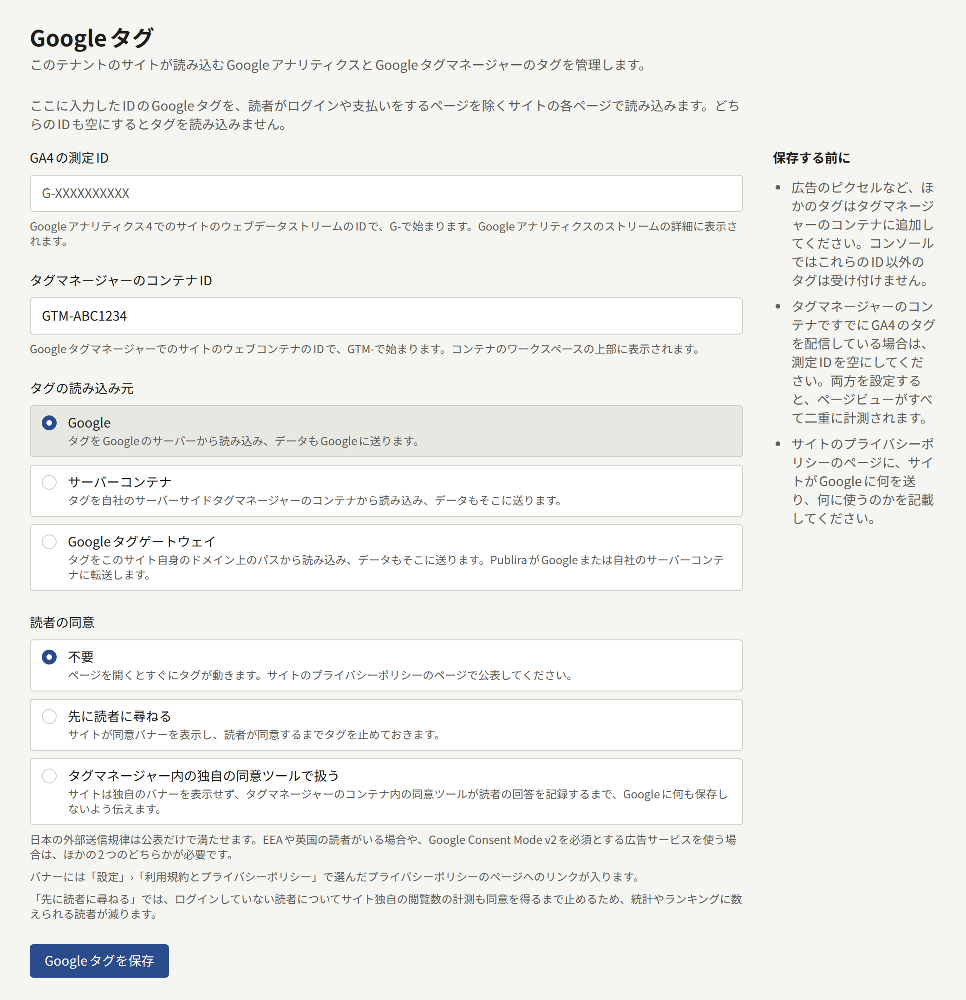
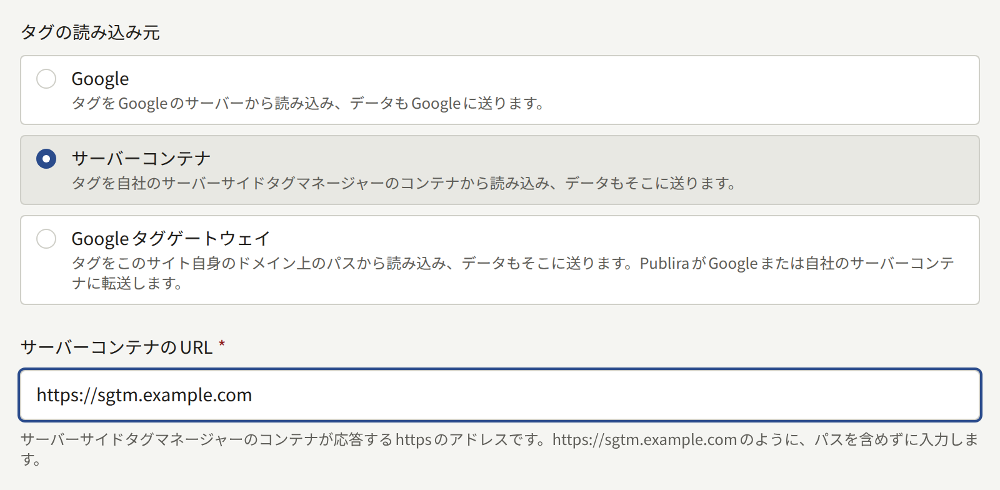
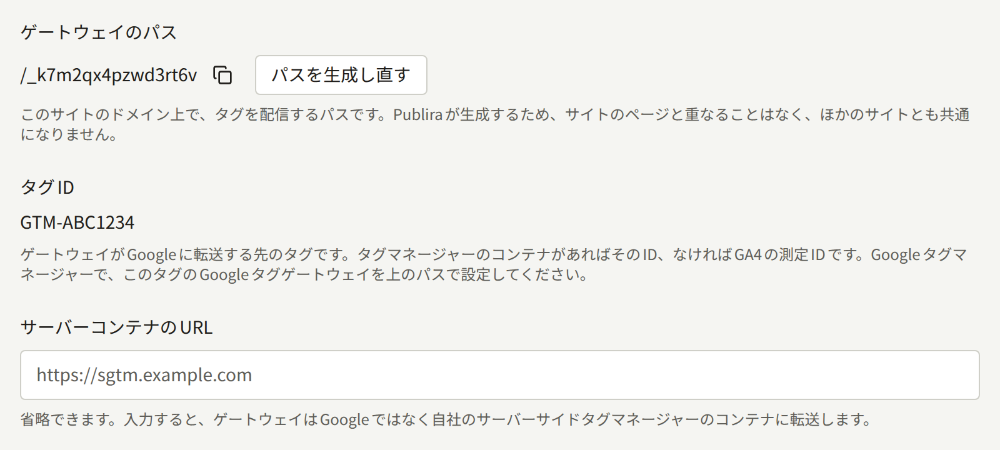
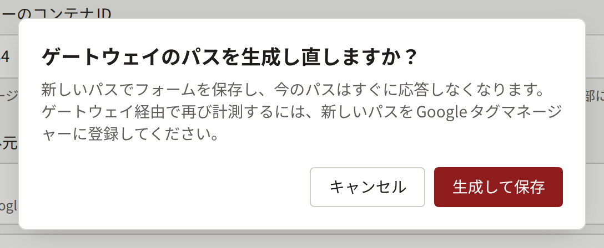
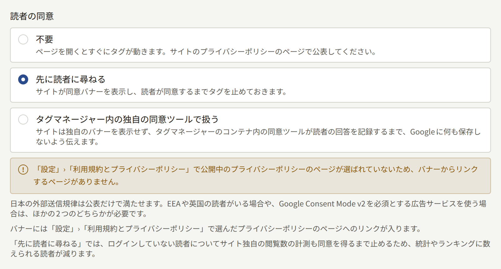

**外部連携** › **Googleタグ**でIDを入力すると、テナントのサイトがGoogleタグを読み込みます。測定IDを入力すればGoogle Analytics 4のタグが、コンテナIDを入力すればGoogle Tag Managerのタグが読み込まれ、両方を入力することもできます。このページはテナント管理者向けに、入力するIDと、3種類のタグの読み込み元、それぞれに必要なGoogle AnalyticsとGoogle Tag Managerの設定、タグを動かす前に読者に尋ねるかどうかを説明します。

**Googleタグ**の画面はテナント管理者にだけ表示され、保存した変更はすべて**監査ログ**に**Googleタグの更新**として記録されます。この設定の対象はブラウザーで見るサイトだけで、テナントのアプリはGoogleタグを読み込みません。

## 始める前に

次のものを用意しておきます。

- 出版社が所有する、サイト用のWebデータストリームがあるGoogle Analytics 4のプロパティか、Google Tag ManagerのWebコンテナ。後で説明するとおり、Google Analytics以外のタグはすべてコンテナに入れます。
- タグについて記載したプライバシーポリシー。タグは独自のCookieを設定し、収集した情報をGoogleに送りますが、Publiraが挙げているサイトの保存内容の一覧にはこのことが含まれていません。タグを有効にする前に、[サイトが読者のブラウザーに保存するもの](./3-setup/3-pages.md#サイトが読者のブラウザーに保存するもの)の説明に従ってポリシーに書き加えてください。

## 入力するID

- **GA4の測定ID**には、サイトのWebデータストリームの、`G-`で始まるIDを入力します。Google Analyticsの**Admin** › **Data collection and modification** › **Data streams**でストリームを開くと、詳細に表示されます。`UA-`で始まるユニバーサルアナリティクスのIDは、Googleがもうデータを収集していないので入力できません。
- **タグマネージャーのコンテナID**には、サイトのWebコンテナの、`GTM-`で始まるIDを入力します。Google Tag Managerのコンテナのワークスペースの上部に表示されます。

どちらを入力するかは、サイトをどう計測しているかで決まります。

| サイトの計測 | 入力するID |
| --- | --- |
| コンテナの中でGoogle Analyticsを設定している | コンテナIDだけ。GA4タグを配信するコンテナと**GA4の測定ID**を両方設定すると、ページビューがすべて二重に計測されます。**保存する前に**の案内でも、このことに注意を促しています。 |
| コンテナがない | 測定IDだけ |
| 広告タグだけを入れたコンテナのように、コンテナ自身はGA4を配信しない | 両方 |

管理画面で設定できるのはこの2つのIDだけで、タグそのものは登録できません。広告ピクセルやコンバージョンタグなど、ほかのタグはタグマネージャーのコンテナに入れてください。サイトはコンテナを読み込むと、その中のタグもすべて読み込みます。タグの読み込みをやめるには、両方のIDを空にして保存します。

サイトはページを再読み込みせずに移動するので、2ページ目以降のページビューは、ブラウザーが履歴に記録する変化をもとに計測されます。GA4の拡張計測機能は、GA4タグをサイトが読み込む場合もコンテナから配信する場合も、既定でこの変化を計測します。ストリームの設定でブラウザーの履歴イベントに基づくページビューをオフにしていると、1回の訪問で計測されるのは最初のページだけです。

## タグの読み込み元

**タグの読み込み元**では、読者のブラウザーがタグのスクリプトをどこから取得し、タグが収集した情報をどこへ送るかを選びます。

| モード | タグの読み込み元 | データの送信先 | 必要な設定 |
| --- | --- | --- | --- |
| **Google** | Googleのサーバー | Google | ID以外は不要です |
| **サーバーコンテナ** | テナントのサーバーサイドのタグマネージャーコンテナ | サーバーコンテナ | **サーバーコンテナのURL**の入力と、タグマネージャーのコンテナ内にあるGoogleタグへのサーバーコンテナのURLの設定 |
| **Googleタグゲートウェイ** | サイト自身のドメイン上のパス | 同じパス。届いたものをPubliraがGoogleかサーバーコンテナへ転送します | Google Tag Managerでのゲートウェイの設定 |

既定は**Google**で、ID以外に設定するものはありません。

### サーバーコンテナ

**サーバーコンテナ**を選ぶと、出版社が運用するサーバーサイドのタグマネージャーコンテナからタグを読み込み、タグはGoogleではなくそのコンテナにデータを送ります。このコンテナはPubliraが動かすものではありません。

**サーバーコンテナのURL**には、コンテナが応答する`https`のアドレスを、`https://sgtm.example.com`のようにパスなしで入力します。IPアドレスは受け付けず、ドメイン名で指定する必要があります。サイト自身のドメインのサブドメインでコンテナを提供すると、タグをファーストパーティとして動かせます。Googleも[カスタムドメインの設定についてのドキュメント](https://developers.google.com/tag-platform/tag-manager/server-side/custom-domain)でこの構成を推奨しています。

サイトは`gtm.js`と`gtag.js`を、Googleが配信しているのと同じパスでこのアドレスから読み込みます。そのため、コンテナはデータを受け取るだけでなく、Googleのスクリプトも配信しなければなりません。タグ付けサーバーでの設定方法は、Googleの[Googleのスクリプトをファーストパーティで読み込む方法](https://developers.google.com/tag-platform/tag-manager/server-side/dependency-serving)にあります。スクリプトを配信していないコンテナではサイトにタグが読み込まれず、配信するようになるまで何も計測されません。

データの送信先は、どちらのIDでGoogle Analyticsを読み込んでいるかで変わります。

- **GA4の測定ID**の場合は、読み込んだGA4タグに対して、データをサーバーコンテナへ送るようサイトが指示します。ほかに設定するものはありません。
- **タグマネージャーのコンテナID**の場合は、サイトはコンテナをサーバーコンテナから読み込みますが、コンテナ内のタグはコンテナで設定された送信先にデータを送り、設定を変えない限り送信先はGoogleです。Googleの[サーバーサイドのタグマネージャーにデータを送る方法](https://developers.google.com/tag-platform/tag-manager/server-side/send-data?option=GTM)に従って、WebコンテナのGoogleタグで`server_container_url`に**サーバーコンテナのURL**を設定し、コンテナを公開してください。公開するまでは、サイトはこれまでどおり計測され、ヒットはすべてGoogleに直接送られます。

### Googleタグゲートウェイ

**Googleタグゲートウェイ**は、Googleが「Google tag gateway for advertisers」と呼んでいる仕組みです。タグをサイト自身のドメイン上のパスから読み込み、データも同じパスに送ります。そのパスに届いたものは、PubliraがGoogleに転送します。通常この転送は、サイトの所有者が自分のCDNやロードバランサーで設定するものです。PubliraのサイトのドメインはPubliraが配信しているので、この部分はPubliraが受け持ち、残る作業はGoogle Tag Managerにパスを登録することだけです。

- **ゲートウェイのパス**は、`/_k7m2qx4pzwd3rt6v`のような、タグを配信するパスです。このモードで初めてフォームを保存したときにPubliraが生成するので、サイトのページと重なることも、ほかのサイトと同じになることもありません。ほかのモードに切り替えてもパスは残り、このモードに戻せば以前と同じパスでタグが配信されます。
- **タグID**は、ゲートウェイがGoogleへの転送を受け持つタグです。**タグマネージャーのコンテナID**が設定されていればコンテナID、なければ**GA4の測定ID**です。コンテナは自身が配信するタグをすべてまとめて扱うので、両方のIDを設定しているサイトでも、設定はコンテナについて1回で済みます。
- **サーバーコンテナのURL**は、このモードでは省略できます。入力すると、ゲートウェイの転送先がGoogleではなく出版社のサーバーコンテナになります。その場合は、Googleの[Googleのスクリプトをファーストパーティで読み込む方法](https://developers.google.com/tag-platform/tag-manager/server-side/dependency-serving)にあるとおり、コンテナ自身がゲートウェイのパスに応答する必要があります。Publiraがコンテナに接続するのは、そのホスト名が公開アドレスに解決される場合だけで、プライベートネットワーク上のコンテナには接続できません。

Publiraは、ゲートウェイのパスに届いたリクエストを、パスとクエリも含めてそのまま`https://<Tag ID>.fps.goog`かサーバーコンテナに転送します。読者のCookieのうち転送するのは`_ga`、`_gcl_au`、`FPID`などのGoogle自身の計測用Cookieだけで、ブラウザーに返すCookieもこれらに限ります。読者のサイトへのログイン情報や、サイトのほかのCookieがPubliraの外に出ることはありません。読者のIPアドレスは、Googleのゲートウェイが前提としているとおり転送します。読者の国と地域は、Publiraの前にあるリバースプロキシやCDNが判定している場合に転送し、Googleはこの情報を地域別のレポートと地域ごとの同意の既定値に使います。判定していない構成では、ゲートウェイを経由したサイトのトラフィックは地域なしでレポートされます。どちらの構成かは、Publiraを運用している人に確認してください。

#### Google Tag Managerでの設定

1. **Googleタグゲートウェイ**のモードでフォームを保存し、表示された**ゲートウェイのパス**をコピーします。
2. コンテナを使う場合は、Google Tag Managerでコンテナを開き、**Admin** › **Google tag gateway**に進みます。測定IDだけでコンテナを使わない場合は、Googleタグの設定から進みます。Google Analyticsの**Admin** › **Data collection and modification** › **Data streams**でサイトのストリームを選び、**Configure tag settings**を開いてから**Admin** › **Google tag gateway**に進みます。
3. **Continue**を選び、**Scan your site**にサイトのアドレスを入力します。
4. Googleが接続を代わりに設定してくれるCDNに、Publiraは含まれていません。**More ways to set up**で**Guided**を選び、計測パスとして**ゲートウェイのパス**を入力します。ガイドはこのあと、パスから`fps.goog`への転送を設定するよう案内しますが、その転送はPubliraがすでに行っているので作業は不要です。

Googleの[設定ガイド](https://developers.google.com/tag-platform/tag-manager/gateway/setup-guide)には、転送を自分で設定するサイト向けにその内容が書かれています。Publiraが代わりに何をしているかは、このガイドで確かめられます。

#### 動作の確認

##### パスの応答

サイトのドメインと**ゲートウェイのパス**を当てはめた`https://comics.example.com/<gateway path>/healthy`をブラウザーで開きます。ゲートウェイがGoogleに接続できていれば`ok`と表示されます。Googleが案内しているもう1つの確認`?validate_geo=healthy`は、Publiraが読者の国と地域を転送しないので`ok`になりません。

##### ヒットの経路

Tag Assistantでコンテナをプレビューしながらサイトを閲覧し、**Summary** › **Output** › **Hits Sent**で、ヒットの送信先がゲートウェイのパスになっていることを確認します。

##### Googleでの認識

Google Tag Managerの**Google tag gateway**の画面では、パスを通じてGoogleがデータを受け取るまでサイトのドメインが**Pending**と表示され、受け取ったあとは**First-party**と表示されます。

#### パスの再生成

**パスを生成し直す**を選ぶと、**ゲートウェイのパス**が新しいものに置き換わります。新しいパスでフォームが保存され、それまでのパスはすぐに応答しなくなるので、新しいパスをGoogle Tag Managerに設定し直すまで、ゲートウェイ経由では何も計測されません。

## 読者の同意

**読者の同意**では、タグを動かす前にサイトが読者に尋ねるかどうかを選びます。この設定は、どこから閲覧しているかにかかわらず、サイトのすべての読者に適用されます。

| 選択肢 | サイトの動作 | 必要なもの |
| --- | --- | --- |
| **不要** | ページを読み込むとすぐにタグを動かします | プライバシーポリシーのページでのタグの公表 |
| **先に読者に尋ねる** | 同意バナーを表示し、読者が同意するまでタグを動かしません | バナーからリンクするプライバシーポリシーのページ |
| **タグマネージャー内の独自の同意ツールで扱う** | サイト独自のバナーは表示しません。出版社の同意ツールが読者の回答を記録するまで、何も保存しないようGoogleに伝えます | **タグマネージャーのコンテナID**と、そのコンテナ内の同意ツール |

既定は**不要**です。どれを選ぶかは、サイトを誰が読むかで決まります。

| サイトの読者 | 選ぶもの |
| --- | --- |
| 日本国内の読者だけ | **不要**。プライバシーポリシーのページでタグを公表すれば、電気通信事業法の外部送信規律を満たせます |
| EEAや英国にも読者がいる、またはGoogle Consent Mode v2を必須とする広告商品を使う | ほかの2つのどちらか。どちらも、読者の回答に応じたGoogle Consent Mode v2のシグナルを送ります |

### 先に読者に尋ねる

読者が初めて訪れると、ウィンドウの下端にバナーが表示されます。バナーは、サイトが閲覧数を数えていることと、出版社のためにGoogleがサイトを計測していることを伝え、**同意する**と**同意しない**を同じ目立ち方で横に並べます。バナーが表示されている間もページのほかの部分は操作でき、読者が**同意する**を選ぶまで、Googleのものは何も読み込みません。

回答は、[サイトが読者のブラウザーに保存するもの](./3-setup/3-pages.md#サイトが読者のブラウザーに保存するもの)に挙げているCookieとして読者のブラウザーに6か月間保存され、期限が切れるまでバナーは表示されません。フッターのリンクの最後にある**Cookie設定**を選ぶとバナーがもう一度表示され、読者は回答を変えられます。同意を取り消すと、以後は何も保存しないようGoogleに伝えます。ただし、Googleのタグがすでに設定したCookieは期限が切れるまで残り、バナーでもそのことを読者に伝えます。Global Privacy Controlを送信するブラウザーは同意しなかったものとして扱い、バナーも**Cookie設定**も表示せず、何も保存しません。

バナーには、[設定 › 利用規約とプライバシーポリシー](./3-setup/1-settings.md#利用規約とプライバシーポリシー)でプライバシーポリシーとして選んだページへのリンクが入ります。そこで公開中のページを選ばないまま**先に読者に尋ねる**を選ぶと、バナーのリンク先がないという警告がフォームに表示されます。公開中のページを選べば警告は消えます。警告の有無にかかわらず、設定は保存できます。

ログインしていない読者については、同意するまでサイト自身の閲覧数も数えません。通常は、[サイトが読者のブラウザーに保存するもの](./3-setup/3-pages.md#サイトが読者のブラウザーに保存するもの)にある、ログインしていない読者用の識別子で数えています。ログインしている読者の閲覧数は、回答にかかわらずアカウントに結び付けて数えます。この方法ではブラウザーに新しく何も残らないからです。そのため、先に読者に尋ねるサイトの統計やランキングでは、尋ねない場合より数えられる読者が少なくなります。

### タグマネージャー内の独自の同意ツールで扱う

この選択肢は、同意管理プラットフォームをタグマネージャーのコンテナ内のタグとしてすでに運用している出版社向けです。サイトはコンテナを読み込む前に、Consent Mode v2のシグナルをすべて`denied`に設定します。その後、コンテナ内の同意ツールが独自のバナーを表示し、読者の回答に応じてシグナルを更新します。

同意ツールはコンテナの中でしか動かせないので、この選択肢を選べるのは**タグマネージャーのコンテナID**を入力しているときだけです。入力するまでは、選択肢の下にそのことが表示されます。この選択肢を保存したままコンテナIDを空にしようとしても、同じ理由で受け付けられず、IDの横にそのことが表示されます。

## タグを読み込まないページ

サイトはすべてのページでタグを読み込みますが、読者がパスワードやパスキーを使うページと、メールのリンクから開くページは例外です。

- **ログイン**のページと会員登録のページ
- メールアドレスの確認、パスワードの再設定、確認メールの再送など、アカウントに関するメールから進む手順のページ
- **設定**とその下のすべてのページ

支払いは決済サービスの決済ページで行われ、そのページにはサイトのタグは一切読み込まれません。支払いを終えた読者は、通常どおりタグを読み込むサイトのページに戻るので、戻り先のページで購入を計測できます。

これらのページには同意バナーも表示されません。これらのページを直接開いたり再読み込みしたりすると、タグは読み込まれません。一方、サイトのほかのページから移動してきた場合は、途中でページが再読み込みされないので、すでに動いているタグがそのまま動き続けます。

## プライバシーポリシーに書くこと

**保存する前に**の案内は、サイトがGoogleに何を送り、何のために使うのかを、サイトのプライバシーポリシーのページに書くよう求めています。タグはGoogleのCookieを設定し、収集した情報をGoogleかサーバーコンテナに送ります。コンテナが配信するタグもすべて同じです。Publira自身が読者のブラウザーに保存するものは、[サイトが読者のブラウザーに保存するもの](./3-setup/3-pages.md#サイトが読者のブラウザーに保存するもの)の一覧にあります。ポリシーにはこの一覧の内容に加えて、Googleのドキュメントとコンテナ内の各タグのドキュメントをもとに、タグについて記載してください。

[読者の同意](#読者の同意)でどれを選んでも、ポリシーにはタグが送る内容を書きます。先に尋ねるかどうかで変わるのはタグが動くタイミングだけで、送る内容は変わりません。

## 変更が反映されるタイミング

保存した変更は、保存した直後から、サイトで次にページを読み込んだときに反映されます。パスを生成し直すと、それまでのゲートウェイのパスは次のリクエストから応答しなくなります。
