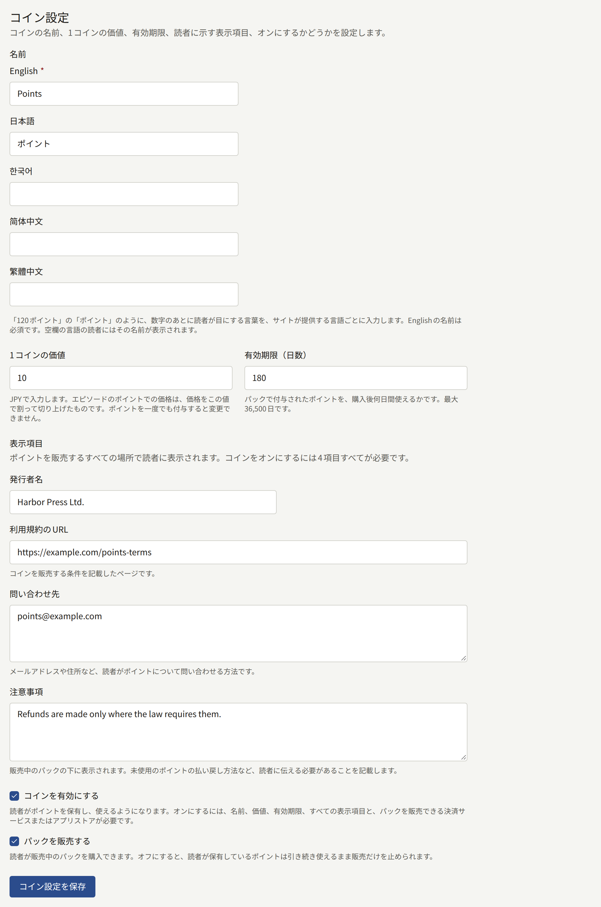
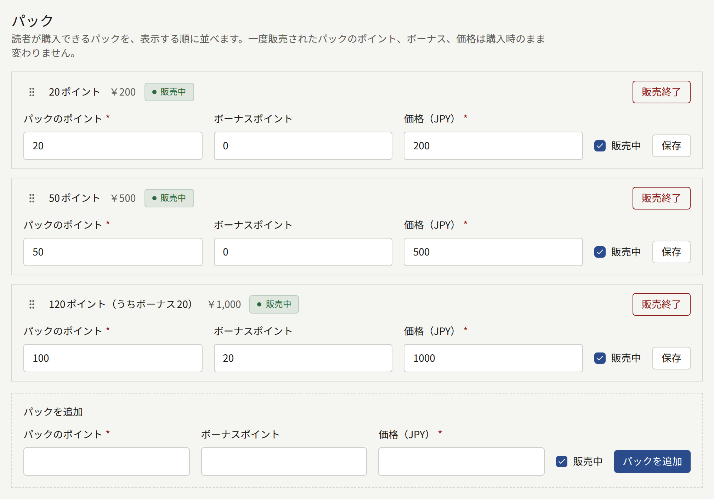
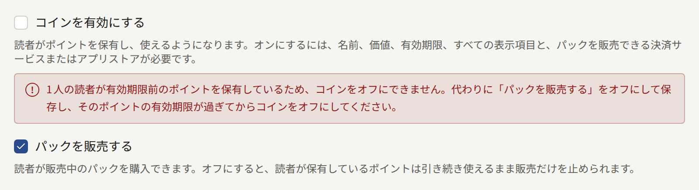

コインは、読者がエピソードの代金を前払いするための仕組みです。読者はテナントのコインをパックで一度に購入し、エピソードごとに数コインずつ使います。エピソードを買うたびに決済ページを通る必要はありません。コインを発行するのはテナントで、名前、テナントの通貨での1コインの価値、有効期限、販売するパックもテナントが決めます。コインを有効にしたあとにサイトやアプリで読者に何が表示されるかは、[エピソードの販売](./4-selling-episodes.md#コインでの支払い)で説明しています。

**決済** › **コイン**は**テナント管理者**が使う画面で、編集担当と監査担当には表示されません。

## 始める前に

コインは前払式の支払手段で、販売するテナントがその発行者です。テナントや読者の所在地によっては、前払式支払手段、電子マネー、資金移動、ギフトカードに関する法令がコインに適用されます。こうした法令は、届出や保証金の供託、未使用残高の払い戻し、販売する場所での所定の情報の表示をテナントに求めることがあります。テナントがコインを発行してよいか、そのために何をしなければならないかは、テナント自身で確かめてください。この画面にあるのは切り替えのスイッチと表示項目の入力欄だけで、法令についての案内はありません。

コインを使うには、次の2つが先に整っている必要があります。

### プラットフォームによる許可

テナントがコインを発行できるかどうかはプラットフォームが決めます。新しいインストールでは許可されていません。許可されていない間はサイドバーに**コイン**が表示されず、アドレスを入力して画面を開いても、プラットフォームがテナントによるコインの発行を許可していないと表示されます。許可するのはオペレーターで、手順は[プラットフォーム全体の既定値とポリシー](../3-operations/9-platform-policies.md#テナントによるコインの発行)にあります。

### パックの販売手段

コインを有効にできるのは、[エピソードの販売](./4-selling-episodes.md)で説明しているとおり、**決済** › **決済方法**で決済サービス、App Store、Google Playのいずれかが**利用可能**になっている間だけです。画面のそのほかの項目は、それより前に入力しておけます。

## コインの3つの状態

画面の上部に、テナントのコインが今どの状態にあるかが表示されます。

| 状態 | 読者に表示されるもの |
| --- | --- |
| **オフ** | コインに関するものは何も表示されません。エピソードはすべて、コインがないときと同じように販売されます |
| **オン(販売中)** | コインでのエピソードの価格、読者の残高、販売中のパック |
| **オン(販売停止中)** | **オン(販売中)**と同じですが、パックは購入できません。読者は手元のコインを引き続き使えます |

状態は、**コイン設定**の**コインを有効にする**と**パックを販売する**で切り替えます。コインをオフにすると、読者が代金を払ったコインが使えなくなります。そのため、コインの提供をやめるときは[販売の停止](#販売の停止)で説明しているとおり、いったん**オン(販売停止中)**を経由します。

## コイン設定

**名前**は、`120 Points`の`Points`のように、数字のあとに付けて読者に見せる言葉です。サイトが提供する言語ごとに入力します。サイトの既定の言語の名前は必須で、空のまま保存するとその入力欄の下にエラーが表示されます。名前が空の言語で読む読者には、既定の言語の名前が表示されます。保存した名前は管理画面の表示にも使われます。使われるのは管理画面を表示している言語の名前で、たとえばパックの入力欄は**パックのポイント**や**ボーナスポイント**になります。

**1コインの価値**には、1コインがテナントの通貨でいくらに当たるかを入力します。1コイン10円なら`10`です。エピソードのコインでの価格は、エピソードの価格をこの値で割って端数を切り上げたもので、キャンペーン価格で販売している間はキャンペーン価格をもとにします。1コイン10円なら、300円のエピソードは30コインです。コイン用の価格表は別になく、エピソードの価格を変えればコインでの価格も変わります。読者に一度でもコインを付与すると、すべての残高がこの値で数えられるようになり、以後は変更できません。

「**有効期限(日数)**」には、パックを購入してから何日間そのコインを使えるかを入力します。最大は36,500日です。期限までに使われなかったコインは失われ、読者の履歴にもその旨が表示されます。

**表示項目**は、コインを販売するすべての場所でパックの下に表示されます。項目は次の4つです。

| 項目 | 内容 |
| --- | --- |
| **発行者名** | コインの発行者の名前 |
| **利用規約のURL** | コインの販売条件を記載したページ |
| **問い合わせ先** | 読者がコインについて問い合わせる方法 |
| **注意事項** | 未使用のコインの払い戻し方法など、ほかに読者に伝えなければならないこと |

**コインを有効にする**にチェックを入れると、コインがオンになります。それには、既定の言語の名前、1コインの価値、有効期限、4つの表示項目のすべてと、パックの販売手段がそろっている必要があります。欠けているものがあると保存は受け付けられず、足りない項目がそれぞれ示されます。**パックを販売する**にチェックを入れると、パックが販売中になります。コインをオンにしたまま、こちらだけチェックを外すこともできます。

## パック

**パック**には、読者が購入できるパックがサイトに表示される順に並びます。各行には、`120 Points (including 20 bonus)`のように読者に見えるとおりのパックと、価格、販売中かどうかが表示されます。

- 一覧の下の**パックを追加**では、パックで付与するコインの数と、それに上乗せするボーナスコインの数、テナントの通貨での価格を入力します。価格は0より大きくなければなりません。追加したパックは一覧の最後に並びます。テナントが提供できるパックは最大20個です。
- パックの内容はその行で編集し、行の**保存**で保存します。**販売中**を切り替えると、ほかのパックはそのままで、そのパックだけ販売を止めたり再開したりできます。
- 一度でも売れたパックは、コインの数、ボーナス、価格が、購入した読者が支払った時点の内容のまま固定されます。その行ではこれらが編集できないテキストで表示され、理由も示されます。操作できるのは**販売中**だけです。内容の違うパックを売るには、新しいパックを追加し、古いパックの販売を終了します。
- **販売終了**を選んで確認すると、そのパックの販売は二度と再開できません。パックは一覧から消えますが、そのパックで購入したコインは読者の手元に残ります。
- 並び順は、行のハンドルをドラッグして変えます。キーボードでは、ハンドルにフォーカスしてSpaceキーを押し、矢印キーで動かしてから、もう一度Spaceキーを押します。

ボーナスはテナントが負担する割引です。印税は、[レポートと印税](./6-reports-and-royalties.md#著者に支払う額)で説明しているとおり、読者がコインの購入に支払った金額をもとに計算します。

### アプリでのパック

テナントのアプリがApp StoreとGoogle Playで販売する場合、パックは1つずつ別々のストアの商品として購入されます。商品の名前は、`coins_`のあとにパックのIDを続けたものです。**決済** › **決済方法**の最下部にある**ストアの商品**には、エピソードの価格に必要な商品と並んで、すべてのパックの商品が表示されます。エピソードについて[アプリでの販売](./4-selling-episodes.md#アプリでの販売)で説明しているのと同じ要領で、パックごとに、そのパックの価格の消耗型の商品を作成してください。

## 販売の停止

**パックを販売する**のチェックを外して保存すると、サイトとアプリでのパックの販売がすべて止まり、状態は**オン(販売停止中)**になります。読者は手元のコインを引き続き使えます。

有効期限が来ていないコインを持つ読者が1人でもいる間は、**コインを有効にする**のチェックを外しても保存できません。画面には、そうした読者の人数と、代わりに販売を止めるよう促すメッセージが表示されます。最後にパックを販売してから、最長で「**有効期限(日数)**」の日数が過ぎると、そのコインはすべて期限切れになります。それを待ってからコインをオフにしてください。

オペレーターがテナントによるコインの発行を許可しなくなると、テナントが何を保存していても、すべてのテナントのコインがすぐに止まります。コインの販売も使用もできなくなりますが、読者の残高は残ります。テナントの設定も保持され、オペレーターが再び許可すると、その設定がまた有効になります。

設定の保存と、パックの追加、変更、販売終了は、操作したテナント管理者とともにすべて[監査ログ](./3-setup/8-audit-log.md)に記録されます。
