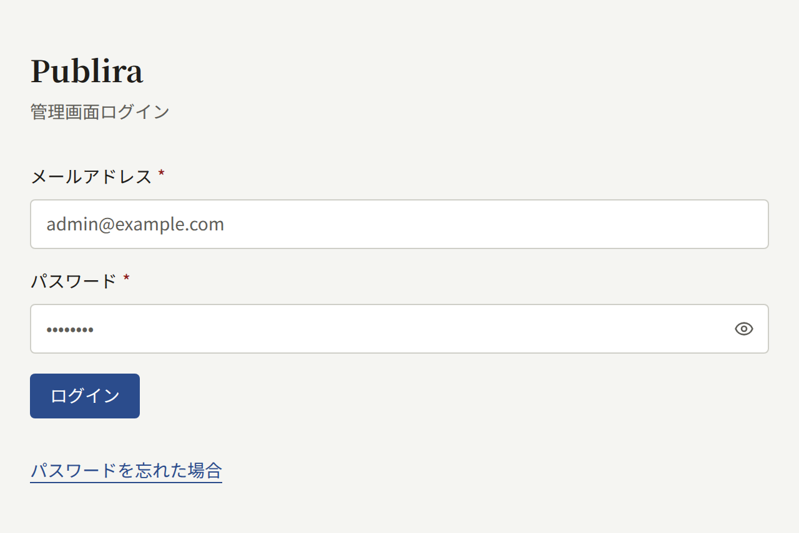
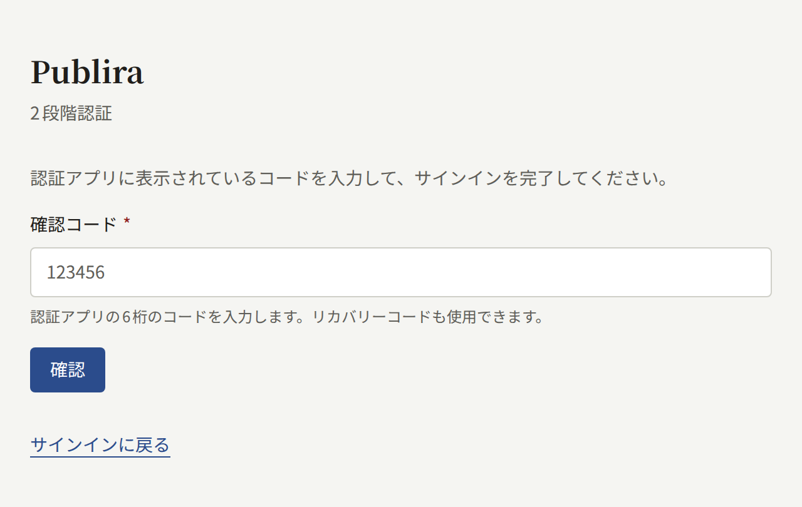
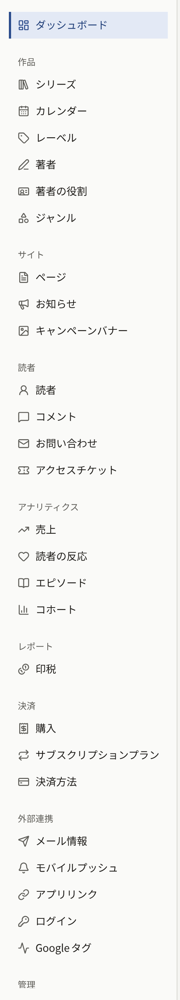

テナントにはそれぞれ専用の管理画面があり、出版社のスタッフはここでサイトの作品と読者、サイトの設定を管理します。このセクションは、そうしたスタッフに向けたページです。テナントがすでに作成されていて、自分にアクセス権が与えられていることを前提にしています。オペレーターがアクセス権を与える側の手順は[テナントのスタッフ](../3-operations/3-tenant-staff.md)で説明しています。

## ログイン

管理画面は、テナントの管理画面用のホストで開きます。オペレーターが別のホストを指定していなければ、公開サイトのドメインの先頭に`admin.`を付けたものがそのホストです。公開サイトが`comics.example.com`なら、管理画面は`admin.comics.example.com`にあります。ここで自分のアカウントのメールアドレスとパスワードを入力してログインします。パスワードを忘れたときは、同じ画面の**パスワードを忘れた場合**から再設定用のリンクをメールで受け取れます。

アカウントで2段階認証を有効にしていれば、パスワードの次に認証アプリのコードを入力します。オペレーターは、そのインストールのすべてのテナント管理者に2段階認証を義務付けられます。義務付けられた場合、認証アプリをまだ登録していないテナント管理者は、登録を済ませるまで先へ進めません。2段階認証を有効にする方法と、スマートフォンをなくしたときの対処は[自分のアカウント](./3-setup/9-your-account.md)で説明しています。

管理画面のアカウントは、テナントのサイトのアカウントでもあります。同じメールアドレスとパスワードでサイトの作品を読んだり購入したりでき、管理画面はロールに応じてそこに加わる機能です。

## ロール

スタッフには3つのロールのどれか1つが割り当てられ、管理画面にはそのロールで使える部分だけが表示されます。

| ロール | できること |
| --- | --- |
| **テナント管理者** | 管理画面のすべての操作。スタッフの管理、テナントのすべての設定、メールや決済、プッシュ通知、ログイン、Googleタグとの連携、読者のアカウント、購入と返金、サブスクリプションプラン、コイン、印税、監査ログを扱えます |
| **編集担当** | 作品とサイトのページ、お知らせ、キャンペーンバナーの作成と編集、コメントのモデレーション |
| **監査担当** | 編集担当が扱う内容とテナントの設定の閲覧。変更はできません |

ほかのスタッフにロールを割り当てるのは、テナント管理者が**メンバー**で行います。各ロールの詳細は[テナントのスタッフ](../3-operations/3-tenant-staff.md#3つのロール)を参照してください。

## このセクションの内容

- [作品の公開](./1-catalog/index.md)では、作品が1つもない状態から読者が開ける最初のエピソードを公開するまでの流れと、作品を構成するシリーズ、エピソード、レーベル、著者、著者の役割、ジャンルを説明します。
- [読者、コメント、お問い合わせ](./2-readers/index.md)では、読者アカウントの利用停止と削除、承認待ちのコメントと通報されたコメントの処理、お問い合わせへの返信、アクセスチケットで有料エピソードを特定の読者に開放する方法を説明します。
- [テナントの初期設定](./3-setup/index.md)では、新しいテナントを出版社らしい見た目と法務関連のページ、スタッフがそろったサイトに仕上げるまでの流れを、設定、ブランディング、ページ、お知らせ、キャンペーンバナー、メンバー、メールサーバー、監査ログ、自分のアカウントの順に説明します。
- [エピソードの販売](./4-selling-episodes.md)では、エピソードの価格設定、StripeやPAY.JPでの決済、エピソードを販売する場所、アプリ内課金、返金、本番公開前の動作確認を説明します。
- [サブスクリプションプラン](./5-subscription-plans.md)では、Stripeで期間ごとに課金し、作品全体や一部のレーベル、一部のシリーズを読めるようにするプランの販売を説明します。Stripeに用意するPriceとWebhookイベント、購読者がサイトで行う操作も扱います。
- [レポートと印税](./6-reports-and-royalties.md)では、ダッシュボードとアナリティクスの画面が集計する内容、著者ごとの印税の計算方法、月を締めて明細にする手順、明細のCSVエクスポートを説明します。
- [AppleとGoogleでのログイン](./7-sign-in.md)では、読者がAppleやGoogleのアカウントでサイトとアプリにログインできるようにする方法と、そのためにAppleとGoogleの管理画面で作成するものを説明します。
- [Googleタグ](./8-google-tag.md)では、Google AnalyticsやGoogle Tag Managerによるサイトの計測、タグの読み込み元にできる3つの場所、ゲートウェイを使うときにGoogle Tag Managerで行う設定を説明します。
- [コイン](./9-coins.md)では、読者が前払いで購入するコインの名称、コインについて表示する事項、コインを販売するパック、コインの有効化と販売停止、無効化を説明します。

Publiraがどのようなものかをまだ読んでいなければ、[はじめに](../1-getting-started.md)から読んでください。
