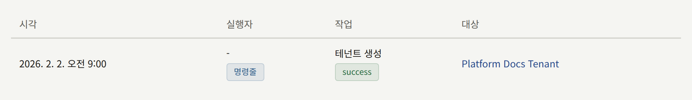
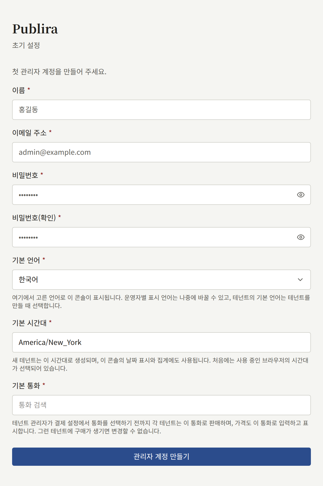
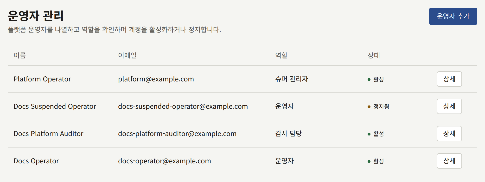
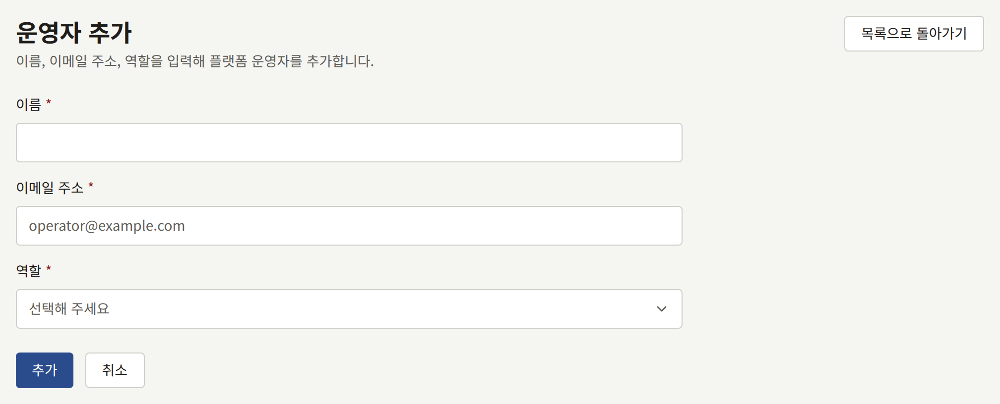
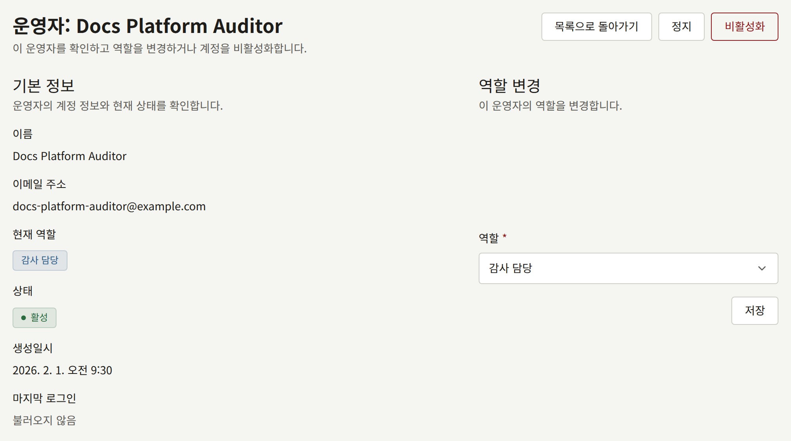
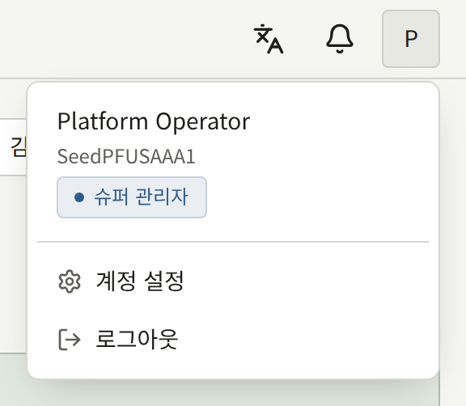
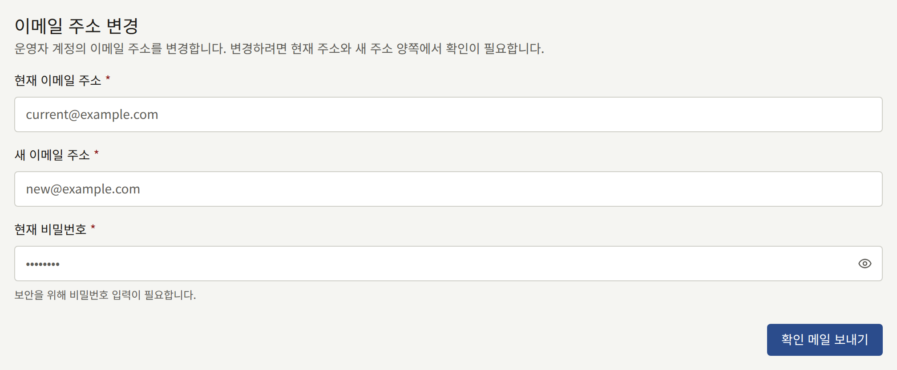
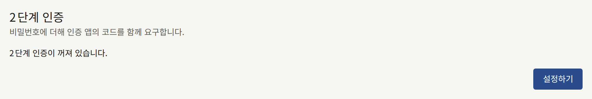
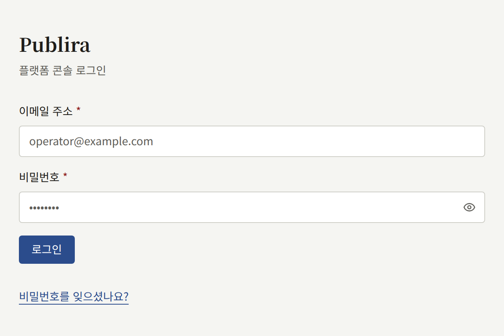

설치 환경은 두 곳 중 한 곳에서 관리하며, 대부분의 작업은 어느 쪽에서든 할 수 있습니다. 이 페이지에서는 둘이 어떻게 다른지, 플랫폼 콘솔이 첫 번째 운영자를 어떻게 얻는지, 그 뒤에 운영자를 어떻게 추가하고 역할을 부여하는지 설명합니다.

## 둘 중 고르기

`publiractl`은 [설치](../2-deployments/2-installing.md)에서처럼 설치 환경이 실행하는 릴리스의 이미지로 실행하거나, [Docker Compose](../2-deployments/3-docker-compose.md) 설치 환경에서는 `docker compose run --rm publiractl`로 실행하는 명령입니다. 데이터베이스에 `publira_platform`으로 직접 연결하므로 플랫폼 콘솔을 실행하지 않는 설치 환경에서도 동작하며, 그 연결 외에는 아무것도 필요 없습니다. 계정도, 브라우저도, 실행 중인 다른 프로세스도 필요 없습니다.

플랫폼 콘솔은 운영자가 로그인하는 웹 앱 `web-platform`입니다. 플랫폼 콘솔에는 자체 계정이 있고 계정마다 역할이 있으므로, 어떤 사람에게 모든 테넌트를 볼 수 있게 하면서도 아무것도 바꾸지 못하게 할 수 있으며, 각 변경을 어느 운영자가 했는지 기록합니다.

둘은 같은 코드를 통해 쓰므로, 한쪽에서 만든 테넌트는 다른 쪽에서 만든 테넌트와 같으며, 한 설치 환경에서 둘 다 사용할 수 있습니다. 다른 점은 각각이 제공하는 작업입니다.

| 작업                                           | `publiractl` | 플랫폼 콘솔 |
| ---------------------------------------------- | ------------ | ----------- |
| 테넌트 생성, 변경, 정지                        | 예           | 예          |
| 테넌트의 멤버와 관리자 초대                    | 예           | 예          |
| 메일을 보내지 않고 비밀번호로 콘솔 계정 만들기 | 예           | 아니요      |
| 플랫폼 운영자                                  | 아니요       | 예          |
| 운영자가 잃어버린 2단계 인증 제거              | 예           | 아니요      |
| 플랫폼의 기본값, 정책, 보존 기간               | 예           | 예          |
| 모든 테넌트의 독자                             | 아니요       | 예          |
| 감사 로그 열람                                 | 아니요       | 예          |
| 유지 관리 작업 실행                            | 예           | 아니요      |

어느 쪽이든 테넌트나 그 스태프에 대해 한 변경은 모두 플랫폼 콘솔의 **감사 로그**에 기록됩니다. `publiractl`로 한 변경은 거기서 운영자를 나타내지 않으며, 그 행위자는 **명령줄**입니다.



플랫폼 콘솔을 실행하지 않는다면 `publiractl`만으로 설치 환경을 운영할 수 있습니다. 포기하는 것은 감사 로그 열람과 테넌트를 가로질러 독자의 계정을 다루는 일이며, 각 테넌트의 관리자는 여전히 테넌트 콘솔에서 자기 독자를 관리합니다.

## 첫 번째 운영자

[설치](../2-deployments/2-installing.md#web-platform으로-플랫폼-콘솔-사용하기)에서 설명하는 대로 `web-platform`을 실행하고 엽니다. 운영자가 생기기 전까지는 어느 주소로 가든 **초기 설정** 화면이 나오며, 다음을 묻습니다.

- **이름**, **이메일 주소**, **비밀번호**, 그리고 **비밀번호(확인)**: 첫 번째 운영자의 계정입니다.
- **기본 언어**: 플랫폼 콘솔이 시작할 때의 언어입니다. 플랫폼의 기본 언어도 되어, `publiractl setup`이 저장한 언어를 대체합니다. 각 운영자는 나중에 자신이 보는 언어를 바꿀 수 있고, 각 테넌트는 만들어질 때 자신의 언어를 고릅니다.
- **기본 시간대**: 시간대 없이 만든 테넌트가 시작할 때의 시간대이며, 플랫폼 콘솔이 날짜를 표시하고 계산하는 시간대입니다. 처음에는 브라우저의 시간대가 들어 있고, 그대로 두면 그 시간대가 저장되어 `publiractl setup`이 저장한 시간대를 대체합니다. 다른 시간대를 고르려면 지역이나 도시를 검색하세요. 이미 있는 테넌트는 자신의 시간대를 유지합니다.
- **기본 통화**: 각 테넌트의 관리자가 자체 **결제 설정**을 저장하기 전까지 모든 테넌트가 판매에 사용하는 통화입니다. 처음에는 `publiractl setup`이 저장한 통화가 들어 있으므로, 그대로 두면 그 통화가 유지됩니다. 다른 통화를 찾으려면 이름이나 `EUR` 같은 ISO 4217 코드를 입력하세요. 그 통화로 판매하는 테넌트에 구매가 생기면, 그 테넌트의 가격이 그 통화의 금액이므로 이 필드는 읽기 전용이 되며 그렇다고 표시합니다. 저장된 통화를 읽을 수 없을 때도 필드는 읽기 전용이 되고 그렇다고 표시하며, 설정은 통화를 그대로 유지합니다. 나중에 **일반 설정**에서 바꾸세요. 통화가 어디까지 영향을 미치는지는 [플랫폼 기본값](./9-platform-policies.md#플랫폼-기본값)에서 설명합니다.



**관리자 계정 만들기**는 **슈퍼 관리자** 역할로 계정을 만들고 로그인 화면으로 보냅니다. 그 뒤로는 설정 화면이 사라집니다. 두 번째 첫 번째 운영자는 없으며, `publiractl`에도 운영자를 만드는 기능은 없습니다. 이후의 운영자는 모두 슈퍼 관리자가 **운영자 관리**에서 추가합니다.

플랫폼 콘솔의 계정은 플랫폼 콘솔만의 것입니다. `publiractl setup`이 만든 테넌트 관리자는 플랫폼 콘솔에 로그인할 수 없고, 운영자도 운영자 계정으로 테넌트의 콘솔에 로그인할 수 없습니다.

## 운영자 역할

각 운영자는 세 역할 중 하나를 가집니다.

| 역할 | 할 수 있는 일 |
| --- | --- |
| **감사 담당** | 대시보드, 테넌트와 그 멤버, 사용자, 감사 로그, 플랫폼의 설정 등 모든 것을 볼 수 있습니다. 자신의 계정 외에는 아무것도 바꾸지 않습니다 |
| **운영자** | 감사 담당이 할 수 있는 모든 일에 더해, 테넌트, 그 멤버와 초대, 독자의 계정, 플랫폼의 설정과 서비스를 바꿀 수 있습니다 |
| **슈퍼 관리자** | 운영자가 할 수 있는 모든 일에 더해, 운영자를 추가하고, 그 역할을 바꾸고, 정지하거나 비활성화할 수 있습니다 |

플랫폼 콘솔은 감사 담당에게도 운영자와 같은 화면과 양식을 보여 주며, 변경을 제출하면 거부합니다. 전체 표는 [`publira server` 레퍼런스](https://github.com/publira/publira/blob/main/server/cmd/publira/README.md#platform-console-role-permissions)에 있습니다.

## 운영자 관리

사이드바의 **거버넌스** 아래에 있는 **운영자 관리**는 모든 운영자를 역할, 상태와 함께 나열합니다. 거기서 무언가를 바꿀 수 있는 것은 슈퍼 관리자뿐입니다.



### 운영자 추가

**운영자 추가**는 운영자의 **이름**, **이메일 주소**, **역할**을 묻고 즉시 계정을 만듭니다. 새 운영자에게는 계정의 첫 비밀번호를 설정하는 링크가 메일로 전송되며, 비밀번호를 설정하면 그 비밀번호로 로그인합니다. 링크는 24시간 동안 유효하며, 그 뒤에는 로그인 화면에서 **비밀번호를 잊으셨나요?** 링크를 선택해 새 링크를 받습니다. 그 메일은 플랫폼 콘솔이 보내는 다른 모든 메일과 마찬가지로, 플랫폼이 저장한 SMTP 설정으로 플랫폼의 기본 언어로 `publira worker`가 보냅니다.

그 주소에 역할이 없는 플랫폼 콘솔 계정이 이미 있으면, 새 계정을 만드는 대신 그 계정에 역할을 부여합니다. 그 계정은 기존 비밀번호를 유지하므로, 메일에는 비밀번호 링크가 없고 이제 로그인할 수 있다는 안내만 있습니다.



비활성화된 운영자를 포함해 이미 운영자의 것인 주소는 다시 추가할 수 없습니다.

### 운영자의 역할 변경

**운영자 관리**에서 운영자를 열고 **역할 변경**에서 새 역할을 고릅니다. 누구도 자신의 역할은 바꿀 수 없으므로, 슈퍼 관리자가 스스로를 강등하는 일은 없으며, 설치 환경에는 항상 작업 중인 슈퍼 관리자가 남습니다.



### 정지와 비활성화

같은 화면에서 다음을 할 수 있습니다.

- **정지**는 운영자의 로그인을 막고 열려 있는 세션을 끝냅니다. **재활성화**하면 다시 로그인할 수 있습니다.
- **비활성화**는 계정을 영구히 종료합니다. 비활성화된 계정은 다시 사용할 수 없고, 그 주소는 새 운영자로 추가할 수 없습니다. 그 계정이 한 변경은 감사 로그에 그 계정의 이름으로 남습니다.

어느 쪽도 자신의 계정에는 할 수 없습니다.

## 운영자 자신의 계정

콘솔 헤더의 계정 메뉴에 있는 **계정 설정**에서 이메일 주소를 바꿉니다. 현재 주소와 새 주소 양쪽으로 확인 링크가 메일로 전송되며, 두 링크를 모두 열면 변경이 적용됩니다.





### 2단계 인증

같은 페이지의 **2단계 인증**은 로그인할 때마다 비밀번호 다음에 인증 앱의 코드를 묻습니다. **설정하기**는 앱으로 스캔할 QR 코드와, 스캔할 수 없는 앱을 위해 같은 키를 텍스트로 보여 줍니다. 앱에 표시되는 6자리 코드를 입력하고 **2단계 인증 사용 설정**을 선택하세요. 그러면 페이지에 복구 코드 10개가 한 번만 표시됩니다. 휴대폰과는 다른 안전한 곳에 보관하세요. 각 코드는 인증 앱을 쓸 수 없을 때, 로그인이 코드를 묻는 곳 어디서든 한 번 로그인할 수 있게 해 줍니다.



그 뒤로 로그인은 비밀번호 다음에 **2단계 인증**에서 멈추고 코드를 묻습니다. 복구 코드로 로그인하면 남은 코드 수를 알려 줍니다. 2단계 인증이 켜져 있는 동안 같은 카드에는 두 가지 양식이 있습니다.

- **복구 코드 재발급**은 사용했든 안 했든 갖고 있는 모든 코드를 새 코드 10개로 바꿉니다. 복구 코드가 아니라 인증 앱의 코드가 필요합니다.
- **2단계 인증 끄기**에는 인증 앱의 코드나 복구 코드를 사용할 수 있습니다. 언제든 다시 설정할 수 있으며, 새 인증 앱이 있다면 그것으로도 설정할 수 있습니다.

플랫폼은 [보안](./12-security/2-two-step-verification.md#플랫폼-운영자)에서 설명하는 대로 모든 운영자에게 2단계 인증을 요구할 수 있습니다. 그러면 다음 로그인 때 설정하라는 요청을 받고, 설정을 마치면 로그인이 완료됩니다.

로그인한 상태에서 비밀번호를 바꾸는 양식은 없습니다. 로그아웃한 뒤 로그인 화면에서 **비밀번호를 잊으셨나요?** 링크를 선택하고, 메일로 받은 링크에서 새 비밀번호를 설정하세요. 링크는 24시간 동안 유효합니다.



### 잃어버린 2단계 인증

2단계 인증을 켠 뒤 인증 앱과 모든 복구 코드를 잃어버린 운영자는 플랫폼 콘솔에 로그인할 수 없으며, 다른 운영자도 플랫폼 콘솔에서 그 계정의 2단계 인증을 제거할 수 없습니다. `publiractl`로 제거하세요.

```bash
publiractl operator reset-mfa --email operator@example.com
```

`--email` 대신 `--user <public ID>`로 계정을 지정할 수도 있습니다. 이 명령은 계정의 인증 앱과 모든 복구 코드를 제거할 뿐, 그 밖의 것은 건드리지 않습니다. 비밀번호, 역할, 상태는 그대로입니다. 운영자는 비밀번호만으로 로그인한 뒤 **계정 설정**에서 2단계 인증을 다시 설정합니다. 플랫폼이 모든 운영자에게 2단계 인증을 요구한다면, 로그인이 완료되기 전에 설정하라는 요청을 받습니다.

`publiractl`은 계정 없이 실행되므로, 2단계 인증을 잃어버린 운영자가 설치 환경의 유일한 **슈퍼 관리자**일 때도 이것이 다시 들어가는 방법입니다.

2단계 인증을 제거하면 계정은 비밀번호만으로 보호되는데, 이는 비밀번호를 훔친 사람이 바로 요청할 만한 일입니다. 명령을 실행하기 전에, 요청이 들어온 경로가 아니라 그 운영자의 것임을 이미 알고 있는 경로를 통해 요청이 정말 그 운영자에게서 온 것인지 확인하세요.

제거는 플랫폼 콘솔의 **감사 로그**에 **명령줄**을 행위자로 하여 기록됩니다.
