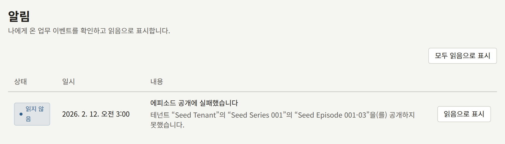

설치 환경이 요청 없이 하는 일은 모두 `publira worker`가 합니다. 지금 시각으로 예약된 에피소드를 공개하고, 변경으로 오래된 캐시 페이지를 웹 앱에 알리고, 메일과 푸시 알림을 보내고, 통계와 랭킹을 다시 만들고, 보존 기간이 지난 것을 삭제합니다. 그 밖에 타이머로 실행해야 하는 것은 없으며, 호스트의 cron이나 Kubernetes CronJob도 필요 없습니다. 이 페이지에서는 무엇이 언제 실행되는지, 어떤 증상의 원인이 되는 작업이 무엇인지 알아내는 방법, 그리고 `publiractl job`으로 작업을 직접 실행하는 방법을 설명합니다.

각 작업의 주기, 작업을 조정하는 변수, 전체 작업 목록은 [`publira worker` 레퍼런스](https://github.com/publira/publira/blob/main/server/cmd/publira/README.md#publira-worker)와 [`publiractl job` 레퍼런스](https://github.com/publira/publira/blob/main/server/cmd/publiractl/README.md#job)에 있으며, 이 페이지에서는 반복하지 않습니다.

## 증상별 담당 작업

보이는 증상에서 출발해, 그 증상을 담당하는 작업을 살펴보세요.

| 보이는 증상 | 작업 | 살펴볼 곳 |
| --- | --- | --- |
| 에피소드가 시각이 지났는데도 **예약됨** 상태 | 예약 공개 | [예약 공개](#예약-공개) |
| 에피소드의 사이트 페이지가 무료 공개 기간 중인데 유료로, 또는 기간이 끝났는데 무료로 표시됨 | 무료 공개 기간 | [무료 공개 기간](#무료-공개-기간과-그-밖의-캐시된-페이지) |
| 사이트의 주간 연재표가 여전히 어제를 오늘로 표시함 | 테넌트의 날짜 변경 | [무료 공개 기간](#무료-공개-기간과-그-밖의-캐시된-페이지) |
| 사이트 배너가 **게시 종료 일시**가 지났는데도 표시됨 | 고정 공지 | [무료 공개 기간](#무료-공개-기간과-그-밖의-캐시된-페이지) |
| 시리즈가 **공개 일시**가 지났는데도 사이트 목록에 없음 | 예약된 시리즈 | [무료 공개 기간](#무료-공개-기간과-그-밖의-캐시된-페이지) |
| 캠페인 배너가 기간이 시작되었는데도 사이트에 없거나, 끝났는데도 표시됨 | 캠페인 배너 | [무료 공개 기간](#무료-공개-기간과-그-밖의-캐시된-페이지) |
| 에피소드의 사이트 페이지가 캠페인 가격이 시작되었는데도 정가를, 또는 끝났는데도 캠페인 가격을 표시함 | 캠페인 가격 | [무료 공개 기간](#무료-공개-기간과-그-밖의-캐시된-페이지) |
| 독자의 코인 내역에 사용되지 않고 만료된 코인이 표시되지 않음 | 코인 만료 | [그 밖의 예약 작업](#그-밖의-예약-작업) |
| 시리즈의 공개 후 무료 규칙에 따라 무료가 되는 날이 지났는데도 에피소드가 유료임 | 공개 후 무료 | [그 밖의 예약 작업](#그-밖의-예약-작업) |
| 예약된 공지가 시각이 지났는데도 발송되지 않음 | 예약된 공지 | [그 밖의 예약 작업](#그-밖의-예약-작업) |
| 페이지가 변경 전의 내용을 계속 표시함 | 아웃박스의 캐시 재검증 | [아웃박스](#아웃박스-메일-푸시-캐시-재검증) |
| 메일이나 푸시 알림이 도착하지 않음 | 아웃박스 | [아웃박스](#아웃박스-메일-푸시-캐시-재검증) |
| 랭킹, 시리즈 평점, 추천이 움직이지 않음 | 통계와 랭킹 체인 | [통계와 랭킹](#통계와-랭킹) |
| 테넌트의 마감일에 월 마감이 되지 않음 | 인세 마감 | [그 밖의 예약 작업](#그-밖의-예약-작업) |
| Google Play에서 구매한 에피소드가 환불 후에도 열려 있음 | Google Play 환불 동기화 | [그 밖의 예약 작업](#그-밖의-예약-작업) |
| 검색이 새로 저장한 엔진으로 옮겨 가지 않음 | 검색 인덱스 구축 | [검색](./7-search.md#구축이-실패했을-때) |
| 테넌트 관리자가 시작한 결제 대사가 끝나지 않음 | 결제 대사 | [그 밖의 예약 작업](#그-밖의-예약-작업) |
| 독자의 데이터 다운로드가 대기 상태로 남아 있음 | 데이터 다운로드 | [그 밖의 예약 작업](#그-밖의-예약-작업) |
| 오래된 레코드가 삭제되지 않음 | 삭제 작업 | [그 밖의 예약 작업](#그-밖의-예약-작업) |

어느 경우든 먼저 `publira worker`가 실행 중이고 준비되어 있어야 합니다. 워커가 멈춘 설치 환경은 모든 페이지를 제공하지만, 아무것도 공개하지 않고, 아무것도 보내지 않고, 아무것도 다시 만들지 않습니다. 워커의 `GET /readyz`는 워커가 로그인하는 데이터베이스 로그인마다 확인 항목을 하나씩 표시하므로, 응답하지 않게 된 로그인은 그곳에 나타납니다. 워커를 큐별로 나눈 설치 환경에서는 [일부 작업만 맡는 워커](#일부-작업만-맡는-워커)에서 설명하듯이, 각 작업에 그 큐를 맡는 실행 중인 워커도 필요합니다.

### 작업의 실패가 기록되는 곳

워커는 모든 실패를 로그에 남기며, 로그 줄에는 작업 이름이 들어 있습니다. 또한 예약 작업은 실행할 때마다 워커가 자기 작업을 큐에 넣는 데이터베이스의 `river_job` 테이블에 행을 남기므로, 이 테이블을 보면 작업이 실행되기는 했는지, 언제 실행되었는지 알 수 있습니다.

행이 실패에 대해 말하는 내용은 작업에 따라 다릅니다. 공개, 무료 공개 기간, 날짜 변경, 고정 공지, 예약된 시리즈, 캠페인 배너, 캠페인 가격, 코인 만료, 공개 후 무료, 예약된 공지 작업은 실행 중에 무언가 실패해도 실행을 끝까지 마칩니다. 각 작업은 끝내지 못한 것을 로그에 남기고 1분 후의 다음 실행으로 넘기므로, 행은 완료로 표시되고 실패는 로그에만 남습니다. 그 밖의 모든 작업은 실패한 실행을 행에 기록하며, 모든 시도의 오류를 `errors` 열에 보관하고 멈춘 테넌트와 날짜를 표시합니다. 데이터베이스의 [관리용 로그인](../2-deployments/2-installing.md#서비스-준비)으로 연결한 `psql`로 조회하세요.

```sql
SELECT kind, state, attempt, finalized_at, errors
FROM river_job
WHERE state IN ('retryable', 'discarded')
ORDER BY id DESC
LIMIT 20;
```

`retryable`은 다음 시도를 기다리는 실행이고, `discarded`는 시도 횟수를 다 쓴 실행입니다. 완료되거나 취소된 행은 하루 후에, 버려진 행은 1주일 후에 삭제되므로, 증상이 나타나면 곧바로 확인하세요. 아웃박스는 [아래](#포기된-항목-확인)에서 설명하는 자체 기록을 보관합니다.

## 예약 공개

스태프가 예약한 에피소드는 시각이 지나면 워커가 공개하며, 시리즈 팔로워에게 보내는 알림과, 그 에피소드를 예약 상태로 표시하던 캐시 페이지의 폐기도 함께 처리합니다. 워커는 1분마다 공개할 에피소드를 찾으므로, 에피소드는 예약 시각으로부터 약 1분 안에 공개됩니다.

공개에 실패하면 같은 실행 안에서 몇 번 다시 시도합니다. 모든 시도가 실패하면 에피소드는 **예약됨** 상태로 남고, 워커는 테넌트 콘솔에서 테넌트 관리자에게, 플랫폼 콘솔의 **알림**에서 모든 운영자에게 "에피소드 공개에 실패했습니다"라는 제목의 알림을 작성합니다. 이 알림은 에피소드마다 한 번씩 작성됩니다. 워커는 이후 실행마다 그 에피소드를 다시 시도하므로, 실패하던 데이터베이스나 실행되지 않은 마이그레이션 같은 원인이 해결되면 에피소드는 저절로 공개됩니다. 스태프가 그때까지 기다릴 필요는 없습니다. 테넌트 콘솔의 에피소드 페이지에 있는 **공개 설정**에 현재 시각을 입력하면 워커 없이 그 요청에서 에피소드가 공개됩니다. 팔로워에게는 여전히 워커가 [아웃박스](#아웃박스-메일-푸시-캐시-재검증)를 통해 알립니다.



## 무료 공개 기간과 그 밖의 캐시된 페이지

여섯 가지 작업이 지나간 시각에 맞춰 웹 앱의 캐시된 페이지를 올바르게 유지합니다.

- **무료 공개 기간.** **무료 공개 기간** 항목 안에 있는 에피소드는 기간이 시작되는 순간부터 무료로 읽을 수 있고, 기간이 끝나면 다시 유료가 됩니다. 여기에는 작업이 관여하지 않습니다. 읽을 때마다 기간을 현재 시각과 비교하기 때문입니다. 이 작업이 바로잡는 것은 사이트가 경계 시각 이전에 캐시한 페이지이며, 모든 기간의 시작과 끝에 그 페이지를 오래된 것으로 표시합니다.
- **테넌트의 날짜 변경.** 각 테넌트의 시간대 기준 자정에, 테넌트의 달력 날짜가 답이 되는 유일한 페이지인 사이트의 주간 연재표를 오래된 것으로 표시합니다.
- **고정 공지.** 공지의 **게시 종료 일시**가 지나면 배너에서 그 공지를 내리고 배너를 오래된 것으로 표시합니다.
- **예약된 시리즈.** 미래의 **공개 일시**로 저장한 시리즈는 그 시각부터 공개되며, 여기에는 작업이 관여하지 않습니다. 읽을 때마다 그 시각을 현재 시각과 비교하기 때문입니다. 이 작업이 바로잡는 것은 시리즈가 아직 숨겨져 있던 동안 사이트가 캐시한 시리즈 목록, 작가 페이지, 시리즈 자체의 페이지이며, 시각이 지나면 그 페이지를 오래된 것으로 표시합니다. 같은 실행에서 시리즈가 숨겨져 있던 동안 공개된 에피소드의 공개 일시를 그 시각으로 정하고, 그 에피소드의 알림을 [아웃박스](#아웃박스-메일-푸시-캐시-재검증)에 넘깁니다.
- **캠페인 배너.** 게시된 캠페인 배너는 기간의 시작부터 끝까지 표시되며, 여기에는 작업이 관여하지 않습니다. 읽을 때마다 기간을 현재 시각과 비교하기 때문입니다. 이 작업이 바로잡는 것은 사이트가 경계 시각 이전에 캐시한 배너이며, 게시된 모든 배너 기간의 시작과 끝에 그 배너를 오래된 것으로 표시합니다.
- **캠페인 가격.** 캠페인 가격이 적용된 에피소드는 캠페인의 시작부터 끝까지 그 가격으로 표시되고 청구되며, 여기에는 작업이 관여하지 않습니다. 읽을 때와 결제할 때마다 캠페인을 현재 시각과 비교하기 때문입니다. 이 작업이 바로잡는 것은 사이트가 경계 시각 이전에 캐시한 에피소드 페이지와 시리즈 페이지이며, 모든 캠페인의 시작과 끝에 그 페이지를 오래된 것으로 표시합니다.

각 작업은 1분마다 실행됩니다. 어느 작업도 캐시를 직접 버리지 않습니다. 각 작업은 캐시 폐기를 아웃박스에 항목으로 기록하고, 워커가 이를 웹 앱으로 보냅니다. 따라서 워커에 `PUBLIRA_REVALIDATE_TOKEN`이 있는데도 페이지가 계속 오래된 채라면, [아래](#아웃박스-메일-푸시-캐시-재검증)에서 설명하는 아웃박스의 문제입니다.

`PUBLIRA_REVALIDATE_TOKEN` 없이 시작한 워커는 캐시 재검증이 꺼져 있습니다. 그러면 이 작업들은 캐시 폐기를 전혀 기록하지 않으면서도 각 경계 시각과 각 시리즈의 시각을 지난 것으로 처리하고 각 배너를 내리므로, 아웃박스에는 다시 시도할 것이 없고, 토큰을 지정해 워커를 재시작해도 그 폐기는 돌아오지 않습니다. 버려졌어야 할 페이지는 같은 대상에 대한 다음 변경으로 폐기되거나 캐시가 만료될 때까지 캐시한 내용을 유지합니다. 제때 처리되어야 하는 첫 경계 시각 전에, [설치](../2-deployments/2-installing.md#시크릿-생성)에서 설명하듯이 `publira server`와 `publira worker`에 토큰을 설정하세요.

이 작업들에는 `publiractl job` 명령이 없으며, 필요하지도 않습니다. 각 작업은 실행될 때마다(워커가 시작된 후의 첫 실행 포함) 지나간 모든 시각을 처리합니다.

## 통계와 랭킹

통계, 랭킹, 시리즈 평점, 추천은 테넌트의 시간대 기준으로 하루가 끝날 때마다 열람 활동으로부터 만들어집니다. 네 가지 작업이 하나의 체인으로 차례대로 이를 처리합니다.

1. **열람 반영**(`project-episode-reads`)은 끝까지 읽은 모든 열람을 분석 이벤트로 기록합니다.
2. **일간 통계**(`aggregate-content-stats`)는 끝난 각 날짜의 조회, 완독, 구매, 평가, 즐겨찾기, 댓글을 시리즈와 에피소드별로, 그리고 독자가 각 에피소드를 어디까지 읽었는지를 다시 만듭니다. 사이트가 표시하는 시리즈 평점은 여기서 계산됩니다. 또한 그날 어느 로그인한 독자가 어느 시리즈의 에피소드를 조회, 완독, 구매했는지 기록하며, 콘솔은 이 기록으로 한 주에 가입한 독자를 추적합니다. 이 기록을 도입한 릴리스로 업그레이드할 때, 분석 이벤트가 아직 남아 있던 모든 날짜에 대해 이 기록이 만들어졌습니다. 그때 이미 삭제된 날짜에는 기록이 없으며, 나중에 만들 수도 없습니다.
3. **랭킹**(`aggregate-rankings`)은 사이트의 **랭킹** 페이지가 표시하는 일간 및 주간 순위표를 다시 만듭니다.
4. **추천**(`build-recommend-features`)은 각 독자의 추천을 뽑는 스냅샷을 다시 만듭니다.

체인은 1시간마다 시작되며, 각 단계는 끝날 때 다음 단계를 시작합니다. 테넌트마다 자정이 다른 시각에 오므로, 테넌트의 하루는 끝난 후 약 1시간에 체인이 걸리는 시간을 더한 만큼 안에 다시 만들어집니다. 따라서 테넌트의 자정 후 몇 시간 동안 랭킹이 움직이지 않는 것은 정상이지만, 하루 동안 움직이지 않는 것은 정상이 아닙니다.

워커는 테넌트별로 각 단계가 마지막으로 끝낸 날짜를 기억하고, 그다음 날부터 시작합니다. 어떤 날짜가 실패하면 다른 테넌트는 계속 진행하는 동안 그 테넌트는 그 날짜에서 멈춥니다. 오류는 실패한 단계의 `river_job` 행에 있으며, 실행은 최대 세 번까지 시도되고, 다음 1시간 단위 실행은 실패한 날짜부터 다시 시작합니다. 원인이 해결되면 테넌트는 놓친 날짜를 순서대로 모두 스스로 따라잡습니다.

## 그 밖의 예약 작업

| 작업 | 주기 | 하는 일 |
| --- | --- | --- |
| 공개 후 무료 | 1분마다 | 시리즈의 공개 후 무료 규칙이 적용되는, 공개된 유료 에피소드마다 무료 공개 기간을 추가합니다. 에피소드가 공개된 후 설정한 일수가 지났고, 규칙이 유료로 유지하는 최신 에피소드에 들지 않는 경우입니다. 기간은 그날부터, 또는 그때 아직 진행 중인 직접 예약한 기간이 끝나는 시점부터 시작하며, 그 기간이 삭제되면 그날로 되돌아갑니다. 기간은 규칙이 더 이상 에피소드를 대상으로 하지 않을 때까지 이어집니다. 규칙을 끄거나 에피소드가 제외되는 숫자로 저장하면 즉시 삭제되며, 최신 에피소드에 들게 되거나 비공개로 내려가는 등 그 밖의 이유로 규칙에서 벗어난 에피소드에서는 다음 실행에서 삭제됩니다. 기간이 시작되거나 끝날 때와 마찬가지로, 에피소드의 페이지는 같은 실행에서 오래된 것으로 표시됩니다. 캐시된 페이지를 시각에 맞추는 작업들처럼 `publiractl job` 명령은 없습니다 |
| 예약된 공지 | 1분마다 | [공지사항](../4-console/3-setup/4-announcements.md#공지사항-예약하기)에서 설명하듯이, 스태프가 예약한 각 공지를 시각이 지나면 발송합니다. 공지를 발송됨으로 표시해 독자에게 보이게 하고, 그 알림을 [아웃박스](#아웃박스-메일-푸시-캐시-재검증)에 넘기며, 독자의 공지 페이지와, 배너로 표시되는 공지라면 배너를 오래된 것으로 표시합니다. 캐시된 페이지를 시각에 맞추는 작업들처럼 `publiractl job` 명령은 없습니다 |
| 코인 만료 | 1분마다 | 사용되지 않은 코인이 남은 채로 만료된 코인 지급마다 독자의 코인 내역에 항목을 기록해, 코인이 어디로 갔는지 내역에 나타나게 합니다. 코인은 만료되는 순간 작업과 관계없이 잔액에서 빠지며, 다시 돌아오지 않습니다. 캐시된 페이지를 시각에 맞추는 작업들처럼 `publiractl job` 명령은 없습니다 |
| 인세 마감(`close-royalty-statements`) | 1시간마다 | **자동으로 마감**을 사용하는 테넌트의 마감일이 되면, 그 테넌트가 정산해야 하는 각 월을 마감합니다. 직접 또는 이전 실행에서 이미 마감된 월은 그대로 둡니다 |
| Google Play 환불 동기화(`sync-google-play-voided-purchases`) | 1시간마다 | Google Play 스토어를 켠 모든 테넌트에 대해 Google Play가 최근 30일 동안 환불한 구매를 읽어, [에피소드 판매](../4-console/4-selling-episodes.md#환불)에서 설명하듯이 회수합니다 |
| 검색 인덱스 구축(`build-search-index`) | 30초마다 | [검색](./7-search.md#다른-엔진으로-옮기기)에서 설명하듯이, 새로 저장한 검색 엔진에 인덱스를 구축하고 검색을 그 엔진으로 옮깁니다 |
| 결제 대사(`reconcile-payments`) | 10초마다 | [에피소드 판매](../4-console/4-selling-episodes.md#결제-제공자와의-대사)에서 설명하듯이, 테넌트 관리자가 시작한 각 대사를 실행해 테넌트의 결제 제공자나 스토어에서 그 기간의 결제를 읽습니다. 소스가 거부한 실행은 다시 시도하지 않고 실패로 기록하며, 테넌트 관리자가 다시 시작합니다. 멈춘 워커가 처리하던 실행은 2시간 후에 다시 처리됩니다 |
| 데이터 다운로드(`build-data-exports`) | 10초마다 | [독자 계정](../4-console/2-readers/1-accounts.md#독자가-내려받는-자신의-데이터)에서 설명하듯이, 독자가 요청한 자기 데이터 사본을 각각 준비해 버킷에 저장하고 준비되었다고 독자에게 알립니다. 오브젝트 스토리지가 설정되지 않은 동안의 요청은 다시 시도하지 않고 실패로 기록하며, 독자가 다시 요청합니다. 멈춘 워커가 처리하던 요청은 15분 후에 다시 처리됩니다 |
| 삭제 작업(`purge-*`) | 1시간 또는 24시간마다 | [플랫폼 기본값과 정책](./9-platform-policies.md#보존-기간)에서 설명하듯이 보존 기간이 지난 철회된 댓글, 분석 이벤트, 랭킹 스냅샷을 삭제하고, 2단계 로그인이 끝난 챌린지, 준비된 지 7일이 지난 독자의 데이터 다운로드와 삭제된 계정의 데이터 다운로드, 그리고 어느 테넌트에서도 더 이상 쓰지 않는 이미지 중 하루가 지난 것을 삭제합니다 |

## 일부 작업만 맡는 워커

`--queue`로 시작한 워커는 지정한 큐의 작업을 실행하고, 나머지는 그 큐를 지정한 워커에게 맡깁니다. 이는 [큐별로 워커 나누기](../2-deployments/7-scaling-out.md#큐별로-워커-나누기)에서 설명합니다. 이 페이지의 작업은 여섯 개의 큐에 있으며, `river_job`은 `outbox`를 `default`로 부르는 것 외에는 같은 이름을 씁니다.

| 큐 | 작업 |
| --- | --- |
| `outbox` | [아웃박스](#아웃박스-메일-푸시-캐시-재검증): 메일, 푸시 알림, 캐시 재검증, 검색 엔진의 인덱스 업데이트 |
| `ticker` | 예약 공개, 무료 공개 기간, 테넌트의 날짜 변경, 고정 공지, 예약된 시리즈, 캠페인 배너, 캠페인 가격, 코인 만료, 공개 후 무료, 예약된 공지 |
| `maintenance` | 통계와 랭킹 체인, 인세 마감, Google Play 환불 동기화, 삭제 작업 |
| `search_index` | 검색 인덱스 구축 |
| `payment_reconciliation` | 결제 대사 |
| `data_export` | 데이터 다운로드 |

모든 큐에는 그 큐를 맡는 실행 중인 워커가 적어도 하나 필요합니다. 작업을 예약하는 워커는 자신이 맡는 큐와 관계없이 모든 작업을 예약하므로, 그 큐를 맡는 실행 중인 워커가 없는 작업은 사라지지는 않지만 아무도 실행하지 않습니다. 그 작업은 큐를 맡는 워커가 시작될 때까지 `river_job`에서 기다렸다가, [중단 후](#중단-후)와 같은 방식으로 실행됩니다. 각 워커는 시작할 때 다른 워커에게 맡기는 큐를 `worker leaves queues to other replicas`로 로그에 남기며, `not_hosted`에 그 큐가 표시됩니다. 작업이 기다리고 있는 큐는 `river_job`에서 확인할 수 있습니다.

```sql
SELECT queue, kind, count(*), min(scheduled_at)
FROM river_job
WHERE state = 'available' AND scheduled_at < now() - interval '5 minutes'
GROUP BY queue, kind;
```

여기 나오는 행은 실행 시각이 5분 지났는데도 어느 워커도 가져가지 않은 작업입니다. 그 `queue`를 맡는 워커를 시작하거나, 실행 중인 워커의 `--queue`에 그 큐를 추가하세요.

## 중단 후

멈춰 있었거나 동작하는 데이터베이스 없이 실행되던 워커는 그동안 아무것도 하지 않으며, 할 일은 사라지지 않고 데이터베이스에서 기다립니다. 다시 시작하면 다음과 같이 처리합니다.

| 작업 | 시작할 때 |
| --- | --- |
| 아웃박스 | 기다리던 모든 항목을 보냅니다. 멈춘 워커가 처리하던 항목은 15분 후에 다시 처리됩니다 |
| 예약 공개 | 시각이 지난 모든 에피소드를 공개하고 팔로워에게 알립니다 |
| 무료 공개 기간, 테넌트의 날짜 변경, 고정 공지, 예약된 시리즈 | 그동안 경계 시각이 지난 모든 페이지를 오래된 것으로 표시하고, 시각이 끝난 모든 배너를 내립니다 |
| 공개 후 무료 | 그동안 날짜가 지난 모든 에피소드를 그날부터 무료로 엽니다 |
| 예약된 공지 | 시각이 지난 모든 공지를 발송하고 독자에게 알립니다 |
| 통계와 랭킹 체인 | 각 테넌트가 놓친 모든 날짜를 순서대로 다시 만듭니다. 단, 분석 이벤트가 이미 보존 기간을 지났거나, 이전에 저장된 더 짧은 기간에 따라 삭제된 날짜는 누락으로 로그에 남기고 건너뛰며, 다시 만들 수 없습니다 |
| 인세 마감 | 정산 대상이 된 모든 월을 마감합니다 |
| 검색 인덱스 구축 | 대기 중인 인덱스를 구축합니다 |
| 결제 대사 | 그동안 시작된 모든 대사를 실행합니다 |
| 데이터 다운로드 | 그동안 요청된 모든 사본을 준비합니다 |
| 삭제 작업 | 현재의 시간 또는 날짜 안에 완료된 실행이 없을 때만 실행합니다. 이 구간은 워커가 시작된 시점이 아니라 시계로 셉니다. 그러면 첫 실행에서 그동안 만료된 것을 모두 삭제합니다 |
| Google Play 환불 동기화 | 삭제 작업처럼, 현재의 시간 안에 완료된 실행이 없을 때만 실행합니다. 30일보다 오래 멈춰 있던 워커는 Google Play가 더 이상 나열하지 않는 환불을 놓칩니다 |

이렇게 구간을 기다리기 때문에, 재시작이나 배포가 모든 테이블과 버킷 전체를 훑는 일이 되지 않습니다.

## 아웃박스: 메일, 푸시, 캐시 재검증

요청이 나중으로 미루는 모든 부수 효과(메일, 푸시 알림, 캐시된 페이지의 폐기, 검색 엔진의 인덱스 업데이트)는 그 원인이 된 변경과 같은 트랜잭션에서 아웃박스에 기록됩니다. 따라서 부수 효과 없이 변경만 저장되는 일은 없으며, 워커는 몇 초 안에 그 항목을 보냅니다.

실패한 항목은 실패할 때마다 두 배씩 기다렸다가 다시 시도합니다. 1초, 다음은 2초, 그다음은 4초입니다. 처음 시도한 지 약 9분 후인 열 번째 시도까지 실패하면 그 항목은 완전히 포기되어 **dead** 상태가 되며, 다시 보내는 일은 없습니다. 삭제된 계정으로 보내는 메일처럼 절대 성공할 수 없는 항목은 즉시 포기됩니다. 워커가 모르는 종류의 항목은 실패한 것이 아닙니다. 업그레이드 중에는 새 릴리스만 기록하는 항목이므로, 워커는 그 항목을 새 릴리스의 워커에게 맡기고 1분마다 다시 확인하며, 기록된 지 하루가 지나야 포기합니다. 무엇이 실패인지는 항목에 따라 다릅니다.

- **메일**은 [이메일](./6-email.md#설치-환경이-보내는-메일)에서 설명하듯이, SMTP 서버나, 켜져 있는 경우 `email-renderer`가 거부하거나 접근할 수 없는 동안 실패합니다.
- 휴대폰으로 보내는 **푸시 알림**은 테넌트에 Firebase 자격 증명이 저장되지 않은 동안 실패가 아니라 건너뛴 것으로 처리되므로, 자격 증명이 저장된 후에도 다시 시도되지 않습니다. 브라우저 알림은 [Web Push](./8-web-push.md)에서 설명하듯이 Web Push를 켠 후에만 발송됩니다.
- **캐시 재검증**은 웹 앱이 중단된 동안 실패합니다. `PUBLIRA_REVALIDATE_TOKEN`이 없는 워커는 `publira server`나 `publiractl`이 기록한 모든 폐기를 매번 실패하며, 자기 작업의 폐기는 [무료 공개 기간](#무료-공개-기간과-그-밖의-캐시된-페이지)에서 설명하듯이 아예 기록하지 않습니다.

시도 횟수는 `publira worker`의 `PUBLIRA_OUTBOX_MAX_ATTEMPTS`로 정합니다. 대기 시간은 시도 사이에 최대 1시간까지 계속 두 배로 늘어나므로, 시도 횟수를 몇 번만 늘려도 항목이 훨씬 긴 중단을 견딜 수 있습니다.

### 포기된 항목 확인

워커는 포기한 항목을 `outbox event dead`로 로그에 남기고, [모니터링](./11-monitoring.md#아웃박스)에서 설명하듯이 메트릭을 켜면 `publira.outbox.events.dead` 메트릭으로 집계합니다. 둘 중 하나에 알림을 거세요. 항목 자체는 마지막 오류와 함께 `outbox_events` 테이블에 남습니다.

```sql
SELECT event_type, tenant_id, attempts, last_error, updated_at
FROM outbox_events
WHERE status = 'dead'
ORDER BY updated_at DESC
LIMIT 20;
```

dead 상태의 항목은 다시 보낼 수 없습니다. 그 영향은 `event_type`에 따라 다릅니다.

- **메일**은 도착하지 않습니다. 독자는 비밀번호 재설정이나 확인 메일을 새로 요청하고, 관리자 초대는 [테넌트의 스태프](./3-tenant-staff.md)에서 설명하듯이 다시 보냅니다.
- **푸시 알림**은 도착하지 않으며, 알림은 사이트와 앱의 독자 알림 목록에 남습니다.
- **캐시 재검증**이 포기되면 그 항목이 지정한 페이지는 같은 대상에 대한 다음 변경으로 다시 폐기되거나 캐시가 만료될 때까지 이전 내용을 계속 표시합니다.

## 작업 직접 실행

`publiractl job <job>`은 유지 관리 작업을 한 번 실행하고 종료합니다. 워커의 예약 실행과 같은 코드를 실행하며 그 사본이 아니므로, 예약 실행과 똑같이 동작합니다. 일정이 해 주지 않는 일을 위한 것입니다.

- **백필**: 체인이 이미 지나간 특정 날짜의 통계를 다시 만듭니다.
- **드라이 런**: 삭제 작업이 삭제하기 전에 무엇을 삭제할지 셉니다.
- **변경 즉시 적용**: 방금 저장한 더 짧은 보존 기간을 다음 일간 실행이 아니라 지금 적용해 삭제합니다.
- **디버깅**: 실패하는 실행을 로그를 보면서 확인합니다.

설치 환경이 실행 중인 릴리스의 이미지로, `PUBLIRA_CONTENT_STATS_DB_URL`을 `publira_content_stats` 연결로 설정해 실행하세요.

```bash
docker run --rm -e PUBLIRA_CONTENT_STATS_DB_URL \
  publira/publiractl:<tag> job purge-content-events
```

[Docker Compose](../2-deployments/3-docker-compose.md) 설치 환경에서는 `docker compose run --rm publiractl job purge-content-events`에 이미 연결이 설정되어 있습니다. 이미지 삭제, 데이터 다운로드와 그 삭제, Google Play 환불 동기화, 결제 대사, 검색 인덱스 구축은 사용하는 자격 증명이 설치 환경에 저장되어 있을 때(버킷의 액세스 키, 테넌트의 결제 제공자와 스토어 자격 증명, 검색 엔진의 비밀번호처럼) `PUBLIRA_SECRET_ENCRYPTION_KEYS`와 `PUBLIRA_SECRET_ENCRYPTION_PRIMARY_KEY_ID`도 필요합니다.

작업은 표준 출력에 로그를 남기며, 실행이 실패하면 `1`로 종료합니다. 테넌트를 하나씩 처리하는 작업은 종료하기 전에 나머지 테넌트를 끝까지 처리하며, 로그에 실패한 각 테넌트를 표시합니다.

### 드라이 런

모든 삭제 작업에는 삭제하는 대신 세도록 하는 변수가 있습니다. 예를 들어 `purge-content-events`에는 `PUBLIRA_CONTENT_EVENTS_PURGE_DRY_RUN=true`가 있으며, 각 삭제 작업의 변수 이름은 레퍼런스에 있습니다. 센 결과는 로그에 있습니다.

```bash
docker run --rm -e PUBLIRA_CONTENT_STATS_DB_URL \
  -e PUBLIRA_CONTENT_EVENTS_PURGE_DRY_RUN=true \
  publira/publiractl:<tag> job purge-content-events
```

삭제 작업은 시작할 때 보존 기간을 읽으므로, 드라이 런은 지금 저장된 기간으로 삭제될 양을 셉니다. 훨씬 짧은 기간을 저장한 후에는 실제 실행 전에 드라이 런을 실행해 삭제 작업이 얼마나 많이 지울지 확인하세요. `purge-orphan-images`의 드라이 런은 버킷에 있는 오브젝트 중 어느 이미지 행도 가리키지 않으며 하루 이상 지난 것을 보고합니다. [복원](../2-deployments/9-backup-and-restore.md#워커가-따라잡는-것) 후에는 백업을 만든 후에 업로드된 이미지도 여기에 포함됩니다.

### 하루치 통계 재구축

체인은 이미 끝낸 날짜로 되돌아가지 않으므로, 하루치 통계의 바탕이 되는 데이터가 나중에 수정되어도 통계는 다시 만들어지지 않습니다. 그런 수정 후나 릴리스 노트가 요구할 때 하루치를 다시 만들려면, 테넌트 자체 달력의 날짜를 지정해 네 단계를 순서대로 실행하세요.

```bash
docker run --rm -e PUBLIRA_CONTENT_STATS_DB_URL \
  publira/publiractl:<tag> job project-episode-reads
docker run --rm -e PUBLIRA_CONTENT_STATS_DB_URL \
  -e PUBLIRA_CONTENT_STATS_DATE=2026-10-01 \
  publira/publiractl:<tag> job aggregate-content-stats
docker run --rm -e PUBLIRA_CONTENT_STATS_DB_URL \
  publira/publiractl:<tag> job aggregate-rankings
docker run --rm -e PUBLIRA_CONTENT_STATS_DB_URL \
  publira/publiractl:<tag> job build-recommend-features
```

한 번 실행하면 모든 테넌트의 그 날짜를 다시 만듭니다. 사이트는 가장 최근 순위표만 표시하고 어제 끝난 주간 순위표가 최근 7일을 포함하므로, 랭킹과 추천은 여기서 모든 테넌트의 어제 날짜로 다시 만들어집니다. 더 오래된 순위표를 다시 만들 때만 `PUBLIRA_CONTENT_RANKING_DATE`와 `PUBLIRA_RECOMMEND_FEATURES_DATE`로 날짜를 지정하세요.

콘텐츠 이벤트 보존 기간이 더 이상 그 날짜를 포함하지 않는 테넌트는 워커가 그런 날짜를 건너뛰는 것과 마찬가지로 실행에서 제외됩니다. 그 날짜의 분석 이벤트가 이미 없으므로, 통계는 남은 것으로 다시 만들지 않고 그대로 유지됩니다. 삭제 작업이 그 날짜를 지운 후에 기간을 늘린 테넌트도 마찬가지입니다. 기간을 늘려도 삭제된 이벤트는 돌아오지 않습니다. 실행은 그런 테넌트를 각각 건너뛴 것으로 로그에 남기고, 나머지 모든 테넌트의 그 날짜는 다시 만듭니다.

직접 실행해도 각 테넌트가 어디까지 진행했는지에 대한 워커의 기록은 바뀌지 않으므로, 그 때문에 워커가 날짜를 건너뛰거나 반복하지는 않습니다.

### 반복해도 안전한 작업

모든 작업은 다시 실행할 수 있으며, 워커 자체의 실행과 동시에 실행할 수도 있습니다.

| 작업 | 다시 실행하면 |
| --- | --- |
| `project-episode-reads` | 모든 열람이 기록되었다면 아무것도 쓰지 않습니다 |
| `aggregate-content-stats`, `aggregate-rankings`, `build-recommend-features` | 만든 것을 같은 결과로 대체합니다. 같은 테넌트와 날짜에 대해 같은 작업을 두 번 실행하면 서로를 기다리며, 둘 다 쓰는 대신 두 번째 실행이 30초 후에 실패합니다 |
| 모든 `purge-*` | 삭제할 것이 남아 있지 않습니다 |
| `close-royalty-statements` | 정산해야 하는 모든 월이 이미 마감되어 있습니다. 첫 실행이 실제로 마감하는 것은 다음 예약 실행이 마감할 월, 즉 **자동으로 마감**을 사용하고 마감일이 된 테넌트의 월뿐입니다 |
| `sync-google-play-voided-purchases` | 같은 것을 두 번 회수하지 않습니다 |
| `build-search-index` | 구축할 것이 없거나 워커가 이미 구축 중이면 아무것도 하지 않습니다 |
| `reconcile-payments` | 기다리는 대사가 없으면 아무것도 하지 않습니다. 워커가 실행 중인 대사를 다시 처리하지 않습니다 |
| `build-data-exports` | 사본을 기다리는 독자가 없으면 아무것도 하지 않습니다. 워커가 준비 중인 사본을 다시 처리하지 않습니다 |

단 하나의 예외는 시점입니다. [백업과 복원](../2-deployments/9-backup-and-restore.md#1-워커-멈추기)에서 설명하듯이, 버킷의 백업을 복사하는 동안에는 `purge-orphan-images`나 `purge-data-exports`를 실행하지 마세요.

공개, 무료 공개 기간, 날짜 변경, 고정 공지 작업에는 자체 명령이 없습니다. 이 작업들이 동작하게 하려면 워커를 실행하세요.
