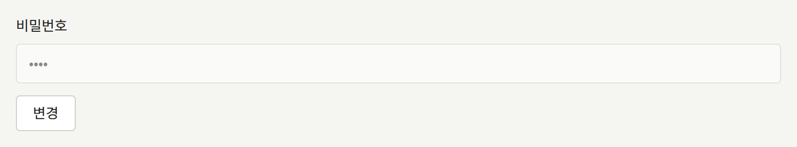
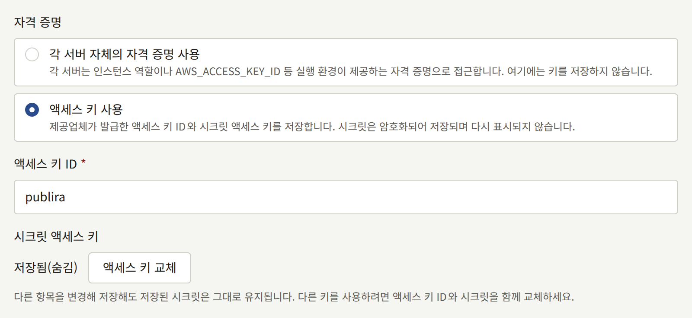

이 절차들은 [각 시크릿을 둘 수 있는 곳](./index.md#각-시크릿을-둘-수-있는-곳)에 나오는 각 시크릿을 교체합니다. 필요해지기 전에 읽어 두세요. 어느 절차든 사고 중보다 조용한 날에 실행하기가 더 쉽습니다.

시크릿을 처음 생성하는 것은 [설치](../../2-deployments/2-installing.md#시크릿-생성)의 일부이고, 시크릿을 보관하는 것은 [백업과 복원](../../2-deployments/9-backup-and-restore.md#시크릿-암호화-키)의 일부입니다.

## 시크릿 암호화 키 교체

설치 환경이 저장하는 모든 자격 증명은 암호화 키로 봉인되며, 봉인된 각 값에는 그것을 봉인한 키가 표시됩니다. `PUBLIRA_SECRET_ENCRYPTION_KEYS`는 프로세스가 값을 열 수 있는 모든 키를 나열하고, `PUBLIRA_SECRET_ENCRYPTION_PRIMARY_KEY_ID`는 새 값을 봉인할 키를 지정합니다. 교체란 키를 추가하고, 그 키로 봉인하고, 저장된 값을 그 키로 옮기는 것입니다. 목록에 키가 더 이상 없는 값은 아예 열 수 없습니다.

### 1. 새 키 추가

키를 생성하고, `k2`처럼 목록에 아직 없는 ID를 주세요. 이전 키 옆에 추가하고, 기본 키는 그대로 두세요.

```text
PUBLIRA_SECRET_ENCRYPTION_KEYS=k1:<old key>,k2:<new key>
PUBLIRA_SECRET_ENCRYPTION_PRIMARY_KEY_ID=k1
```

이 값으로 `publira server`와 `publira worker`를 재시작하고, 이후의 모든 `publiractl` 명령에도 사용하세요. 새 키는 즉시 시크릿 저장소와 백업에 보관하세요. 다음 단계부터 값이 이 키로 봉인됩니다.

### 2. 기본 키로 지정

모든 프로세스가 두 키를 가지고 실행되면, 기본 키를 `k2`로 바꾸고 다시 재시작하세요. 그 후로 저장되는 모든 값은 `k2`로 봉인되며, `k1`로 봉인된 값도 여전히 열립니다.

두 번의 재시작을 나누는 데는 이유가 있습니다. 아직 `k2`가 없는 프로세스는 다른 프로세스가 이미 `k2`로 봉인한 값을 열 수 없습니다. 따라서 `publira server`나 `publira worker`가 인스턴스를 둘 이상 실행하거나 차례로 재시작하는 동안 같은 단계에서 기본 키를 바꾸면, 메일이 실패하거나 로그인이 거부되는 시간이 생깁니다.

[Docker Compose](../../2-deployments/3-docker-compose.md) 설치 환경에서는 각 단계가 `.env`의 두 변수를 편집한 다음 `docker compose up -d`를 실행하는 것입니다. 그러면 `server`와 함께 워커가 재시작되고, 나머지는 계속 실행됩니다.

### 3. 저장된 값 다시 봉인

프로세스가 지금 가진 것과 같은 두 변수를 지정하고, 관리용 로그인의 연결로 `publiractl db reseal`을 실행하세요.

```bash
publiractl db reseal
```

이 명령은 데이터베이스의 봉인된 모든 값을 목록의 키로 열어, 기본 키가 아닌 키가 표시된 값을 모두 기본 키로 다시 봉인합니다. 플랫폼과 모든 테넌트의 자격 증명, 모든 스태프와 운영자의 2단계 인증 시크릿, 각 Sign in with Apple 연결이 가진 토큰, Web Push 개인 키, 모든 웹훅 엔드포인트의 서명 시크릿, 그리고 아웃박스 항목이 워커에 전달하는 값이 대상입니다. 값 자체는 바뀌지 않으므로 아무도 로그아웃되지 않고 아무도 다시 입력할 필요가 없으며, 실행 중에도 설치 환경은 계속 서비스합니다. 그동안 들어온 저장은 이 명령을 기다리거나 이 명령이 그 저장을 기다리며, 어느 쪽도 사라지지 않습니다.

이 명령은 저장된 값에 표시된 키 ID마다 한 줄씩 출력합니다.

```text
KEY ID        RESEALED  ON PRIMARY  UNREADABLE
k1            42        0           0
k2 (primary)  0         3           0
```

`RESEALED`는 그 키가 봉인했다가 이제 기본 키가 봉인하는 값의 수, `ON PRIMARY`는 기본 키가 이미 봉인하고 있던 값의 수, `UNREADABLE`은 목록의 어느 키로도 열리지 않는 값의 수입니다. 아무것도 기록하지 않고 같은 표를 보려면 `publiractl db reseal --dry-run`을 실행하세요.

[Docker Compose](../../2-deployments/3-docker-compose.md) 설치 환경에서는 `publiractl` 서비스에 이미 관리용 연결과 `.env`의 키가 있습니다.

```bash
docker compose run --rm publiractl db reseal
```

### 4. 아무것도 사용하지 않을 때만 이전 키 제거

`db reseal`이 `0`으로 종료되고 `UNREADABLE` 열에 남은 값이 없을 때만 목록에서 `k1`을 제거하세요. 그 상태에서 다시 실행하면 기본 키에 대한 한 줄만 출력되며, 그 줄이 세는 모든 값은 `k1` 없이 열립니다.

목록의 어느 키로도 열리지 않는 값이 있으면, `db reseal`은 그 값을 그대로 두고 나머지 값을 모두 봉인한 다음 `1`로 종료합니다. 로그에는 그런 값마다 열, 행, 표시된 키 ID가 나오며, 표는 그 값을 해당 키 ID 아래에 셉니다. 그 값은 더 이상 목록에 없는 키로, 또는 같은 ID의 다른 키 재료로 봉인된 것입니다. 그 키를 목록에 되돌려 놓고 명령을 다시 실행하세요. 더 이상 아무도 키를 가지고 있지 않은 값은, 키를 잃었을 때처럼 그 값을 저장했던 곳에서 다시 입력해야 합니다.

키가 사라진 값은 열 수 없습니다. 테넌트 관리자의 인증 앱 시크릿이 아직 `k1`로 봉인되어 있는데 `k1`을 제거하면, 그 관리자의 로그인은 2단계 인증 단계에서 오류 페이지와 함께 실패하고, 서버는 `secretcrypto: unknown key id: k1`을 로그에 남기며, 테넌트의 감사 로그에는 이유가 `secret_undecryptable`인 실패한 **로그인 시 2단계 인증**이 기록됩니다. 사라진 키로 봉인된 비밀번호가 필요한 메일도 발송되지 않으며, 그 키로 서명 시크릿이 봉인된 웹훅 엔드포인트로는 아무것도 보내지 않습니다. 그 엔드포인트의 전송은 키가 돌아오거나 테넌트 관리자가 시크릿을 재발급할 때까지 기다립니다. 키를 목록에 되돌려 놓고 재시작하면 이 모든 것이 원래대로 돌아옵니다.

키가 유출되었다면 다시 봉인하는 것만으로는 부족합니다. 이전 키와 교체 전에 만든 데이터베이스 백업을 가진 사람은 그 백업의 모든 값을 열 수 있으므로, 자격 증명 자체를 발급한 곳에서 교체하고(새 SMTP 비밀번호, 버킷의 새 액세스 키, 새 결제 제공자 키) 새 자격 증명을 저장하세요. 플랫폼 콘솔에서는 [이메일](../6-email.md#변경)과 [오브젝트 스토리지](../5-object-storage.md#액세스-키-교체)에서 설명하듯이, 새 SMTP 비밀번호는 **메일**의 **비밀번호** 옆에 있는 **변경**으로, 새 액세스 키는 **스토리지**의 **액세스 키 교체**로 입력합니다.





## 데이터베이스 역할의 비밀번호 교체

역할은 한 번에 비밀번호를 하나만 가지므로, 교체는 PostgreSQL에서 비밀번호를 바꾸고 곧바로 그 역할로 연결하는 모든 프로세스를 재시작하는 것입니다.

| 역할 | 연결하는 것 |
| --- | --- |
| `publira_public`, `publira_admin` | `publira server` |
| `publira_platform` | `publira server`, 그리고 플랫폼 설정을 변경하는 `publiractl` 명령 |
| `publira_outbox`, `publira_ticker` | `publira worker` |
| `publira_content_stats` | `publira worker`, 그리고 `publiractl job` |

1. `openssl rand -hex 32`로 새 비밀번호를 생성하세요. 연결 URL에는 비밀번호가 이스케이프 없이 들어가므로 16진수로 만듭니다.
2. 관리용 로그인의 연결로 그 역할의 플래그만 지정해 `publiractl db roles`를 실행하세요. 다른 모든 역할은 비밀번호를 유지합니다.

   ```bash
   publiractl db roles --admin-password-file /run/secrets/publira-admin-db-password
   ```

   이 명령은 역할마다 한 줄씩 출력하며, 지정한 역할에는 `set its password`, 나머지에는 `kept its password`가 표시됩니다.

3. 위 표에 있는 모든 프로세스의 연결 URL을 새 비밀번호로 바꾸고 재시작하세요.

프로세스가 이미 열어 둔 연결은 로그인된 상태로 남으므로, 비밀번호를 바꾸는 순간 실패하는 것은 없습니다. 그 후에 여는 연결은 거부되므로, 두 단계 사이에 간격을 두지 마세요. 이전 비밀번호로 재시작한 프로세스는 아예 시작되지 않습니다. 로그에 `password authentication failed for user "publira_admin"`이 반복되며, 다시 실행되면 `GET /readyz`가 역할마다 확인 항목을 하나씩 표시하므로 불일치가 그곳에 나타납니다. 프로세스가 가진 비밀번호로 `db roles`를 다시 실행하면 바로잡힙니다.

모든 역할을 한꺼번에 교체하려면 `db roles`에 여섯 개의 플래그를 모두 지정하고 `publira server`와 `publira worker`를 재시작하세요.

Docker Compose 설치 환경에서는 비밀번호가 `.env`의 `PUBLIRA_*_DB_PASSWORD` 변수이며, Compose 파일이 이 변수로 모든 연결 URL을 만듭니다. 변수를 바꾼 다음 실행하세요.

```bash
docker compose run --rm publiractl db roles --admin-password-file /run/secrets/admin-db-password
docker compose up -d
```

`docker compose up -d`는 연결 URL이 바뀐 프로세스만 재시작합니다.

### 관리용 로그인의 비밀번호

`publiractl`은 관리용 로그인을 관리하지 않습니다. `psql`에서 `ALTER ROLE postgres PASSWORD '<new password>'`로, 또는 데이터베이스 제공업체를 통해 PostgreSQL에서 비밀번호를 바꾼 다음, `db` 명령을 실행할 때 쓰는 `PUBLIRA_DB_URL`을 바꾸세요. 상시 실행되는 프로세스는 이 로그인을 사용하지 않으므로 재시작할 것은 없습니다.

Docker Compose 설치 환경에서는 PostgreSQL이 볼륨을 만들 때만 `PUBLIRA_POSTGRES_PASSWORD`를 읽으므로, `.env`만 바꿔서는 아무것도 바뀌지 않습니다. `docker compose exec postgres psql -U postgres -d publira`로 `ALTER ROLE`을 실행한 다음, `.env`에 같은 값을 설정하세요. 다음 `docker compose up -d`는 변수가 바뀌었으므로 `postgres` 컨테이너를 재시작하며, 이 때문에 모든 프로세스가 몇 초 동안 중단됩니다.

## 서명 키와 토큰 교체

이 값들은 프로세스가 시작할 때 읽힙니다. 교체하려면 그 값을 가진 모든 프로세스에 새 값을 주고 함께 재시작하면 됩니다. 어느 값도 데이터베이스에 저장되지 않으며, 교체한 후에는 보관할 필요도 없습니다.

| 값 | 변경할 곳 | 변경의 영향 |
| --- | --- | --- |
| `PUBLIRA_AUTH_JWT_SECRET` | `publira server` | 모든 사람을 로그아웃시킵니다. 모든 테넌트의 사이트와 모바일 앱의 독자, 모든 테넌트 콘솔의 스태프, 플랫폼 콘솔의 운영자가 해당합니다 |
| 웹 앱 하나의 `PUBLIRA_AUTH_SECRET` | 그 웹 앱 | 그 앱의 사용자만 로그아웃시킵니다 |
| 캐시 재검증 토큰 | `publira server`, `publira worker`, 모든 웹 앱 | 아무도 로그아웃시키지 않습니다 |
| 웹 서비스 토큰 | `publira server`, `web-admin`, `web-platform` | 아무도 로그아웃시키지 않습니다 |

Docker Compose 설치 환경에서는 `.env`의 `PUBLIRA_AUTH_JWT_SECRET`, `PUBLIRA_WEB_STOREFRONT_AUTH_SECRET`, `PUBLIRA_WEB_ADMIN_AUTH_SECRET`, `PUBLIRA_WEB_PLATFORM_AUTH_SECRET`, `PUBLIRA_REVALIDATE_TOKEN`, `PUBLIRA_WEB_SERVICE_TOKEN`이 해당 변수입니다. 하나를 바꾸면 `docker compose up -d`가 그 변수를 읽는 프로세스만 정확히 재시작합니다.

### 액세스 토큰 서명 키

모든 세션은 이 키로 서명된 액세스 토큰이므로, 새 키를 쓰면 모든 세션이 한꺼번에 끝납니다. 페이지를 여는 독자나 스태프는 "세션이 만료되었습니다. 다시 로그인해 주세요."와 함께 로그인 화면으로 보내집니다. 테넌트 모바일 앱의 세션도 같은 종류의 토큰이므로 함께 끝납니다. 2단계 인증 로그인 도중이던 스태프는 비밀번호부터 다시 시작합니다.

에피소드 이미지의 링크에는 같은 키로 서명된 수명이 짧은 토큰이 들어 있습니다. 테넌트의 사이트는 무료 에피소드의 페이지를 링크까지 포함해 최대 1시간 동안 캐시하므로, 그 페이지가 다시 만들어질 때까지 무료 에피소드의 이미지가 로드되지 않을 수 있습니다.

이 키가 유출되었을 가능성이 있을 때, 그리고 세션 키가 유출되었을 가능성이 있을 때마다 교체하세요. 세션 쿠키에는 하루 동안 유효한 액세스 토큰이 들어 있으며, 그보다 빨리 끝내는 방법은 새 서명 키뿐입니다.

### 웹 앱의 세션 키

각 웹 앱은 자체 `PUBLIRA_AUTH_SECRET`으로 세션 쿠키를 봉인합니다. 새 키를 쓰면 그 키가 봉인한 모든 쿠키를 읽을 수 없게 되므로, 그 앱의 사용자는 아무 메시지 없이 로그인 화면으로 가게 되고, 다른 앱은 세션을 유지합니다. `web-storefront`의 키를 교체하면 독자는 사이트에서는 로그아웃되지만 모바일 앱에서는 로그아웃되지 않으며, 진행 중이던 Apple이나 Google 로그인은 취소됩니다. `web-admin`의 키를 교체하면 진행 중이던 2단계 인증 로그인도 취소됩니다.

값은 최소 32바이트여야 하며, 처음 32바이트만 사용되므로, 이전 값의 끝을 고치지 말고 `openssl rand -base64 32`로 완전히 새 값을 생성하세요.

### 캐시 재검증 토큰

`publira server`와 `publira worker`는 웹 앱의 캐시된 페이지를 폐기하는 모든 요청에 이 토큰을 보내며, 각 웹 앱은 토큰이 자기 것과 일치하지 않는 요청을 거부합니다. 양쪽이 일치하지 않는 동안 모든 폐기는 `401`로 거부되고, 워커는 각 시도를 `revalidate endpoint returned status=401`과 함께 `outbox event retry scheduled`로 로그에 남깁니다. 워커는 각 폐기를 약 9분 동안 계속 시도하므로, 그 안에 모든 프로세스를 새 토큰으로 재시작하면 잃는 것이 없습니다. 시도 횟수를 다 쓴 폐기는 [예약 작업과 유지 관리 작업](../10-scheduled-jobs.md#포기된-항목-확인)에서 설명하듯이 그 폐기가 지정한 페이지를 그대로 둡니다.

### 웹 서비스 토큰

`web-admin`과 `web-platform`은 모든 스태프가 똑같이 보는 것을 읽을 때 이 토큰을 보냅니다. `publira server`가 다른 토큰을 가지고 있는 동안에는 그 읽기가 거부되며, 두 콘솔 모두 대시보드에 "세션이 유효하지 않습니다. 다시 로그인해 주세요."를 표시합니다. 다시 로그인해도 해결되지 않습니다. 세 프로세스를 모두 같은 토큰으로 재시작하세요.
