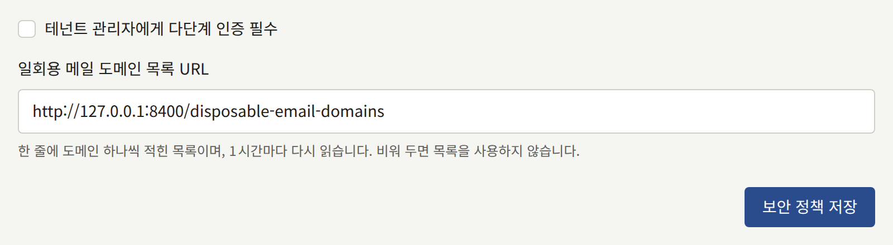

이 페이지는 운영자를 위한 것으로, 테넌트 스태프와 플랫폼 콘솔 운영자가 두 번째 인증 수단으로 계정을 보호하는 방법, 이를 요구하는 방법, 그리고 인증 수단을 잃었을 때 할 일을 설명합니다.

## 테넌트 스태프

테넌트의 모든 스태프는 [내 계정](../../4-console/3-setup/9-your-account.md)에서 설명하듯이, 콘솔의 **계정 설정**에서 인증 앱과 복구 코드 10개로 콘솔 계정을 보호할 수 있습니다.

[패스키로 로그인하기](../../4-console/3-setup/9-your-account.md#패스키로-로그인하기)에서 설명하듯이, 스태프는 패스키나 보안 키로도 2단계 인증에 응답할 수 있습니다. 패스키는 인증 앱과 마찬가지로 아래의 요구 사항을 충족합니다. 로그인할 때 2단계 인증 설정을 요청받은 테넌트 관리자는 그 대신 패스키를 등록할 수 있습니다. 계정의 패스키와 인증 앱은 같은 복구 코드 10개를 공유하며, 거부된 패스키는 잘못된 코드와 같은 잠금 횟수에 포함됩니다.

패스키는 콘솔의 호스트에 묶이며, 그 호스트가 어디에서 제공되든 마찬가지입니다. 콘솔이 `admin.<domain>`처럼 테넌트의 도메인 아래에 있더라도 테넌트의 도메인에 묶이지는 않습니다. 따라서 [콘솔을 다른 호스트로 옮기면](../2-tenants.md#테넌트를-다른-호스트-이름으로-옮기기)(새 관리 도메인을 주거나, 콘솔이 `admin.<domain>`에 있는 테넌트의 도메인을 바꾸는 경우) 스태프가 등록한 모든 패스키를 사용할 수 없게 됩니다. 인증 앱이나 복구 코드가 있는 스태프는 그것으로 로그인합니다. 두 번째 인증 수단이 패스키뿐이던 스태프는, 요구 사항이 그 역할에 적용되면 2단계 인증을 다시 설정하도록 요청받고, 적용되지 않으면 비밀번호만으로 로그인합니다. 콘솔을 원래대로 옮기면 이전 패스키를 다시 사용할 수 있습니다.

설치 환경의 모든 테넌트 관리자에게 이를 요구할 수 있습니다. 플랫폼 콘솔의 **정책** 아래에 있는 **보안**에서 **테넌트 관리자에게 다단계 인증 필수**를 체크하고 **보안 정책 저장**을 선택하거나, 다음을 실행하세요.

```bash
publiractl policy set --mfa-required-for-tenant-admin
```



`--mfa-required-for-tenant-admin=false`로 요구를 해제합니다. 요구 사항은 테넌트 관리자가 로그인할 때 확인되므로, 이미 열려 있는 세션이 아니라 각 관리자의 다음 로그인부터 적용됩니다. 이 설정이 하는 일과 적용 대상은 [플랫폼 기본값과 정책](../9-platform-policies.md#테넌트-관리자의-2단계-인증)에 있습니다.

모든 두 번째 인증 수단(인증 앱과 패스키)과 모든 복구 코드를 잃은 스태프는 다시 로그인할 수 없으며, 테넌트의 다른 관리자도 그 계정에서 2단계 인증을 제거할 수 없습니다. 운영자는 [테넌트의 스태프](../3-tenant-staff.md#잃어버린-2단계-인증)에서 설명하듯이 `publiractl tenant member reset-mfa`로 제거할 수 있습니다.

각 인증 앱의 시크릿은 암호화 키로 봉인되므로, [이전 키를 제거하면](./1-rotating-secrets.md#4-아무것도-사용하지-않을-때만-이전-키-제거) 스태프가 로그인하지 못하게 될 수 있습니다. 패스키는 그렇지 않습니다. 설치 환경은 각 패스키의 공개 키만 보관하며, 공개 키는 읽는 사람에게 아무것도 증명하지 못하므로, 키를 교체하거나 제거해도 패스키는 계속 동작합니다.

## 플랫폼 운영자

모든 운영자는 [운영자 자신의 계정](../1-platform-console.md#운영자-자신의-계정)에서 설명하듯이, **계정 설정**의 **2단계 인증**에서 같은 방법으로, 인증 앱과 복구 코드 10개로 플랫폼 콘솔 계정을 보호할 수 있습니다.

역할과 관계없이 모든 운영자에게 이를 요구할 수 있습니다. **정책** 아래에 있는 **보안**에서 **Platform Console의 모든 운영자에게 2단계 인증 필수**를 체크하고 **보안 정책 저장**을 선택하거나, 다음을 실행하세요.

```bash
publiractl policy set --mfa-required-for-platform-operator
```

`--mfa-required-for-platform-operator=false`로 요구를 해제합니다. 요구 사항은 운영자가 로그인할 때 확인되므로, 자신의 세션을 포함해 이미 열려 있는 세션이 아니라 각 운영자의 다음 로그인부터 적용됩니다. 인증 앱을 설정하지 않은 운영자에게 무엇이 보이는지는 [플랫폼 기본값과 정책](../9-platform-policies.md#플랫폼-운영자의-2단계-인증)에 있습니다. 로그인이 무엇을 요구하는지 처음 알게 되는 사람이 자신이 되지 않도록, 요구하기 전에 자신의 인증 앱을 먼저 설정하세요.

인증 앱과 모든 복구 코드를 잃은 운영자는 다시 로그인할 수 없으며, 다른 어떤 운영자도 플랫폼 콘솔에서 그 계정의 인증 앱을 제거할 수 없습니다. [잃어버린 2단계 인증](../1-platform-console.md#잃어버린-2단계-인증)에서 설명하듯이 `publiractl operator reset-mfa`로 제거할 수 있습니다. 이 명령에는 계정이 필요 없으므로, 인증 수단을 잃은 운영자가 설치 환경의 유일한 **슈퍼 관리자**일 때도 동작합니다.

각 인증 앱의 시크릿은 테넌트 스태프의 것과 마찬가지로 암호화 키로 봉인되므로, [이전 키를 제거하면](./1-rotating-secrets.md#4-아무것도-사용하지-않을-때만-이전-키-제거) 운영자도 로그인하지 못하게 될 수 있습니다.

2단계 인증을 요구하든 하지 않든 다음을 지키세요.

- 각 운영자에게 비밀번호 관리자에 보관하는 자기만의 긴 비밀번호를 주세요.
- **슈퍼 관리자** 역할은 가능한 한 적은 운영자에게만 주고, 보기만 하면 되는 사람에게는 **감사 담당**을 주세요.
- 더 이상 계정이 필요 없는 운영자는 [정지와 비활성화](../1-platform-console.md#정지와-비활성화)에서 설명하듯이 정지하거나 비활성화하세요.
- VPN이나 TLS 종단의 주소 허용 목록 등을 통해, 운영자가 접근하는 네트워크에만 플랫폼 콘솔의 호스트 이름을 제공하는 것을 고려하세요. 독자와 테넌트 스태프에게는 필요 없습니다.
