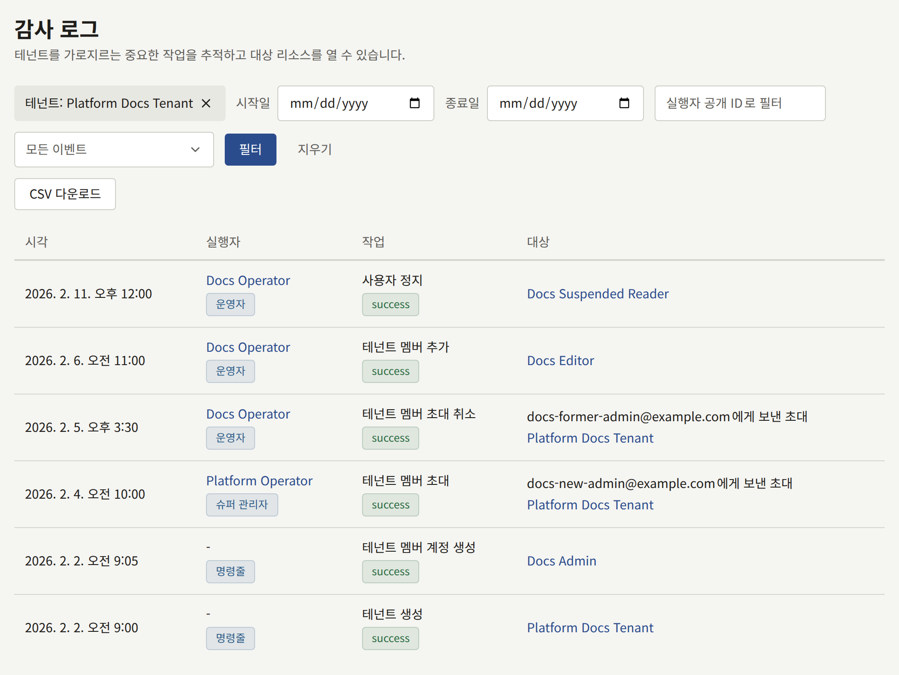

설치 환경은 항목을 서로 공유하지 않는 두 가지 감사 로그를 보관합니다. 운영자와 `publiractl`이 변경한 것을 기록하는 플랫폼 콘솔의 로그와, 각 테넌트의 스태프가 테넌트 콘솔에서 변경한 것을 기록하는 테넌트의 로그입니다. 항목은 삭제되지 않으며, 데이터베이스는 Publira의 프로세스가 연결하는 모든 역할에 대해 항목의 변경을 거부합니다. 단 하나의 예외는 행동한 계정이 삭제될 때 데이터베이스 스스로 하는 변경으로, 이때 항목은 그 계정 대신 계정의 이름과 공개 ID를 보관합니다. 어느 로그든 기간 단위로 [CSV로 내보낼](#로그-내보내기) 수 있습니다.

## 플랫폼 콘솔의 로그

플랫폼 콘솔의 **거버넌스** 아래에 있는 **감사 로그**는 최신 항목부터 한 페이지에 20개씩 나열합니다. **감사 담당**을 포함한 모든 운영자가 읽을 수 있습니다. 각 항목에는 **시각**, 역할과 함께 표시되는 **실행자**, 결과와 함께 표시되는 작업, **대상**이 표시됩니다. `publiractl`에서 한 변경은 운영자를 표시하지 않으며, 실행자는 **명령줄**입니다. 목록은 **시작일**과 **종료일**로 기간을(플랫폼의 **기본 시간대** 기준의 하루 단위), 공개 ID로 실행자 한 명을, 그리고 작업 종류 하나로 좁힐 수 있습니다. 테넌트 페이지의 **감사 로그 확인**은 그 테넌트로도 좁힌 상태로 로그를 엽니다. 그 테넌트, 그 테넌트의 초대, 그 테넌트의 스태프와 독자의 계정을 변경한 항목이 표시됩니다. 테넌트 이름은 목록 위에 표시되며, 그 닫기 버튼은 그 필터만 해제합니다. **지우기**는 모든 필터를 해제합니다.

기록하는 내용은 다음과 같습니다.

- **운영자**: 추가, 변경, 정지, 재활성화, 비활성화. 그리고 각 운영자 자신의 2단계 인증: 설정, 로그인 시 요청한 코드(맞았는지 틀렸는지 포함), 복구 코드로 로그인, 새 복구 코드 발급, 끄기.
- **플랫폼 설정과 서비스**: 일반 설정, 보안 및 커뮤니티 정책, 보존 기간 기본값, 메일·스토리지·검색 설정, Web Push 연락처의 저장과, 메일·스토리지·검색 연결의 테스트와 그 결과.
- **테넌트와 그 스태프**: 테넌트의 생성, 변경, 정지, 재개. 관리자 초대와 초대 재발송 및 취소. 멤버 추가, 비밀번호로 생성, 새 역할 부여, 삭제.
- **독자**: 운영자가 정지, 복구, 삭제한 계정.
- **로그 자체**: 로그를 내보낼 때마다, 그 대상 기간과 좁힌 테넌트.

## 테넌트의 로그

각 테넌트 콘솔의 **관리** 아래에 있는 **감사 로그**는 그 테넌트의 스태프가 콘솔에서 하는 일을 2단계 인증을 포함해 기록하며, 그 테넌트의 테넌트 관리자만 읽을 수 있습니다. 기록하는 내용은 [감사 로그](../../4-console/3-setup/8-audit-log.md)에 있습니다. 플랫폼 콘솔에서는 읽을 수 없으며, 운영자가 플랫폼 콘솔이나 `publiractl`에서 테넌트에 대해 변경한 것은 테넌트의 로그가 아니라 플랫폼 콘솔의 로그에 기록됩니다.

## 로그 내보내기

어느 로그든 그 로그를 읽을 수 있는 사람이 최대 366일을 포함하는 CSV 파일 하나로 내보낼 수 있습니다. 테넌트의 로그는 그 테넌트의 테넌트 관리자가, 플랫폼 콘솔의 로그는 **감사 담당**을 포함한 모든 운영자가 내보낼 수 있습니다. 기간은 하루 단위로, 테넌트의 로그는 테넌트의 시간대, 플랫폼 콘솔의 로그는 플랫폼의 **기본 시간대** 기준이며, 실행자와 작업, 그리고 플랫폼 콘솔의 로그에서는 테넌트가 목록을 좁히는 것과 같은 방식으로 파일을 좁힙니다.

파일에는 그 기간의 모든 항목이 오래된 것부터 항목 하나에 한 행씩 들어 있습니다. 각 행에는 기록된 시각(기간이 속한 시간대의 오프셋 포함), 실행자의 공개 ID, 이름, 역할, 작업, 그 결과와 이유, 작업 대상의 종류와 ID, 클라이언트 주소가 있습니다. 플랫폼 콘솔의 로그 파일에는 각 항목의 테넌트(공개 ID와 이름)와, 항목이 작업한 대상의 공개 ID와 이름도 들어 있습니다. 파일은 바이트 순서 표시가 있는 UTF-8이며, 이 덕분에 스프레드시트가 UTF-8로 읽습니다. 스프레드시트가 수식으로 읽을 값은 앞에 아포스트로피를 붙여 써서 텍스트로 남게 합니다.

내보내기 자체도 그것이 읽은 로그의 항목이 되므로, 로그에는 누가 언제 어느 기간의 사본을 가져갔는지가 나타납니다.

플랫폼 콘솔에서는 **감사 로그**의 필터 옆에 있는 **CSV 다운로드**가 표시된 기간, 테넌트, 실행자, 작업의 항목을 `platform-audit-log-2026-04-01--2026-04-30.csv`처럼 기간을 딴 이름의 파일로 저장합니다. **종료일**이 없으면 기간은 오늘 끝나고, **시작일**이 없으면 **종료일** 또는 오늘로 끝나는 366일입니다. 그보다 긴 기간이나 **시작일**이 **종료일**보다 늦은 기간은 좁히기 전까지 다운로드할 수 없습니다. 다운로드할 때마다 로그에 **감사 로그 CSV 다운로드**로 나타납니다.

## 어느 로그도 기록하지 않는 것

- **비밀번호로 로그인.** 로그인 성공도 잘못된 비밀번호도 항목을 남기지 않습니다. 테넌트의 로그는 그 뒤에 오는 2단계 인증 단계만 기록합니다. `publira server`는 사이트, 테넌트 콘솔, 플랫폼 콘솔에 대한 모든 로그인 시도를 `audit auth action=admin_login outcome=failure ... reason=invalid_credentials`처럼 작업, 결과, 이유, 클라이언트 주소와 함께 `audit auth`로 시작하는 줄로 로그에 남깁니다. 이 기록이 필요하면 서버의 로그를 보관하세요.
- **설치 환경의 시크릿과 변수.** 키, 비밀번호, 토큰의 교체는 Publira 밖에서 이루어지며 어디에도 항목을 남기지 않습니다. 언제 무엇을 교체했는지는 직접 기록해 두세요.

모든 항목은 저장되기 전에 `msg=audit`가 들어간 줄로 `publira server`의 로그에도 기록됩니다. 대부분의 항목은 변경 직후 서버 메모리의 큐에서 저장되며, 몇 번 시도해도 저장하지 못한 항목이나 서버가 멈출 때 아직 큐에 있던 항목은 콘솔의 목록에서는 빠지지만 그 로그 줄에는 남습니다. 이렇게 빠진 항목에 알림을 걸 로그 줄과 메트릭은 [모니터링](../11-monitoring.md#감사-로그)에 있습니다.
