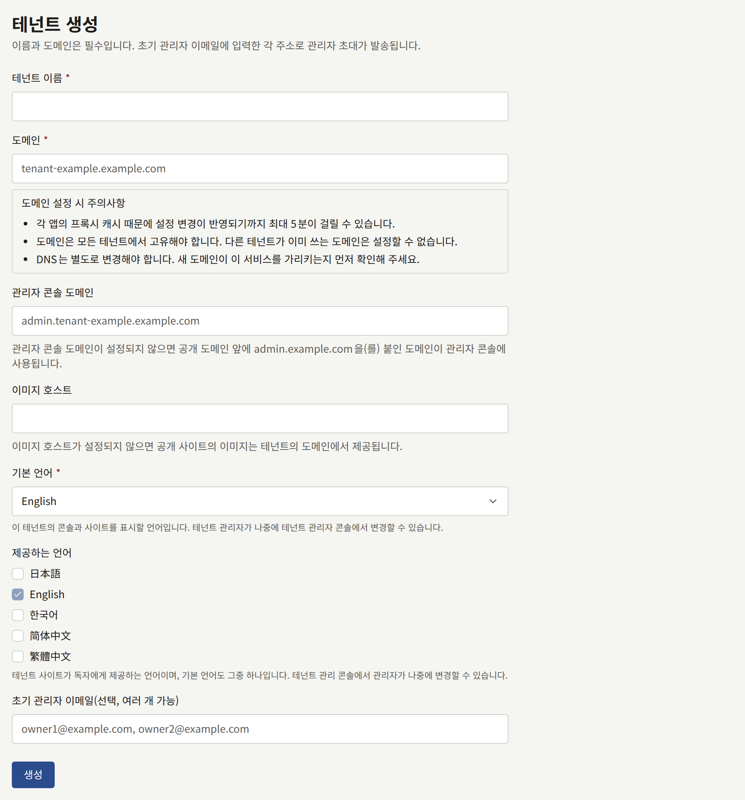
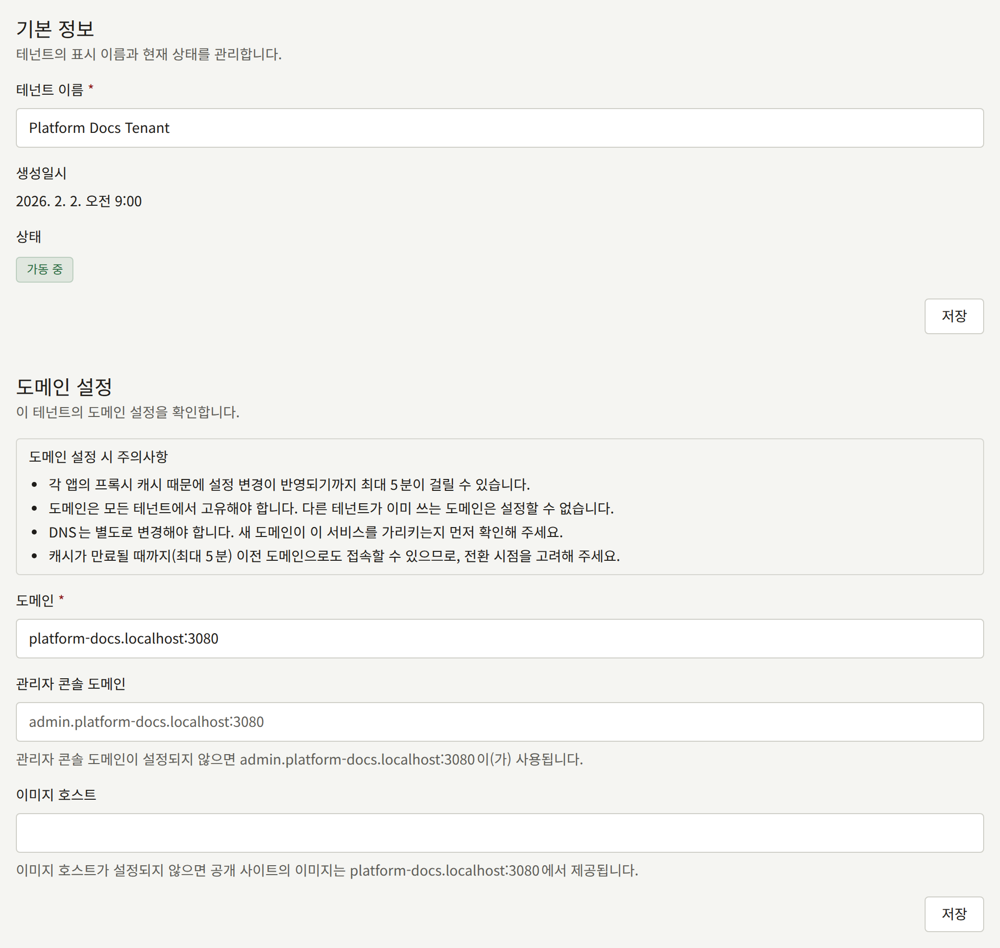
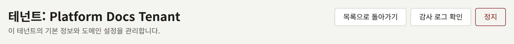
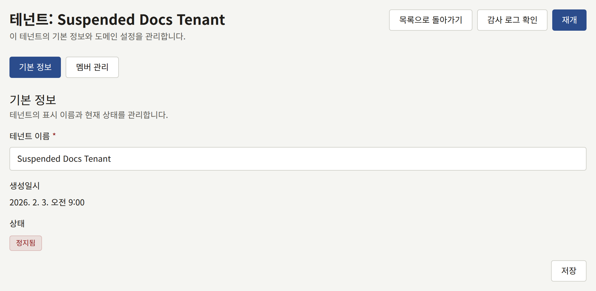
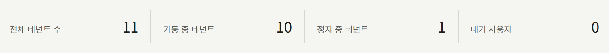
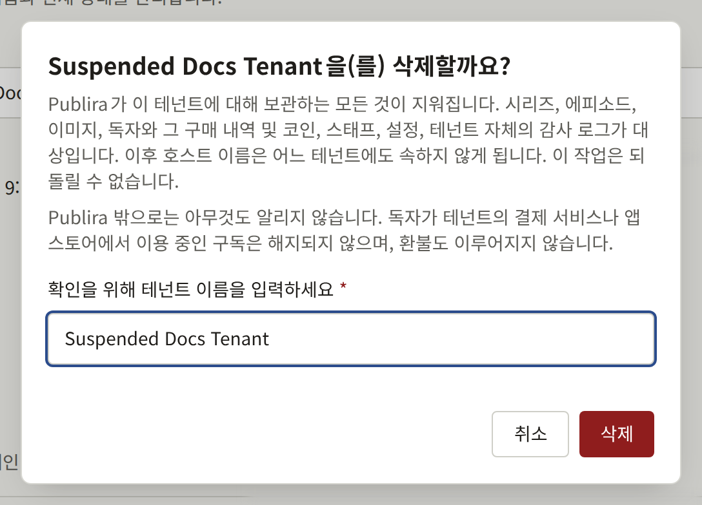

설치 환경이 서비스하는 각 출판사는 테넌트이며, 자기 도메인의 공개 사이트와 두 번째 호스트 이름의 콘솔을 가집니다. 첫 번째 테넌트는 `publiractl setup`이 만들었습니다. 이 페이지에서는 다음 테넌트를 추가하는 방법과, 만든 뒤에 테넌트에서 바꿀 수 있는 것을 설명합니다.

여기의 `publiractl` 명령은 모두 명령만 표시합니다. [플랫폼 콘솔과 publiractl](./1-platform-console.md#둘-중-고르기)에서 설명하는 방법으로, `PUBLIRA_PLATFORM_DB_URL`을 `publira_platform` 연결로 설정해 실행하세요. 전체 플래그 목록은 [`publiractl` 레퍼런스](https://github.com/publira/publira/blob/main/server/cmd/publiractl/README.md#tenant)에 있습니다.

## 테넌트를 만들기 전에

테넌트는 존재하는 순간부터 자신의 호스트 이름으로 서비스되므로, 다음을 먼저 정하세요.

- **도메인**: 공개 사이트를 제공하는 호스트입니다. 예: `comics.example.com`.
- **콘솔 호스트**: 스태프가 로그인하는 호스트입니다. 별도로 지정하지 않으면 도메인 앞에 `admin.`을 붙인 것이 됩니다. 예: `admin.comics.example.com`.
- **이미지 호스트**: 사이트의 이미지를 `images.comics.example.com`처럼 별도의 호스트 이름에서 제공할 때만 필요하며, [이미지 호스트](#이미지-호스트)에서 설명합니다. 없으면 이미지는 도메인에서 제공됩니다.
- **기본 언어**: 사이트와 콘솔이 시작할 때의 언어입니다. 자동으로 정해지지 않습니다. 테넌트의 관리자가 나중에 테넌트 콘솔에서 바꿀 수 있습니다.
- **사이트가 독자에게 제공하는 언어**: 기본 언어를 포함합니다. 그대로 두면 사이트는 기본 언어만 제공합니다. 이것도 테넌트의 관리자가 나중에 바꿀 수 있습니다.
- **첫 번째 관리자**와 그 사람이 접근하는 방법: 메일로 보내는 초대, 또는 직접 비밀번호를 정해 만드는 계정입니다. 둘의 비교는 [테넌트의 스태프](./3-tenant-staff.md)에 있습니다.

각 호스트 이름은 그 이름만 소문자로 적으세요. `https://`, 경로, 끝의 `/`는 붙이지 않습니다. 각 호스트 이름은 한 테넌트의 도메인, 콘솔 호스트, 이미지 호스트 중 하나에만 속하며, 둘 이상에 속하지 않습니다. 프록시는 한 호스트 이름을 한 곳으로만 보내므로, 같은 이름을 두 번 쓰면 둘 중 하나에 도달할 수 없게 됩니다. Publira는 다른 테넌트가 셋 중 어느 것으로든 이미 쓰고 있는 도메인, 콘솔 호스트, 이미지 호스트를 거부하며, 콘솔에 기본으로 주어지는 `admin.<domain>`도 마찬가지입니다. 또 테넌트 자신의 도메인과 같은 콘솔 호스트, 테넌트 자신의 도메인이나 콘솔 호스트와 같은 이미지 호스트도 거부합니다. 테넌트에 주어질 `admin.<domain>`이 이미 사용 중이라면, 별도의 관리자 콘솔 도메인을 지정하세요.

그다음 [테넌트 추가](../2-deployments/4-edge/index.md#테넌트-추가)에 나온 순서대로 DNS, 인증서, 엣지의 라우팅을 설정해 호스트 이름이 설치 환경에 도달하게 합니다. 이 작업은 테넌트를 만들기 전이든 후든 할 수 있지만, 끝나기 전에는 스태프가 콘솔을 열 수 없습니다.

### 별도 도메인의 콘솔 호스트

콘솔 호스트가 테넌트의 도메인 아래에 있을 필요는 없습니다. `example.com`의 사이트가 `admin.example.net`에 콘솔을 둘 수 있으며, 아래의 **관리자 콘솔 도메인**이나 `--admin-domain`으로 지정합니다. 콘솔용으로 두 번째 도메인을 등록할 수 있다면 그쪽이 더 안전합니다. 공인 인증 기관이 발급하는 모든 인증서는 Certificate Transparency 로그에 공개되며, crt.sh 같은 서비스로 누구나 도메인별로 검색할 수 있습니다. 그래서 사이트의 도메인 아래에 있는 콘솔 호스트는 이름이 무엇이든 인증서가 발급되는 순간부터 사이트와 나란히 목록에 오릅니다. 와일드카드 인증서를 쓰면 이름이 로그에 나오지 않지만, `admin.<domain>`은 누구나 가장 먼저 시도해 보는 이름입니다. 등록 가능한 다른 도메인에 있고, 사이트의 어떤 호스트도 이름에 포함하지 않는 인증서를 쓰는 콘솔 호스트는 그런 식으로 사이트와 연결되지 않습니다. 콘솔은 여전히 스태프에게 로그인을 요구하므로, 이렇게 해서 감춰지는 것은 로그인 페이지입니다. `admin.<domain>`은 계속 기본값이며, 그대로도 동작합니다.

스태프가 패스키를 등록하기 전에 정하세요. 패스키는 콘솔의 호스트에 묶여 있으므로, 나중에 콘솔을 다른 호스트로 옮기면 이미 등록된 패스키를 쓸 수 없게 됩니다. 자세한 내용은 [2단계 인증](./12-security/2-two-step-verification.md#테넌트-스태프)에 있습니다.

엣지에서 더 나아가 스태프의 IP 주소에서 온 요청만 콘솔 호스트로 받을 수도 있습니다. [샘플 구성](../2-deployments/4-edge/1-sample-configurations.md)은 이를 대신 해 주지 않습니다. 이 규칙이 보호하는 것은 콘솔의 페이지입니다. 콘솔의 API에는 그런 규칙이 필요 없습니다. 콘솔은 사설 네트워크를 통해 API를 호출하며, [공개 API만 엣지를 거친다](../2-deployments/4-edge/index.md#공개-api만-엣지를-거친다)에서 설명하는 대로 구성한 엣지는 어느 호스트에서도 API를 전달하지 않습니다.

### 이미지 호스트

테넌트 사이트의 이미지는 페이지와 같은 엣지를 거쳐 테넌트의 도메인에서 제공됩니다. 이미지 호스트는 대신 `images.comics.example.com` 같은 별도의 호스트 이름에서 이미지를 제공하며, 이를 통해 이미지가 페이지나 공개 API와 떨어져 별도의 로드 밸런서나 CDN을 거쳐 Publira에 도달하게 할 수 있습니다. 자세한 내용은 [이미지와 공개 API를 따로 제공하기](../2-deployments/7-scaling-out.md#이미지와-공개-api를-따로-제공하기)에 있습니다. 그럴 필요가 없는 테넌트에는 이미지 호스트가 필요 없습니다.

테넌트에 이미지 호스트가 생기면, 공개 API는 그 테넌트 사이트의 이미지 주소를 그 호스트로 알려 주고, Publira는 그 호스트에서 테넌트 사이트의 이미지에만 응답합니다. 페이지, API, 콘솔은 거기서 제공되지 않습니다. 테넌트의 사이트와 모바일 앱은 이미지를 그 호스트에서 불러오며, 테넌트 콘솔은 계속 콘솔 호스트에서 이미지를 불러옵니다.

이미지 호스트는 테넌트의 다른 호스트 이름처럼 설치 환경에 도달해야 합니다. DNS에 등록하고, 인증서를 갖추고, 그 호스트의 `/images`를 `publira server`로 라우팅해야 하며, 자세한 내용은 [테넌트의 이미지 호스트](../2-deployments/4-edge/index.md#테넌트의-이미지-호스트)에 있습니다. 샘플 구성은 이미지 호스트가 `PUBLIRA_EDGE_IMAGE_HOSTS`에 들어 있으면 라우팅합니다. 설정하는 순간부터 사이트가 그 호스트에서 이미지를 불러오므로, 설정하기 전에 준비해 두세요.

나중에 설정, 변경, 해제하는 것은 다른 호스트 이름과 마찬가지로 이동이며, [테넌트를 다른 호스트 이름으로 옮기기](#테넌트를-다른-호스트-이름으로-옮기기)에서 설명합니다. 변경 전에 사이트가 준비해 둔 페이지는 `publira worker`가 웹 앱에 변경을 알릴 때까지 이전 호스트의 이미지로 연결되므로, 그때까지는 이전 호스트를 계속 서비스하세요.

## 테넌트 만들기

### 플랫폼 콘솔에서

사이드바의 **테넌트** 아래에서 **테넌트 생성**을 선택하고 다음을 입력합니다.

- **테넌트 이름**: 출판사의 이름이며, 초대 메일을 비롯한 테넌트의 메일에서 이 이름으로 부릅니다.
- **도메인**: 정해 둔 도메인입니다.
- **관리자 콘솔 도메인**: 콘솔 호스트가 `admin.<domain>`이 아닐 때만 입력합니다. 비워 두면 필드 아래 줄에 표시되는 대로 콘솔은 `admin.<domain>`에서 제공됩니다.
- **이미지 호스트**: 테넌트 사이트의 이미지를 도메인이 아닌 곳에서 제공할 때만 입력하는 호스트입니다. 비워 두면 필드 아래 줄에 표시되는 대로 이미지는 도메인에서 제공됩니다.
- **기본 언어**.
- **제공하는 언어**: 언어마다 체크박스가 있으며, 테넌트의 사이트가 제공하는 언어에 체크합니다. 기본 언어의 체크박스는 항상 체크되어 있고 해제할 수 없으며, 나머지는 해제된 상태로 시작합니다.
- **초기 관리자 이메일(선택, 여러 개 가능)**: 테넌트의 관리자로 초대할 주소이며, 쉼표나 줄바꿈으로 구분합니다. 테넌트가 만들어지는 즉시 각 주소로 초대가 메일로 전송됩니다.



**생성**은 테넌트를 만들고 그 페이지를 엽니다. 테넌트의 시간대는 플랫폼의 기본값이며, 테넌트의 관리자가 테넌트 콘솔에서 바꿀 수 있습니다.

### publiractl에서

```bash
publiractl tenant create \
  --name "Example Comics" \
  --domain comics.example.com \
  --default-locale en \
  --supported-locale en \
  --supported-locale ja \
  --initial-admin-email owner@comics.example.com
```

`--supported-locale`은 테넌트의 사이트가 제공하는 언어를 지정하며, 여러 번 쓸 수 있습니다. 기본 언어는 그중 하나여야 합니다. 생략하면 사이트는 기본 언어만 제공합니다. `--admin-domain`은 콘솔에 별도의 호스트를, `--image-domain`은 사이트의 이미지에 별도의 호스트를 지정하고, `--timezone`은 플랫폼의 기본값이 아닌 IANA 시간대를 지정합니다. `--initial-admin-email`은 여러 번 쓸 수 있으며, 각 주소는 플랫폼 콘솔에서처럼 초대됩니다.

### 만든 뒤에

초대 메일은 `publira worker`가 보내므로, 워커가 실행 중이고 플랫폼의 SMTP 설정이 저장되어 있어야 합니다. 메일을 보내지 않는 설치 환경은 대신 `publiractl tenant admin create`로 테넌트의 첫 번째 관리자를 만들며, [테넌트의 스태프](./3-tenant-staff.md#메일-없이-계정-만들기)에서 설명합니다.

관리자가 로그인한 뒤에는 사이트, 브랜딩, 결제, 다른 스태프 등 테넌트의 나머지 설정을 그 콘솔에서 합니다.

## 테넌트 변경

테넌트의 이름, 도메인, 콘솔 호스트, 이미지 호스트는 만든 뒤에도 바꿀 수 있습니다. 언어와 시간대는 테넌트의 관리자가 관리하며, 테넌트 콘솔에서 바꿉니다.

### 플랫폼 콘솔에서

**테넌트 목록**에서 테넌트를 엽니다. **기본 정보**에서 **테넌트 이름**을, **도메인 설정**에서 **도메인**, **관리자 콘솔 도메인**, **이미지 호스트**를 바꿉니다. **관리자 콘솔 도메인**을 비우면 콘솔이 `admin.<domain>`으로 돌아가고, **이미지 호스트**를 비우면 사이트의 이미지가 다시 도메인에서 제공됩니다.



### publiractl에서

```bash
publiractl tenant update --tenant comics.example.com --name "Example Comics Ltd."
```

`--tenant`는 테넌트를 도메인이나 공개 ID로 지정합니다. `--name`, `--domain`, `--admin-domain`, `--image-domain`은 각각 그 값만 바꾸고 나머지는 유지합니다. `--admin-domain ""`은 콘솔을 `admin.<domain>`으로 되돌리고, `--image-domain ""`은 사이트의 이미지를 다시 도메인에서 제공합니다. `publiractl tenant show --tenant comics.example.com`은 테넌트의 현재 상태를 출력합니다.

### 테넌트를 다른 호스트 이름으로 옮기기

`publira worker`가 웹 앱에 변경을 알리는 즉시, 사이트는 이전 도메인에서 응답하지 않게 되고 페이지는 새 도메인으로 연결됩니다. `PUBLIRA_REVALIDATE_TOKEN`이 없는 워커는 알릴 수 없으며([아웃박스](./10-scheduled-jobs.md#아웃박스-메일-푸시-캐시-재검증)에서 설명합니다), 그러면 이전 도메인은 최대 5분 동안 계속 응답합니다. 새 도메인은 바로 응답합니다. 단, 변경 전에 누군가 그 도메인을 열었다면 예외입니다. 사이트는 어느 테넌트에도 속하지 않았던 호스트 이름을 최대 5분 동안 기억합니다. 콘솔은 조회한 모든 호스트 이름을 최대 5분 동안 보관하므로, 새 콘솔 호스트가 응답하기까지 그만큼 걸리고, 이전 콘솔 호스트는 그때까지 계속 응답합니다.

[테넌트 추가](../2-deployments/4-edge/index.md#테넌트-추가)의 순서를 따르세요. 변경 전에 새 이름을 DNS, 인증서, 라우팅에 넣고, 변경이 적용된 뒤에 이전 이름을 뺍니다. 별도의 관리자 콘솔 도메인이 없는 테넌트는 콘솔이 `admin.<domain>`에 있으므로, 도메인을 옮기면 콘솔도 함께 옮겨지며, 새 이름 두 개를 모두 준비해야 합니다.

도메인을 옮기면 그 위에 만들어진 모든 것도 함께 옮겨집니다.

- 독자와 스태프는 한 호스트 이름에서 로그인하므로, 새 호스트 이름에서 다시 로그인합니다.
- 스태프의 패스키는 콘솔의 호스트에 속하므로, 콘솔의 호스트가 바뀌는 이동(새 관리자 콘솔 도메인, 또는 콘솔이 `admin.<domain>`에 있는 테넌트의 새 도메인)을 하면 패스키를 쓸 수 없게 됩니다. 자세한 내용은 [2단계 인증](./12-security/2-two-step-verification.md#테넌트-스태프)에 있습니다.
- 테넌트의 모바일 앱은 하나의 호스트용으로 빌드되며, 그 호스트의 링크만 엽니다. [앱 매니페스트](../5-mobile-app/1-app-manifest.md)에 새 호스트를 넣어 다시 빌드하고 제출하세요.
- 테넌트 콘솔이 결제용으로 표시하는 **웹훅 URL**과 Apple, Google 로그인용으로 표시하는 리디렉션 URL은 도메인에 있습니다. 새 URL을 각 제공업체에 등록하세요.
- 변경 전에 보낸 메일은 이전 호스트로 연결됩니다.

## 테넌트 정지

플랫폼 콘솔에서 테넌트 페이지의 **정지**나 `publiractl tenant suspend --tenant comics.example.com`은 테넌트를 **정지됨**으로 표시합니다. **재개** 또는 `publiractl tenant resume`은 다시 활성 상태로 표시합니다. 플랫폼 콘솔의 버튼은 확인 없이 누르는 즉시 적용됩니다. 어느 쪽이든 변경은 **감사 로그**에 기록되고, 대시보드는 그 테넌트를 **정지 중 테넌트**에 셉니다.







정지는 테넌트의 서비스를 멈출 뿐, 테넌트의 다른 것은 바꾸지 않습니다.

- 사이트, 앱, 콘솔이 동작을 멈춥니다. API는 로그인을 포함해 그 테넌트에 대한 모든 요청을 거부하고, 이미지도 더 이상 제공되지 않습니다. 독자의 브라우저나 Publira 앞의 캐시가 이미 갖고 있는 이미지는 최대 1시간 동안 계속 보이는데, 이는 Publira가 이미지를 보관하도록 허용하는 시간입니다.
- 독자에게는 사이트를 이용할 수 없다는 사실만 보입니다. 사이트의 모든 페이지는 그렇게 알리는 페이지와 함께 상태 `503`으로 응답하며, 이는 검색 엔진에 사이트가 사라진 것이 아니라 잠시 자리를 비웠다고 알려 줍니다. 앱은 모든 화면 대신 같은 내용을 **다시 시도**와 함께 표시하며, 테넌트가 재개된 뒤 독자가 그것을 탭하거나 앱으로 돌아오면 다시 열립니다.
- 스태프에게는 로그인 페이지를 포함한 콘솔의 모든 페이지에서, 사이트가 정지되어 콘솔을 이용할 수 없다는 내용이 보입니다. 거기에 내부 정보는 나타나지 않습니다.
- 웹 앱은 조회한 호스트 이름을 최대 5분 동안 보관합니다. 정지 후 그 시간 동안에는 이미 준비해 둔 페이지가 여전히 표시될 수 있고, 그 밖의 페이지는 위의 페이지 대신 앱의 오류 페이지를 표시합니다.
- 결제 제공자와 수신 메일 제공자가 보내는 알림도 거부됩니다. 각 제공자는 거부된 알림을 자체 일정에 따라 재시도하므로, 테넌트가 재개될 때까지 재시도 중인 알림은 그때 처리되고, 재시도를 포기한 알림은 처리되지 않습니다.
- 독자와 스태프는 로그인 상태를 유지합니다. 테넌트가 정지된 동안에는 세션이 인정되지 않으며, 재개되면 다시 동작합니다.
- 독자와 스태프에게 가는 메일과 푸시 알림은 전송되지 않으며, 나중에 보내도록 보관되지도 않습니다. 연결되는 대상을 이용할 수 없고, 테넌트가 재개될 즈음에는 내용이 오래된 것이 되기 때문입니다. 플랫폼 콘솔이나 `publiractl`에서 보내는 테넌트 관리자 초대는 예외로 전송됩니다. 그 링크는 테넌트가 재개되면 동작하며, 그때까지 만료되었다면 **다시 보내기**로 새 링크를 발급합니다.
- 예약 공개, 무료 열람 기간, 인세 마감 등 테넌트의 예약 작업은 계속 진행되므로, 재개된 테넌트는 자신의 일정대로라면 도달했을 상태에 있습니다.
- 테넌트의 정보, 멤버, 초대는 [테넌트의 스태프](./3-tenant-staff.md)에서 설명하는 대로 플랫폼 콘솔과 `publiractl`에서 계속 바꿀 수 있습니다.

정지하거나 재개해도 테넌트에 대해 삭제되거나 바뀌는 것은 없으며, 재개하면 다른 작업 없이 바로 다시 서비스됩니다.

## 테넌트 삭제

정지된 테넌트는 삭제할 수 있으며, 삭제하면 설치가 그 테넌트에 대해 보관하는 모든 것이 지워집니다. 시리즈, 에피소드, 이미지, 독자와 그 구매 내역 및 코인, 스태프, 설정, 테넌트 자체의 감사 로그가 대상입니다. 삭제는 되돌릴 수 없으며, **슈퍼 관리자**만 할 수 있습니다.

활성 테넌트는 삭제할 수 없으므로 먼저 정지하고, 무엇이든 지워지기 전에 독자와 스태프를 거부해 두고 싶은 기간만큼 정지된 상태로 두세요. 삭제한 테넌트는 더 이상 재개할 수 없습니다.

설치 밖으로는 아무것도 알리지 않습니다. 독자가 테넌트의 결제 서비스나 앱 스토어에서 이용 중인 구독은 그곳에서 계속 갱신되며, 환불도 이루어지지 않습니다. 출판사가 해야 할 환불은 테넌트를 삭제하기 전에 출판사가 그 서비스에서 처리합니다.

### 플랫폼 콘솔에서

**테넌트**에서 정지된 테넌트를 엽니다. **재개** 옆의 **테넌트 삭제**는 지워지는 것을 설명하고 테넌트 이름을 묻는 대화 상자를 엽니다. 저장된 그대로 정확하게 입력하세요. 둘이 일치할 때까지 대화 상자의 **삭제**는 사용할 수 없습니다. 운영자와 감사 담당에게는 이 버튼이 표시되지 않습니다.



그 뒤로 테넌트는 목록과 테넌트 페이지에 **삭제 중**으로 표시됩니다. 페이지는 테넌트가 삭제 중이라고 알리며, 아무것도 바꿀 수 없게 됩니다. **재개**와 **저장** 버튼은 사용할 수 없습니다.

### publiractl에서

```bash
publiractl tenant delete --tenant comics.example.com --name "Example Comics"
```

`--name`은 테넌트 이름과 정확히 같아야 하며, 명령은 이것으로 어느 테넌트를 삭제하는지 확인합니다. 지워질 때까지 `publiractl tenant show`는 테넌트를 `deleting`으로 표시합니다.

### 그다음에 일어나는 일

`publira worker`가 1분 안에 테넌트를 지웁니다. 모든 테이블의 행, 버킷의 객체, 검색 엔진 인덱스의 문서, Valkey에 남은 변환된 이미지와 요청 제한 카운터를 지운 뒤 테넌트 자체를 삭제합니다. 그때까지 테넌트는 정지된 테넌트처럼 거부됩니다. 지워진 뒤에는 테넌트의 호스트 이름이 어느 테넌트의 것도 아니게 되므로, DNS, 인증서, 에지의 라우팅에서 빼거나 다른 테넌트에 줄 수 있습니다.

그러면 테넌트는 목록에서 사라집니다. 플랫폼 콘솔은 한 번 읽은 목록을 최대 1분 동안 보관하므로, 그동안은 새로 고쳐도 **삭제 중**으로 표시될 수 있습니다. 모든 운영자는 **알림**에서 "테넌트를 삭제했습니다"라는 제목의 알림을 받고, **감사 로그**에는 요청과 삭제의 항목이 테넌트의 이름, 도메인, 콘솔 호스트와 함께 남습니다.

**삭제 중**으로 남아 있는 테넌트는 worker가 지우기를 마치지 못한 테넌트입니다. 그때 어떻게 되는지는 [그 밖의 예약 작업](./10-scheduled-jobs.md#그-밖의-예약-작업)에서 설명합니다.
