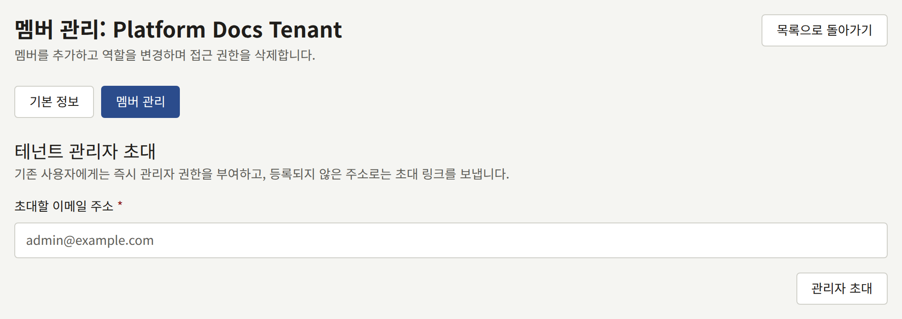
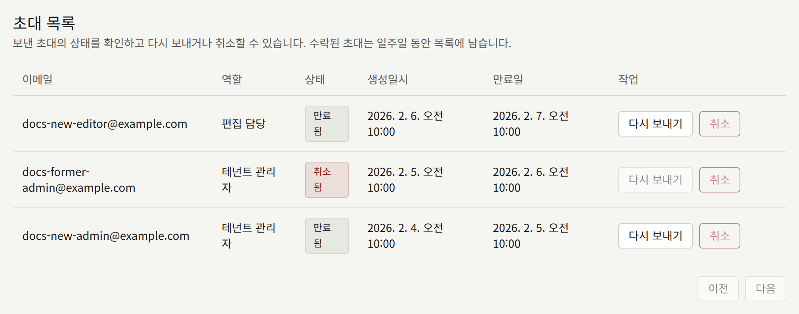
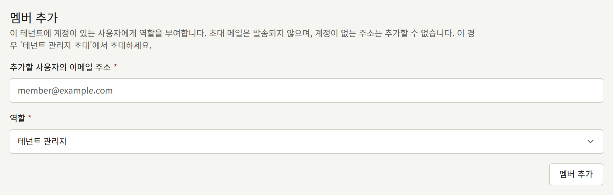
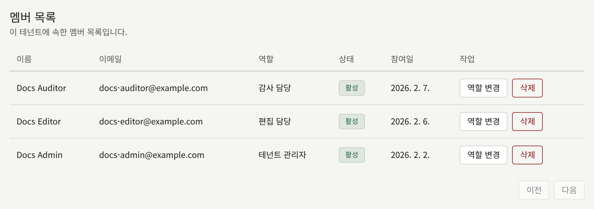

테넌트의 스태프는 그 테넌트의 콘솔에 로그인하는 사람들입니다. 이 페이지에서는 스태프가 콘솔에 들어가기까지를 운영자 쪽에서 설명합니다. 첫 번째 관리자 초대, 스태프가 가지는 역할, 그리고 테넌트에 관리자가 남아 있지 않을 때 할 일입니다. 테넌트에 관리자가 생기면 나머지 스태프는 [멤버](../4-console/3-setup/6-members.md)에서 설명하는 대로 그 관리자가 테넌트 콘솔의 **멤버**에서 관리하며, 운영자는 무언가 잘못되었을 때만 다시 필요합니다.

여기의 `publiractl` 명령은 [플랫폼 콘솔과 publiractl](./1-platform-console.md#둘-중-고르기)에서처럼 실행하며, 모두 `--tenant`로 도메인이나 공개 ID를 써서 테넌트를 지정합니다. 전체 플래그 목록은 [`publiractl` 레퍼런스](https://github.com/publira/publira/blob/main/server/cmd/publiractl/README.md#tenant)에 있습니다.

## 멤버와 사용자

모든 계정은 하나의 테넌트에 속합니다. 두 테넌트의 사이트에 가입한 독자는 각 테넌트에 하나씩, 두 개의 계정을 가집니다. 계정은 그 테넌트의 **사용자**입니다. 콘솔 역할도 가진 사용자는 테넌트 스태프의 **멤버**이며, 테넌트의 콘솔에 로그인할 수 있습니다.

이로부터 다음이 따릅니다.

- 누군가를 스태프로 만들어도 그 계정은 옮겨지지 않습니다. 역할을 받은 테넌트의 독자는 읽을 때 쓰던 이메일 주소와 비밀번호로 콘솔에 로그인합니다.
- 누군가의 역할을 빼앗아도 계정은 남습니다. 그 사람은 테넌트의 독자로 남으며, 나중에 다시 역할을 받을 수 있습니다.
- 계정이 역할을 가지고 있는 동안에는 사이트와 앱에서 테넌트의 공개된 모든 에피소드를 구매하지 않고 읽을 수 있으므로, 스태프는 독자가 보는 그대로 카탈로그를 확인할 수 있습니다. 사이트에서는 이렇게 연 유료 에피소드의 가격 옆에, 역할 덕분에 열려 있다는 것과 구매하지 않은 독자에게는 페이지 대신 구매 안내가 보인다는 것이 표시됩니다. 테넌트의 연령 확인은 여전히 적용되며, 에피소드를 평가할 수 없으므로 스태프 자신의 열람은 사이트가 보여 주는 평가에 반영되지 않습니다. 역할을 빼앗으면 이것도 함께 사라집니다.

## 세 가지 역할

| 역할 | 할 수 있는 일 |
| --- | --- |
| **테넌트 관리자** | 콘솔의 모든 것: 스태프와 그 초대, 테넌트의 모든 설정, 사이트와 브랜딩, 메일, 결제, 푸시 알림, 로그인, Google 태그 연동, 독자의 계정과 문의, 이용권, 구매와 환불, 인세, 감사 로그. 테넌트가 에피소드 공개 전에 검토를 요구하는 경우, 승인하거나 반려하는 것은 테넌트 관리자만 할 수 있습니다 |
| **편집 담당** | 카탈로그(시리즈, 에피소드, 작가, 레이블, 장르)와 테넌트의 페이지, 공지사항, 캠페인 배너를 작성하고, 댓글을 관리합니다. 테넌트가 검토를 요구하는 경우, [공개 전 검토](../4-console/1-catalog/2-episodes.md#공개-전-검토)에서 설명하는 대로 에피소드를 검토에 제출합니다 |
| **감사 담당** | 편집 담당이 작업하는 것과 테넌트의 설정을 볼 수 있지만, 아무것도 바꾸지 않습니다 |

각 역할은 그 아래 역할이 할 수 있는 모든 일을 포함합니다. 콘솔은 역할이 쓸 수 없는 것을 숨깁니다. 편집 담당의 사이드바에는 **멤버**, **독자**, **인세**, **구매**가 보이지 않고, 감사 담당에게는 무언가를 바꾸는 버튼이 보이지 않습니다.

다른 사람에게 역할을 줄 수 있는 것은 테넌트 관리자뿐이므로, 테넌트에는 테넌트 관리자가 적어도 한 명 필요합니다.

## 스태프에게 접근 권한 주기

방법은 세 가지이며, 어느 것이 맞는지는 그 사람이 이미 테넌트에 계정을 가지고 있는지, 그리고 설치 환경이 메일을 보내는지에 따라 달라집니다.

### 테넌트 관리자 초대하기

초대는 주소로 메일을 보내고, 수락되면 그 주소를 테넌트 관리자로 만듭니다. 새 테넌트는 보통 만들 때 지정한 주소를 통해 이 방법으로 첫 번째 관리자를 얻으며, 나중에 관리자를 더 추가할 때도 이 방법을 씁니다.

- **플랫폼 콘솔**: **테넌트 목록**에서 테넌트를 열고, **멤버 관리**를 선택한 다음, **테넌트 관리자 초대**에 주소를 입력하고 **관리자 초대**를 선택합니다.
- **publiractl**: `publiractl tenant invite create --tenant comics.example.com --email editor-in-chief@comics.example.com`



초대받은 사람에게는 테넌트의 기본 언어로 테넌트 콘솔의 링크가 메일로 전송됩니다. 링크에서 **이름**과 **비밀번호**를 입력하고 **초대 수락하기**를 선택한 뒤 로그인합니다. 링크는 24시간 동안 유효합니다.

이미 테넌트 사용자의 것인 주소는 초대되지 않습니다. 그 주소는 즉시 테넌트 관리자가 되며, 메일은 전송되지 않습니다. 이는 그 주소가 이전에 가지고 있던 역할을 대체하므로, 이렇게 초대된 편집 담당은 테넌트 관리자가 됩니다.

초대 메일은 `publira worker`가 보내며, 테넌트가 자체 SMTP 설정을 저장했다면 그 설정으로, 그렇지 않으면 플랫폼의 설정으로 보냅니다. 워커가 실행 중이지 않은 설치 환경은 초대를 만들기만 하고 아무것도 보내지 않습니다.

플랫폼 콘솔이나 `publiractl`에서 보낸 초대로는 테넌트 관리자만 만들 수 있습니다. 편집 담당과 감사 담당은 [기존 사용자 추가하기](#기존-사용자-추가하기)에서 설명하는 방법으로 역할을 받거나, 테넌트 자체의 관리자에게 초대받습니다. 테넌트 관리자의 콘솔에서는 세 역할 중 어느 것이든 부여하는 초대를 보낼 수 있습니다.

### 초대 후속 관리

같은 **멤버 관리** 화면의 **초대 목록**은 테넌트의 모든 초대를 나열하며, 테넌트 자체의 관리자가 테넌트 콘솔에서 보낸 초대도 포함됩니다. 각 초대에는 수락하면 부여되는 **역할**과 상태(**대기 중**, **수락됨**, **취소됨**, **만료됨**)가 표시됩니다.

- 대기 중이거나 만료된 초대의 **다시 보내기**는 새 링크로 초대를 다시 메일로 보내며, 링크는 다시 24시간 동안 유효합니다. 이전 링크는 동작하지 않게 됩니다.
- 대기 중인 초대의 **취소**는 초대를 철회하며, 그 링크는 동작하지 않게 됩니다.



명령줄에서는 `publiractl tenant invite list --tenant comics.example.com`이 각 초대를 ID와 함께 출력하고, `tenant invite resend --id <ID>`와 `tenant invite cancel --id <ID>`가 만료된 것을 포함해 초대 하나에 대해 동작합니다.

테넌트 자체의 관리자는 테넌트 콘솔에서 같은 초대를 보며, 거기서 초대를 보내고, 다시 보내고, 취소할 수 있습니다.

### 기존 사용자 추가하기

테넌트의 독자에게는 메일 없이 세 역할 중 어느 것이든 직접 줄 수 있습니다.

- **플랫폼 콘솔**: 테넌트의 **멤버 관리** 화면에서 **멤버 추가**에 주소를 입력하고, **역할**을 고른 다음 **멤버 추가**를 선택합니다.
- **publiractl**: `publiractl tenant member add --tenant comics.example.com --email reader@example.com --role tenant_editor`. `--role`은 `tenant_admin`, `tenant_editor`, `tenant_auditor` 중 하나입니다.



이 방법은 테넌트에 이미 계정이 있는 주소에만 쓸 수 있으며, 그 밖의 주소는 거부됩니다. 계정이 없는 사람은 먼저 테넌트의 사이트에 가입하거나, 테넌트 관리자로 초대받습니다. 이미 역할을 가진 계정은 대신 **역할 변경**으로 바꿉니다.

### 메일 없이 계정 만들기

`publiractl tenant admin create`는 콘솔 계정을 곧바로 만듭니다. 계정에 비밀번호가 주어지고, 주소는 확인된 것으로 간주되며, 바로 로그인할 수 있습니다. 메일을 보내지 않으므로, 메일을 보내지 않는 설치 환경이 첫 번째 관리자와 이후의 스태프 멤버를 얻는 방법입니다.

```bash
publiractl tenant admin create \
  --tenant comics.example.com \
  --email owner@comics.example.com \
  --name Owner \
  --generate-password
```

`--generate-password`는 비밀번호를 터미널에만, 단 한 번 출력하므로, 터미널을 닫기 전에 비밀번호를 그 주인에게 전달하세요. 비밀번호를 설정하는 다른 방법은 [레퍼런스](https://github.com/publira/publira/blob/main/server/cmd/publiractl/README.md#tenant)에 있으며, `--role`을 지정하면 테넌트 관리자 대신 편집 담당이나 감사 담당을 만듭니다. 플랫폼 콘솔에는 이에 해당하는 기능이 없습니다.

주소는 아직 테넌트에 계정이 없어야 합니다. 계정이 있는 주소에는 대신 `tenant member add`를 쓰세요.

## 역할 변경과 삭제

플랫폼 콘솔에서 테넌트의 **멤버 관리** 화면의 **역할 변경**은 멤버에게 다른 역할을 주고, **삭제**는 멤버의 모든 역할을 빼앗습니다.



명령줄에서는 다음과 같이 합니다.

```bash
publiractl tenant member list --tenant comics.example.com
publiractl tenant member update-role --tenant comics.example.com --user <public ID> --role tenant_auditor
publiractl tenant member remove --tenant comics.example.com --user <public ID>
```

`tenant member list`는 각 멤버의 공개 ID를 출력하며, `--user`에 이 값을 지정합니다.

콘솔은 요청마다 멤버의 역할을 읽으므로, 변경은 이미 열려 있는 콘솔에도 즉시 적용됩니다. 삭제된 멤버는 테넌트의 독자로 계정을 유지하므로, 구매와 이력은 그대로 그 사람의 것으로 남습니다.

## 잃어버린 2단계 인증

2단계 인증을 켠 뒤 모든 두 번째 인증 수단(인증 앱과 패스키)과 모든 복구 코드를 잃어버린 스태프 멤버는 콘솔에 로그인할 수 없으며, 테넌트의 스태프 중 누구도 그 계정의 2단계 인증을 제거할 수 없습니다. 운영자는 제거할 수 있습니다.

```bash
publiractl tenant member reset-mfa --tenant comics.example.com --email editor@comics.example.com
```

`--email` 대신 `--user <public ID>`로 계정을 지정할 수도 있습니다. 이 명령은 계정의 인증 앱, 어느 콘솔 주소에서 등록했든 계정이 등록한 모든 패스키, 그리고 모든 복구 코드를 제거할 뿐, 그 밖의 것은 건드리지 않습니다. 비밀번호와 역할은 그대로입니다. 멤버는 비밀번호만으로 로그인한 뒤 [내 계정](../4-console/3-setup/9-your-account.md)에서 설명하는 대로 **계정 설정**에서 2단계 인증을 다시 설정합니다. 플랫폼이 그 멤버의 역할에 2단계 인증을 요구한다면, 콘솔은 로그인할 때 설정하라고 요청합니다.

2단계 인증을 제거하면 계정은 비밀번호만으로 보호되는데, 이는 비밀번호를 훔친 사람이 바로 요청할 만한 일입니다. 명령을 실행하기 전에, 요청이 들어온 경로가 아니라 그 멤버의 것임을 이미 알고 있는 경로를 통해 요청이 정말 그 멤버에게서 온 것인지 확인하세요.

제거는 플랫폼 콘솔의 **감사 로그**에 **명령줄**을 행위자로 하여 기록됩니다. 플랫폼 콘솔 자체에는 이에 해당하는 기능이 없습니다.

## 관리자가 없는 테넌트 복구

테넌트 콘솔은 마지막 테넌트 관리자의 강등이나 삭제를 거부하므로, 보통 테넌트에는 항상 관리자가 있습니다. 그래도 실제로는 마지막 관리자를 잃을 수 있습니다. 관리자가 출판사를 떠나거나, 메일함에 접근할 수 없게 되거나, 계정을 탈취당하는 경우입니다.

플랫폼 콘솔과 `publiractl`은 운영자가 개입할 수 있도록 일부러 마지막 테넌트 관리자를 보호하지 않습니다.

- **스태프 중 누군가가 넘겨받아야 하는 경우.** **역할 변경**이나 `tenant member update-role --role tenant_admin`으로 그 사람의 계정에 테넌트 관리자 역할을 줍니다.
- **새 관리자가 테넌트에 계정이 없는 경우.** 그 사람을 초대하거나, 메일을 받을 수 없다면 `publiractl tenant admin create`로 계정을 만듭니다.
- **마지막 관리자가 2단계 인증을 잃어버린 경우.** [잃어버린 2단계 인증](#잃어버린-2단계-인증)에서 설명하는 대로 `tenant member reset-mfa`로 제거하면, 그 사람은 비밀번호로 다시 로그인합니다.
- **마지막 관리자의 계정이 탈취된 경우.** 먼저 다른 사람에게 역할을 준 다음, 탈취된 계정에서 **삭제**로 역할을 빼앗으면 그 계정은 즉시 콘솔에서 차단됩니다. 그 계정은 여전히 독자로서 테넌트의 사이트에 로그인할 수 있으며, 새 관리자가 테넌트 콘솔의 **독자**에서 정지할 수 있습니다.

이 변경은 모두 플랫폼 콘솔의 **감사 로그**에 변경한 운영자와 함께, `publiractl`로 한 변경은 **명령줄**과 함께 기록됩니다. 테넌트 자체의 스태프가 테넌트 콘솔에서 바꾼 것은 대신 테넌트의 감사 로그에 기록됩니다.
