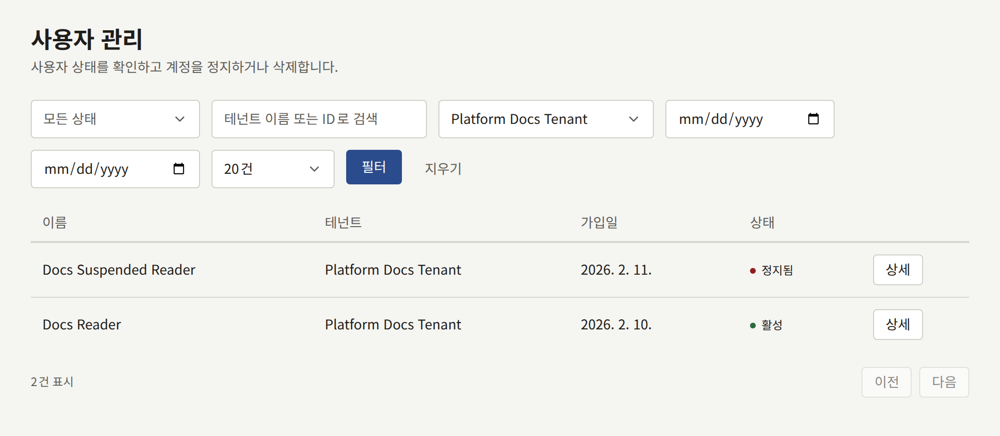
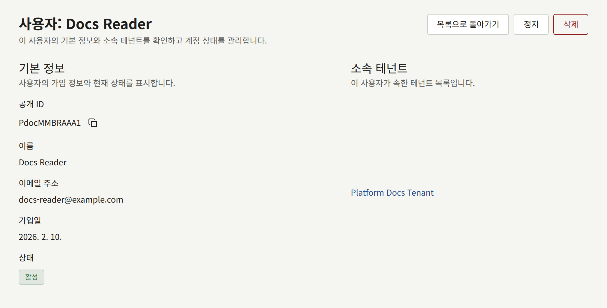
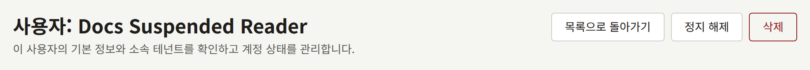

플랫폼 콘솔 사이드바의 **거버넌스** 아래에 있는 **사용자 관리**는 모든 테넌트의 독자를 한곳에 나열합니다. 이 화면은 하나의 테넌트만으로는 처리할 수 없는 일을 위해 있습니다. 출판사가 아니라 운영자에게 들어온 불만이나 법적 요청, 또는 테넌트의 관리자가 손댈 수 없는 계정입니다. 평소에는 각 테넌트의 관리자가 테넌트 콘솔의 **독자**에서 자기 독자를 관리합니다. 이에 해당하는 `publiractl` 기능은 없습니다.

## 목록에 표시되는 것

모든 계정은 하나의 테넌트에 속하므로, 두 테넌트의 사이트에서 읽는 사람은 테넌트마다 한 번씩, 두 번 나타납니다. 목록은 각 계정의 **이름**, **테넌트**, **가입일**, **상태**를 표시하며, 상태, 테넌트, 가입일로 좁힐 수 있습니다. 이름이나 이메일 주소로 검색하는 기능은 없습니다. 계정은 그 테넌트와 가입한 날짜로 좁혀서 찾으세요.

목록에는 독자만 있습니다. 테넌트 콘솔에서 역할을 가진 계정은 스태프이며, [테넌트의 스태프](./3-tenant-staff.md)에서 설명하는 대로 그 테넌트의 **멤버 관리**에서 관리합니다.

**상세**는 계정을 엽니다. 계정의 **공개 ID**, 이름, **이메일 주소**, 가입일, 상태, 그리고 계정이 속한 테넌트가 표시됩니다.

## 계정 정지와 삭제

운영자나 슈퍼 관리자는 계정의 페이지에서 계정을 다룰 수 있습니다. 감사 담당에게는 버튼 없이 페이지만 보입니다.

- **정지**는 독자가 사이트와 앱에서 로그인하지 못하게 하고, 이미 가진 세션을 끝냅니다. 계정에서 제거되는 것은 없습니다. **정지 해제**하면 다시 로그인할 수 있습니다.
- **삭제**는 계정을 영구히 제거하며, 되돌릴 수 없습니다. 자신의 계정을 없애고 싶은 독자는 테넌트의 사이트에서 직접 삭제할 수 있으며, 보통은 그쪽이 더 나은 방법입니다.

콘솔 역할을 가진 계정에는 어느 쪽도 할 수 없습니다. 먼저 테넌트의 **멤버 관리**에서 역할을 빼앗으세요.

각 작업은 작업한 운영자와 함께 **감사 로그**에 기록됩니다.
