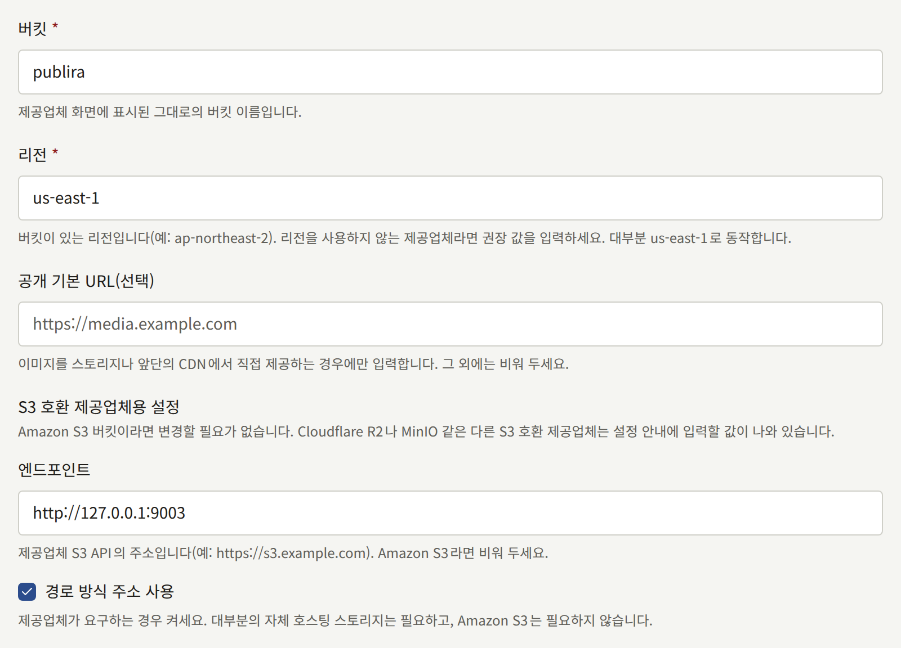
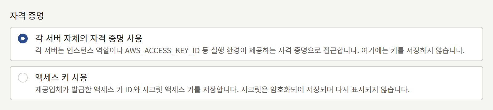
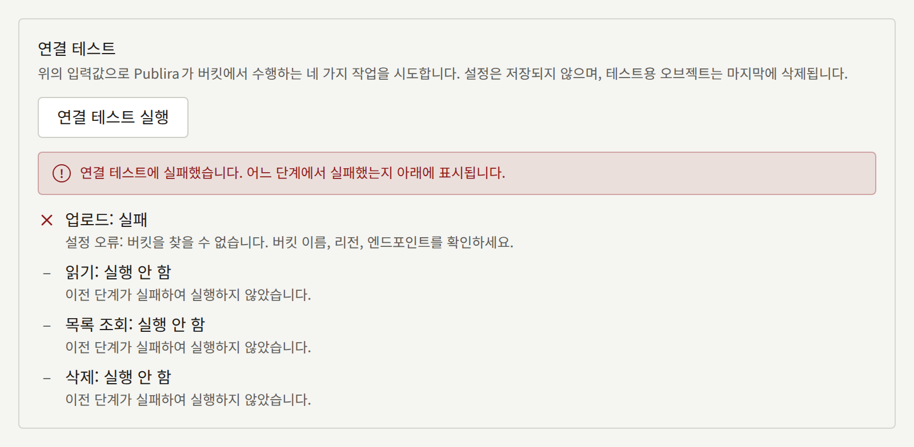
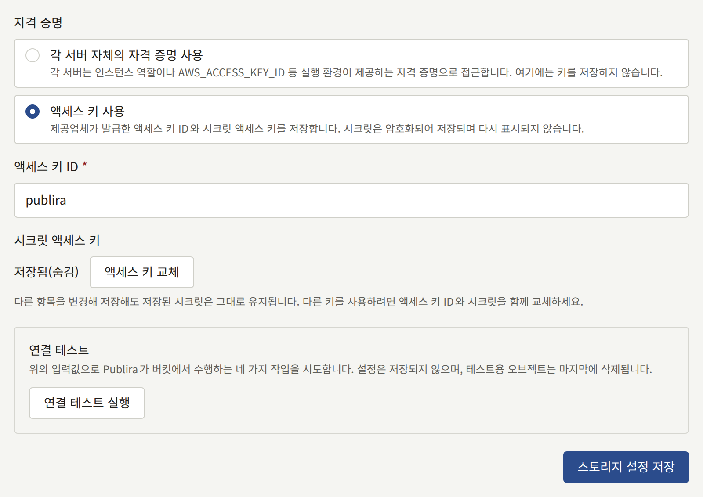

설치 환경이 보관하는 모든 이미지(표지, 에피소드 페이지, 작가 사진, 각 테넌트의 로고)는 모든 테넌트가 함께 쓰는 S3 호환 버킷 하나에 저장됩니다. 이 버킷은 `publiractl setup`이 저장해 두었습니다. 이 페이지에서는 버킷의 각 설정과 그 테스트 방법, 나중에 변경하는 방법, 그리고 저장된 이미지가 독자에게 전달되는 방식을 설명합니다.

여기 나오는 `publiractl` 명령은 모두 명령만 적어 보여 줍니다. [플랫폼 콘솔과 publiractl](./1-platform-console.md#둘-중-고르기)에서 설명하는 방법으로, `PUBLIRA_PLATFORM_DB_URL`을 `publira_platform` 연결로 설정하고 프로세스가 실행될 때와 같은 `PUBLIRA_SECRET_ENCRYPTION_KEYS`와 `PUBLIRA_SECRET_ENCRYPTION_PRIMARY_KEY_ID`를 지정해 실행하세요. 모든 플래그는 [`publiractl` 레퍼런스](https://github.com/publira/publira/blob/main/server/cmd/publiractl/README.md#storage)에 있습니다.

## 버킷

Publira는 버킷을 만들지 않습니다. 먼저 제공업체에서 빈 버킷을 만들고, Publira가 사용하는 자격 증명에 그 버킷의 오브젝트를 업로드, 읽기, 목록 조회, 삭제할 권한을 주세요. 버킷을 공개할 필요는 없습니다. 독자가 버킷에서 직접 가져오는 일은 없습니다.

설정은 버킷과 그 버킷에 접근하는 방법을 지정합니다.

| 설정 | `publiractl storage set` | 플랫폼 콘솔 |
| --- | --- | --- |
| 버킷 이름 | `--bucket` | **버킷** |
| 버킷의 리전 | `--region` | **리전** |
| Amazon S3 이외 스토어의 주소 | `--endpoint` | **엔드포인트** |
| 호스트 이름이 아닌 URL 경로로 버킷 지정 | `--force-path-style` | **경로 방식 주소 사용** |
| 저장된 오브젝트를 읽을 수 있는 URL | `--public-base-url` | **공개 기본 URL(선택)** |



Amazon S3의 버킷이라면 버킷과 리전만 지정하고 나머지는 비워 두세요.

그 밖의 S3 호환 스토어(Cloudflare R2, MinIO, RustFS, 또는 제공업체의 오브젝트 스토리지)라면 S3 API 주소를 엔드포인트로 지정하고, 제공업체가 요구하면 경로 방식 주소를 켜세요. 직접 호스팅하는 스토어는 대부분 이를 요구합니다. 리전이 없는 스토어에도 리전 값은 필요합니다. 해당 문서가 권장하는 값을 입력하고, 권장 값이 없으면 `us-east-1`을 입력하세요.

공개 기본 URL은 비워 두세요. 어떤 값이 들어 있든, 이미지는 [이미지가 독자에게 전달되는 방식](#이미지가-독자에게-전달되는-방식)에서 설명하듯이 항상 `publira server`를 통해 전달됩니다.

## 자격 증명

Publira는 버킷에 보내는 모든 요청에 다음 두 가지 방법 중 하나로 서명합니다.

**설정과 함께 저장하는 액세스 키**: 제공업체가 발급한 액세스 키 ID와 시크릿 액세스 키입니다. 시크릿은 설치 환경의 암호화 키로 암호화되어 저장되므로, 버킷에 접근하는 모든 프로세스는 그 키를 가지고 실행되어야 하며, 한번 저장한 시크릿은 다시 표시되지 않습니다. Amazon S3 이외의 스토어에서는 보통 이 방법을 선택하며, 프로세스가 자체 자격 증명을 갖지 않는 설치 환경에서는 이 방법밖에 없습니다.

**각 프로세스가 스스로 찾는 자격 증명**: 키를 저장하지 않습니다. 각 프로세스는 AWS SDK가 기본적으로 하는 방식대로 서명합니다. 환경의 `AWS_ACCESS_KEY_ID`와 `AWS_SECRET_ACCESS_KEY`, 웹 ID 토큰, 또는 실행 중인 머신의 인스턴스 역할을 사용합니다. AWS에서는 이렇게 하면 수명이 긴 시크릿을 데이터베이스에 전혀 두지 않게 되지만, 대신 `publira server`, `publira worker`, 그리고 직접 실행하는 `publiractl`이 모두 그 자격 증명을 가져야 합니다. 서버는 이미지를 업로드하고 읽으며, 워커는 더 이상 사용되지 않는 이미지를 삭제하고, `publiractl storage test`도 서명을 하기 때문입니다.

플랫폼 콘솔의 **자격 증명**에서는 이 두 가지를 **액세스 키 사용**과 **각 서버 자체의 자격 증명 사용**으로 제공합니다. `publiractl storage set`에서는 `--access-key-id`를 지정하면 키가 저장됩니다. 시크릿은 `--secret-access-key-file`로 파일에서, `--secret-access-key-stdin`으로 stdin에서, 마스킹된 프롬프트에서, 또는 플랫폼이 시크릿을 환경 변수로만 설정할 수 있는 경우 `--secret-access-key-env`로 환경 변수에서 읽습니다. `--access-key-id`를 생략하면 각 프로세스의 자체 자격 증명으로 서명하며, 저장된 키는 삭제됩니다.



## 연결 테스트

테스트는 작은 오브젝트를 업로드하고, 다시 읽고, 목록에서 확인하고, 삭제합니다. 이는 Publira가 버킷에서 하는 작업 전부이며, 네 단계 각각의 결과를 보고합니다.

- 플랫폼 콘솔에서는 **스토리지**의 **연결 테스트 실행**이 양식에 입력된 값을 저장하기 전에 테스트합니다. 테스트는 `publira server`에서 실행됩니다.
- `publiractl storage test`는 이미 저장된 설정을 `publiractl`이 실행되는 위치에서 테스트하며, 실패한 단계가 있으면 `1`로 종료합니다.

실패하면 어느 단계에서 왜 실패했는지 알려 줍니다. 스토어가 거부한 자격 증명, 키에 특정 작업 권한이 없는 경우, 그 이름·리전·엔드포인트로 버킷을 찾을 수 없는 경우, 엔드포인트에 연결할 수 없는 경우 등입니다. 콘솔의 테스트와 명령은 서로 다른 머신에서 실행되므로, 방화벽이 한쪽만 스토어에 접근하도록 허용하면 한쪽에서는 테스트가 통과하고 다른 쪽에서는 실패합니다. 스토어에 접근할 수 있어야 하는 것은 `publira server`와 `publira worker`입니다.



## 설정 변경

### 플랫폼 콘솔에서

사이드바의 **외부 서비스** 아래에서 **스토리지**를 선택하세요. 화면에는 저장된 설정이 표시되며, 저장된 시크릿은 **저장됨(숨김)** 상태로 표시됩니다. 값을 변경하고 **연결 테스트 실행**을 선택한 다음 **스토리지 설정 저장**으로 저장하세요. 다른 액세스 키를 사용하려면 **액세스 키 교체**를 선택하고 액세스 키 ID와 시크릿을 함께 입력하세요. 저장된 시크릿은 함께 저장된 ID에만 대응합니다.



**운영자**나 **슈퍼 관리자**는 저장할 수 있습니다. **감사 담당**은 화면을 볼 수 있지만 저장할 수는 없습니다.

### publiractl에서

```bash
publiractl storage set \
  --bucket publira-images \
  --region ap-northeast-1 \
  --access-key-id AKIA... \
  --secret-access-key-file /run/secrets/aws-secret-access-key
publiractl storage test
publiractl storage show
```

`storage set`은 저장된 모든 설정을 주어진 플래그로 대체하므로, 매번 모든 플래그를 지정하세요. 생략한 플래그의 설정은 지워집니다. 같은 `--access-key-id`를 시크릿 없이 지정해 실행하면 저장된 시크릿이 유지됩니다.

### 변경이 반영되는 시점

모든 프로세스는 30초마다 설정을 다시 읽으므로, 저장한 내용은 재시작 없이 1분 안에 모든 프로세스에 반영됩니다. 저장과 테스트는 모두 **감사 로그**에 기록됩니다.

### 다른 버킷으로 옮기기

새 버킷을 저장해도 그 버킷으로 아무것도 복사되지 않습니다. 지금까지 업로드된 이미지는 이전 버킷에 남아 있고, 설치 환경은 이미지가 없는 새 버킷에서 이미지를 찾게 됩니다. 저장하기 전에 키를 유지한 채 오브젝트를 복사하고, 저장한 다음, 첫 번째 복사 중에 업로드된 것까지 가져오도록 한 번 더 복사하세요. AWS CLI나 제공업체의 동등한 도구로 다음과 같이 합니다.

```bash
aws s3 sync s3://publira-images s3://publira-images-new
publiractl storage set --bucket publira-images-new --region ap-northeast-1 ...
aws s3 sync s3://publira-images s3://publira-images-new
```

저장한 후에는 설치 환경의 어떤 부분도 이전 버킷을 건드리지 않습니다. 설치 환경이 새 버킷에서 한동안 문제없이 서비스할 때까지 이전 버킷을 남겨 두었다가 직접 삭제하세요.

### 액세스 키 교체

제공업체에서 새 키를 발급하고, `storage set`이나 **액세스 키 교체**로 저장하고, 테스트한 다음, 그 후에야 이전 키를 폐기하세요. 프로세스가 새 키로 옮겨 가는 데 최대 1분이 걸리므로, 이전 키를 그보다 먼저 폐기하면 업로드와 이미지 읽기가 실패하는 시간이 생깁니다.

## 이미지가 독자에게 전달되는 방식

독자의 브라우저와 앱은 테넌트 자체 호스트 이름의 `/images`에서 이미지를 가져오며, 엣지는 [라우팅](../2-deployments/4-edge/index.md#라우팅)이 요구하는 대로 이 요청을 `publira server`로 보냅니다. 서버는 요청마다 다음을 수행합니다.

1. 독자가 그 이미지를 볼 수 있는지 확인합니다. 에피소드 페이지는 그 에피소드가 무료인 독자나 잠금을 해제한 독자에게만 표시되며, 공개되지 않은 에피소드의 페이지는 콘솔에 있는 테넌트 스태프에게만 표시됩니다.
2. 버킷에서 원본을 읽어 브라우저가 받아들이는 WebP나 AVIF로 변환하고, 페이지가 요청한 크기로 조정합니다.
3. 변환된 결과를 변환 캐시에 보관하므로, 같은 이미지를 같은 크기로 다시 요청하면 버킷을 읽거나 다시 변환하지 않습니다.
4. 에피소드 페이지는 독자에게 보내기 전에 암호화하므로, 브라우저가 받는 것은 저장해서 다른 곳에서 열 수 있는 이미지 파일이 아닙니다. 표지, 로고, 그 밖의 이미지는 그대로 보냅니다.

이 때문에 버킷에는 공개 접근도, 앞단의 CDN도, 미리 만들어 둔 크기별 사본도 필요하지 않습니다. 버킷에는 이미지마다 원본 하나만 있으면 됩니다.

### 변환 캐시

변환 캐시는 `publira server`에 `PUBLIRA_REDIS_URL`로 지정한 Valkey 또는 Redis 서버에 보관되며, 서버의 모든 인스턴스가 함께 사용합니다. 지정하지 않으면 각 인스턴스의 메모리에 보관됩니다. 인스턴스가 하나라면 문제없지만, 인스턴스를 추가하면 그때마다 모든 이미지를 다시 변환하게 됩니다.

변환된 이미지는 `publira server`의 `PUBLIRA_IMAGE_CACHE_TTL`로 따로 정하지 않는 한 1시간 동안 보관됩니다. 이 값은 `6h` 같은 기간이나 초 단위의 숫자로 지정합니다. 시간을 길게 하면 Valkey의 메모리를 더 쓰는 대신 버킷 읽기와 변환이 줄어들고, 짧게 하면 그 반대가 됩니다. 각 이미지 응답에는 `X-Publira-Image-Cache: hit` 또는 `miss`가 붙으며, 이를 보면 캐시가 제 역할을 하고 있는지 알 수 있습니다.

그 밖의 이미지 관련 변수와, 변환에 필요한 libvips 라이브러리를 포함해 서버를 빌드하는 방법은 [`publira server` 레퍼런스](https://github.com/publira/publira/blob/main/server/cmd/publira/README.md#image-delivery)에 있습니다.
