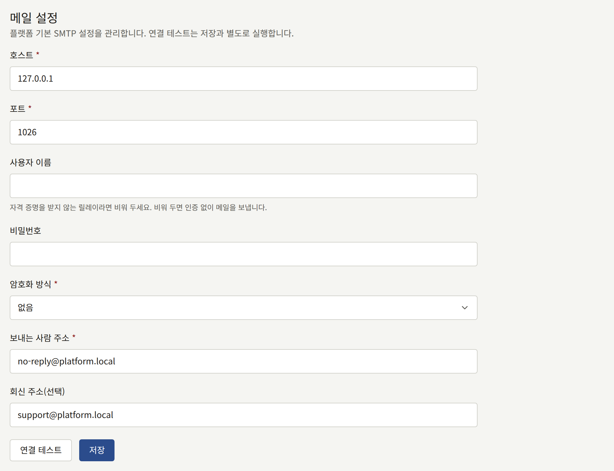
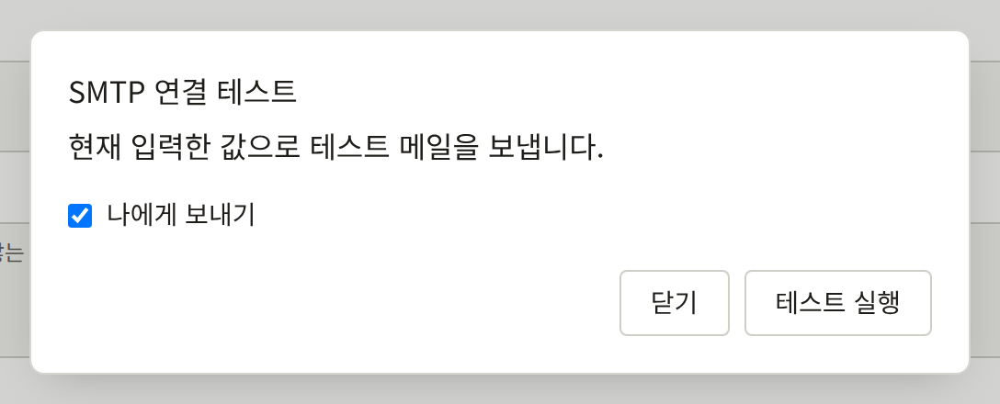
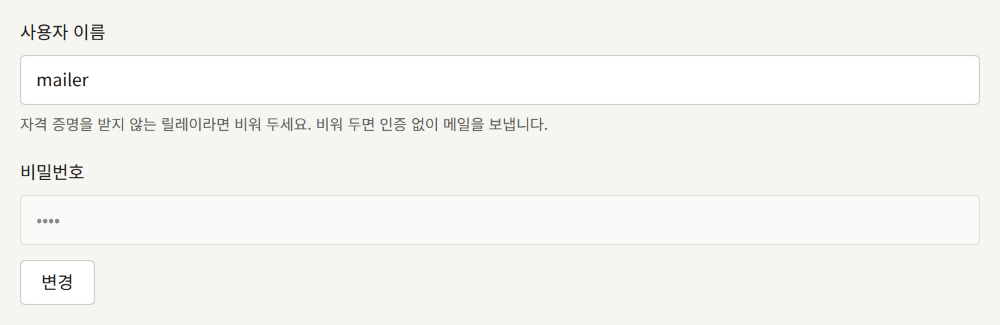

설치 환경은 독자, 각 테넌트의 스태프, 플랫폼 콘솔의 운영자에게 메일을 보냅니다. 모든 메일은 `publira worker`가 운영자가 제공하는 SMTP 서버를 통해 보냅니다. 플랫폼의 SMTP 계정은 `publiractl setup`이 저장해 두었으며, 테넌트는 자체 계정을 저장할 수 있습니다. 이 페이지에서는 두 계정과 그 테스트 방법, 그리고 메일의 모양과 링크가 향하는 곳을 정하는 설정을 설명합니다.

여기 나오는 `publiractl` 명령은 모두 명령만 적어 보여 줍니다. [플랫폼 콘솔과 publiractl](./1-platform-console.md#둘-중-고르기)에서 설명하는 방법으로, `PUBLIRA_PLATFORM_DB_URL`을 `publira_platform` 연결로 설정하고 프로세스가 실행될 때와 같은 `PUBLIRA_SECRET_ENCRYPTION_KEYS`와 `PUBLIRA_SECRET_ENCRYPTION_PRIMARY_KEY_ID`를 지정해 실행하세요. 모든 플래그는 [`publiractl` 레퍼런스](https://github.com/publira/publira/blob/main/server/cmd/publiractl/README.md#smtp)에 있습니다.

## 설치 환경이 보내는 메일

| 받는 사람 | 메일 |
| --- | --- |
| 테넌트의 독자 | 새 계정의 주소를 확인하는 링크, 비밀번호 재설정과 비밀번호가 변경되었다는 알림, 새 이메일 주소 확인과 이전 주소로 보내는 변경 알림, 이미 계정이 있는 주소로 누군가 가입을 시도했다는 알림, 문의 메시지에 대한 스태프의 답변, 팔로우하는 시리즈나 작가의 새 에피소드, 테넌트가 게시한 공지, 댓글 승인 |
| 테넌트의 스태프 | 테넌트 관리 초대, 비밀번호 재설정, 새 이메일 주소 확인과 이전 주소로 보내는 알림, 독자가 보낸 새 문의 메시지 |
| 플랫폼 운영자 | 비밀번호 재설정, 새 이메일 주소 확인과 이전 주소로 보내는 알림 |

각 메일은 테넌트의 기본 언어로, 운영자에게 보내는 메일은 플랫폼의 기본 언어로 작성됩니다.

마지막 세 가지는 독자의 알림 설정에 따라 전달됩니다. 알림 종류마다 이메일 설정이 따로 있으며, 독자가 끄지 않는 한 켜져 있고, 확인된 주소로만 보냅니다. 테넌트가 모든 독자에게 보내는 공지는 설정과 관계없이 확인된 주소가 있는 모든 독자에게 메일로 발송되므로, 독자가 많은 테넌트는 그만큼 많은 메일을 SMTP 계정으로 한꺼번에 보내게 됩니다.

워커는 모든 메일을 큐에 넣고, 보내지 못한 메일은 실패할 때마다 두 배씩 기다렸다가 다시 시도합니다. 1초, 다음은 2초, 그다음은 4초입니다. 처음 시도한 지 약 9분 후인 열 번째 시도까지 실패하면 그 메일은 완전히 포기하며, 다시 보내는 일은 없습니다. 따라서 SMTP 서버나, 켜져 있는 경우 `email-renderer`가 그보다 오래 중단되면, 그동안 큐에 쌓인 메일은 늦게 가는 것이 아니라 사라집니다. 시도 횟수는 `publira worker`의 `PUBLIRA_OUTBOX_MAX_ATTEMPTS`로 정합니다. 대기 시간은 시도 사이에 최대 1시간까지 계속 두 배로 늘어나므로, 시도 횟수를 몇 번만 늘려도 훨씬 긴 중단을 견딜 수 있습니다.

포기한 메일은 워커가 `outbox event dead`로 로그에 남기고, 워커가 OpenTelemetry 메트릭을 내보낼 때는 `publira.outbox.events.dead` 메트릭으로 집계하므로, 둘 중 하나에 알림을 거세요. 설치 환경은 이런 메일을 다시 보낼 수 없습니다. 독자는 비밀번호 재설정이나 확인 메일을 새로 요청하고, 관리자 초대는 [테넌트의 스태프](./3-tenant-staff.md)에서 설명하는 대로 다시 보냅니다.

워커가 실행되고 있지 않은 설치 환경은 메일을 전혀 보내지 않습니다.

## 어느 SMTP 계정으로 보내는가

| 메일 | 보내는 계정 |
| --- | --- |
| 테넌트가 독자와 스태프에게 보내는 메일 | 테넌트가 자체 SMTP 계정을 저장하고 켰다면 그 계정, 그렇지 않으면 플랫폼의 계정 |
| 플랫폼 콘솔의 메일 | 항상 플랫폼의 SMTP 계정 |

플랫폼의 계정은 필수입니다. 이 계정이 없으면 어떤 운영자도 비밀번호를 재설정할 수 없고, 자체 계정이 없는 테넌트는 아무것도 보내지 못합니다. 테넌트의 자체 계정은 선택 사항이며, 자기 도메인과 자기 제공업체에서 메일을 보내고 싶은 출판사를 위한 것입니다.

## 플랫폼의 SMTP 계정

| 설정 | `publiractl smtp set` | 플랫폼 콘솔 |
| --- | --- | --- |
| SMTP 서버 | `--host`, `--port` | **호스트**, **포트** |
| 연결을 암호화하는 방식 | `--encryption`: `tls`, `starttls`, `none` 중 하나 | **암호화 방식**: **TLS**, **STARTTLS**, **없음** 중 하나 |
| 로그인할 사용자 | `--username` | **사용자 이름** |
| 그 비밀번호 | `--password-file`, `--password-stdin`, 마스킹된 프롬프트, 또는 플랫폼이 시크릿을 환경 변수로만 설정할 수 있는 경우 `--password-env` | **비밀번호** |
| 메일을 보내는 주소 | `--from-address` | **보내는 사람 주소** |
| 보내는 사람과 다를 때 회신을 받을 주소 | `--reply-to` | **회신 주소(선택)** |



메일 제공업체가 SMTP 제출용으로 안내하는 값을 사용하세요. 포트 587은 거의 항상 STARTTLS이고, 포트 465는 처음부터 TLS입니다. **없음**은 자체 사설 네트워크 안의 릴레이에만 선택하세요.

로그인 없이 메일을 받는 릴레이라면 사용자 이름을 비워 두세요. 그러면 워커는 인증 없이 보내며, 비밀번호는 보관되지 않습니다. 비밀번호는 설치 환경의 암호화 키로 암호화되어 저장되므로, `publira worker`는 그 비밀번호를 저장할 때와 같은 키로 실행되어야 합니다.

보내는 사람 주소는 제공업체가 그 계정에 발신을 허용하는 주소여야 하며, 도메인에는 제공업체가 요구하는 SPF와 DKIM 레코드를 게시해야 합니다. 그렇지 않으면 메일의 상당수가 스팸으로 분류되거나 독자의 메일 서버에서 거부됩니다.

### 계정 테스트

테스트는 계정을 통해 짧은 메시지 하나를 보내고, 서버가 받아들였는지 보고합니다.

- 플랫폼 콘솔에서는 **메일**의 **연결 테스트**가 **SMTP 연결 테스트**를 엽니다. 양식에 입력된 값으로 저장하기 전에, **나에게 보내기**로 자신에게, 또는 다른 **받는 사람 이메일 주소**로 보냅니다. 메일은 `publira server`에서 보냅니다.
- `publiractl smtp test --to operator@example.com`은 이미 저장된 설정으로 `publiractl`이 실행되는 위치에서 보내며, 서버가 거부하면 `1`로 종료합니다.



서버가 테스트 메시지를 받아들였더라도 스팸으로 전달될 수 있으니, 메일이 도착한 받은편지함을 확인하세요. 또한 테스트는 `publira server`나 `publiractl`이 보내지만 실제 메일은 `publira worker`가 보내므로, 워커도 SMTP 서버에 접근할 수 있는지 확인하세요.

### 변경

플랫폼 콘솔에서 사이드바의 **외부 서비스** 아래에 있는 **메일**을 선택하고, 값을 변경한 다음 **저장**을 선택하세요. 저장된 비밀번호는 옆에 있는 **변경**을 선택하지 않는 한 유지되며, 선택한 후 필드를 비운 채 저장하면 삭제됩니다. **운영자**나 **슈퍼 관리자**는 저장할 수 있고, **감사 담당**은 화면만 볼 수 있습니다.



`publiractl`에서는 다음과 같이 합니다.

```bash
publiractl smtp set \
  --host smtp.example.com --port 587 --encryption starttls \
  --username mailer --password-file /run/secrets/smtp-password \
  --from-address no-reply@example.com
publiractl smtp test --to operator@example.com
publiractl smtp show
```

`smtp set`은 저장된 모든 설정을 주어진 플래그로 대체하므로, 매번 모든 플래그를 지정하세요. `--reply-to`를 생략하면 저장된 값이 지워집니다. 같은 `--username`을 비밀번호 없이 지정하면 저장된 비밀번호가 유지됩니다.

워커는 메일을 보낼 때마다 설정을 읽으므로, 저장한 내용은 재시작 없이 다음 메일부터 적용됩니다. 저장과 테스트는 모두 **감사 로그**에 기록됩니다.

## 테넌트의 자체 SMTP 계정

테넌트의 관리자는 테넌트 콘솔의 **연동** › **메일**에서 자체 계정을 설정합니다. **덮어쓰기 사용**으로 **이 테넌트 전용 SMTP 서버 사용**을 켜고, 플랫폼의 계정과 같은 값에 더해 **보내는 사람 이름(선택)** 항목도 입력합니다. **연결 테스트**는 양식에 입력된 값으로 테스트 메시지를 보내고, **저장**은 그 값을 저장합니다. 이 설정은 테넌트 관리자만 변경할 수 있으며, 그 절차는 [메일](../4-console/3-setup/7-email.md)에서 안내합니다.

다음 메일부터는 새 관리자 초대를 포함해 그 테넌트의 모든 메일이 자체 계정으로 발송됩니다. 덮어쓰기를 끄면 다시 플랫폼의 계정으로 발송됩니다.

운영자가 따로 설정할 것은 없으며, 플랫폼 콘솔과 `publiractl` 모두 테넌트의 계정을 변경하지 않습니다. 플랫폼의 테스트는 통과하는데 어떤 테넌트의 메일이 도착하지 않는다면, 가장 먼저 그 테넌트의 자체 계정을 확인하세요.

## 일반 텍스트와 HTML

`email-renderer`가 없으면 모든 메일은 일반 텍스트입니다. 있으면 모든 메일에 같은 텍스트와 함께 HTML 버전이 담기며, 독자의 메일 앱이 선호하는 쪽을 표시합니다. 켜려면 [email-renderer로 HTML 메일 보내기](../2-deployments/2-installing.md#email-renderer로-html-메일-보내기)에서 설명하듯이 렌더러를 실행하고 `PUBLIRA_EMAIL_RENDERER_URL`로 `publira worker`가 그 렌더러를 가리키게 하면 됩니다.

켜고 나면 렌더러는 메일 발송의 일부가 됩니다. 렌더러가 중단된 동안 워커는 메일을 텍스트만으로 보내지 않고, SMTP 중단 때와 같은 시도 횟수 안에서 다시 시도합니다. 따라서 렌더러가 그보다 오래 중단되어도 메일이 사라집니다. 일반 텍스트로 되돌리려면 변수를 제거하고 워커를 재시작하세요.

## 메일 속 링크가 향하는 곳

대부분의 메일에는 주소 확인, 비밀번호 재설정, 초대 수락 같은 링크가 들어 있습니다. 워커는 요청이 어느 호스트로 들어왔는지 모르는 채로 링크를 만들기 때문에, 호스트와 스킴은 `publira worker`가 읽는 설치 환경의 설정에서 가져옵니다.

| 메일 | 링크가 향하는 곳 |
| --- | --- |
| 독자에게 보내는 메일 | `https://comics.example.com` 같은 테넌트의 도메인 |
| 테넌트 스태프에게 보내는 메일 | 테넌트의 콘솔 호스트. 테넌트에 다른 호스트가 지정되지 않았다면 `admin.<domain>` |
| 플랫폼 운영자에게 보내는 메일 | `https://platform.example.com` 같은 `PUBLIRA_PLATFORM_APP_URL`의 주소 |

테넌트 링크의 스킴은 `PUBLIRA_TENANT_URL_SCHEME`이며, 설정하지 않으면 `https`입니다. 브라우저가 실제로 HTTP로 테넌트를 여는 경우에만 `http`로 설정하세요. 플랫폼 콘솔을 실행하는 설치 환경에서는 `publira worker`에 반드시 `PUBLIRA_PLATFORM_APP_URL`을 설정해야 합니다. 설정하지 않으면 운영자에게 보내는 링크가 로컬 개발 머신의 주소로 향합니다.

테넌트의 링크는 그 테넌트의 도메인을 따르므로, [테넌트를 다른 호스트 이름으로 옮기기](./2-tenants.md#테넌트를-다른-호스트-이름으로-옮기기)에서 설명하듯이 테넌트가 다른 호스트 이름으로 옮긴 후에 보내는 메일은 새 호스트로, 그 전에 보낸 메일은 여전히 이전 호스트로 향합니다.
