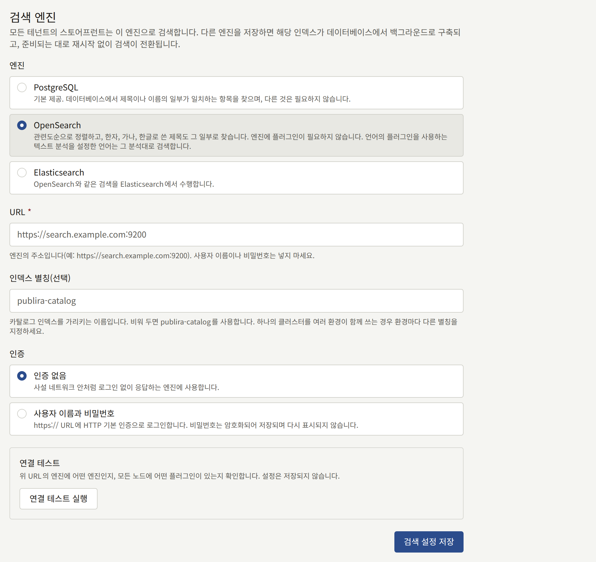
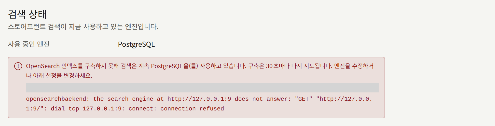
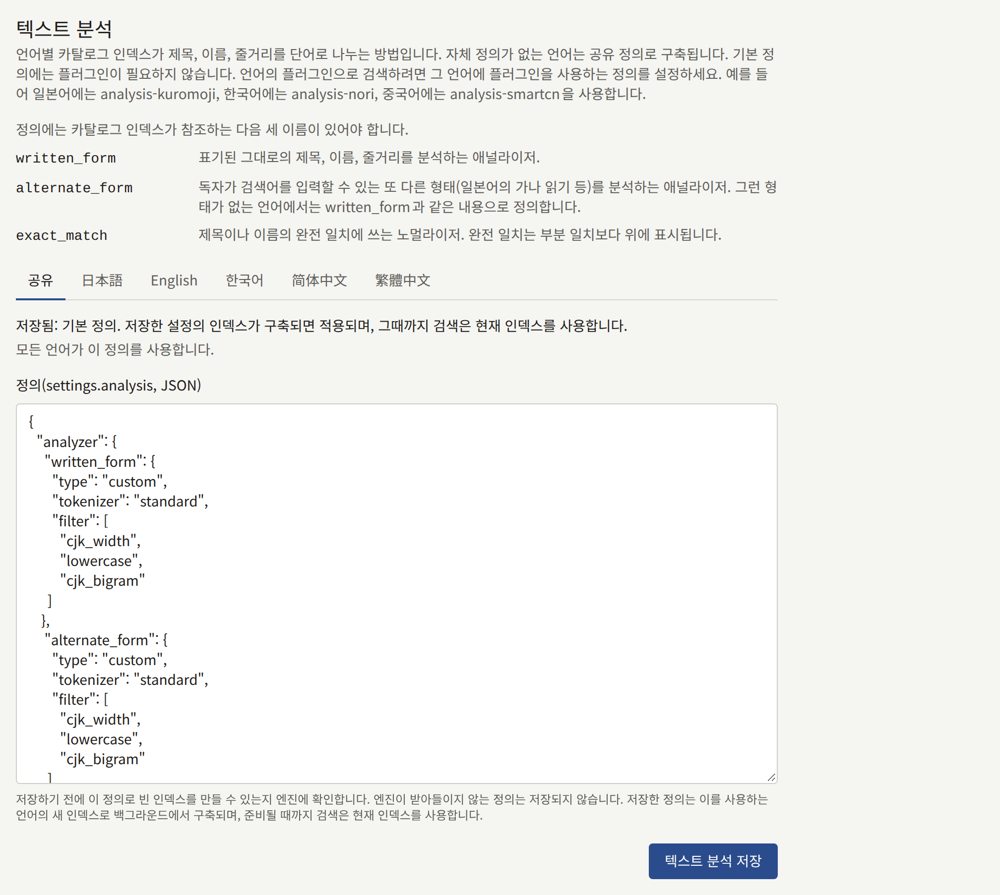

모든 테넌트 사이트의 검색은 모든 테넌트가 함께 쓰는 엔진 하나로 시리즈, 작가, 레이블을 찾습니다. 설치 환경은 데이터베이스 자체로 시작하며 그 밖에 필요한 것은 없습니다. 관련도순으로 정렬된 결과를 원하는 설치 환경은 OpenSearch나 Elasticsearch를 선택할 수 있습니다. 이 페이지에서는 엔진들을 비교하고, 검색을 한 엔진에서 다른 엔진으로 옮기는 방법과 엔진이 유지하는 인덱스를 설명합니다.

여기 나오는 `publiractl` 명령은 모두 명령만 적어 보여 줍니다. [플랫폼 콘솔과 publiractl](./1-platform-console.md#둘-중-고르기)에서 설명하는 방법으로, `PUBLIRA_PLATFORM_DB_URL`을 `publira_platform` 연결로 설정하고 프로세스가 실행될 때와 같은 `PUBLIRA_SECRET_ENCRYPTION_KEYS`와 `PUBLIRA_SECRET_ENCRYPTION_PRIMARY_KEY_ID`를 지정해 실행하세요. 모든 플래그는 [`publiractl` 레퍼런스](https://github.com/publira/publira/blob/main/server/cmd/publiractl/README.md#search)에 있습니다.

## 엔진 선택

| 엔진 | `--engine` | 검색 방식 | 필요한 것 |
| --- | --- | --- | --- |
| **PostgreSQL** | `sql` | 입력한 내용을 포함하는 제목과 이름을 찾아 제목순 또는 이름순으로 보여 줍니다 | 없음. 설치 환경이 이미 가지고 있는 데이터베이스입니다 |
| **OpenSearch** | `opensearch` | 결과를 관련도순으로 정렬하고, 라틴 문자로 쓴 단어의 오타 한 글자는 너그럽게 넘기며, 한자, 가나, 한글로 쓴 제목을 그 일부로 찾습니다. [자체 텍스트 분석](#언어에-자체-플러그인-지정)을 지정한 언어는 그 분석대로 검색합니다. 예를 들어 한자로 쓴 일본어 제목을 가나로 입력한 읽는 법으로 찾을 수 있습니다 | OpenSearch 클러스터 |
| **Elasticsearch** | `elasticsearch` | OpenSearch와 같은 검색 | Elasticsearch 클러스터 |

어느 엔진이 결과를 찾든, 사이트가 각 결과에 대해 표시하는 내용은 데이터베이스에서 읽습니다. 따라서 엔진이 아직 따라잡지 못했다는 이유로 시리즈에 오래된 제목, 가격, 표지가 표시되는 일은 없습니다. 검색 범위를 좁히고 정렬하는 방식은 모든 엔진에서 같습니다.

모든 엔진은 독자의 언어로 표시되는 제목과 시놉시스로 시리즈를 찾습니다. 영어로 둘러보는 독자는 영어 제목으로 시리즈를 찾으며, 일본어 제목에만 있는 단어로는 찾지 못합니다. 영어 제목이 없는 시리즈는 대신 표시되는 제목, 즉 사이트의 기본 언어로 된 제목으로 찾습니다. 작가와 레이블은 모든 언어에서 이름이 하나이며, 독자의 언어와 관계없이 그 이름으로 찾습니다.

독자가 검색보다 둘러보기를 많이 하거나 제목을 정확히 입력하는 카탈로그라면 PostgreSQL로 충분합니다. 독자가 읽는 법으로 제목을 찾거나 철자를 틀려서 아무것도 찾지 못한다면 엔진으로 옮기세요.

## OpenSearch 또는 Elasticsearch 준비

Publira는 엔진을 대신 실행해 주지 않습니다. 직접 운영하는 클러스터나 관리형 클러스터를 사용하고, 다음을 준비하세요.

- **필요한 경우 플러그인.** 기본 텍스트 분석은 OpenSearch와 Elasticsearch에 포함된 기능만으로 구성되므로, 공식 이미지의 엔진을 그대로 사용할 수 있습니다. 플러그인은 플러그인을 바탕으로 [자체 텍스트 분석을 지정하는](#언어에-자체-플러그인-지정) 언어에만 필요합니다.
- 엔진이 응답하는 **URL**. `http://` 또는 `https://`이며, `publira server`, `publira worker`, `publiractl`이 모두 접근할 수 있어야 합니다.
- 엔진이 요구하는 경우 **사용자**. Publira는 HTTP 기본 인증으로 로그인하며, 이는 `https://` URL로만 보냅니다. API 키와 자체 인증 기관은 지원하지 않으므로, 보안이 켜진 엔진에는 서버가 이미 신뢰하는 인증서가 필요합니다. 사용자에게는 아래 인덱스 별칭으로 시작하는 이름의 인덱스를 생성, 쓰기, 삭제하고 별칭을 옮길 권한이 필요합니다.
- **인덱스 별칭**. Publira의 인덱스 이름의 바탕이 되는 이름으로, 따로 지정하지 않으면 `publira-catalog`입니다. Publira는 독자가 선택할 수 있는 언어마다 인덱스를 하나씩 두며, 각 인덱스는 별칭 뒤에 언어를 붙인 이름(`publira-catalog-en`, `publira-catalog-ja`, `publira-catalog-zh-hans` 등) 뒤에 있습니다. 인덱스와 그 별칭은 Publira가 직접 만듭니다. 두 설치 환경이 같은 별칭을 쓰면 서로의 카탈로그를 덮어쓰므로, 클러스터를 함께 쓰는 설치 환경마다 별칭을 따로 지정하세요.

## 엔진 테스트

테스트는 엔진에 그것이 무엇인지, 모든 노드에 어떤 플러그인이 있는지 묻고, 제품, 버전, 플러그인을 보고합니다. 엔진이 응답하지 않거나, 자격 증명을 거부하거나, 선택한 것과 다른 제품으로 밝혀지면 실패합니다. 플러그인은 결과에 영향을 주지 않습니다. 기본 텍스트 분석에는 플러그인이 필요 없고, 직접 작성한 정의는 저장할 때 엔진에서 확인되기 때문입니다. 플러그인 목록을 가져오려면 사용자에게 다른 용도로는 필요 없는 클러스터 권한이 있어야 하므로, 그 권한이 없는 사용자는 플러그인 목록 없이 테스트를 통과합니다.

- 플랫폼 콘솔에서는 **검색**의 **연결 테스트 실행**이 양식에 입력된 값을 저장하기 전에 테스트합니다. 테스트는 `publira server`에서 실행됩니다.
- `publiractl search test`는 이미 저장된 엔진을 `publiractl`이 실행되는 위치에서 테스트하며, 테스트가 실패하면 `1`로 종료합니다. PostgreSQL에서는 테스트할 것이 없으므로 `1`로 종료합니다.

## 다른 엔진으로 옮기기

엔진을 저장해도 검색이 즉시 그 엔진으로 옮겨 가지는 않습니다. 새 엔진의 인덱스는 비어 있으므로 `publira worker`가 먼저 데이터베이스에서 인덱스를 구축하고, 인덱스에 모든 테넌트의 카탈로그가 들어가면 검색이 옮겨 갑니다. 그때까지 사이트는 계속 이전 엔진에서 응답하므로, 독자가 빈 인덱스를 검색하는 일은 없습니다.

### 플랫폼 콘솔에서

1. 사이드바의 **외부 서비스** 아래에서 **검색**을 선택하세요.
2. **엔진**에서 **OpenSearch**나 **Elasticsearch**를 선택하고, **URL**과, 지정하는 경우 **인덱스 별칭(선택)** 항목을 입력하세요.
3. **인증**에서 **인증 없음**을 선택하거나, **사용자 이름과 비밀번호**를 선택하고 둘 다 입력하세요.
4. **연결 테스트 실행**을 선택하고, 통과하면 **검색 설정 저장**으로 저장하세요.



화면 맨 위의 **검색 상태**에는 사이트가 응답하는 엔진과, 인덱스를 구축하는 동안에는 옮겨 갈 엔진이 표시됩니다. 화면은 몇 초마다 다시 확인하므로, 옮겨 가는 시점에 그 사실이 표시됩니다. **운영자**나 **슈퍼 관리자**는 저장할 수 있고, **감사 담당**은 화면만 볼 수 있습니다.

### publiractl에서

```bash
publiractl search set \
  --engine opensearch \
  --url https://search.example.com:9200 \
  --username publira --password-file /run/secrets/search-password
publiractl search test
publiractl search show
```

`search set`은 저장된 모든 설정을 주어진 플래그로 대체하므로, 매번 모든 플래그를 지정하세요. `--username`을 생략하면 저장된 비밀번호가 삭제됩니다. 같은 `--username`을 비밀번호 없이 지정하면 저장된 비밀번호가 유지됩니다. `search show`는 검색이 응답하는 엔진과, 진행 중이거나 실패한 구축을 출력합니다.

### 걸리는 시간

워커는 30초마다 구축할 인덱스가 있는지 확인하며, 인덱스를 채우는 데는 엔진이 모든 테넌트의 공개된 시리즈, 작가, 레이블을 모두 받아들이는 만큼의 시간이 걸립니다. 그동안 이루어진 변경도 새 인덱스에 기록되므로, 기다리는 동안 잃는 것은 없습니다.

### 구축이 실패했을 때

엔진이 사라졌거나, 저장된 정의가 필요로 하는 플러그인이 노드에서 없어졌거나, 사용자가 인덱스를 만들 수 없는 등의 이유로 구축이 실패하면, 검색은 원래 있던 곳에 머물고 오류는 **검색 상태**와 `publiractl search show`에 표시됩니다. 워커는 30초마다 다시 시도하므로, 엔진을 고치면 설정을 다시 저장하지 않아도 구축이 진행됩니다. 옮기기를 그만두려면 검색이 아직 응답하고 있는 엔진을 저장하세요.



### PostgreSQL로 되돌리기

**PostgreSQL**을 저장하거나 `publiractl search set --engine sql`을 실행하면 검색이 즉시 되돌아갑니다. 데이터베이스에는 인덱스가 필요 없기 때문입니다. 엔진의 인덱스는 그대로 남으므로, 다시 사용하지 않을 거라면 직접 삭제하세요.

### 변경이 모든 프로세스에 반영되는 시점

`publira server`와 `publira worker`는 30초마다 설정을 다시 읽으므로, 옮기기는 재시작 없이 1분 안에 모든 인스턴스에 반영됩니다. 저장과 테스트는 모두 **감사 로그**에 기록됩니다.

## 텍스트 분석

엔진이 제목, 이름, 시놉시스를 단어로 나누는 방식이 텍스트 분석입니다. 테넌트들이 인덱스를 함께 쓰므로 정의는 모든 테넌트에 하나이며, 각 언어의 인덱스는 그 언어에 자체 정의가 없는 한 이 정의로 구축됩니다. 기본 정의는 플러그인이 필요 없고 모든 언어에 어느 정도 맞습니다. 라틴 문자로 쓴 제목은 단어로 찾되 오타 한 글자는 너그럽게 넘기고, 한자, 가나, 한글로 쓴 제목은 그중 연속된 두 글자 이상으로 찾으며, 대소문자와 문자 및 가나의 전각·반각 차이는 무시합니다. 그 이상의 언어 지식은 없으므로, 예를 들어 한자로 쓴 제목을 읽는 법으로 찾지는 못합니다. 그 이상이 필요한 언어에는 그 언어의 플러그인을 바탕으로 [자체 정의를 지정](#언어에-자체-플러그인-지정)할 수 있습니다.

정의는 인덱스의 `settings.analysis` 객체로, 최대 64 KiB의 JSON이며, 인덱스가 참조하는 세 가지 이름, 즉 분석기 `written_form`과 `alternate_form`, 노멀라이저 `exact_match`를 정의해야 합니다. 각각의 용도는 [텍스트 분석 레퍼런스](https://github.com/publira/publira/blob/main/server/README.md#text-analysis)에 있습니다.

- 플랫폼 콘솔에서는 **검색**의 **텍스트 분석**에 있는 **공유** 탭이 **정의(settings.analysis, JSON)** 필드에서 정의를 받아 **텍스트 분석 저장**으로 저장합니다. **기본값으로 되돌리기**는 기본 정의로 되돌립니다. PostgreSQL에서는 인덱스가 없으므로 저장할 텍스트 분석도 없습니다.
- `publiractl`에서는 `search set --analysis-file korean-analysis.json`이 엔진과 함께 정의를 저장하고, `--default-analysis`는 기본값으로 되돌립니다. 둘 다 지정하지 않으면 `search set`은 이미 저장된 정의를 유지합니다.

언어를 그 언어의 플러그인으로 검색하려면 그 언어에 자체 정의를 지정하세요. 그 언어의 인덱스는 그 정의로, 다른 모든 언어의 인덱스는 공유 정의로 구축됩니다.

- 플랫폼 콘솔의 **텍스트 분석**에는 공유 정의의 탭인 **공유**가 있어 어느 언어가 그 정의를 쓰는지 보여 주며, 언어마다 탭이 하나씩 있습니다. 자체 정의가 없는 언어의 탭에는 출발점으로 공유 정의가 표시됩니다. 그 탭의 **텍스트 분석 저장**은 편집기의 내용을 그 언어의 자체 정의로 저장하고, **공유 정의 사용**은 자체 정의를 버려 그 언어를 다시 공유 정의로 구축하게 합니다.
- `publiractl`에서는 `search set`이 언어의 자체 정의를 받습니다.

```bash
publiractl search set --engine opensearch --url https://search.example.com --locale-analysis-file ja=japanese-analysis.json
```

`--locale-analysis-file`은 언어와 파일을 `LOCALE=FILE` 형식으로 받고, `--shared-analysis-for ja`는 그 언어를 다시 공유 정의로 구축하게 합니다. 언어마다 어느 쪽이든 반복해서 지정하세요. 어느 쪽에도 지정되지 않은 언어는 지금 가진 정의를 유지하며, 둘 다 없이 `search set`을 실행하면 모든 언어가 그렇습니다. 언어는 `ja`, `en`, `ko`, `zh-Hans`, `zh-Hant`입니다. `publiractl search show`는 자체 정의가 있는 언어를 **Own analysis** 아래에 나열합니다.



정의를 저장하기 전에 엔진에 그 정의로 빈 인덱스를 만들도록 요청하며, 엔진이 거부한 정의는 저장되지 않고 엔진이 밝힌 이유와, 언어의 자체 정의라면 그 언어가 함께 표시됩니다. 저장된 정의는 새 엔진과 같은 방식으로 그 정의가 바꾸는 언어의 새 인덱스에 구축되며, 구축이 끝나면 검색이 새 인덱스로 옮겨 갑니다. 다른 언어의 인덱스는 그대로 남습니다.

### 언어에 자체 플러그인 지정

각 언어는 자체 정의를 지정하기 전까지 공유 정의로 검색되며, 자체 정의 지정은 선택 사항입니다. OpenSearch와 Elasticsearch는 모두 여러 언어용 분석 플러그인을 제공합니다. 한자로 쓴 제목을 가나로 입력한 읽는 법과 대응시킬 수 있는 일본어용 `analysis-kuromoji`와 `analysis-icu`, 한국어용 `analysis-nori`, 중국어용 `analysis-smartcn` 등이 있으며, 이를 바탕으로 한 정의는 그 언어를 플러그인이 분석하는 방식대로 검색합니다.

1. 각 노드를 멈춘 상태에서 `bin/opensearch-plugin install` 또는 `bin/elasticsearch-plugin install`과 플러그인 이름으로 모든 노드에 플러그인을 설치하세요. 저장소의 [개발용 OpenSearch 이미지](https://github.com/publira/publira/blob/main/infra/docker/opensearch/Dockerfile)에서 이 단계를 Dockerfile로 볼 수 있습니다. 그러면 **연결 테스트 실행**이 모든 노드에 있는 플러그인 목록에 그 플러그인을 표시합니다.
2. 엔진의 플러그인 문서에 설명된 대로 플러그인의 토크나이저와 필터를 사용하고, 위의 세 가지 이름을 정의하는 정의를 작성하세요.
3. **텍스트 분석**의 그 언어 탭에서, 또는 `publiractl search set --locale-analysis-file`로 저장하세요.

그 언어의 인덱스가 이 정의로 다시 구축되고, 준비되면 그 언어의 검색이 새 인덱스로 옮겨 갑니다. 그 언어로 된 제목이 없는 시리즈는 대신 표시되는 제목으로 그 언어의 인덱스에 들어가므로, 그 제목에도 그 언어의 분석이 적용됩니다.

## 인덱스 재구축

워커는 테넌트가 공개, 편집하거나 기본 언어를 바꿀 때마다 인덱스를 최신 상태로 유지하고, 엔진이나 텍스트 분석이 바뀌거나 릴리스에서 독자가 선택할 수 있는 언어나 기본 텍스트 분석이 바뀔 때마다 새 인덱스를 구축하므로, 인덱스를 직접 재구축할 일은 거의 없습니다. 구축하는 동안 **검색 상태**와 `publiractl search show`에는 진행 중인 구축이 표시되며, 사이트는 기존 인덱스에서 계속 응답합니다. `publiractl search reindex`는 남은 두 가지 경우를 위한 것입니다.

- **릴리스에서 인덱스가 바뀐 경우.** [릴리스 노트](../2-deployments/8-upgrading.md#릴리스-노트-읽기)에 카탈로그 인덱스가 바뀌었다고 나와 있으면, 업그레이드를 마친 후 실행하세요.
- **인덱스를 잃은 경우.** 클러스터를 교체했거나 인덱스가 삭제된 경우입니다.

```bash
publiractl search reindex
```

이 명령은 언어마다 현재 인덱스 옆에 새 인덱스를 만들어 모든 테넌트의 카탈로그로 채우고, 모든 별칭을 한꺼번에 새 인덱스로 옮긴 다음 이전 인덱스를 삭제하므로, 실행 중에도 사이트의 검색은 계속됩니다. 카탈로그는 `publira_content_stats` 역할로 읽으므로, 그 역할의 `PUBLIRA_CONTENT_STATS_DB_URL`을 지정하고, 엔진에 저장된 비밀번호가 있으면 암호화 키도 함께 지정하세요. 워커가 인덱스를 구축하는 동안에는 실행할 수 없으며, 구축이 진행 중이면 `1`로 종료합니다. 구축이 끝난 후 다시 실행하세요. PostgreSQL에서는 재구축할 인덱스가 없으므로 `1`로 종료합니다.

`publiractl search reindex --tenant comics.example.com`은 새 인덱스를 만들지 않고, 검색이 응답하는 인덱스에 한 테넌트의 카탈로그를 다시 씁니다. 결과가 이상해 보이는 한 테넌트를 위한 것이며, 인덱스 자체의 변경을 적용할 수는 없습니다.
