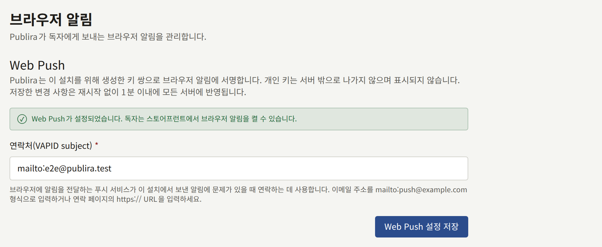

독자는 테넌트의 사이트가 브라우저로 알림을 보내도록 허용할 수 있으며, 그러면 사이트를 열지 않아도 새 에피소드나 테넌트가 게시한 공지를 알 수 있습니다. 설치 환경은 각 독자 브라우저의 푸시 서비스를 통해 알림을 보내며, 설치 환경에 속한 VAPID 키 쌍으로 각 알림에 서명합니다. Web Push는 선택 사항이며 켜기 전까지는 꺼져 있습니다. 켜지 않은 설치 환경은 브라우저 알림을 보내지 않을 뿐, 실패하는 것은 없습니다.

여기 나오는 `publiractl` 명령은 모두 명령만 적어 보여 줍니다. [플랫폼 콘솔과 publiractl](./1-platform-console.md#둘-중-고르기)에서 설명하는 방법으로, `PUBLIRA_PLATFORM_DB_URL`을 `publira_platform` 연결로 설정하고 프로세스가 실행될 때와 같은 `PUBLIRA_SECRET_ENCRYPTION_KEYS`와 `PUBLIRA_SECRET_ENCRYPTION_PRIMARY_KEY_ID`를 지정해 실행하세요. 모든 플래그는 [`publiractl` 레퍼런스](https://github.com/publira/publira/blob/main/server/cmd/publiractl/README.md#webpush)에 있습니다.

## 켜는 데 필요한 것

두 가지가 필요하며, 둘 다 프로세스의 환경이 아니라 설치 환경의 설정에 보관됩니다.

- **VAPID 키 쌍**. 브라우저의 푸시 서비스는 모든 알림을 이 키 쌍으로 확인합니다. 키 쌍은 Publira가 생성하므로 어느 키도 직접 다룰 일이 없습니다. 개인 키는 설치 환경의 암호화 키로 암호화되어 저장되고 표시되지 않으며, 공개 키는 각 독자의 브라우저가 구독할 때 그 브라우저에 전달됩니다.
- **subject**. 설치 환경이 보내는 내용에 문제가 있을 때 푸시 서비스가 연락할 수 있는 연락처로, `mailto:push@example.com` 형식의 이메일 주소나 연락처 페이지의 `https://` URL입니다.

Web Push는 subject가 저장될 때까지 꺼져 있습니다. 그때까지 사이트는 브라우저 알림을 제공하지 않으며, 워커도 알림을 보내지 않습니다.

## 켜기

### publiractl에서

```bash
publiractl webpush init --subject mailto:push@example.com
publiractl webpush show
```

`webpush init`은 저장된 키 쌍이 아직 없으면 생성하고 subject를 저장합니다. `webpush show`는 subject와 공개 키를 출력합니다.

`publiractl setup`에서도 이 단계를 물어보므로, 그때 답한 설치 환경은 이미 Web Push가 켜져 있습니다.

### 플랫폼 콘솔에서

사이드바의 **외부 서비스** 아래에서 **Web Push**를 선택하세요. 화면을 열면 저장된 키 쌍이 아직 없을 경우 키 쌍이 생성됩니다. **연락처(VAPID subject)** 항목을 입력하고 **Web Push 설정 저장**을 선택하면, 화면에 Web Push가 설정되었다고 표시됩니다. **운영자**나 **슈퍼 관리자**는 저장할 수 있고, **감사 담당**은 화면만 볼 수 있습니다.



API 서버에 시크릿 암호화 키가 없어서 Web Push를 설정할 수 없다고 화면에 표시되면, `publira server`가 `PUBLIRA_SECRET_ENCRYPTION_KEYS` 없이 시작된 것입니다. 다른 프로세스와 같은 키를 설정하고 서버를 재시작한 다음 화면을 다시 여세요.

### 작동하는지 확인하기

API와 워커는 10초마다 설정을 다시 읽으므로, 저장한 subject는 재시작 없이 반영됩니다. 또한 처음 저장하면, API가 subject를 포함해 응답하기 시작한 약 20초 후에 워커가 모든 테넌트의 사이트 정보 캐시를 버리므로, 각 사이트는 다음 요청부터 브라우저 알림을 제공합니다. 이 캐시 폐기는 아웃박스의 캐시 재검증으로, 다른 재검증과 마찬가지로 발송됩니다. [아웃박스](./10-scheduled-jobs.md#아웃박스-메일-푸시-캐시-재검증)에서 설명하듯이, `PUBLIRA_REVALIDATE_TOKEN`이 없는 워커는 이를 보낼 수 없습니다.

동작을 확인하려면 테넌트의 사이트에 독자로 로그인하고, 독자의 알림 설정에 있는 **브라우저 알림**에서 **이 브라우저에서 푸시 알림 받기**를 켜고, 알림 설정의 **팔로우 중인 시리즈와 에피소드의 새 에피소드** 행에서 **브라우저**를 켠 채로 두고, 시리즈를 팔로우하세요. 그 시리즈에 다음 에피소드가 공개되어 사이트에 표시되면 브라우저 알림으로 도착합니다. 공지는 독자가 처음에는 꺼져 있는 **공지사항** 행의 **브라우저**도 켜야 도착합니다.

저장할 때마다 **감사 로그**에 기록됩니다.

## 나중에 변경하기

subject는 `webpush init`에 새 `--subject`를 지정하거나 같은 화면에서 언제든지 변경할 수 있습니다. 삭제할 수는 없습니다. 한번 subject를 저장하면 Web Push는 계속 켜져 있습니다.

키 쌍은 교체되지 않습니다. 모든 브라우저 구독은 그 공개 키로 만들어졌으므로, 새 키 쌍을 쓰면 알림을 켠 모든 독자에게 아무 표시 없이 알림이 끊깁니다. `publiractl`과 플랫폼 콘솔 어디에도 두 번째 키 쌍을 생성하는 기능은 없습니다. 따라서 키 쌍은 설치 환경의 백업이 보존해야 하는 것에 포함됩니다. 키 쌍은 암호화 키로 암호화되어 데이터베이스에 있으므로, 둘 중 하나를 잃으면 키 쌍도 잃습니다. 암호화 키를 교체해도 키 쌍은 유지됩니다. [시크릿 암호화 키 교체](./12-security/1-rotating-secrets.md#시크릿-암호화-키-교체)에서 설명하듯이, `publiractl db reseal`이 다른 모든 것과 함께 개인 키를 새 키로 다시 봉인합니다.

독자가 권한을 철회했거나 사이트 데이터를 지워서 브라우저가 포기한 구독은, 다음에 그 구독으로 보낸 알림이 거부될 때 삭제됩니다.

## 모바일 앱의 알림

Web Push는 브라우저만 다룹니다. 테넌트의 모바일 앱이 받는 알림은 테넌트 관리자가 테넌트 콘솔에서 설정하는 테넌트 자체의 Firebase 프로젝트를 통해 발송되며, 설치 환경의 설정과는 관계가 없습니다. 그 설정은 [푸시 알림](../5-mobile-app/3-push-notifications.md)에서 설명합니다.
