설치 환경은 어느 테넌트에도 속하지 않는 몇 가지 설정으로 운영됩니다. 새 테넌트가 처음에 사용하는 언어, 시간대, 통화, 독자 한 명이나 주소 하나가 플랫폼에 과도한 부하를 주지 않도록 하는 제한, 그리고 만료되는 레코드를 얼마나 오래 보관하는지입니다. 이 페이지에서는 각 그룹이 무엇을 막는지, 어떻게 변경하는지, 그리고 테넌트의 관리자가 자기 테넌트에 대해 어느 부분을 변경할 수 있는지 설명합니다.

모든 정책과 보존 기간 값에는 기본 제공 값이 있으며, 아무것도 저장하지 않은 설치 환경은 그 값으로 운영됩니다. 기본 시간대도 마찬가지로 저장하기 전까지는 `UTC`이고, 기본 통화는 `publiractl setup`에 지정한 통화이며, 지정하지 않았다면 `USD`, 이 릴리스 이전부터 운영하던 설치 환경에서는 `JPY`입니다. 기본 언어에는 기본 제공 값이 없습니다. `publiractl setup`이 저장한 값을, 플랫폼 콘솔의 설정 화면이 첫 운영자가 선택한 언어로 바꾸었습니다. 각 값의 범위와 기본 제공 값은 `publiractl` 레퍼런스의 [`policy`](https://github.com/publira/publira/blob/main/server/cmd/publiractl/README.md#policy)와 [Retention periods](https://github.com/publira/publira/blob/main/server/cmd/publiractl/README.md#retention-periods)에 있으며, 이 페이지에서는 반복하지 않습니다.

## 설정이 있는 곳

각 그룹은 플랫폼 콘솔에서, 또는 [플랫폼 콘솔과 publiractl](./1-platform-console.md#둘-중-고르기)에서 설명하는 방법으로 실행한 `publiractl`에서 설정할 수 있습니다.

| 그룹 | 플랫폼 콘솔 | `publiractl` |
| --- | --- | --- |
| 기본 언어, 시간대, 통화 | **플랫폼** 아래의 **일반** | `platform set`, `platform show` |
| 2단계 인증, 테넌트의 코인 발행 허용 여부, 로그인·비밀번호·구매·이용권·메일·익명 열람 제한, 일회용 이메일 도메인 목록 | **정책** 아래의 **보안** | `policy set`, `policy show` |
| 댓글, 신고, 평가, 문의, 뷰어, 알림 설정 제한 | **정책** 아래의 **커뮤니티** | `policy set`, `policy show` |
| 만료되는 레코드의 보관 기간 | **정책** 아래의 **보존 기간** | `retention set`, `retention show` |

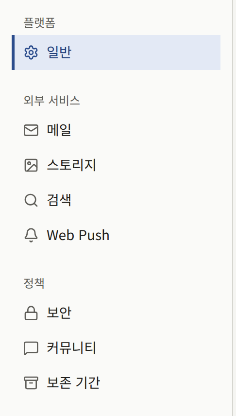

둘 다 같은 코드를 통해 기록합니다. `set` 명령은 플래그로 지정한 값만 변경하고 나머지는 유지하며, 플랫폼 콘솔의 페이지는 그 페이지의 모든 값을 한꺼번에 저장합니다. 아무것도 바꾸지 않는 저장은 기록되지 않으며, 그 밖의 저장은 **감사 로그**에 **플랫폼 설정 변경**, **플랫폼 정책 변경**, **보존 기간 기본값 변경**으로 기록됩니다. **보안**, **커뮤니티**, **보존 기간** 페이지는 자신이 보지 못한 저장을 덮어쓰지 않습니다. 페이지를 연 후에 누군가 그 페이지를 저장했다면 플랫폼 콘솔은 "다른 운영자가 이 설정을 변경하여 저장되지 않았습니다. 화면을 새로고침한 뒤 다시 시도하세요."라며 거부합니다. **보안**과 **커뮤니티**는 하나의 정책으로 저장되므로, 어느 한쪽을 저장할 때도 다른 쪽의 오래된 사본이면 거부됩니다. **일반 설정**의 세 양식은 이를 확인하지 않습니다. 각 양식은 저장된 값과 관계없이 자기 값을 저장하고, 다른 값은 저장된 그대로 유지합니다. `publiractl`은 값을 기록하기 직전에 저장된 값을 읽으며, 그 사이에 다른 저장이 끼어들면 `1`로 종료합니다. 그 후 같은 명령을 다시 실행하면 그 저장 위에 플래그의 값이 적용됩니다.

**운영자**나 **슈퍼 관리자**는 이 페이지들을 저장할 수 있습니다. **감사 담당**은 같은 양식을 볼 수 있지만 저장은 거부됩니다.

정책을 저장하기 전까지 플랫폼 콘솔 대시보드의 **설정 현황** 카드에는 "로그인, 악용 방지, 데이터 보존 한도에 기본 제공 값이 적용됩니다."라고 표시됩니다. 이는 설정이 끝나지 않은 설치 환경이 아니라 정상적으로 동작하는 설치 환경입니다. 기본 제공 값이 플랫폼에 맞지 않을 때만 값을 변경하세요.

## 플랫폼 기본값

**일반 설정**에는 값이 세 가지 있으며, 각각 저장 버튼이 따로 있습니다.

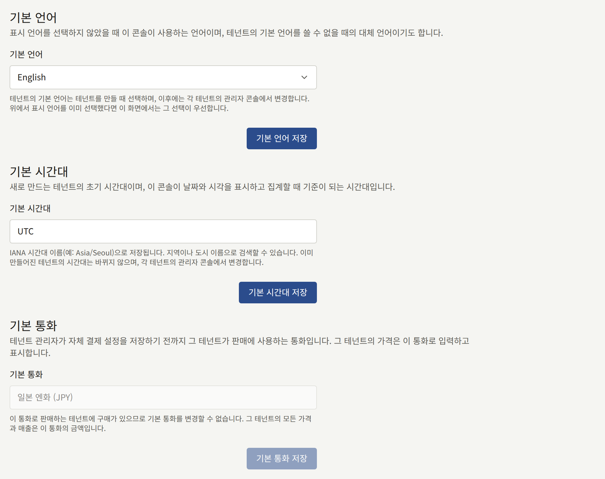

**기본 언어**는 언어를 선택하지 않은 운영자에게 플랫폼 콘솔을 표시하는 언어이며(로그인 화면 포함), 비밀번호 재설정처럼 플랫폼 콘솔이 운영자에게 보내는 메일의 언어입니다. 어느 테넌트의 언어도 정하지 않습니다. [테넌트](./2-tenants.md#테넌트를-만들기-전에)에서 설명하듯이, 모든 테넌트는 생성될 때 자체 기본 언어를 받습니다. 이 값은 첫 운영자가 설정 화면에서 선택했습니다.

**기본 시간대**는 시간대 없이 생성된 새 테넌트가 처음에 사용하는 시간대이며, 플랫폼 콘솔이 날짜를 표시하고 집계하는 시간대입니다. 테넌트는 생성될 때의 시간대를 유지하므로, 기본값을 바꾸면 그 후에 생성되는 테넌트에만 영향을 줍니다. 테넌트의 시간대는 테넌트 관리자가 테넌트 콘솔에서 변경합니다. 이 값은 첫 운영자가 설정 화면에서 선택했으며, 설정 화면은 그 운영자 브라우저의 시간대를 제시했습니다.

**기본 통화**는 관리자가 **결제 설정**을 저장하지 않은 모든 테넌트가 판매에 사용하는 통화이므로, 그 테넌트의 가격을 입력하고 표시하는 통화입니다. 결제 설정을 저장한 테넌트는 그곳에 저장한 통화를 유지하며, 기본값의 영향을 더 이상 받지 않습니다. 목록에서 통화 이름이나 `EUR` 같은 ISO 4217 코드로 찾으세요. 이 통화로 판매하는 테넌트에서 한 번이라도 판매가 이루어지면 변경할 수 없습니다. 그러면 필드는 읽기 전용이 되어 그 이유를 표시하고, `publiractl`도 변경을 거부합니다. 이 상태는 그런 테넌트가 모두 자체 통화로 결제 설정을 저장할 때까지 계속됩니다. `publiractl setup`과 플랫폼 콘솔의 설정 화면은 설치 환경을 설정할 때 이 값을 묻는데, 그때가 이 값을 정할 시점입니다.

명령줄에서는 다음과 같이 합니다.

```bash
publiractl platform set --default-locale en --default-timezone America/New_York --default-currency USD
```

## 보안

**보안 정책**에는 모든 테넌트에 똑같이 적용되고 어느 테넌트도 변경할 수 없는 값이 있습니다. 각 값은 계정, 메일을 보내는 작업, 또는 돈이 오가는 작업을 보호합니다.

### 테넌트 관리자의 2단계 인증

**테넌트 관리자에게 다단계 인증 필수**(`--mfa-required-for-tenant-admin`)를 켜면 테넌트 관리자가 비밀번호만으로 테넌트 콘솔에 로그인할 수 없습니다. 인증 앱을 설정하지 않은 관리자를 돌려보내지는 않습니다. 비밀번호를 입력하면 콘솔이 **2단계 인증 설정**을 표시하며, 인증 앱을 등록해야만 로그인이 완료됩니다. 화면에는 테넌트가 이를 요구한다고 표시되지만, 실제로는 플랫폼의 요구이며 테넌트가 끌 수는 없습니다.

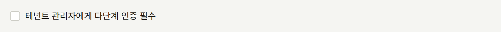

이 설정은 모든 테넌트에 한꺼번에 적용되며, **테넌트 관리자** 역할에만 적용됩니다. 편집 담당과 감사 담당에게는 요구되지 않습니다. 이미 열려 있는 세션이 아니라 각 관리자의 다음 로그인부터 적용됩니다. 관리자는 여전히 계정 설정에서 인증 앱을 끌 수 있으며, 그러면 다음에 로그인할 때 다시 설정하도록 요청받습니다.

플랫폼 콘솔의 운영자에게는 이 설정이 적용되지 않습니다. 운영자에게는 다음 설정이 적용됩니다.

### 플랫폼 운영자의 2단계 인증

**플랫폼 콘솔의 모든 운영자에게 2단계 인증 필수**(`--mfa-required-for-platform-operator`)를 켜면 운영자가 비밀번호만으로 플랫폼 콘솔에 로그인할 수 없습니다. 인증 앱을 설정하지 않은 운영자를 돌려보내지는 않습니다. 비밀번호를 입력하면 콘솔이 **2단계 인증 설정**을 표시하며, 인증 앱을 등록하고 복구 코드를 확인해야만 로그인이 완료됩니다.

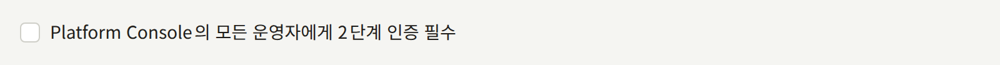

모든 운영자가 모든 테넌트의 데이터를 읽을 수 있으므로, 이 설정은 **감사 담당**을 포함한 모든 역할에 적용됩니다. 이미 열려 있는 세션이 아니라 각 운영자의 다음 로그인부터 적용됩니다. 운영자는 여전히 **계정 설정**에서 인증 앱을 끌 수 있으며, 그러면 다음에 로그인할 때 다시 설정하도록 요청받습니다. 누군가 켜기 전까지는 꺼져 있습니다. `publira server`에 `PUBLIRA_SECRET_ENCRYPTION_KEYS`가 없는 설치 환경에서는 켤 수 없습니다. 그곳에서는 어떤 운영자도 인증 앱을 설정할 수 없어, 다시 끄기 위해 로그인할 수 있는 사람이 없어지기 때문입니다.

### 테넌트가 발행하는 코인

**테넌트의 코인 발행 허용**(`--tenant-coins-allowed`)을 켜면 테넌트가 코인을 발행할 수 있습니다. 코인은 테넌트의 독자가 미리 구매해 그 테넌트의 에피소드에 사용하는 잔액입니다. 새 설치 환경에서도, 이 기능이 없던 릴리스에서 업그레이드한 설치 환경에서도 누군가 켜기 전까지는 꺼져 있습니다.

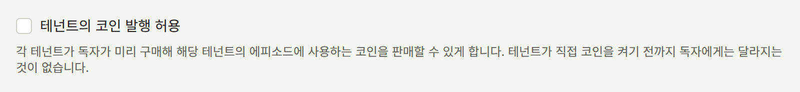

코인은 선불 가치 수단이므로, 운영자와 각 테넌트가 있는 곳에 따라 선불 지급 수단, 전자화폐, 송금, 기프트 카드에 관한 법률이 적용될 수 있습니다. 일부 관할 지역에서는 코인을 판매하는 테넌트가 아니라 설치 환경을 운영하는 플랫폼이 그 법률의 대상이 됩니다. 테넌트에 코인 발행을 허용해도 운영자가 발행자가 되지 않는다는 것을 확인했거나 발행자로서 필요한 조치를 마친 경우가 아니라면 꺼 두세요.

켜도 독자에게 보이는 것은 바뀌지 않습니다. [코인](../4-console/9-coins.md)에서 설명하듯이, 테넌트는 여전히 콘솔의 **결제** › **코인**에서 스스로 코인을 켜야 합니다. 체크박스를 해제하거나 `--tenant-coins-allowed=false`로 끄면, 각 테넌트의 설정과 관계없이 모든 테넌트가 한꺼번에 멈춥니다. 어느 테넌트도 코인을 판매하지 않고 어느 독자도 코인을 사용하지 않으며, 모든 독자는 잔액을 유지합니다. 다시 켜면 각 테넌트는 저장해 두었던 설정으로 돌아갑니다.

### 요청 제한

각 제한은 1분 또는 1시간당 횟수와 1일당 두 번째 횟수로 이루어지며, 1일 횟수는 짧은 쪽보다 낮을 수 없습니다. 제한을 넘은 요청은 그 구간이 지날 때까지 거부됩니다. 구간은 독자의 첫 요청에서 시작하는 것이 아니라 시계에 고정되어 있으므로, 횟수는 매 분이나 매 시가 바뀔 때, 1일 횟수는 UTC 자정에 다시 시작됩니다.

| 보안 페이지의 항목 | 보호하는 것 |
| --- | --- |
| **1분당 비밀번호 확인 수**와 **1일당 비밀번호 확인 수** | 독자가 비밀번호 변경, 이메일 주소 변경, 계정 삭제를 위해 현재 비밀번호를 입력하는 것. 각각 계정마다 세며, 올바른 비밀번호를 입력하면 횟수가 초기화되므로, 한 번 잘못 입력한 독자가 아니라 보유한 세션의 비밀번호를 추측하는 사람을 늦춥니다 |
| **주소당 1시간 메일 요청 수**와 **주소당 1일 메일 요청 수** | 메일을 보내는 양식이 한 주소로 보내는 메일. 독자 가입과 이메일 인증, 세 앱 모두의 비밀번호 재설정과 이메일 변경, 스태프 초대, 플랫폼 콘솔에서의 관리자 초대와 운영자 추가, 문의 메시지에 대한 답변이 해당합니다. 주소는 자기 테넌트 안에서, 또는 플랫폼 콘솔 안에서 세며, `+tag`가 붙은 주소는 그것을 뺀 주소로 셉니다 |
| **요청 출처당 1시간 메일 요청 수**와 **요청 출처당 1일 메일 요청 수** | 같은 메일을 그것을 요청한 클라이언트 주소로, 모든 주소와 모든 테넌트에 걸쳐 센 것. 클라이언트 하나가 모르는 사람들의 긴 목록으로 메일을 보낼 수 없게 합니다 |
| **독자당 1분 인앱 결제 확정 수**와 **독자당 1일 인앱 결제 확정 수** | 독자 한 명이 Apple이나 Google에 확인하도록 서버에 넘기는 스토어 거래 |
| **독자당 1분 기다리면 무료 이용권 사용 수**와 **독자당 1일 기다리면 무료 이용권 사용 수** | 독자 한 명이 기다리면 무료 이용권을 사용하려는 요청. 사용된 이용권은 이미 시리즈의 충전 시간으로 제한되며, 이 제한은 거부된 시도의 횟수를 제한합니다 |

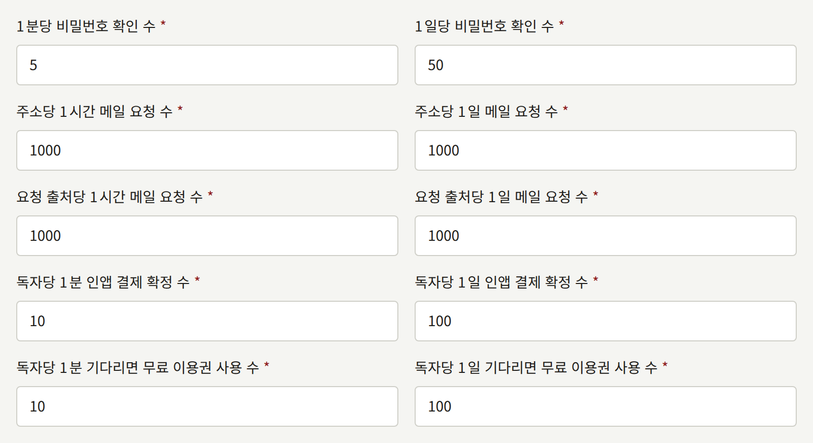

이런 종류의 제한이 열 가지 더 있지만, 아직 보안 페이지에 필드가 없습니다. 개정된 버전에 동의하라는 요청을 받은 독자 한 명이 자기 테넌트의 이용 약관과 개인정보 처리방침에 보내는 동의는 `publiractl policy set --legal-page-agreement-per-minute`와 `--legal-page-agreement-per-day`로 설정하지 않으면 1분에 10회, 1일에 50회입니다. 독자 한 명이 Apple이나 Google 계정을 자기 계정에 연결하는 요청은 `--identity-link-per-minute`와 `--identity-link-per-day`로 설정하지 않으면 1분에 5회, 1일에 20회입니다. 독자 한 명이 아이콘을 업로드, 선택, 삭제하는 횟수는 `--icon-change-per-minute`와 `--icon-change-per-day`로 설정하지 않으면 1분에 5회, 1일에 20회입니다. 독자 한 명이 패스키 등록이나 패스키로 요청 확인을 시작하거나, 패스키의 이름을 바꾸거나 삭제하는 횟수는 `--passkey-per-minute`와 `--passkey-per-day`로 설정하지 않으면 1분에 10회, 1일에 50회입니다. 독자 한 명이 시작하는 시리즈 나머지 일괄 결제는 `--series-remainder-checkout-per-minute`와 `--series-remainder-checkout-per-day`로 설정하지 않으면 1분에 10회, 1일에 50회입니다. 독자 한 명이 사이트의 결제나 테넌트 앱의 스토어를 통해 시작하는 구독은 합쳐서 세며, `--subscription-checkout-per-minute`와 `--subscription-checkout-per-day`로 설정하지 않으면 1분에 10회, 1일에 50회입니다. 독자 한 명이 코인으로 결제하는 에피소드는 `--coin-payment-per-minute`와 `--coin-payment-per-day`로 설정하지 않으면 1분에 20회, 1일에 500회입니다. 독자 한 명이 웹이나 앱의 스토어를 통해 시작하는 에피소드, 권, 코인 팩 구매는 합쳐서 세며, `--purchase-checkout-per-minute`와 `--purchase-checkout-per-day`로 설정하지 않으면 1분에 10회, 1일에 100회입니다. 독자 한 명이 조회하는 프로모션 코드는, 코드가 얼마를 할인하는지 묻는 것과 코드로 구매를 시작하는 것을 합쳐서 세며, `--promotion-code-attempt-per-minute`와 `--promotion-code-attempt-per-day`로 설정하지 않으면 1분에 5회, 1일에 30회입니다. 코드는 테넌트가 나눠 준 비밀이고, 이 제한이 한 계정이 코드를 추측할 수 있는 속도를 정하기 때문입니다. 그리고 [독자 계정](../4-console/2-readers/1-accounts.md#독자가-내려받는-자신의-데이터)에서 설명하는, 독자 한 명이 요청하는 자기 데이터 사본은 각 요청이 설치 환경이 그 독자에 대해 보관하는 모든 레코드를 읽으므로, `--data-export-per-hour`와 `--data-export-per-day`로 설정하지 않으면 1시간에 1회, 1일에 1회입니다. 보안 페이지를 저장해도 이 값들은 설정된 그대로 유지됩니다.

초대는 각각 요청 하나로 셉니다. **테넌트 생성**의 **초기 관리자 이메일** 주소도 모두 해당하며, 이 주소들은 테넌트가 생성되기 전에 모두 셉니다. 하나라도 제한을 넘으면 테넌트는 생성되지 않고 메일도 보내지 않습니다. `publiractl`은 어떤 양식도 거치지 않으므로 이 제한들의 횟수에 포함되지 않습니다.

클라이언트 주소는 [Publira가 신뢰하는 프록시](../2-deployments/4-edge/index.md#publira가-신뢰하는-프록시)에서 설명하듯이, `publira server`가 신뢰하는 프록시를 건너뛰며 `Forwarded`나 `X-Forwarded-For`에서 찾은 주소입니다. 사무실이나 모바일 통신사 게이트웨이처럼 주소 하나를 함께 쓰는 독자들은 요청 출처당, 클라이언트당 횟수를 공유합니다.

### 로그인 시도

테넌트의 사이트, 테넌트 콘솔, 플랫폼 콘솔에 비밀번호로 로그인하는 것 자체를 보호하는 제한이 두 가지 더 있습니다. 이 제한은 **보안** 페이지에서 요청 제한 다음에 있으며, 같은 방식으로 셉니다.

| 보안 페이지의 항목 | 플래그 | 보호하는 것 |
| --- | --- | --- |
| **주소당 1분 로그인 시도 수**와 **주소당 1일 로그인 시도 수** | `--login-attempts-per-account-per-minute`와 `--login-attempts-per-account-per-day` | 한 주소에 대해 시도한 비밀번호. 주소는 자기 테넌트 안에서(테넌트의 사이트와 테넌트 콘솔이 횟수 하나를 공유합니다), 또는 플랫폼 콘솔 안에서 셉니다. 올바른 비밀번호로 로그인하면 횟수가 초기화되므로, 잘못 입력한 사람이 아니라 한 계정의 비밀번호를 추측하는 사람을 늦춥니다 |
| **요청 출처당 1시간 로그인 실패 수**와 **요청 출처당 1일 로그인 실패 수** | `--login-attempts-per-source-per-hour`와 `--login-attempts-per-source-per-day` | 한 클라이언트 주소에서 모든 주소, 모든 테넌트, 플랫폼 콘솔에 걸쳐 실패한 로그인. 클라이언트 하나가 긴 주소 목록에 비밀번호를 시도할 수 없게 합니다. 올바른 비밀번호로 로그인한 것은 세지 않습니다 |

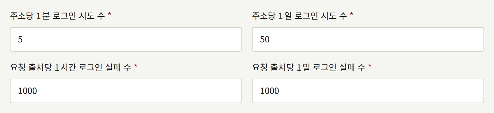

어느 제한이든 넘은 시도는 비밀번호를 확인하기 전에 거부되며, 그 주소에 계정이 있든 없든 똑같이 거부되므로, 추측하는 사람은 어느 주소가 등록되어 있는지 알 수 없습니다. 이때 로그인 화면에는 이메일 주소나 비밀번호가 올바르지 않다는 메시지가 아니라 "짧은 시간에 요청이 너무 많습니다. 잠시 후 다시 시도해 주세요."가 표시됩니다. 비밀번호가 맞았을 수도 있기 때문입니다. 2단계 인증은 비밀번호 다음의 별도 확인이며, 이 제한들은 그 코드를 세지 않습니다.

주소당 제한 때문에, 주소를 아는 사람은 누구나 틀린 비밀번호로 그 횟수를 소진시켜 구간이 지날 때까지 주소의 주인이 비밀번호로 로그인하지 못하게 할 수도 있습니다. Apple이나 Google로 로그인하는 것과 비밀번호 재설정은 이 제한의 영향을 받지 않습니다. 다른 사람의 스크립트 때문에 하루 동안 비밀번호로 로그인하지 못하는 일이 없도록 1일 값을 충분히 높게 두세요.

### 익명 열람

로그인하지 않은 클라이언트 주소 하나가 테넌트의 사이트를 얼마나 빠르게 읽을 수 있는지 제한하는 값이 세 가지 더 있습니다. 모바일 앱이 하는 공개 API 호출, 작품 검색 호출, 그리고 테넌트의 도메인과 이미지 호스트의 이미지입니다. 각각 1일 횟수 없이 10초 구간의 횟수이며, 설치 환경 앞의 엣지가 같은 요청에 두는 제한 뒤에서, 아무것도 제한하지 않는 엣지에 대비해 동작합니다. 웹 앱이 모든 독자를 대신해 자기 자신으로서 하는 호출은 세지 않습니다.

이 제한은 **보안** 페이지의 로그인 시도 제한 다음, **익명 열람** 아래에 있습니다.

| 보안 페이지의 항목 | 플래그 |
| --- | --- |
| **클라이언트당 10초 공개 API 호출 수** | `--anonymous-read-public-api-per-10-seconds` |
| **클라이언트당 10초 작품 검색 수** | `--anonymous-read-search-per-10-seconds` |
| **클라이언트당 10초 이미지 요청 수** | `--anonymous-read-images-per-10-seconds` |

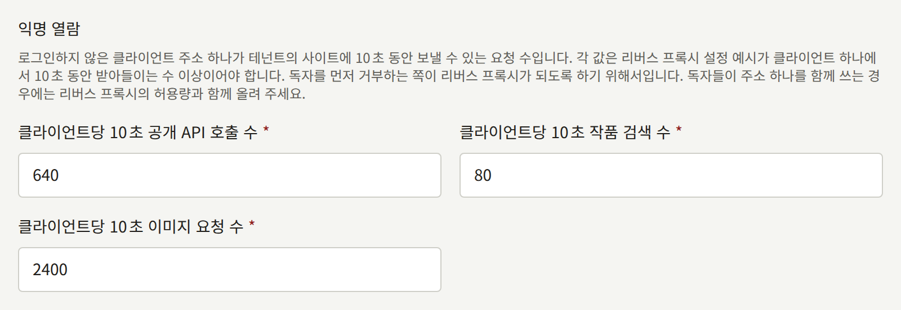

엣지가 언제나 독자를 먼저 거부하도록, 샘플 엣지 구성이 클라이언트 하나에 10초 동안 허용하는 값보다 낮은 값은 거부됩니다. 이때 페이지는 메시지에 최솟값을 표시하고 아무것도 저장하지 않습니다. 모바일 통신사 게이트웨이처럼 독자들이 주소 하나를 함께 쓰는 경우에는 엣지의 허용치와 함께 이 값들을 올리세요. 엣지의 허용치만 서버의 값보다 높이면, 엣지가 통과시킨 요청을 서버가 거부하게 됩니다. 기본 제공 값, 각 값의 최솟값, 엣지가 허용하는 값은 [publira server가 스스로 제한하는 것](./12-security/5-rate-limits.md#publira-server가-스스로-제한하는-것)에 있습니다.

### 횟수가 보관되는 곳

제한의 횟수는 `publira server`가 `PUBLIRA_REDIS_URL`로 지정된 Valkey 또는 Redis 서버에서 세며, 이 서버는 [설치](../2-deployments/2-installing.md#서비스-준비)에서 준비하도록 안내합니다. `publira server`의 모든 인스턴스가 이 횟수를 공유하므로, 인스턴스를 몇 개 실행하든 제한은 설치 환경 전체에 걸쳐 유지됩니다.

이 변수가 없으면 각 인스턴스는 자기 메모리에서 세며, 로그에는 그렇다는 사실이 남지 않습니다. 그러면 요청이 세 인스턴스로 나뉘는 독자는 제한의 세 배를 받게 되고, 재시작하면 모든 횟수가 0부터 다시 시작됩니다. 인스턴스가 Redis에 접근할 수 없는 동안에도 마찬가지입니다. 시작할 때 연결하지 못한 서버는 오류를 로그에 남기고 혼자 세며, 나중에 연결이 끊긴 서버는 경고를 로그에 남기고 연결이 돌아올 때까지 혼자 세다가, 연결이 돌아오면 다시 로그를 남깁니다. `publira server`를 둘 이상 실행한다면 모든 인스턴스에 `PUBLIRA_REDIS_URL`을 설정하세요.

저장한 변경은 재시작 없이 10초 안에 실행 중인 모든 인스턴스에 반영됩니다.

### 일회용 이메일 도메인 목록

**일회용 메일 도메인 목록 URL**(`--disposable-email-domains-url`)은 `publira server`가 일회용 메일용으로 만들어진 도메인 목록을 읽는 위치입니다. Publira에는 목록이 포함되어 있지 않으므로, URL을 지정하기 전까지는 목록이 없습니다.

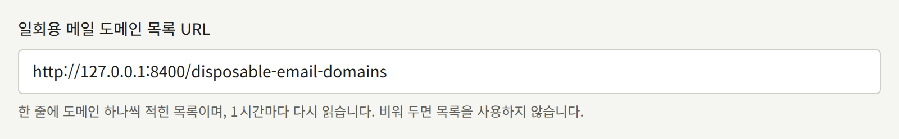

목록은 한 줄에 도메인 하나씩 적힌 일반 텍스트 파일이며, 빈 줄과 `#`으로 시작하는 줄은 무시됩니다. 이는 [disposable-email-domains](https://github.com/disposable-email-domains/disposable-email-domains) 프로젝트의 차단 목록 형식입니다. 목록에 있는 도메인은 그 하위 도메인도 포함합니다. 각 인스턴스는 목록이 처음 필요할 때 읽고, 1시간 후에 다시 읽습니다. 읽기에 실패하거나 파일에 도메인이 아닌 줄이 있으면, 인스턴스는 마지막으로 읽은 목록을 계속 사용하고 경고를 로그에 남깁니다. 이전에 읽은 목록이 없으면 아무것도 거부하지 않고 1시간 후에 다시 시도합니다. 새 URL은 저장한 후 다음에 조회할 때 읽힙니다.

목록을 저장하는 것만으로는 아무것도 거부되지 않습니다. 일회용 주소를 거부하려는 테넌트는 콘솔의 **설정**에 있는 **받지 않는 이메일 주소**에서 **일회용 이메일 도메인 받지 않기**를 켜며, 그 후로 독자는 목록에 있는 도메인의 주소로 가입하거나 주소를 변경할 수 없습니다. Apple이나 Google로 로그인하는 것은 영향을 받지 않습니다. 플랫폼에 목록이 없으면 그 스위치에는 효과가 없다고 표시됩니다.

## 커뮤니티

**커뮤니티 제한**은 테넌트의 커뮤니티에서 독자가 하는 행동에 대한 제한입니다. 여기의 각 값은 모든 테넌트의 출발점이자 테넌트가 선택할 수 있는 가장 느슨한 값입니다. 테넌트는 자기 제한을 더 엄격하게 할 수는 있지만 더 느슨하게 할 수는 없습니다.

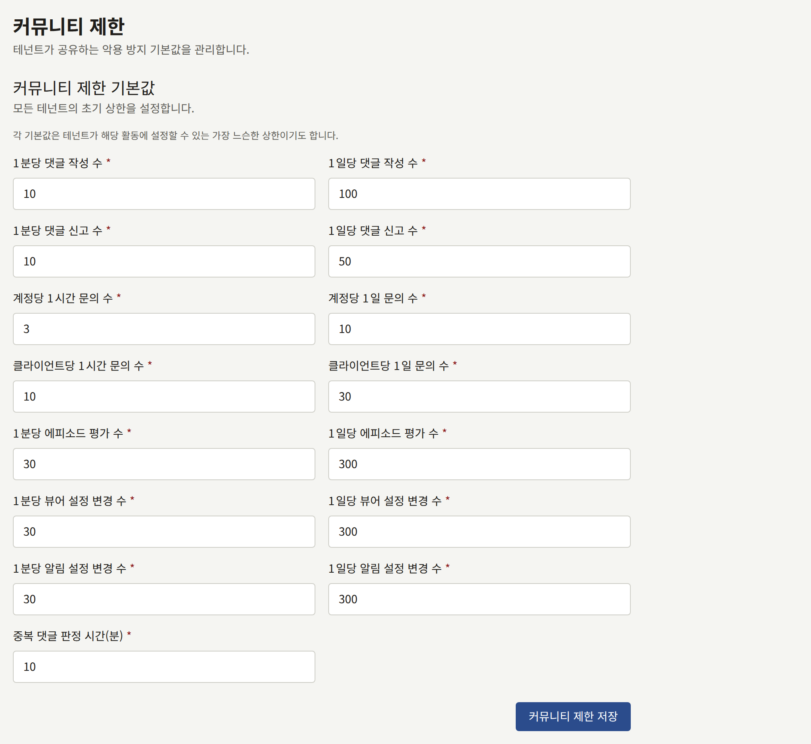

| 커뮤니티 페이지의 항목 | 제한하는 것 |
| --- | --- |
| **1분당 댓글 작성 수**와 **1일당 댓글 작성 수** | 독자 한 명이 작성하는 댓글 |
| **1분당 댓글 신고 수**와 **1일당 댓글 신고 수** | 독자 한 명이 신고하는 댓글 |
| **계정당 1시간 문의 수**와 **계정당 1일 문의 수** | 로그인한 독자 한 명이 테넌트의 문의 양식으로 보내는 메시지 |
| **클라이언트당 1시간 문의 수**와 **클라이언트당 1일 문의 수** | 로그인 여부와 관계없이 클라이언트 주소 하나에서 문의 양식으로 보내는 메시지. 모든 테넌트에 걸쳐 셉니다 |
| **1분당 에피소드 평가 수**와 **1일당 에피소드 평가 수** | 독자 한 명이 에피소드 평가를 누르는 횟수 |
| **1분당 뷰어 설정 변경 수**와 **1일당 뷰어 설정 변경 수** | 독자 한 명이 뷰어의 레이아웃을 저장하는 횟수 |
| **1분당 알림 설정 변경 수**와 **1일당 알림 설정 변경 수** | 독자 한 명이 알림 설정을 저장하는 횟수 |
| **중복 댓글 판정 시간(분)** | 독자가 같은 에피소드에 같은 댓글을 다시 작성할 때 거부되는 시간으로, 1분부터 1주일까지입니다. 앞뒤 공백을 제거한 후 정확히 일치하는지 비교합니다 |

이 제한은 보안 제한과 같은 곳에서 세므로, [횟수가 보관되는 곳](#횟수가-보관되는-곳)이 여기에도 적용됩니다.

## 보존 기간

**보존 기간 기본값**은 자체 기간을 설정하지 않은 모든 테넌트에 대해 네 종류의 레코드를 얼마나 오래 보관할지 정합니다. 각 기간은 일 단위의 정수입니다. 기간이 지난 것은 `publira worker`가 자체 일정에 따라 삭제합니다. 이를 실행하기 위해 설정할 것은 없으며, `publiractl job`으로 같은 삭제를 직접 실행할 수도 있습니다.

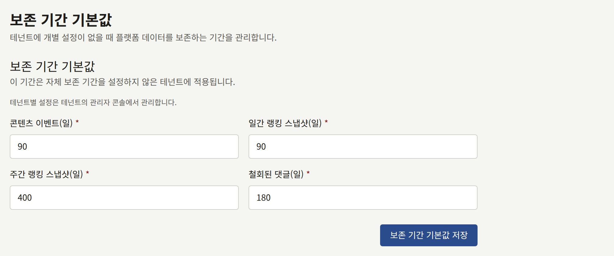

| 레코드 | 내용 | 삭제하는 작업 | 주기 |
| --- | --- | --- | --- |
| **철회된 댓글** | 작성자가 삭제한 댓글로, 신고나 이의 제기가 진행 중인 동안 스태프가 읽을 수 있도록 보관합니다. 댓글에 접수된 신고도 함께 삭제됩니다 | `purge-withdrawn-comments` | 1시간마다 |
| **콘텐츠 이벤트** | 조회, 완독, 구매, 즐겨찾기, 평가, 댓글 하나하나를 발생한 그대로 기록한 것 | `purge-content-events` | 24시간마다 |
| **일간 랭킹 스냅샷** | 매일의 순위표 | `purge-ranking-snapshots` | 24시간마다 |
| **주간 랭킹 스냅샷** | 매주의 순위표 | `purge-ranking-snapshots` | 24시간마다 |

각 삭제 작업은 시작할 때 기간을 읽으므로, 저장한 변경은 다음 실행부터 적용됩니다. 또한 각 작업은 현재 주기 안에 실행된 적이 없으면 `publira worker`가 시작할 때도 실행되며, 중단 후 첫 실행에서는 그동안 만료된 것을 모두 삭제합니다.

일부 레코드는 의도적으로 기간보다 오래 남습니다.

- 스태프가 숨기거나 신고 임계값에 따라 숨겨진 댓글은 기간과 관계없이 삭제되지 않습니다. 관리 판단의 기록이기 때문입니다. 작성자가 철회한 댓글만 삭제됩니다.
- 테넌트가 가진 각 종류의 가장 최근 순위표는 항상 유지되므로, 랭킹이 비는 일은 없습니다.

기간 정하기:

- **콘텐츠 이벤트**는 기록된 후 두 가지에 쓰입니다. 하루가 끝나면 만들어지는 그날의 통계와, 테넌트 자체 시간대로 끝난 최근 28일로 만들어지는 추천입니다. 통계는 이벤트보다 오래 남으므로, 기간을 짧게 해도 테넌트의 리포트가 줄어들지는 않습니다. 로그인한 각 독자가 어느 날 활동했는지에 대한 기록도 마찬가지입니다. 콘솔은 이 기록으로 한 주에 가입한 독자를 그 후 12주 동안 추적하므로, 그보다 짧은 기간이라도 그 주들은 계속 집계됩니다. 30일(28일에, 추천을 만드는 날 하루와 시간 변경으로 길어지는 날 하루를 더한 값)보다 짧은 기간은 추천이 더 적은 날로 만들어지게 하고, 통계가 만들어지기 전에 그날의 이벤트를 삭제할 수 있으므로, 플랫폼의 기본값이든 테넌트의 자체 기간이든 거부됩니다. Publira가 이를 거부하기 전에 저장된 더 짧은 기간은 30일로 유지됩니다.
- **랭킹 스냅샷**은 시간에 따른 비교를 위해 보관합니다. 독자에게는 가장 최근 것만 표시됩니다. 기간을 짧게 하면 그 비교가 거슬러 올라갈 수 있는 범위만 짧아집니다.
- **철회된 댓글**의 기간은 테넌트가 댓글에 대한 신고나 이의 제기를 처리하는 데 걸리는 시간을 포함해야 합니다. 테넌트 콘솔은 스태프에게 철회된 각 댓글이 언제 삭제될 예정인지 보여 줍니다.

명령줄에서는 다음과 같이 합니다.

```bash
publiractl retention set --content-event-days 120
```

## 테넌트가 변경할 수 있는 것

테넌트의 관리자는 [설정](../4-console/3-setup/1-settings.md#제한-및-보존)에서 설명하듯이 테넌트 콘솔의 **설정** → **제한 및 보존**에서 이 중 일부를 자기 테넌트에 맞게 변경합니다. 편집 담당과 감사 담당은 그 페이지를 볼 수 있지만 저장할 수는 없습니다.

| 그룹 | 테넌트가 할 수 있는 것 |
| --- | --- |
| **일반**: 기본 언어와 시간대 | 여기서는 없습니다. 각 테넌트는 생성된 순간부터 자체 언어와 시간대를 가지며, 콘솔의 **설정**에서 변경합니다 |
| **일반**: 기본 통화 | **결제 설정**에서 자체 통화를 선택할 수 있으며, 그 후로 기본값의 영향을 받지 않습니다 |
| **보안**: 모든 값 | 없습니다. 테넌트가 하는 관련 선택은 일회용 이메일 도메인을 거부할지 여부 하나이며, 거부에 쓰는 목록은 플랫폼의 것입니다 |
| **커뮤니티**: 모든 값 | 어느 값이든 더 엄격하게 할 수 있습니다. 제한을 낮추거나 중복 댓글 판정 시간을 늘리는 것입니다. 플랫폼보다 느슨한 값은 거부됩니다 |
| **보존 기간**: 모든 기간 | 어느 기간이든 플랫폼의 기본값보다 길거나 짧게, 1일부터 36500일까지 설정할 수 있으며, **콘텐츠 이벤트**는 30일부터입니다 |

그 페이지에서 각 그룹은 **플랫폼 기본값 사용**이 체크된 상태로 시작하며, 옆에 플랫폼의 값을 표시합니다. 체크를 해제하면 관리자가 테넌트 자체의 값을 입력할 수 있으며, **커뮤니티 제한 저장**이나 **보존 기간 저장**으로 그 값을 저장합니다. 다시 체크하고 저장하면 그 그룹은 플랫폼의 값으로 돌아갑니다. 플랫폼 기본값을 사용하는 테넌트는 운영자가 이후에 기본값을 변경할 때마다 그것을 따릅니다.

플랫폼의 값이 바뀌어도 테넌트의 자체 값은 유지되지만, 예외가 하나 있습니다. 테넌트의 커뮤니티 제한은 요청마다 플랫폼의 값과 비교되어 둘 중 더 엄격한 쪽이 적용되므로, 플랫폼의 제한을 테넌트의 자체 값보다 낮추면 그 테넌트도 엄격해집니다. 다시 올려도 더 엄격한 값을 선택한 테넌트가 느슨해지지는 않습니다. 보존 기간에는 이런 비교가 없으며, 테넌트의 자체 기간이 그대로 사용됩니다.

테넌트의 변경은 콘솔의 감사 로그에 **커뮤니티 제한 변경**과 **보존 기간 변경**으로 기록됩니다.
