시리즈는 독자가 따라 읽는 작품입니다. 시리즈에는 제목, 줄거리, 표지, 레이블, 작가가 있으며, 독자가 여는 에피소드가 들어 있습니다. 사이드바의 **작품** 그룹에 있는 **시리즈**는 테넌트의 시리즈를 최신순으로 한 페이지에 20개씩 표시합니다. 목록 위의 **연재 상태**, **연령 등급**, **레이블**로 목록을 좁힐 수 있습니다.

각 행에서 **편집**(감사 담당에게는 **보기**)을 선택하면 시리즈가 열리고, **에피소드**를 선택하면 그 에피소드가 열립니다. 행의 **상태**는 시리즈의 **공개 일시**가 지나면 **공개 중**, 그 시각이 아직 앞에 있는 동안은 **예약됨**, 공개 일시가 없으면 **임시저장**입니다. 사이트와 앱 양쪽에 표시되지 않는 시리즈는 제목 옆에 **웹 전용** 또는 **앱 전용**이 붙습니다.

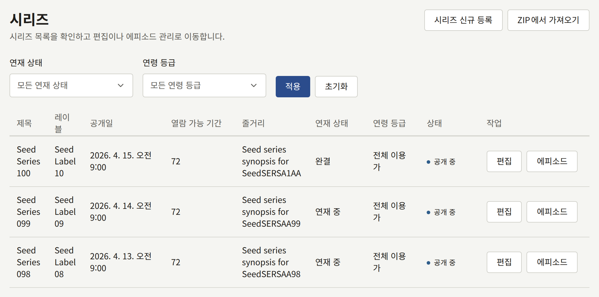

## 시리즈 만들기

**시리즈 신규 등록**을 선택합니다. 이 양식은 나중에 시리즈를 편집할 때 쓰는 양식과 같으며, 양식의 모든 필드는 나중에 바꿀 수 있습니다. 맨 아래의 **시리즈 만들기**를 선택하면 저장되고 시리즈의 편집 페이지가 열립니다.

제목과 줄거리는 사이트의 기본 언어로 씁니다. 사이트의 다른 언어로 된 제목과 줄거리는 시리즈가 만들어진 뒤에 추가하며, 방법은 [다른 언어의 제목](#다른-언어의-제목)에서 설명합니다.

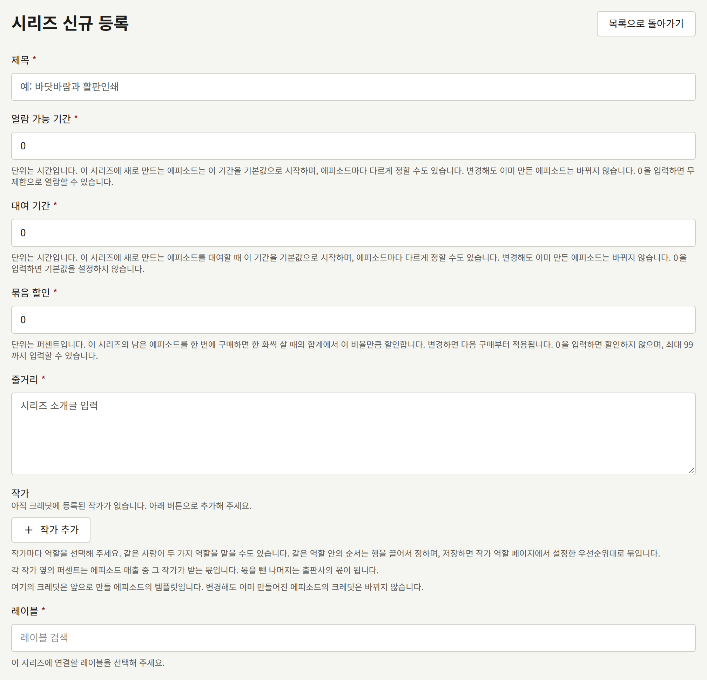

### 독자가 먼저 보는 것

- **제목**: 최대 255자입니다.
- **줄거리**: 시리즈 페이지의 소개글로, 최대 10,000자입니다.
- **작가**: 시리즈에 크레딧이 표시되는 사람들로, 각자 하나의 역할을 맡습니다. 자세한 내용은 [작가와 작가 역할](./4-authors.md#작가를-크레딧에-올리기)에서 설명합니다. 각 작가 옆의 퍼센트는 시리즈 에피소드 매출 중 그 작가의 몫이며, [리포트와 인세](../6-reports-and-royalties.md#작가가-받아야-할-금액)에서 설명합니다. 이 크레딧은 에피소드를 만들 때 각 에피소드에 복사됩니다. 나중에 크레딧을 바꿔도 기존 에피소드는 그대로입니다.
- **레이블**: 시리즈가 출간되는 브랜드입니다. 시리즈에는 반드시 레이블이 있어야 하므로, [레이블](./3-labels.md)에서 설명하는 대로 먼저 레이블을 만드세요.
- **장르**: 테넌트의 장르를 몇 개든 지정할 수 있으며, **장르**에서 정한 순서로 표시됩니다.
- **태그**: 독자가 둘러볼 때 쓸 수 있는 자유로운 단어로, 최대 20개, 각각 최대 50자입니다. 대소문자를 무시하고 이미 사용 중인 태그와 일치하는 태그는 그 태그로 묶입니다.
- **커버 이미지**: 10 MB 이하, 2400 × 3200 픽셀 이상의 JPEG, PNG, WebP 이미지입니다. 이 양식에서는 시리즈를 만들 때만 지정할 수 있으며, 그 뒤에는 **커버 이미지** 탭에서 바꿉니다. 자세한 내용은 [커버 이미지](#커버-이미지)에서 설명합니다.

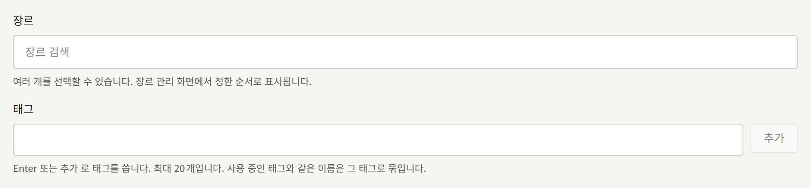

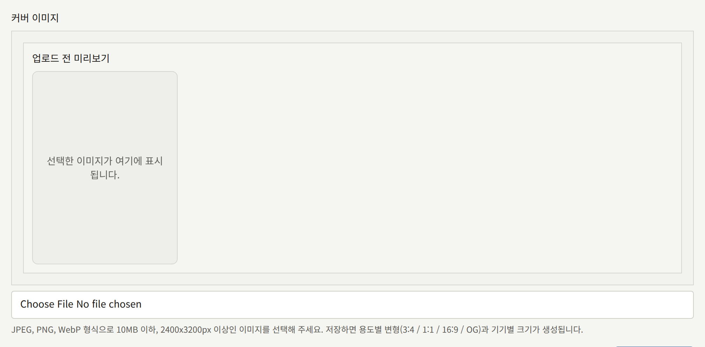

### 공개 일시

**공개 일시**가 시리즈를 공개합니다. 이 값은 필드에 표시된 테넌트의 시간대로 해석됩니다.

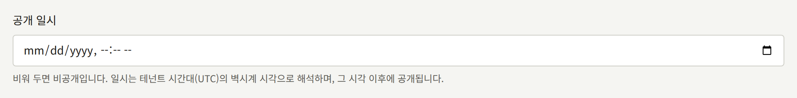

- **비어 있음**: 시리즈가 숨겨집니다. 시리즈 페이지는 존재하지 않는 것처럼 응답하며, 에피소드는 각자의 상태와 관계없이 하나도 읽을 수 없습니다.
- **이미 지난 시각** 또는 현재 시각: 저장하는 즉시 시리즈가 공개됩니다.
- **미래의 시각**: 그 시각까지 시리즈가 숨겨진 상태로 유지됩니다. `publira worker`는 1분마다 공개 시각이 지난 시리즈를 찾아 사이트의 캐시된 페이지를 갱신하므로, 그 시각부터 1분 정도 안에 사이트의 목록과 톱 페이지에 시리즈가 포함됩니다.

나중에 필드를 비우면 공개된 시리즈가 에피소드와 함께 다시 사이트에서 내려갑니다. 에피소드나 권이 있거나 다른 무언가가 참조하는 시리즈는 [시리즈 삭제](#시리즈-삭제)에서 설명하는 대로 삭제할 수 없으므로, 이 방법으로 시리즈를 거두어들입니다.

숨겨져 있던 시리즈가 처음으로, 또는 다시 공개되면, 숨겨져 있는 동안 공개된 에피소드가 그 에피소드나 시리즈, 또는 에피소드에 크레딧이 표시된 작가를 팔로우하는 독자에게 알려지며, 그 에피소드의 날짜는 시리즈가 공개된 시점이 됩니다. 시리즈가 이전에 공개되어 있던 동안 이미 알려진 에피소드는 날짜가 그대로 유지되며 다시 알려지지 않습니다. 누구에게 알려지는지는 [에피소드](./2-episodes.md#예약된-에피소드가-나타나는-시점)에서 설명합니다.

### 표시 위치와 판매 위치

**표시 위치**는 독자가 시리즈를 찾을 수 있는 곳을 정합니다. **웹과 앱**, **웹 전용**, **앱 전용** 중 하나입니다. 새 시리즈는 **웹과 앱**에서 시작합니다. 표시되지 않는 곳에서는 시리즈와 그 에피소드가 독자에게 존재하지 않는 것과 같으며, 에피소드는 이 설정을 좁힐 수는 있지만 넓힐 수는 없습니다.

**판매 위치**는 유료 에피소드를 구매할 수 있는 곳을 정합니다. 처음에는 **테넌트 설정을 따름**이며, **결제** › **결제 방법**의 **판매 위치**를 따릅니다. 그 설정이 바뀐 뒤에도 계속 따릅니다. 두 설정과, 앱이 있는 테넌트가 어떤 시리즈를 사이트에서만 판매하는 이유는 [에피소드 판매](../4-selling-episodes.md#에피소드를-판매하는-곳)에서 다룹니다.

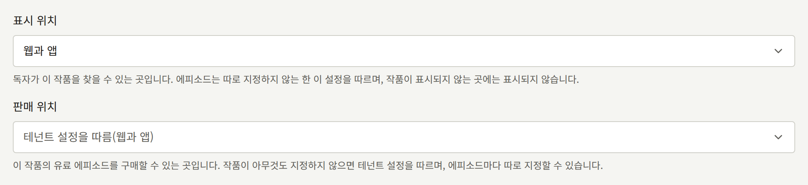

### 연재 상태와 연재 요일

**연재 상태**는 **연재 중**, **완결**, **휴재 중** 중 하나입니다. 독자는 시리즈 페이지에서 이 상태를 보고, 시리즈 목록을 이 상태로 거를 수 있습니다. 그 밖에는 아무것도 바뀌지 않으며, **완결** 시리즈에도 에피소드를 추가할 수 있습니다.

**연재 요일**은 새 에피소드가 나올 것으로 예정된 요일을 표시합니다. 그러면 시리즈 페이지에 그 요일이 "(요일)에 업데이트" 형태로 표시되고, 사이트 톱 페이지의 **요일로 찾기**에서 각 요일 아래에 시리즈가 나열됩니다. 요일을 하나도 선택하지 않으면 시리즈 페이지에는 일정에 대한 내용이 표시되지 않으며, 시리즈는 어느 요일에도 나열되지 않습니다. 그 요일에 에피소드를 공개해 주는 기능은 없습니다. 공개는 여전히 각 에피소드의 **공개 일시**가 정합니다.

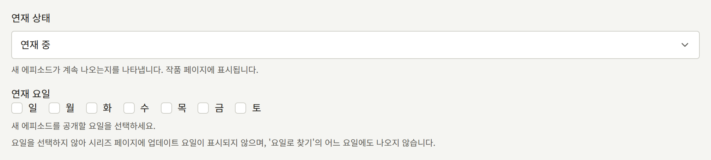

### 연령 등급

**연령 등급**은 **전체 이용가**, **R15**, **R18** 중 하나입니다. **R15** 또는 **R18** 등급의 시리즈는 사이트에 등급이 표시되며, 페이지를 열기 전에 독자에게 나이를 확인하도록 요청합니다. 독자가 확인하기 전까지는 등급이 있는 시리즈가 톱 페이지와 검색 결과에서도 제외됩니다.

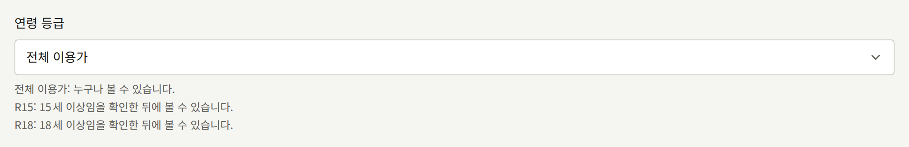

확인만으로 충분한지, 아니면 독자가 나이를 증명하는 생년월일로 로그인해 있어야 하는지는 테넌트 전체에 대해 **나이 증명이 필요한 연령 등급**이 정하며, [설정](../3-setup/1-settings.md#연령-확인)에서 설명합니다. 시리즈별로 정할 수는 없습니다.

### 댓글

**댓글**은 시리즈 에피소드에 달린 독자 댓글을 어떻게 공개할지 정합니다. **받지 않음**, **바로 공개**, **승인 후 공개** 중 하나입니다. 처음에는 **테넌트 설정을 따름**이며, **설정**의 **댓글 공개 방식**을 따릅니다. 그 설정이 바뀐 뒤에도 계속 따르며, 자세한 내용은 [설정](../3-setup/1-settings.md#독자-댓글)에서 설명합니다. 댓글 승인과 관리는 [댓글](../2-readers/2-comments.md)에서 다룹니다.

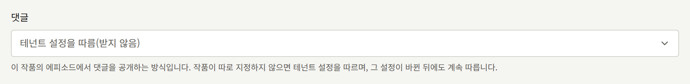

여기서 선택한 값은 테넌트 설정과 관계없이 그 시리즈에 적용됩니다. 따라서 **바로 공개**로 설정된 시리즈는 테넌트가 댓글을 받지 않는 동안에도 댓글을 받습니다.

### 읽는 방향과 펼침면

**읽는 방향**은 시리즈의 페이지를 넘기는 방향입니다. 일본 만화를 읽는 방식이자 기본값인 **오른쪽에서 왼쪽**, 또는 **왼쪽에서 오른쪽**입니다. 이 설정은 페이지를 넘기는 방향, 펼침면에서 두 페이지의 순서, 진행 막대, 그리고 이전 에피소드와 다음 에피소드가 어느 쪽에 있는지를 정합니다.

**펼침면을 시작할 페이지**는 두 페이지를 나란히 표시할 수 있을 만큼 넓은 화면에서 어느 페이지부터 두 페이지씩 짝지어 표시할지 정합니다. 그 앞의 페이지는 한 페이지씩 표시됩니다. 기본값인 `2`는 보통 표지인 첫 페이지를 단독으로 두고, `1`은 첫 페이지부터 짝을 짓습니다. 페이지 수가 이 값보다 적은 에피소드는 한 페이지씩 표시됩니다.

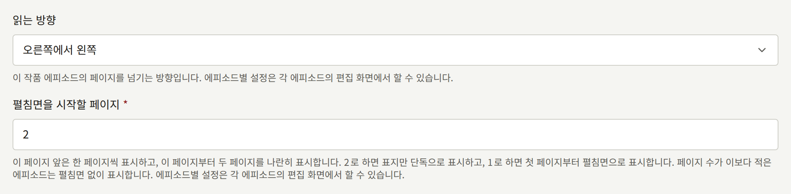

에피소드는 이 두 가지를 각각 따로 설정할 수 있으며, [페이지 레이아웃](./2-episodes.md#페이지-레이아웃)에서 설명합니다. 따로 설정하지 않은 에피소드는 시리즈를 따르며, 시리즈의 설정이 바뀐 뒤에도 계속 따릅니다.

### 열람 가능 기간

**열람 가능 기간**(시간 단위)은 시리즈에 새로 만드는 각 에피소드의 **열람 가능 기간**이 시작하는 값입니다. 구매로 에피소드가 열려 있는 기간은 시리즈가 아니라 에피소드 자체의 기간입니다. 에피소드에는 만들 때 다른 기간을 지정하거나 [나중에 바꿀](./2-episodes.md#가격과-열람-가능-기간-바꾸기) 수 있으며, 나중에 시리즈의 기간을 바꿔도 이미 만든 에피소드는 그대로입니다. 새 시리즈는 `0`에서 시작하며, 이 값은 구매한 에피소드를 기한 없이 열어 둡니다. 기간이 어떻게 쓰이는지는 [에피소드 판매](../4-selling-episodes.md#가격과-열람-가능-기간)에서 설명합니다.

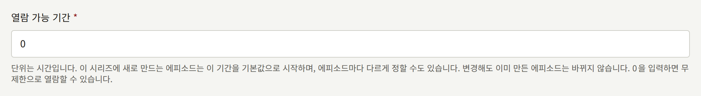

### 대여 기간

**대여 기간**(시간 단위)은 시리즈에 새로 만드는 각 에피소드의 **대여 기간**이 시작하는 값입니다. 이 값만으로 에피소드가 대여되지는 않습니다. 에피소드는 **대여 가격**이 지정되어야 대여되며, 이 기간은 대여로 에피소드가 열려 있는 시간입니다. **열람 가능 기간**과 마찬가지로, 시리즈의 값이 바뀌어도 에피소드는 만들 때의 값을 유지합니다. 새 시리즈가 시작하는 값인 `0`은 기간을 설정하지 않으며, 이때 새 에피소드의 **대여 기간**은 비어 있는 상태로 시작합니다. 대여는 [에피소드 판매](../4-selling-episodes.md#가격과-열람-가능-기간)에서 설명합니다.

### 묶음 할인

**묶음 할인**(정수 퍼센트)은 독자가 시리즈의 나머지를 한 번의 결제로 구매할 때 할인받는 비율입니다. 아직 소유하지 않은 시리즈의 모든 유료 에피소드를, 가격 합계에서 이 비율만큼 뺀 금액으로 구매합니다. 새 시리즈가 시작하는 값인 `0`은 할인하지 않으며, 최대값은 `99`입니다. 변경은 다음 결제부터 적용되며, 독자가 이미 구매한 것에는 영향을 주지 않습니다. 이 판매 방식은 [에피소드 판매](../4-selling-episodes.md#시리즈의-남은-에피소드)에서 설명합니다.

## 다른 언어의 제목

시리즈에는 사이트가 제공하는 언어마다 제목과 줄거리가 있으며, 제공하는 언어는 테넌트 관리자가 [**설정**](../3-setup/1-settings.md#언어)에서 선택합니다. **기본 정보** 탭의 양식 위에 있는 **언어**에는 언어마다 탭이 있으며, 아래 양식은 선택한 언어의 제목과 줄거리를 편집합니다. **제목** 아래의 안내에 그 언어가 표시됩니다. 시리즈에 아직 제목이 없는 언어에는 **(추가되지 않음)** 표시가 붙습니다. 그 탭을 열면 **제목**과 **줄거리**가 비어 있는 양식이 열리며, 거기서 **시리즈 변경**을 선택하면 제목과 줄거리가 추가됩니다. 제목이 추가되기 전까지 그 언어의 독자는 사이트와 앱에서 시리즈를 다른 언어로 보며, 그렇다는 안내가 함께 표시됩니다. 또한 검색 엔진에는 그 언어로 된 시리즈 페이지가 있다고 알리지 않습니다.

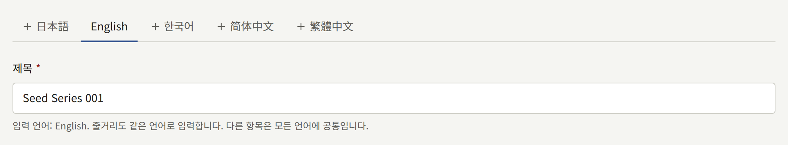

양식의 다른 필드는 모두 특정 언어가 아니라 시리즈 자체에 속하므로, 어느 언어의 탭에서 바꾸든 모든 언어에 대해 바뀝니다. 탭 옆의 **이 번역 삭제**는 선택한 언어의 제목과 줄거리를 삭제하지만, 시리즈에 남은 마지막 제목과 줄거리는 삭제하지 않습니다.

**시리즈** 목록과, 시리즈 이름을 표시하는 콘솔의 다른 화면은 사이트 기본 언어의 제목을 표시합니다. 기본 언어의 제목이 없는 시리즈는 처음 작성된 언어로 표시됩니다.

## 커버 이미지

시리즈의 **커버 이미지** 탭에서는 시리즈를 만들 때 선택한 이미지를 교체하거나 삭제합니다. **커버 이미지**에서 새 이미지를 선택하고 **커버 이미지 변경**을 선택하거나, **현재 커버 이미지 삭제**를 선택해 시리즈에 이미지가 없도록 합니다. 새 이미지는 10 MB 이하, 2400 × 3200 픽셀 이상의 JPEG, PNG, WebP 이미지여야 합니다.

사이트는 업로드한 이미지를 그대로 표시하지 않습니다. 저장하면 이미지에서 정해진 형태의 이미지 네 개가 잘려 나오며, 아래의 **비율별 이미지**에 표시됩니다. 각 칸의 머리에는 형태의 이름이 있고, 그 아래 줄에 그 형태가 쓰이는 곳이 적혀 있습니다.

| 칸 | 최소 크기 | 쓰이는 곳 |
| --- | --- | --- |
| **세로형 (3:4)** | 1200 × 1600 | 사이트와 앱의 서가, 그리고 사이트의 시리즈 페이지에 표시되는 표지 |
| **정사각형 (1:1)** | 1200 × 1200 | 사이트 목록에서 시리즈와 에피소드 옆에 놓이는 작은 이미지, 그리고 사이트가 검색 엔진에 제공하는 이미지 중 하나 |
| **가로형 (16:9)** | 1600 × 900 | 사이트와 앱의 가로 배너, 그리고 사이트의 시리즈 페이지와 에피소드 끝에서 각 에피소드 옆에 놓이는 작은 이미지 |
| **링크 미리보기 (1200:630)** | 1200 × 630 | 시리즈나 그 에피소드의 링크를 공유할 때 표시되는 미리보기. 이 이미지가 없는 시리즈는 사이트가 제목, 로고, 테마 색상으로 그리는 카드로 공유되며, [링크 미리보기](../3-setup/2-branding.md#링크-미리보기)에서 설명합니다 |

각 형태는 이미지의 가운데에서 잘라 냅니다. 어떤 형태에 다른 자르기나 별도의 그림을 쓰려면 **비율별 이미지**에서 그 형태의 이미지를 클릭하고, 칸이 요구하는 크기 이상의 JPEG, PNG, WebP 이미지를 선택합니다. 이전과 같은 이미지여도 됩니다. 그런 다음 **틀 조정**으로 그 형태가 이미지의 어느 부분을 보여 줄지 정하고, **교체**로 저장합니다. 나머지 세 형태는 그대로 유지됩니다. 형태를 교체할 수 있는 것은 시리즈에 커버 이미지가 있을 때뿐이므로, 먼저 **커버 이미지**에서 업로드하세요. 그곳에서 새 커버 이미지를 업로드하면 네 가지가 모두 교체됩니다.

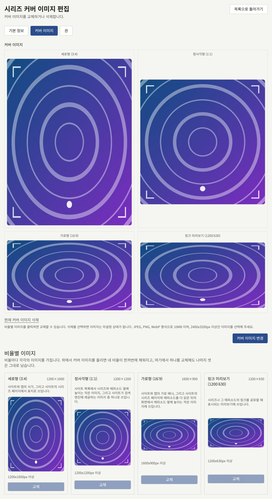

레이블과 장르에도 같은 크기의 같은 탭이 있습니다. 각 형태가 쓰이는 곳은 다르며, 각 칸 아래의 줄이 편집 중인 항목에 대해 쓰이는 곳을 알려 줍니다. 예를 들어 레이블의 정사각형 이미지는 앱의 레이블 타일과 사이트 목록에서 레이블 옆에 놓이는 작은 이미지이며, 레이블의 세로형 이미지는 아직 어디에도 표시되지 않습니다.

## 기다리면 무료

**기본 정보** 탭의 시리즈 양식 아래에 있는 **기다리면 무료**는 로그인한 독자가 시리즈의 유료 에피소드를 한 번에 하나씩 무료로 열 수 있게 합니다. 이때 쓰는 이용권은 일정 시간을 기다리면 다시 생깁니다.

- **이 시리즈에 무료 이용권 제공**으로 켭니다. 끄더라도 아래 숫자는 다음에 다시 켤 때를 위해 유지되며, 독자가 이미 이용권으로 연 에피소드는 시간이 다 될 때까지 열려 있습니다.
- **다음 이용권까지의 시간**: 이용권을 쓴 뒤 다음 이용권을 받기까지의 시간으로, 1부터 8760까지입니다. 처음 값은 `23`입니다. 변경은 각 독자가 다음에 이용권을 쓸 때부터 적용됩니다.
- **에피소드를 읽을 수 있는 시간**: 이용권으로 연 에피소드를 읽을 수 있는 시간으로, 1부터 8760까지입니다. 처음 값은 `72`입니다.
- **이용권으로 읽을 수 없는 최신화 수**: 시리즈 순서에서 마지막 에피소드부터 거슬러 세어, 구매자를 위해 남겨 두는 최근 공개 에피소드의 수입니다. `0`이면 이용권으로 어떤 유료 에피소드든 열 수 있습니다.

**기다리면 무료 설정 저장**을 선택해 저장합니다. 독자는 시리즈마다 이용권을 하나씩 가지며, 쓰지 않아도 이용권이 쌓이지는 않습니다. 이용권으로는 이미 모두에게 무료인 에피소드, 독자가 이미 열 수 있는 에피소드, 독자의 나이로는 열 수 없는 에피소드를 열 수 없습니다. 시리즈 페이지는 독자에게 이용권의 작동 방식을 알려 주며, 이용권으로 열 수 없는 에피소드에는 **무료 이용권 제외**를 표시합니다.

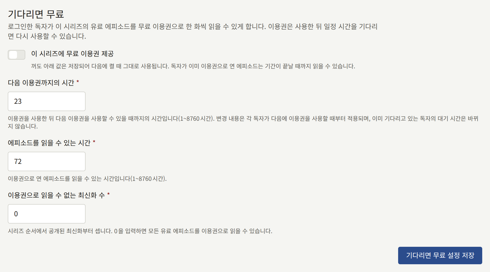

이용권이 가격, 무료 공개 기간과 어떻게 함께 작동하는지는 [에피소드 판매](../4-selling-episodes.md#무료-공개-기간과-기다리면-무료)에서 설명합니다.

## 공개 후 무료

**기본 정보** 탭의 **기다리면 무료** 아래에 있는 **공개 후 무료**는 시리즈의 각 유료 에피소드를 공개되고 정해진 일수가 지난 뒤 모두에게 무료로 만듭니다.

- **공개 후 에피소드를 무료로 전환**으로 켭니다. 끄더라도 아래 숫자는 다음에 다시 켤 때를 위해 유지됩니다.
- **공개 후 일수**: 에피소드가 공개된 뒤 무료가 되기까지의 일수로, 1부터 3650까지입니다. 처음 값은 `30`입니다.
- **유료로 남길 최신화 수**: 시리즈 순서에서 마지막 에피소드부터 거슬러 세어, 아무리 오래되어도 가격을 유지하는 최근 공개 에피소드의 수입니다. `0`이면 모든 유료 에피소드가 날짜가 되면 무료가 됩니다.

**공개 후 무료 설정 저장**을 선택해 저장합니다. 워커는 날짜가 된 각 에피소드에 무료 공개 기간을 추가해 에피소드를 엽니다. 이 기간은 에피소드의 [무료 공개 기간](./2-episodes.md#무료-공개-기간)에 **시리즈 규칙에 따름**으로 표시되며, 그곳에서 삭제할 수 없습니다. 이 기간은 규칙이 에피소드에 적용되는 동안 계속됩니다. 규칙을 끈 채로 저장하거나, 일부 에피소드가 빠지는 숫자로 저장하면 그 에피소드는 즉시 다시 유료가 되며, 나중에 최신화 범위에 들어간 에피소드는 워커의 다음 처리 때 다시 유료가 됩니다. 직접 예약한 무료 공개 기간은 그대로 유지되며, 규칙에 의한 기간은 그 기간이 끝나는 시점에 시작됩니다.

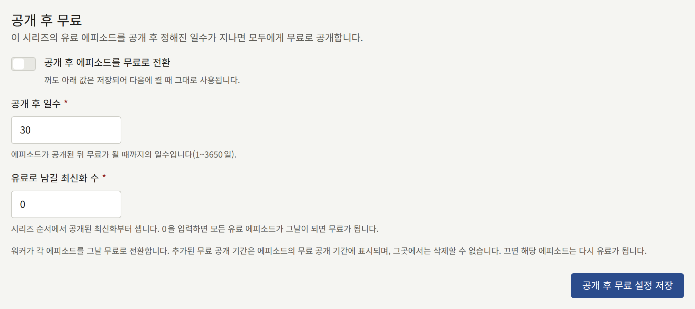

## 권

권은 시리즈의 에피소드를 연속으로 묶어 자체 가격으로 한 번의 결제에 판매하는 단위입니다. 권을 구매하면 그 권에 든 모든 에피소드가 영구히 열립니다. 권은 대여되지 않으며 열람 가능 기간도 없습니다. 에피소드는 최대 하나의 권에 들어갈 수 있으며, 권과 별도로 단독 판매도 계속됩니다.

시리즈의 **권** 탭에는 시리즈의 권이 순서대로 나열되며, 각 권의 표지, 가격, 들어 있는 에피소드 수, 서점 링크 수, **판매 중** 여부가 표시됩니다. 권의 핸들을 드래그하면 순서가 바뀌며, 놓는 즉시 저장됩니다. 감사 담당에게는 핸들 없이 목록이 표시되며, 각 권은 **보기**로 엽니다.

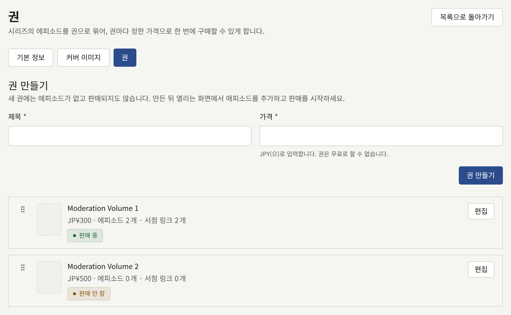

### 권 만들기

**권 만들기**에서 최대 255자의 **제목**과, 테넌트 통화로 `0`보다 큰 **가격**을 입력합니다. **권 만들기**를 선택하면 새 권이 열립니다. 이 권에는 아직 에피소드가 없으며 판매 중도 아닙니다. 한 시리즈에는 권을 최대 100개까지 만들 수 있습니다.

권 화면은 다섯 부분으로 되어 있습니다.

- **기본 정보**에서는 제목과 가격을 함께 바꾸고 **권 변경**으로 저장합니다. 새 가격은 저장한 뒤의 구매부터 적용됩니다.
- **에피소드**는 권에 든 에피소드 목록이며, 아래에서 설명합니다.
- **커버 이미지**에는 10 MB 이하, 2400 × 3200 픽셀 이상의 JPEG, PNG, WebP 이미지를 지정하며, [시리즈의 커버 이미지](#커버-이미지)와 같은 네 가지 형태로 잘립니다. 커버 이미지가 없는 권은 시리즈의 커버 이미지로 표시됩니다.
- **서점 링크**에는 권의 종이책을 판매하는 곳이 나열되며, 아래에서 설명합니다.
- **판매**에서는 권의 판매를 시작하거나 중지합니다.

### 에피소드 고르기

**에피소드**의 **에피소드 추가**에서 시리즈의 에피소드를 검색하고 **추가**를 선택하면 목록의 맨 끝에 추가됩니다. 에피소드의 핸들을 드래그하면 권 안에서의 위치가 바뀌며, 행 끝의 버튼으로 에피소드를 뺍니다. **에피소드 저장**을 선택하기 전까지는 아무것도 저장되지 않습니다. 공개된 에피소드뿐 아니라 임시저장이나 예약된 에피소드도 추가할 수 있습니다.

다른 권에 든 에피소드는 후보로 나오지 않으므로, 먼저 그 권에서 빼세요.

권이 한 번이라도 판매된 뒤에는, 판매를 중지한 뒤에도 그 권에 들어 있던 에피소드를 더 이상 뺄 수 없습니다. 판매 중에 결제를 시작한 독자는 여전히 결제를 마칠 수 있으며, 그 구매로 권에 든 에피소드가 열립니다. 에피소드를 추가하거나 순서를 바꾸는 것은 계속 할 수 있습니다.

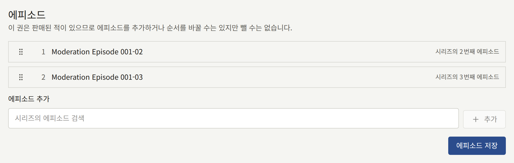

### 서점 링크

**서점 링크**에서 **링크 추가**를 선택하면 목록 끝에 행이 추가됩니다. 각 행에는 1자에서 50자 사이의 **레이블**(서점 이름처럼 버튼에 표시되는 말)과, `https://`로 시작하는 최대 2,048자의 **URL**을 입력합니다. 한 권에는 링크를 최대 10개까지 넣을 수 있습니다. 링크의 핸들을 드래그하면 목록에서의 위치가 바뀌며, 행 끝의 버튼으로 링크를 뺍니다.

**서점 링크 저장**을 선택하기 전까지는 아무것도 저장되지 않으며, 저장하면 목록이 현재 상태와 순서 그대로 저장됩니다. 모든 행을 뺀 채로 저장하면 권에 링크가 하나도 남지 않습니다. 어떤 행을 저장할 수 없으면 그 필드 아래의 메시지가 해당 행을 알려 주며, 목록의 어떤 항목도 저장되지 않습니다. URL이 실제로 응답하는지는 확인하지 않습니다.

권이 판매 중인 동안 사이트와 앱의 시리즈 페이지는 권 아래의 **종이책 구매** 밑에 링크를 목록의 순서대로 나열합니다. 각 링크는 레이블이 적힌 버튼이며, 사이트에서는 서점을 새 탭에서 열고, 앱에서는 앱 안이 아니라 기기의 브라우저에서 엽니다.

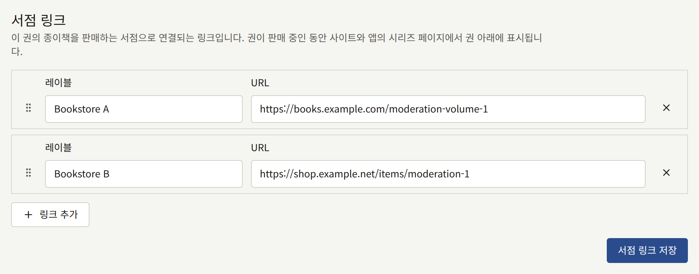

### 권 판매하기

**판매**에서 **판매 시작**을 선택하면 독자에게 권을 판매하고, **판매 중지**를 선택하면 판매를 멈춥니다. 에피소드가 없는 권은 판매를 시작할 수 없습니다. 권의 판매를 중지해도 독자가 이미 구매한 것은 회수되지 않습니다.

권을 구매하면 그 안의 에피소드를 하나하나 구매하는 것이므로, 권은 모든 에피소드를 구매할 수 있는 곳에서만 판매됩니다. 에피소드 중 하나가 **판매 위치**에서 사이트 전용으로 판매되면 권도 사이트에서만 판매됩니다. 에피소드를 판매하는 곳은 [에피소드 판매](../4-selling-episodes.md#에피소드를-판매하는-곳)에서 설명합니다.

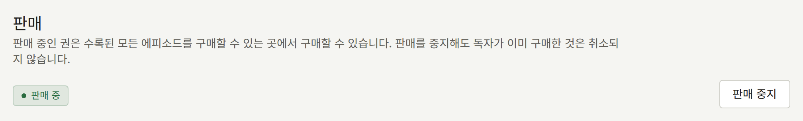

## 시리즈 삭제

테넌트 관리자는 시리즈 편집 화면의 **기본 정보** 탭 맨 끝에 있는 **이 시리즈 삭제**로 시리즈를 삭제합니다. 편집 담당과 감사 담당에게는 표시되지 않습니다. 대화 상자는 시리즈 제목을 입력하라고 합니다. 입력하는 제목은 **시리즈** 목록에 표시되는, 사이트 기본 언어의 제목입니다. 제목을 정확히 입력할 때까지 **시리즈 삭제**를 누를 수 없습니다. 누르면 시리즈가 모든 언어의 제목과 줄거리, 크레딧, 장르와 태그, 커버 이미지, 기다리면 무료와 공개 후 무료 설정, 독자의 팔로우와 함께 삭제됩니다. 시리즈는 사이트와 앱, 검색 색인에서 즉시 사라지며, 콘솔은 **시리즈** 목록으로 돌아갑니다. 삭제는 되돌릴 수 없으며, **감사 로그**에 시리즈 제목과 함께 기록됩니다.

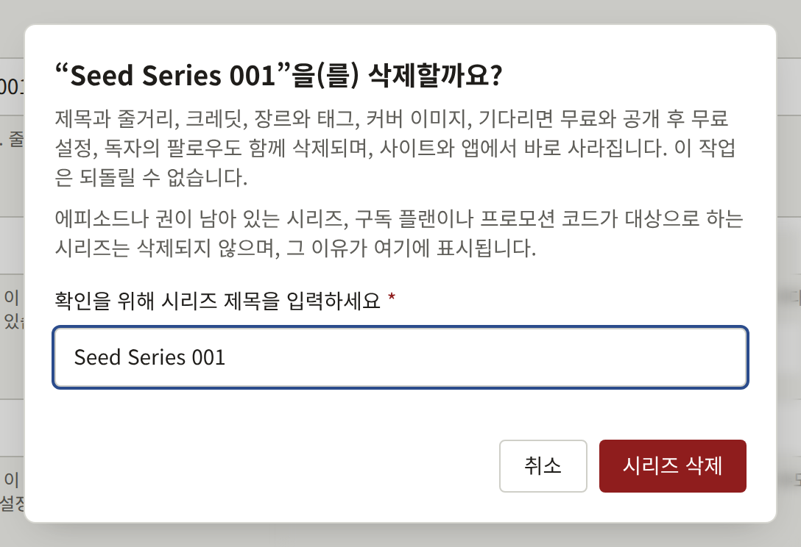

시리즈는 아무것도 담고 있지 않고 아무것도 참조하지 않을 때만 삭제됩니다. 다음 중 하나가 있는 동안에는 시리즈가 삭제되지 않으며, 대화 상자에 그 이유와 그것이 있는 화면으로 가는 링크가 표시됩니다.

- 에피소드. 상태는 상관없습니다. 먼저 [에피소드 삭제](./2-episodes.md#에피소드-삭제)에서 설명하는 대로 에피소드를 하나씩 삭제하세요. **이 시리즈의 에피소드 보기**를 누르면 시리즈의 에피소드 목록이 열립니다.
- 권. 권은 삭제할 수 없으므로, 권이 있는 시리즈는 삭제할 수 없습니다. **이 시리즈의 권 보기**를 누르면 **권** 탭이 열립니다.
- **읽을 수 있는 범위**에 이 시리즈가 포함된 구독 플랜. [플랜 변경, 비공개, 삭제](../5-subscription-plans.md#플랜-변경-비공개-삭제)에서 설명하는 대로 플랜의 읽을 수 있는 범위에서 시리즈를 빼세요. **구독 플랜 보기**를 누르면 **구독 플랜**이 열립니다.
- 삭제하지 않았거나 독자가 사용한 이 시리즈의 프로모션 코드. [코드 확인, 일시 중지, 삭제](../4-selling-episodes.md#코드-확인-일시-중지-삭제)에서 설명하는 대로 아무도 사용하지 않은 코드를 삭제하세요. 독자가 사용한 코드가 있으면 시리즈는 삭제할 수 없습니다. **프로모션 코드 보기**를 누르면 **프로모션 코드**가 열립니다.

대화 상자는 이 순서대로 처음 해당하는 것을 표시합니다. 그래서 여러 개에 해당하는 시리즈는 하나를 해결하면 다음 이유로 다시 삭제가 거부됩니다. 삭제할 수 없는 시리즈는 대신 **공개 일시**를 비워 사이트에서 내리세요.
