에피소드는 독자가 열고 대가를 지불하는 대상입니다. 제목, 가격, 공개 시각이 있는 페이지 이미지의 묶음입니다. 에피소드는 시리즈 안에 있습니다. **시리즈** 목록에서 해당 시리즈 행의 **에피소드**를 선택하면 에피소드가 열립니다.

목록은 각 에피소드를 위치와 제목으로 표시하며, 상태(**임시저장**, **예약됨**, **공개 중**), 가격, 그리고 예약된 에피소드의 경우 공개 예정 시각을 함께 보여 줍니다. 테넌트가 [검토를 요구하는](#공개-전-검토) 동안에는 테넌트 관리자의 결정을 기다리는 예약된 에피소드에 **검토 중**이, 반려된 에피소드에 **반려됨**이 표시됩니다. 사이트와 앱 양쪽에 표시되지 않는 에피소드에는 **웹 전용**, **앱 전용**, **표시되지 않음** 중 하나가 표시되며, [미리보기 페이지](#미리보기-페이지)가 있는 유료 에피소드에는 **미리보기: 3페이지**처럼 그 수가 표시되므로 시리즈 전체의 미리보기 설정을 한눈에 확인할 수 있습니다. **편집**(감사 담당에게는 **보기**)을 선택하면 에피소드가 열립니다. 편집 화면에는 두 개의 탭이 있습니다. [커버 이미지](#커버-이미지)에서 설명하는 **커버 이미지**와, 화면의 나머지 모든 섹션이 있는 **기본 정보**입니다.

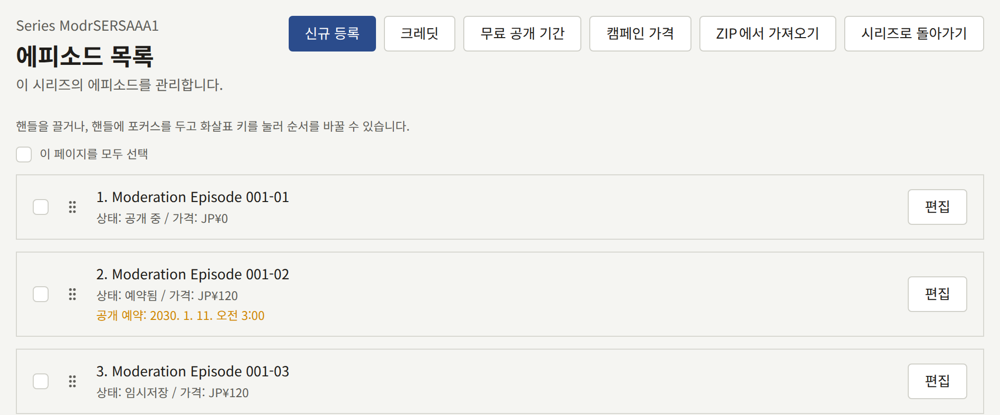

에피소드는 만화든 아니든 페이지 이미지로 이루어집니다. 텍스트로 쓴 소설은 아직 지원하지 않습니다([#505](https://github.com/publira/publira/issues/505)).

## 에피소드 순서

에피소드는 시리즈의 순서대로 나열되고, 사이트에서도 그 순서로 번호가 매겨집니다. 새 에피소드는 맨 끝에 추가됩니다. 에피소드를 옮기려면 핸들을 드래그하거나, 핸들에 포커스를 두고 화살표 키를 사용합니다. 목록은 한 페이지에 20개의 에피소드를 표시하며, 에피소드는 같은 페이지 안에서만 옮길 수 있습니다.

사이트는 각 에피소드에 위치에 따른 번호를 붙여, 번호 뒤에 **화**를 붙인 형태로 표시합니다. 이 번호에는 독자가 아직 볼 수 없는 에피소드도 포함됩니다. 공개된 에피소드의 번호가 빠짐없이 이어지도록, 임시저장과 예약된 에피소드는 순서의 맨 끝에 두세요.

새 순서는 저장하는 즉시 사이트에 반영됩니다.

## 에피소드 만들기

에피소드 목록에서 **신규 등록**을 선택하고 다음을 입력합니다.

- **제목**: 사이트 기본 언어로 된 에피소드 제목입니다. 예: `Episode 1 — A beginning morning`. [나중에 바꿀](#제목-바꾸기) 수 있으며, 사이트의 다른 언어로 된 제목도 그곳에서 지정합니다.
- **가격**: 필드에 표시된 테넌트 통화로 된 가격이며, 그 통화의 소수 자릿수를 넘을 수 없습니다. 500엔이면 `500`, 4.99달러면 `4.99`입니다. `0`이면 에피소드가 무료가 됩니다.
- **열람 가능 기간**: 구매로 에피소드가 열려 있는 시간입니다. `0`이면 기한 없이 열려 있습니다. 처음 값은 시리즈의 [열람 가능 기간](./1-series.md#열람-가능-기간)입니다.
- **대여 가격**과 **대여 기간**: **가격**보다 낮은 에피소드 대여 요금과, 대여로 에피소드가 열려 있는 시간입니다. 대여하지 않으려면 **대여 가격**을 비워 둡니다. **대여 기간**의 처음 값은 시리즈의 [대여 기간](./1-series.md#대여-기간)입니다.
- **미리보기 페이지 수**: 유료 에피소드에서, 구매하기 전에 누구나 읽을 수 있는 앞부분 페이지의 수입니다. 자세한 내용은 [미리보기 페이지](#미리보기-페이지)에서 설명합니다. 처음 값은 `0`이며, 이 값은 페이지를 하나도 열지 않습니다. 무료 에피소드는 모든 페이지가 열리므로, **가격**이 `0`인 동안에는 이 필드가 나타나지 않습니다.
- **공개 일시**: 에피소드가 공개되는 시각으로, 테넌트의 시간대로 해석됩니다. 비워 두면 임시저장으로 만들어집니다. 이미 지난 시각을 입력하면 에피소드는 만들어지는 즉시 공개됩니다.
- **표시 위치**와 **판매 위치**: 에피소드를 찾고 구매할 수 있는 곳이며, [표시 위치와 판매 위치](#표시-위치와-판매-위치)에서 설명합니다. 둘 다 처음에는 시리즈를 따릅니다.

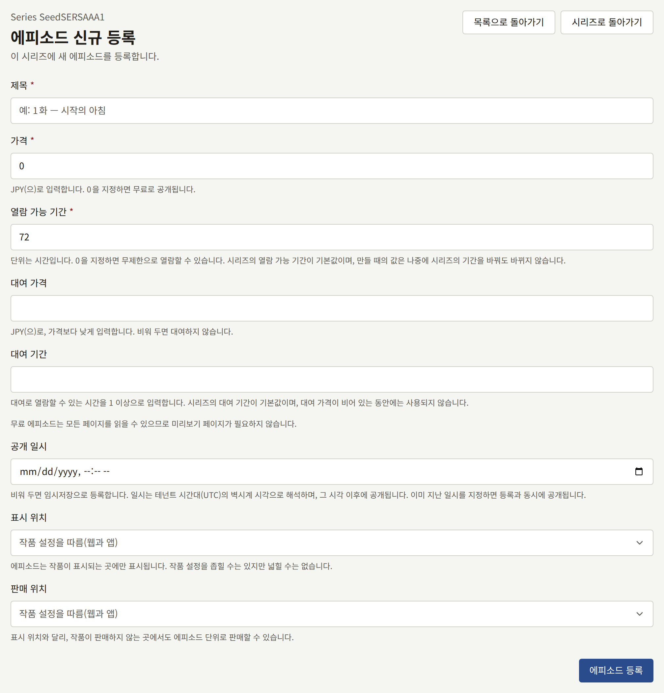

**가격**, **열람 가능 기간**, 대여, **미리보기 페이지 수**는 [나중에 바꿀](#가격과-열람-가능-기간-바꾸기) 수 있습니다. 이 값들은 [에피소드 판매](../4-selling-episodes.md#가격과-열람-가능-기간)에서 설명합니다.

**에피소드 등록**을 선택합니다. 에피소드는 시리즈에 크레딧이 표시된 작가와 함께 만들어지며, 페이지를 추가할 수 있도록 편집 화면이 열립니다.

## 제목 바꾸기

에피소드 편집 화면 맨 위의 **제목**에는 사이트가 제공하는 언어별 에피소드 제목이 있습니다. **언어**에는 언어마다 탭이 있으며, 아래 필드에는 선택한 언어의 제목이 있습니다. 제목을 바꾸고 **제목 변경**을 선택합니다. 저장하는 즉시 사이트와 앱에 새 제목이 표시됩니다. 제목은 비워 둘 수 없습니다.

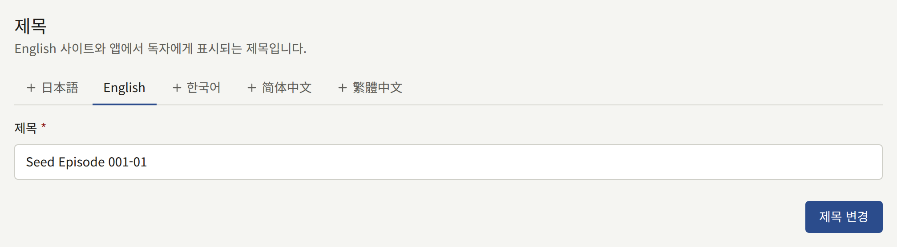

에피소드에 아직 제목이 없는 언어에는 **(추가되지 않음)** 표시가 붙습니다. 그 탭을 열면 필드가 비어 있으므로, 제목을 입력하고 **번역 추가**를 선택합니다. 그 전까지 그 언어로 사이트와 앱을 보는 독자에게는 다른 언어로 된 에피소드 제목이 표시됩니다. 탭 옆의 **이 번역 삭제**는 선택한 언어의 제목을 삭제하지만, 에피소드에 남은 마지막 제목은 삭제하지 않습니다.

에피소드 목록과, 에피소드 이름을 표시하는 콘솔의 다른 화면은 사이트 기본 언어의 제목을 표시합니다.

## 가격과 열람 가능 기간 바꾸기

에피소드 편집 화면의 **가격 및 열람 가능 기간**에는 에피소드를 판매하는 기준이 되는 값이 있으며, 만들 때와 같은 규칙이 적용됩니다. **가격**은 테넌트 통화로 입력하며 `0`이면 에피소드가 무료가 되고, **열람 가능 기간**은 시간 수로 입력하며 `0`이면 구매한 에피소드가 기한 없이 열려 있습니다. **대여 가격**과 **대여 기간**에는 대여 설정이 있습니다. **대여 가격**을 비우면 에피소드 대여를 멈추며, 대여하지 않는 에피소드의 **대여 기간**에는 시리즈의 [대여 기간](./1-series.md#대여-기간)이 들어 있으므로 가격만 입력하면 대여할 수 있습니다. **미리보기 페이지 수**에는 에피소드의 [미리보기 페이지](#미리보기-페이지) 수가 있습니다. 원하는 값을 바꾸고 **가격 및 열람 가능 기간 변경**을 선택합니다. 저장하는 즉시 사이트와 앱은 새 값으로 에피소드를 판매합니다.

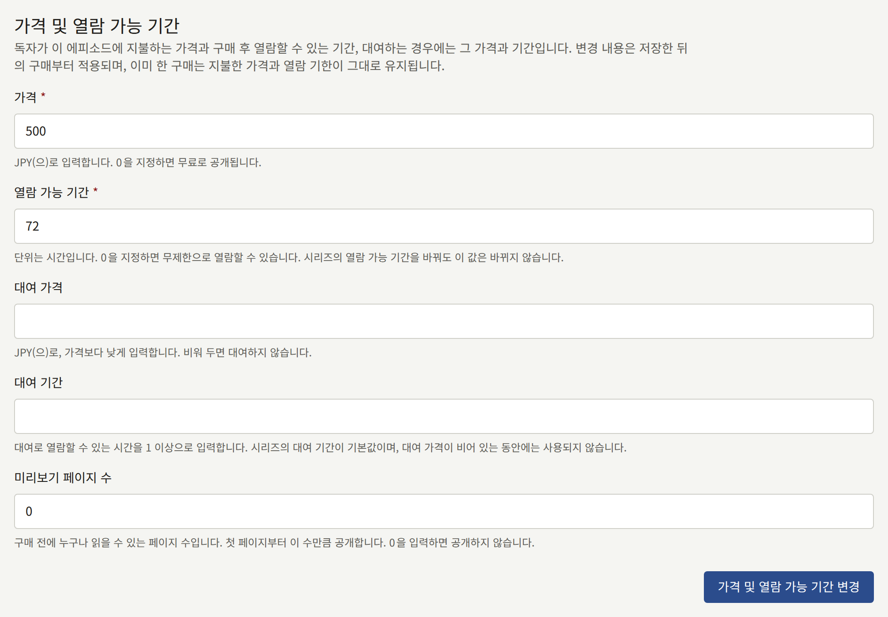

### 미리보기 페이지

**미리보기 페이지 수**는 유료 에피소드의 페이지 중 읽는 순서상 첫 페이지부터 세어, 로그인 여부와 관계없이 누구나 구매 전에 읽을 수 있는 페이지의 수입니다. `0`이면 페이지를 하나도 열지 않으며, 음수는 입력할 수 없습니다. 가격을 정한 뒤에 페이지를 추가하는 경우가 많으므로, 에피소드의 페이지 수보다 큰 값도 받습니다. 필드에는 에피소드에 지금 있는 페이지 수가 안내되고, 지금 있는 페이지만 열리며, 나중에 추가되는 페이지도 지정한 수까지 차례로 열립니다.

이 필드는 **가격**이 `0`보다 큰 동안에만 나타납니다. 무료 에피소드는 어차피 모든 페이지가 열리므로, 필드 대신 미리보기가 필요 없다는 안내가 표시되며, **가격**을 `0`으로 낮추어 저장하면 미리보기 페이지 수가 지워집니다. 에피소드에 다시 가격을 매기면 필드가 `0`인 상태로 나타납니다.

변경은 저장한 뒤의 구매부터 적용됩니다. 이미 이루어진 구매는 지불한 가격과 만료 시각을 그대로 유지하며, 변경 전에 결제 제공자의 결제 페이지를 연 독자는 그 페이지에 표시된 금액을 지불합니다. 시리즈의 **열람 가능 기간**이나 **대여 기간**을 바꿔도 이 값들은 바뀌지 않습니다.

스토어를 통해 판매하는 앱은 가격에 해당하는 스토어 상품으로 에피소드를 구매하므로, 새 가격이나 새 [캠페인 가격](#캠페인-가격)에는 새 상품이 필요할 수 있습니다. [스토어 상품](../4-selling-episodes.md#앱에서의-판매)을 참고하세요.

## 페이지 추가하기

에피소드 편집 화면의 **만화 페이지 추가**는 **업로드 방법**에서 고른 세 가지 방법 중 하나로 페이지를 추가합니다.

- **페이지 이미지 여러 장 선택**은 여러 개의 JPEG, PNG, GIF, WebP 파일을 한 번에 받으며, 파일을 선택하거나 **페이지 이미지**에 끌어다 놓습니다. 파일은 브라우저가 넘겨주는 순서, 보통 파일 이름 순서로 추가되므로, 추가한 뒤 순서를 확인하세요.
- **ZIP으로 등록**은 ZIP 파일을 받아, 그 안의 `.png`, `.jpg`, `.jpeg`, `.gif` 이미지를 경로 순서대로 추가합니다. 따라서 `page2.png`가 `page10.png`보다 앞에 옵니다. 그 밖의 파일은 WebP 이미지를 포함해 무시되며, 이미지는 최대 1000개까지 넣을 수 있습니다.
- **ePub으로 등록**은 ePub 파일을 받아, 그 페이지에 표시되는 JPEG, PNG, GIF, WebP 이미지를 읽는 순서대로 최대 1000개까지 추가합니다.

**페이지 이미지 추가**, **ZIP 등록**, **ePub 등록** 중 하나를 선택해 업로드합니다. 세 방법 모두 이미지 하나는 최대 20 MB, 한 번의 업로드는 최대 128 MB이므로, 에피소드 하나를 ZIP이나 ePub 하나로 통째로 추가할 수 있습니다. ZIP이나 ePub의 압축을 푼 이미지는 합계 256 MB까지입니다. 그보다 큰 것은 여러 번에 나누어 업로드하며, 각 업로드는 마지막 페이지 뒤에 페이지를 추가합니다. 카드의 파일 선택기 아래에 이 형식과 제한이 안내됩니다.

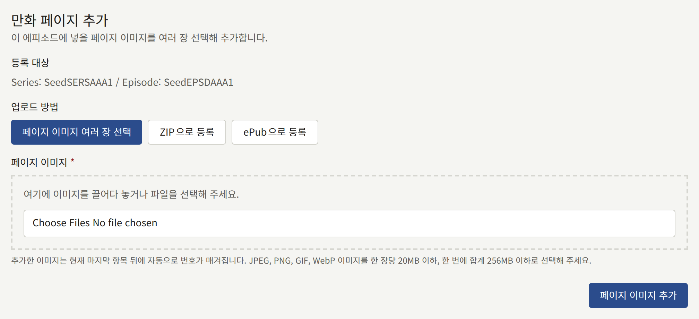

**등록된 페이지 이미지**는 페이지를 순서대로 보여 줍니다. 페이지를 옮기려면 핸들을 드래그하거나, 핸들에 포커스를 두고 화살표 키를 사용합니다. 각 페이지 아래에는 다음이 있습니다.

- **교체**는 그 페이지 자리에 새 이미지를 넣습니다. **새 페이지 이미지**에서 최대 20 MB의 JPEG, PNG, GIF, WebP 이미지 하나를 선택하고 **페이지 교체**를 선택합니다. 다른 페이지는 모두 그대로입니다.
- **삭제**는 **페이지 삭제**로 확인하면 그 페이지를 에피소드에서 뺍니다. 그 뒤의 페이지는 한 자리씩 앞으로 옮겨집니다. 삭제한 페이지는 되돌릴 수 없으므로, 복원하려면 그 이미지를 다시 추가하세요.

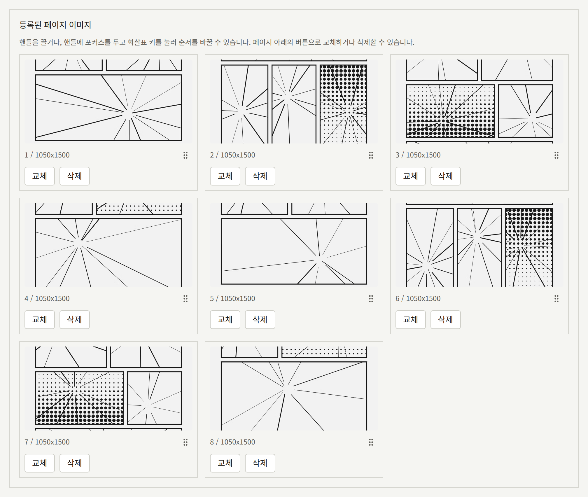

이미 공개된 에피소드에 추가한 페이지, 교체하거나 삭제한 페이지, 새 페이지 순서는 저장하는 즉시 독자에게 반영됩니다. 페이지가 없는 공개된 에피소드는 독자에게 페이지가 아직 공개되지 않았다고 표시합니다.

페이지를 삭제해도 [페이지 레이아웃](#페이지-레이아웃)에서 에피소드에 따로 지정한 **펼침면 시작**은 그대로입니다. 그 페이지가 이제 마지막 페이지보다 뒤에 있으면, 에피소드의 페이지 수가 다시 그만큼 될 때까지 에피소드는 펼침면 없이 표시됩니다.

## ZIP에서 가져오기

**시리즈** 목록과 시리즈의 에피소드 목록에 있는 **ZIP에서 가져오기**는 에피소드를 하나씩 만들고 페이지를 직접 추가하는 대신, 페이지 이미지를 담은 ZIP 하나로 시리즈와 에피소드를 만듭니다. 다른 서비스에서 카탈로그를 옮기거나 여러 에피소드를 한 번에 입고할 때 사용합니다.

ZIP에는 임의의 폴더에 둔 페이지 이미지와 루트에 둔 `publira-import.json`이라는 이름의 매니페스트가 들어갑니다.

```json
{
  "version": 1,
  "series": {
    "title": "시리즈 제목",
    "synopsis": "시리즈 소개",
    "locale": "ko",
    "reading_direction": "rtl"
  },
  "episodes": [
    {
      "title": "제1화",
      "price": 0,
      "scheduled_at": "2030-01-01T00:00:00+09:00",
      "pages": ["ep01/001.png", "ep01/002.png"]
    }
  ]
}
```

- `version`은 `1`입니다.
- `series`는 에피소드가 들어갈 곳을 지정합니다. 시리즈를 만들려면 `title`을 지정하고, 필요하면 `synopsis`, `reading_direction`(`rtl` 또는 `ltr`, 지정하지 않으면 오른쪽에서 왼쪽), 시리즈의 글과 에피소드 제목의 언어인 `locale`(지정하지 않으면 테넌트의 기본 언어)도 지정합니다. 시리즈는 초안으로 만들어집니다. 기존 시리즈에 추가하려면 `{ "id": "<ID>" }`만 지정합니다. ID는 시리즈의 주소 `/series/<ID>`와 에피소드 목록 상단에서 확인할 수 있습니다. 시리즈의 에피소드 목록에서 가져올 때는 매니페스트에 그 시리즈를 지정해야 합니다.
- `episodes`에는 만들 순서대로 에피소드를 나열합니다. 시리즈에 이미 있는 에피소드 뒤에 추가됩니다. 각 에피소드에는 `title`과 `pages`가 필요합니다. `pages`는 ZIP에 저장된 그대로의 경로를 읽는 순서대로 적습니다. `price`는 **가격**과 같은 방식으로 테넌트의 통화로 적으며, 지정하지 않으면 `0`입니다. `scheduled_at`에 오프셋이 있는 미래 시각을 지정하면 모든 페이지가 들어간 뒤 에피소드가 예약되고, 지정하지 않으면 초안으로 남습니다.

매니페스트에는 다른 키를 쓸 수 없습니다. 크레딧, 커버, 번역, 장르, 태그, 대여는 가져온 뒤 콘솔에서 설정합니다.

**ZIP 파일**에서 ZIP을 고릅니다. 콘솔은 아무것도 보내기 전에 ZIP을 확인하고, 잘못된 점을 에피소드와 경로별로 모두 나열합니다. 매니페스트에 쓸 수 없는 키, ZIP에 없는 페이지, 중복된 경로, JPEG, PNG, GIF, WebP 이미지가 아닌 파일, 제한을 넘는 항목이 해당합니다. ZIP이 확인을 통과할 때까지 아무것도 만들어지지 않습니다. ZIP 안에 보이는 경로가 없다고 표시되면 폴더와 파일 이름을 ASCII 문자로 바꾸세요. 일부 도구는 다른 문자를 매니페스트와 일치하지 않는 형태로 저장합니다.

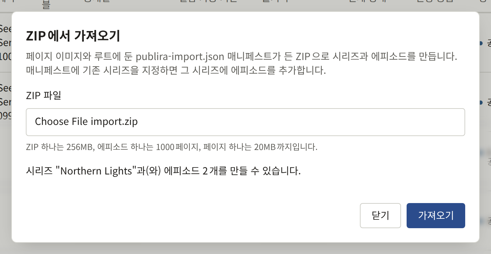

ZIP 하나는 256 MB, 에피소드 하나는 1000페이지, 페이지 하나는 20 MB까지입니다. 더 큰 카탈로그는 같은 시리즈를 ID로 지정한 여러 ZIP으로 나누어 가져옵니다. Cloud Run에 설치한 경우 [#4239](https://github.com/publira/publira/issues/4239)가 해결될 때까지 ZIP 하나는 32 MiB까지입니다.

**가져오기**를 선택하고 결과가 나타날 때까지 창을 열어 두세요. ZIP을 통째로 보내고 마지막 에피소드가 끝나야 콘솔이 응답하므로 몇 분이 걸릴 수 있습니다. 결과에는 에피소드마다 행이 있으며 **가져옴**, **실패**, **시작 안 됨** 중 하나가 표시됩니다.

가져오기는 전부 성공하거나 전부 취소되는 작업이 아닙니다. 에피소드는 차례로 만들어지고, 처음 실패하면 그 뒤의 에피소드는 중단되며, 이미 만들어진 것은 남습니다. 계속하려면 가져온 에피소드를 매니페스트에서 빼고 ZIP을 다시 가져오세요. 실패한 에피소드에 편집 화면 링크가 있으면 초안으로 만들어진 것이며, 페이지가 다 들어가지 않았을 수 있습니다. 그 화면에서 나머지 페이지와 공개 일시를 설정하고 매니페스트에서도 빼거나, 에피소드를 삭제하고 매니페스트에 남겨 두세요. 결과가 나타나기 전에 연결이 끊겨도 가져오기가 끝났을 수 있으므로, 다시 가져오기 전에 시리즈의 에피소드를 확인하세요.

가져온 에피소드는 직접 만든 에피소드와 같습니다. [감사 로그](../../3-operations/12-security/3-audit-logs.md)에 같은 작업이 기록되고, 테넌트가 심사를 요구하면 예약된 에피소드는 [심사](#공개-전-검토)를 거칩니다.

## 페이지 레이아웃

**페이지 레이아웃**은 시리즈가 에피소드에 대해 정하는 두 가지를 이 에피소드에 대해서만 정합니다.

- **읽는 방향**: **작품 설정을 따름**, **오른쪽에서 왼쪽**, **왼쪽에서 오른쪽** 중 하나입니다.
- **펼침면 시작**: **작품 설정을 따름**, 또는 **이 에피소드에서 지정**입니다. **이 에피소드에서 지정**을 고르면 펼침면을 시작할 페이지를 1부터 에피소드의 마지막 페이지 사이에서 입력합니다. 페이지를 먼저 추가하세요. 페이지가 없는 에피소드는 시리즈를 따르는 것만 가능합니다.

**페이지 레이아웃 변경**을 선택해 저장합니다. 시리즈를 따르는 값은 시리즈가 바뀔 때마다 함께 바뀝니다. 각 설정이 뷰어에서 하는 일은 [읽는 방향과 펼침면](./1-series.md#읽는-방향과-펼침면)에서 설명합니다.

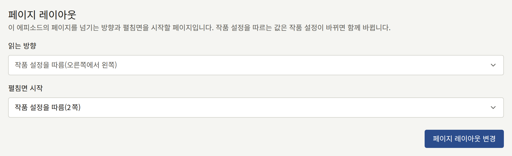

사이트는 너비가 768픽셀 이상이고 높이가 너비보다 크지 않은 뷰어에서만 두 페이지를 나란히 표시하며, 앱은 태블릿이나 가로로 든 휴대폰에서만 그렇게 표시합니다. 그 밖의 경우에는 페이지를 한 장씩 표시합니다.

## 페이지 미리 보기

에피소드 편집 화면 맨 아래의 **미리 보기**는 사이트와 같은 뷰어로 에피소드의 페이지를 보여 줍니다. 저장된 순서대로, 에피소드의 읽는 방향으로 넘기며, 레이아웃이 정한 페이지부터 펼침면으로 짝지어 표시합니다. 임시저장이나 예약된 에피소드도 공개된 에피소드와 같은 방식으로 미리 볼 수 있으므로, 독자가 보기 전에 페이지를 확인할 수 있습니다.

독자가 사이트에서 하듯이 페이지를 넘깁니다. 화살표 키를 쓰거나, 뷰어의 양쪽 가장자리 근처를 클릭하거나, 가운데를 클릭해 페이지 아래에 **이전 페이지**, **다음 페이지**, 읽기 진행 슬라이더를 표시합니다. 미리 보기는 펼침면에 대해 사이트와 같은 규칙을 따르므로, 창이 충분히 넓으면 두 페이지가 나란히 표시됩니다.

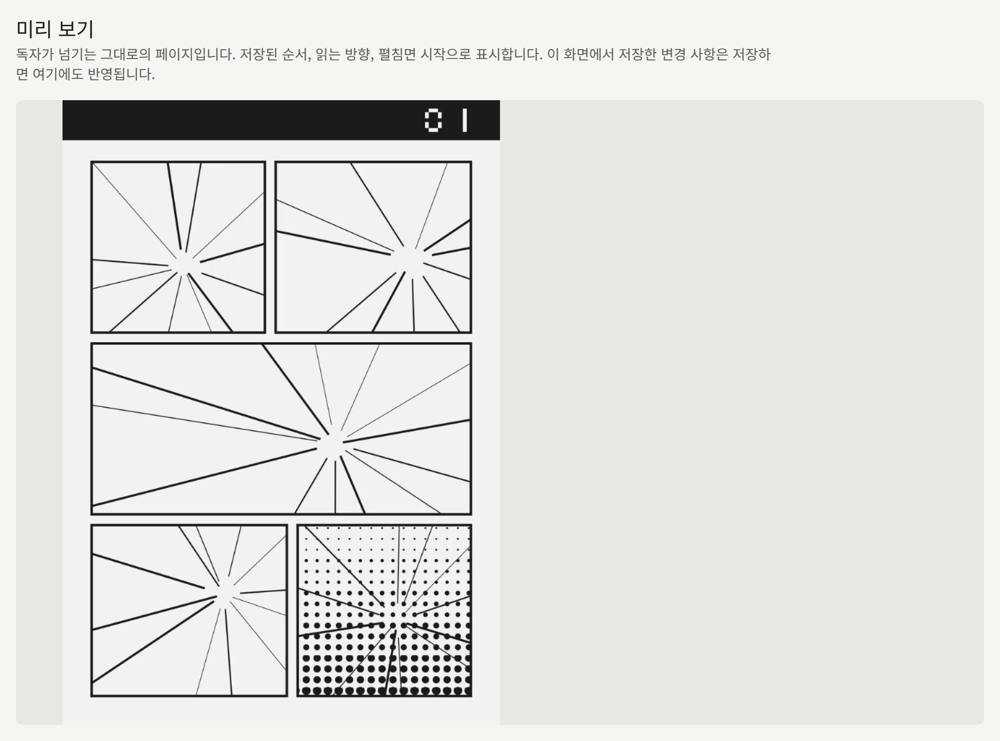

편집 화면에서 저장한 변경(페이지의 추가, 교체, 삭제, 이동, 또는 **페이지 레이아웃** 변경)은 저장한 뒤 미리 보기에 반영되며, 미리 보기는 첫 페이지부터 다시 시작합니다. **페이지 레이아웃**에서 골랐지만 아직 저장하지 않은 값은 반영되지 않습니다. 페이지가 없는 에피소드는 미리 보기에 그렇다고 표시됩니다.

에피소드를 열 수 있는 사람은 에피소드를 변경할 수 없는 사람을 포함해 모두 미리 보기에서 페이지를 넘길 수 있습니다.

## 커버 이미지

자체 커버 이미지가 없는 에피소드는 사이트와 앱이 에피소드 이미지를 보여 주는 모든 곳에서 시리즈의 [커버 이미지](./1-series.md#커버-이미지)를 표시하므로, 새 에피소드는 여기서 아무것도 할 필요가 없습니다. 시리즈와 다르게 보여야 하는 에피소드에만 자체 커버 이미지를 지정하세요. 에피소드와 시리즈 어느 쪽에도 **링크 미리보기 (1200:630)** 이미지가 없으면, 에피소드 링크는 사이트가 에피소드 제목으로 그리는 카드로 공유되며, [링크 미리보기](../3-setup/2-branding.md#링크-미리보기)에서 설명합니다.

에피소드 편집 화면의 **커버 이미지** 탭에서 지정합니다. **커버 이미지**에서 10 MB 이하, 2400 × 3200 픽셀 이상의 JPEG, PNG, WebP 이미지를 선택하고 **커버 이미지 변경**을 선택합니다. 저장하면 시리즈 표지와 같은 네 가지 형태로 같은 크기에 맞추어 잘려 **비율별 이미지**에 표시됩니다. 그 네 가지는 **세로형 (3:4)**, **정사각형 (1:1)**, **가로형 (16:9)**, 그리고 **링크 미리보기 (1200:630)** 형태입니다. 각 칸 아래의 줄은 에피소드 표지의 그 형태가 쓰이는 곳을 알려 줍니다.

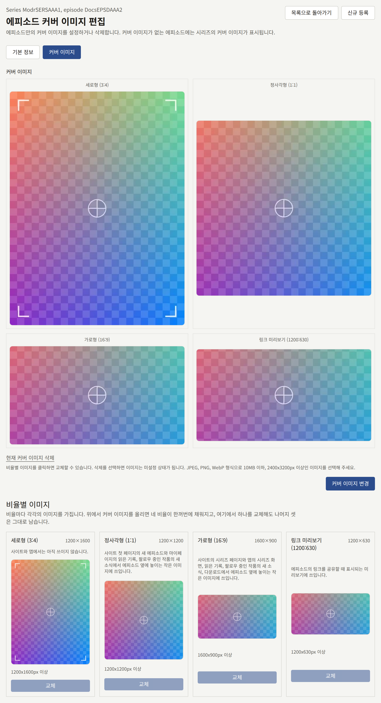

각 형태는 이미지의 가운데에서 잘라 냅니다. 어떤 형태에 다른 자르기나 별도의 그림을 쓰려면 **비율별 이미지**에서 그 형태의 이미지를 클릭하고, 칸이 요구하는 크기 이상의 JPEG, PNG, WebP 이미지를 선택합니다. 이전과 같은 이미지여도 됩니다. 그런 다음 **틀 조정**으로 그 형태가 이미지의 어느 부분을 보여 줄지 정하고, **교체**로 저장합니다. 나머지 세 형태는 그대로 유지됩니다. 형태를 교체할 수 있는 것은 에피소드에 커버 이미지가 있을 때뿐이므로, 먼저 **커버 이미지**에서 업로드하세요. 그곳에서 새 커버 이미지를 업로드하면 네 가지가 모두 교체됩니다.

시리즈의 표지로 되돌리려면 **현재 커버 이미지 삭제**를 선택한 다음 **커버 이미지 변경**을 선택합니다.

## 크레딧

에피소드 편집 화면의 **작가**에는 이 에피소드에 크레딧이 표시된 작가가 각자의 역할, 에피소드 매출 중 각자의 몫과 함께 나열됩니다. 새 에피소드는 시리즈의 크레딧으로 시작하며, 여기서 따로 바꿉니다. 나중에 시리즈의 크레딧을 바꿔도 에피소드에는 반영되지 않습니다. 여기서 추가한 크레딧에는 이 에피소드에만 참여한 게스트를 위한 **에피소드 전용**이 표시됩니다. **작가 저장**을 선택해 저장합니다.

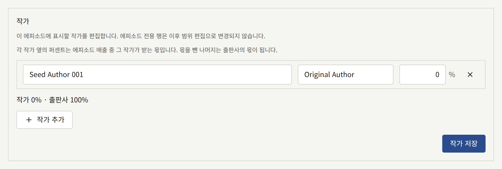

사이트의 에피소드 페이지에는 이 크레딧이 표시되고, 시리즈 페이지에는 시리즈 자체의 크레딧이 표시됩니다. 인세도 에피소드의 크레딧을 기준으로 지급되며, [리포트와 인세](../6-reports-and-royalties.md#작가가-받아야-할-금액)에서 설명합니다. 또한 독자 계정에 연결된 작가는 자신이 크레딧에 오른 에피소드를 읽을 수 있으며, [작가와 작가 역할](./4-authors.md#작가를-독자-계정에-연결하기)에서 설명합니다.

12화부터 작화가가 합류하는 경우처럼 여러 에피소드의 크레딧을 한꺼번에 바꾸려면, 목록에서 에피소드를 선택하고 **크레딧**을 선택합니다. **작업**에는 다음이 있습니다.

- **추가**는 선택한 에피소드 중 그 작가가 그 역할로 아직 크레딧에 없는 모든 에피소드에, 몫 없이 작가를 그 역할로 추가합니다.
- **교체**는 하나의 크레딧을 다른 크레딧으로 바꿉니다.
- **삭제**는 크레딧을 뺍니다.
- **몫 설정**은 크레딧의 몫을 바꿉니다.

작업을 적용할 **작가**와 **역할**을 고르고, 시리즈의 모든 에피소드를 한 번에 최대 1000개까지 나열하는 **에피소드**에서 에피소드를 체크한 다음 **적용**을 선택합니다. **교체**, **삭제**, **몫 설정**은 **에피소드 전용** 크레딧을 건드리지 않습니다. 결과에는 몇 개의 에피소드가 바뀌었는지와, 나머지 에피소드가 각각 바뀌지 않은 이유가 표시됩니다.

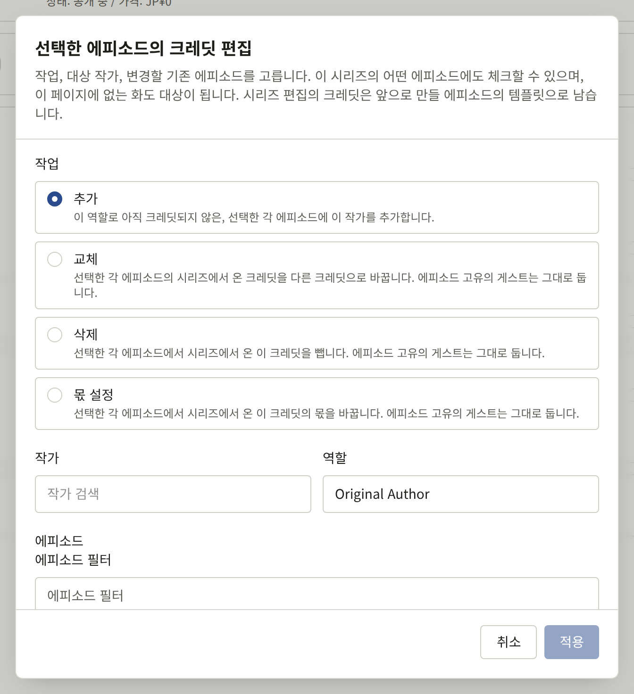

## 표시 위치와 판매 위치

각 에피소드에는 자체 **표시 위치**와 **판매 위치**가 있으며, 처음에는 시리즈를 따릅니다.

- **표시 위치**는 시리즈가 표시되는 곳을 좁힐 수는 있지만 넓힐 수는 없습니다. **앱 전용**으로 표시되는 시리즈에서 **웹 전용**으로 설정한 에피소드는 어디에도 표시되지 않으며, 화면이 이에 대해 경고합니다. **표시 위치 변경**을 선택해 저장합니다.
- **판매 위치**는 시리즈의 **판매 위치**에 없는 곳을 지정할 수 있지만, 에피소드는 표시되는 곳에서만 판매됩니다. **판매 위치 변경**을 선택해 저장합니다.

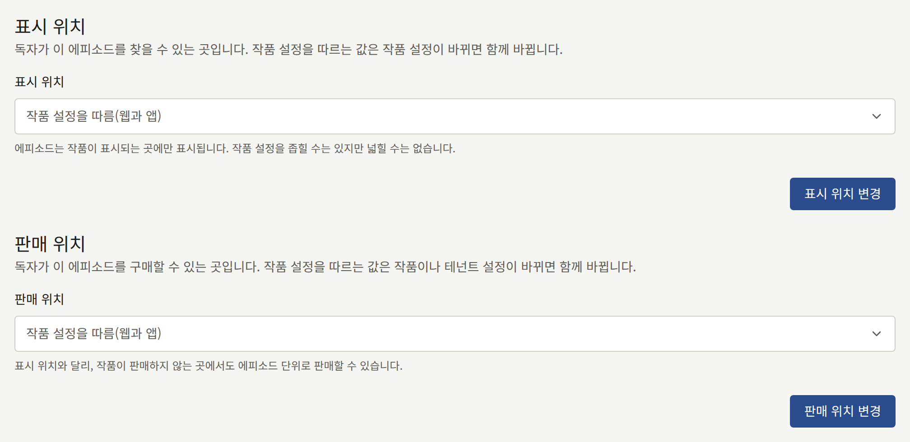

에피소드가 어디에도 표시되지 않도록 **표시 위치**를 설정하면, 공개된 에피소드를 비공개로 돌리지 않고 사이트에서 내릴 수 있습니다. 에피소드가 판매되지 않는 곳에서 독자에게 무엇이 보이는지는 [에피소드 판매](../4-selling-episodes.md#에피소드를-판매하는-곳)에서 다룹니다.

## 무료 공개 기간

무료 공개 기간은 두 시각 사이에 유료 에피소드를 로그인 여부와 관계없이 모두에게 엽니다. 에피소드의 가격은 유지되며, 기간이 끝나면 다시 적용됩니다. 무료 에피소드에 지정한 기간은 아무 효과가 없습니다.

에피소드 편집 화면의 **무료 공개 기간**은 에피소드의 기간을 **무료 공개 중**, **예정**, **종료**로 나열합니다. 기간을 추가하려면 테넌트의 시간대로 **시작 일시**와 **종료 일시**를 입력하고 **무료 공개 기간 추가**를 선택합니다. **종료 일시**는 **시작 일시**보다 뒤이면서 아직 미래여야 합니다. **시작 일시**는 과거여도 되며, 이 경우 에피소드는 지금부터 무료가 됩니다. 한 에피소드의 두 기간은 겹칠 수 없지만, 한 기간이 다른 기간이 끝나는 바로 그 시각에 시작하는 것은 됩니다.

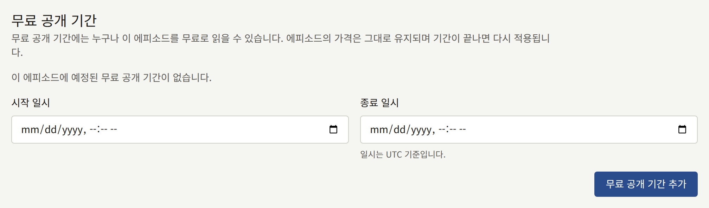

기간은 수정할 수 없습니다. **삭제**하고 새로 추가하세요. 이미 시작된 기간을 삭제하면 에피소드는 즉시 다시 유료가 됩니다.

끝이 없고 **시리즈 규칙에 따름**이 표시된 기간은 시리즈의 [공개 후 무료](./1-series.md#공개-후-무료) 규칙이 추가한 것입니다. 이 규칙은 각 유료 에피소드를 공개되고 정해진 일수가 지난 뒤 엽니다. 이 기간에는 **삭제**가 없습니다. 규칙을 끄거나 규칙이 더 이상 그 에피소드에 적용되지 않으면 사라지며, [예약 작업과 유지 관리 작업](../../3-operations/10-scheduled-jobs.md#그-밖의-예약-작업)에서 설명합니다.

여러 에피소드에 같은 기간을 지정하려면 에피소드 목록에서 **무료 공개 기간**을 선택합니다. **대상 에피소드**에서 목록에서 체크한 에피소드인 **선택한 에피소드**, 시리즈 순서상 처음부터 지정한 수만큼의 에피소드인 **처음 에피소드부터**, 또는 **모든 에피소드**를 고릅니다. 그런 다음 **시작 일시**와 **종료 일시**를 입력하고 **추가**를 선택합니다. 기간이 어느 에피소드에 이미 있는 기간과 겹치면 아무것도 추가되지 않습니다.

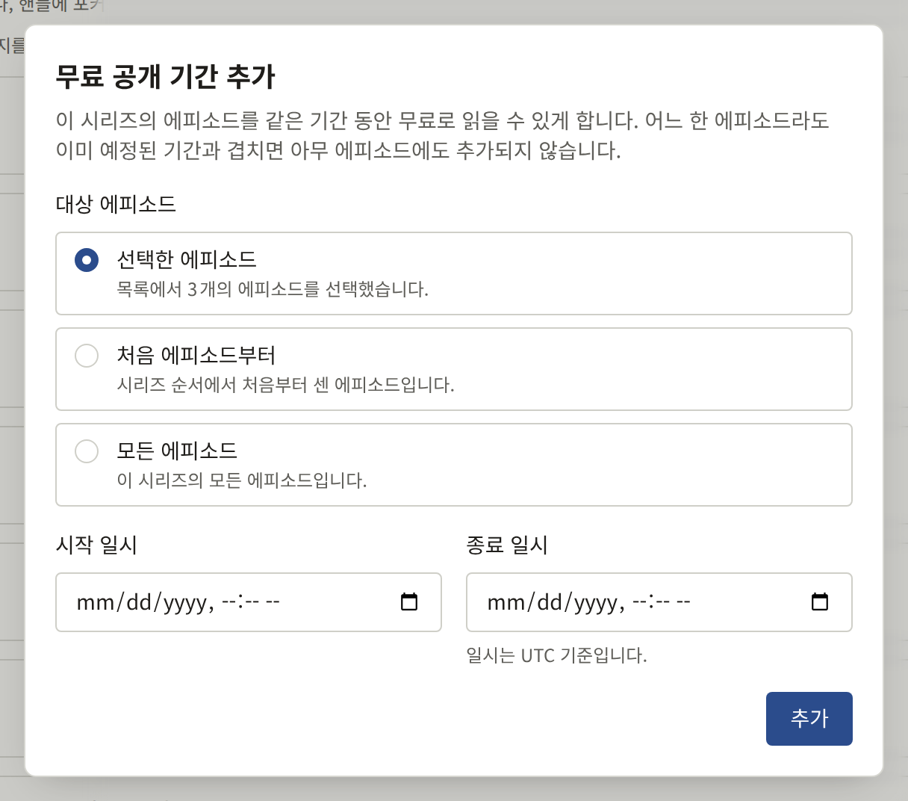

사이트는 기간이 시작하는 순간부터 그 기간을 표시하고, 끝나는 순간 표시를 거둡니다. `publira worker`가 양쪽 시점에 캐시된 페이지를 갱신하며, [예약 작업과 유지 관리 작업](../../3-operations/10-scheduled-jobs.md#무료-공개-기간과-그-밖의-캐시된-페이지)에서 설명합니다.

## 캠페인 가격

캠페인 가격은 두 시각 사이에 유료 에피소드를 더 싸게 판매합니다. 캠페인 동안 에피소드를 구매하면 사이트에서든 **인앱 결제**로 판매하는 앱에서든 캠페인 가격이 청구되며, [시리즈의 나머지](../4-selling-episodes.md#시리즈의-남은-에피소드)와 함께 구매할 때도 시리즈의 **묶음 할인**이 적용되기 전의 가격으로 캠페인 가격이 쓰입니다. 에피소드는 자체 **가격**을 유지하며, 캠페인이 끝나면 다시 그 가격이 적용됩니다. 대여는 **대여 가격**을 그대로 유지하며, 캠페인 가격으로 이루어진 구매는 지불한 가격을 유지합니다.

에피소드 편집 화면의 **캠페인 가격**은 에피소드의 캠페인을 가격과 함께 **할인 중**, **예정**, **종료**로 나열합니다. 캠페인을 추가하려면 에피소드의 **가격**보다 낮은 **캠페인 가격**을 테넌트 통화로 입력하고, 테넌트의 시간대로 **시작 일시**와 **종료 일시**를 입력한 뒤 **캠페인 가격 추가**를 선택합니다. **종료 일시**는 **시작 일시**보다 뒤이면서 아직 미래여야 합니다. **시작 일시**는 과거여도 되며, 이 경우 에피소드는 지금부터 할인 판매됩니다. 한 에피소드의 두 캠페인은 겹칠 수 없지만, 한 캠페인이 다른 캠페인이 끝나는 바로 그 시각에 시작하는 것은 됩니다. 무료 에피소드에는 낮출 가격이 없으므로, 이 섹션에 양식이 나타나지 않습니다.

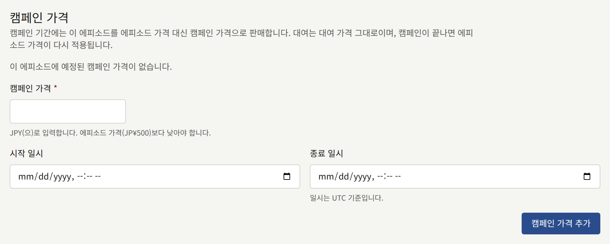

캠페인은 수정할 수 없습니다. **삭제**하고 새로 추가하세요. 이미 시작된 캠페인을 삭제하면 에피소드는 즉시 자체 가격으로 다시 판매됩니다. 에피소드의 **가격**을 캠페인 가격 이하로 낮추면, 에피소드가 자체 가격으로 판매되므로 그 캠페인은 효과가 없어집니다.

여러 에피소드를 같은 가격과 기간으로 할인 판매하려면 에피소드 목록에서 에피소드를 체크하고 **캠페인 가격**을 선택합니다. **캠페인 가격**, **시작 일시**, **종료 일시**를 입력하고 **추가**를 선택합니다. 가격이 체크한 모든 에피소드의 **가격**보다 낮지 않거나, 기간이 어느 에피소드에 이미 있는 캠페인과 겹치면 아무것도 추가되지 않습니다.

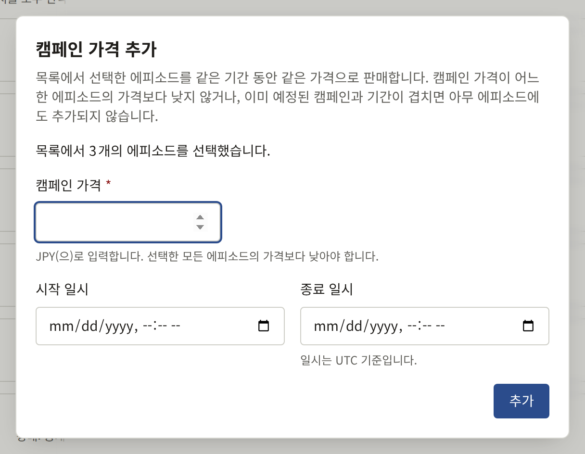

사이트가 에피소드의 가격을 표시하는 모든 곳에서, 캠페인 중인 에피소드에는 캠페인 가격, 그 옆에 취소선이 그어진 자체 **가격**, 그리고 테넌트의 시간대로 표시된 캠페인 종료 시각이 표시됩니다. 가격은 독자가 구매를 시작할 때 정해지므로, 캠페인이 끝난 뒤에 구매를 시작한 독자는 출발한 페이지에 아직 캠페인 가격이 표시되어 있더라도 결제 페이지에 표시되는 에피소드 자체 **가격**을 지불합니다.

사이트는 캠페인이 시작하는 순간부터 캠페인 가격을 표시하고, 끝나는 순간 표시를 거둡니다. `publira worker`가 양쪽 시점에 캐시된 페이지를 갱신하며, [예약 작업과 유지 관리 작업](../../3-operations/10-scheduled-jobs.md#무료-공개-기간과-그-밖의-캐시된-페이지)에서 설명합니다.

앱은 시리즈의 에피소드 목록, 잠긴 에피소드, 그리고 앞 에피소드 끝에 나오는 다음 에피소드 안내에서 캠페인을 표시합니다. 캠페인 가격, 그 옆에 취소선이 그어진 에피소드 자체 **가격**, 그리고 캠페인 종료 시각이 표시되며, 앱의 다른 모든 시각과 마찬가지로 독자 기기의 시간대로 표시됩니다. 앱은 웹 결제로 판매하든 [**인앱 결제**](../4-selling-episodes.md#앱에서의-판매)로 판매하든 이렇게 표시합니다. 인앱 결제는 캠페인 가격에 해당하는 스토어 상품으로 에피소드를 구매하므로, 스토어의 결제 시트는 앱이 표시하는 가격을 청구합니다.

## 에피소드 공개하기

에피소드는 세 가지 상태 중 하나입니다.

| 상태 | 의미 |
| --- | --- |
| **임시저장** | 공개 시각이 없습니다. 독자는 볼 수 없습니다 |
| **예약됨** | 아직 오지 않은 공개 시각이 있습니다. 그때까지 독자는 볼 수 없습니다 |
| **공개 중** | 공개 시각이 지났습니다. 시리즈가 공개되어 있고 독자가 이용하는 곳에 표시되는 한, 독자가 열 수 있습니다 |

에피소드가 공개되기 전까지 에피소드 페이지는 존재하지 않는 것처럼 응답하고, 어떤 목록에도 나오지 않으며, 이웃 에피소드의 이전·다음 링크도 이 에피소드를 건너뜁니다.

### 공개 일시 설정하기

에피소드 편집 화면의 **공개 설정**에서는 이미 있는 에피소드의 공개 일시를 지정하거나 바꿉니다. 테넌트의 시간대로 시각을 입력하거나 필드를 비우고 **공개 일시 변경**을 선택합니다.

- **이미 지난 시각**(현재 시각 등)은 테넌트가 [검토를 요구하지](#공개-전-검토) 않는 한, 임시저장이나 예약된 에피소드를 즉시 공개합니다. 예약된 에피소드가 시각이 되었을 때와 똑같이, 팔로워에게 알려지고 검색 인덱스로 보내집니다. 이미 공개된 에피소드는 그대로이므로, 이미 표시된 시각으로 이 섹션을 저장해도 아무것도 바뀌지 않습니다.
- **미래의 시각**은 에피소드를 그 시각으로 예약합니다.
- **빈 필드**는 에피소드를 임시저장으로 만듭니다.

공개된 에피소드는 뒤의 두 가지로 사이트에서 내려가며, [에피소드를 사이트에서 내리기](#에피소드를-사이트에서-내리기)에서 설명합니다.

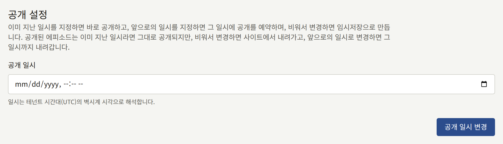

따라서 공개된 시리즈에 새 에피소드를 공개하는 일반적인 방법은 다음과 같습니다.

1. **공개 일시**를 비워 두고 에피소드를 임시저장으로 만듭니다.
2. 페이지를 추가하고 레이아웃을 정한 다음, [미리 보기](#페이지-미리-보기)에서 둘 다 확인합니다.
3. **공개 설정**에서 지금 공개하려면 현재 시각을, 아니면 공개할 시각을 입력하고 저장합니다.

### 예약된 에피소드가 나타나는 시점

에피소드는 `publira worker`가 공개합니다. 워커는 1분마다 공개 시각이 지난 에피소드를 찾습니다. 그 처리 때 에피소드는 다음과 같이 됩니다.

- 사이트와 앱에서 자체 페이지와 시리즈의 에피소드 목록에 나타납니다.
- 그 에피소드나 시리즈, 또는 에피소드에 크레딧이 표시된 작가를 팔로우하는 모든 독자에게 알려집니다. 에피소드가 표시되는 사이트와 앱 각각에서 알림과 푸시 알림으로, 그리고 사이트에 표시되는 경우에는 이메일로도 알려집니다. 이 중 무엇이 독자에게 전달될지는 각 독자의 알림 설정이 정합니다.
- 검색 인덱스로 보내집니다.

따라서 12:00로 예약된 에피소드는 12:01쯤 읽을 수 있게 되며, **업데이트순**으로 정렬된 시리즈 목록 같은 사이트의 목록에도 같은 시점부터 나타납니다.

공개 시각이 한참 지났는데도 **예약됨**인 에피소드는 워커가 실행되지 않거나 에피소드 공개에 실패하고 있다는 뜻입니다. 이때 테넌트 관리자에게 "에피소드 공개에 실패했습니다"라는 제목의 알림이 갑니다. 이는 운영자가 해결할 문제이며, [예약 작업과 유지 관리 작업](../../3-operations/10-scheduled-jobs.md#예약-공개)에서 설명합니다. 문제가 해결되면 에피소드는 저절로 공개됩니다. 기다리지 않고 공개하려면 **공개 설정**에 현재 시각을 입력하고 저장하세요.

시리즈가 공개되지 않은 동안 공개된 에피소드는, 알림이 찾을 수 없는 페이지로 이어지지 않도록 시리즈를 기다립니다. 이 에피소드는 **시리즈 변경**으로든 시리즈 자체의 **공개 일시**가 되어서든 시리즈가 공개될 때 알려지며, 그때까지는 어떤 독자도 열 수 없었으므로 이후 시리즈가 공개된 시점을 공개일로 표시합니다. 시리즈가 이전에 공개되어 있던 동안 팔로워에게 이미 알려진 에피소드는 날짜가 그대로 유지되며 다시 알려지지 않습니다.

**표시되지 않음** 상태에서 공개된 에피소드는 누구에게도 알려지지 않으며, 나중에 표시되더라도 알려지지 않습니다. 사이트와 앱 중 한쪽에만 표시되는 에피소드는 그쪽에서만 알려집니다. 독자는 그쪽의 알림에서만 이 알림을 보며, 푸시 알림도 브라우저에만 또는 휴대폰에만 도착합니다. 에피소드가 어디에 알려질지는 `publira worker`가 알림을 보낼 때 정해지며, 그 뒤에 **표시 위치**를 바꿔도 이미 보낸 알림은 옮겨지지 않습니다. 에피소드가 표시될 곳은 공개 시각 전에 정해 두세요.

### 공개 전 검토

테넌트는 모든 에피소드를 공개하기 전에 테넌트 관리자의 승인을 받도록 하여, 편집 담당이 예약한 것을 다른 사람이 먼저 읽게 할 수 있습니다. 검토는 테넌트 관리자가 [**설정**](../3-setup/1-settings.md#공개-전-검토)에서 **공개 전 검토 필수**를 켜기 전까지 꺼져 있으며, 꺼져 있는 동안 에피소드는 위에서 설명한 대로 공개 시각만으로 공개됩니다.

검토가 필수인 동안에는 다음과 같습니다.

- **시각을 저장하면 에피소드의 검토가 요청됩니다.** 에피소드를 만들 때나 **공개 설정**에서 공개 시각을 저장하면, 에피소드는 **예약됨**이 되며 그것만으로 예약되는 대신 검토에 들어갑니다. 이미 지난 시각도 에피소드를 즉시 공개하지 않으며, 다른 경우와 마찬가지로 결정을 기다립니다. 검토가 필수인 동안 **공개 설정**의 필드 위에 그렇다는 안내가 표시됩니다.
- **테넌트 관리자가 승인하거나 반려합니다.** 에피소드 편집 화면의 **공개 설정** 아래에 **검토** 섹션이 있습니다. 에피소드가 검토 중인 동안 테넌트 관리자에게는 그곳에 **승인**과 **반려**가 있는 **코멘트** 필드가 표시됩니다. 승인된 에피소드는 다른 예약된 에피소드와 마찬가지로 `publira worker`가 공개 시각에 공개하며, 공개 시각이 이미 지난 에피소드는 승인되는 순간 공개됩니다. 승인할 때 코멘트는 선택 사항이며, 반려할 때는 무엇을 고쳐야 하는지 적은 코멘트가 필요합니다.
- **반려된 에피소드는 공개 시각을 유지한 채 공개되지 않습니다.** 검토를 요청한 스태프는 콘솔에서 "에피소드가 반려되었습니다"라는 제목의 알림과, 코멘트를 인용한 이메일을 받습니다. 수정이 끝나면 **공개 설정**에서 **검토 요청**을 선택하며, 이렇게 하면 공개 시각을 옮기지 않고 다시 검토가 요청됩니다. 다른 시각을 저장해도 검토가 요청됩니다.
- **모든 회차가 기록됩니다.** **검토** 섹션은 에피소드 검토의 모든 회차를 오래된 순서로 나열합니다. 누가 언제 검토를 요청했는지, 누가 언제 승인하거나 반려했는지, 그리고 코멘트가 표시됩니다. 에피소드의 현재 상태(**검토 중**, **반려됨**, **승인됨**)는 섹션 제목 옆에 표시됩니다. 모든 스태프가 이 섹션을 읽을 수 있습니다. 감사 담당에게는 이 섹션에 아무 컨트롤도 표시되지 않으며, 편집 담당에게는 **승인**과 **반려**가 표시되지 않습니다.
- **승인 후 변경하면 다시 검토로 돌아갑니다.** 승인된 에피소드의 페이지, 제목, 가격, 레이아웃, 커버 이미지, 크레딧, **표시 위치**와 **판매 위치**를 바꾸거나 다른 시각을 지정하면, 승인된 내용이 더 이상 공개될 내용과 같지 않으므로 다시 승인을 받아야 합니다. 공개된 에피소드는 다시 검토되지 않습니다.
- **검토를 기다리는 에피소드는 실패가 아닙니다.** 공개 시각이 지나도 **예약됨**으로 남으며, 공개하지 못했다는 알림은 누구에게도 가지 않습니다.
- **임시저장은 검토에 들어가지 않습니다.** **공개 설정**에서 시각을 비우면 예약과 함께 검토 요청도 거두어집니다.

검토를 켜면 모든 예약된 에피소드가 검토에 들어갑니다. 이전에 검토가 켜져 있던 동안 승인된 에피소드도 포함되므로, 테넌트 관리자가 승인하기 전까지 어느 것도 공개되지 않습니다. 검토를 끄면 모든 예약된 에피소드가 검토 중이든, 반려되었든, 승인되었든 공개 시각에 공개됩니다. 검토가 꺼져 있는 동안 편집 화면에는 **검토** 섹션과 **검토 요청**이 표시되지 않으며, 에피소드 목록에도 **검토 중**이나 **반려됨**이 표시되지 않습니다.

검토 요청, 승인, 반려는 모두 **감사 로그**에 기록됩니다.

### 언제 무엇이 공개되는지

사이드바의 **작품** 그룹에 있는 **캘린더**는 모든 시리즈에 걸친 테넌트의 한 달 치 공개 일정을 보여 줍니다. 각 날짜에는 그날 공개될, 또는 공개된 에피소드가 시리즈 제목, 에피소드 제목, 상태(**예약됨** 또는 **공개 중**)와 함께 나열되며, 하나를 선택하면 그 편집 화면이 열립니다. 날짜는 화면에 표시된 테넌트의 시간대를 기준으로 하므로, 그 시간대로 23:30에 예약된 에피소드는 보는 사람이 어디에 있든 그 날짜에 표시됩니다. 임시저장은 시각이 없으므로 캘린더에 나오지 않습니다.

캘린더는 오늘이 표시된 이번 달로 열립니다. **이전 달**과 **다음 달**로 한 달씩 이동하고, **이번 달**로 돌아옵니다. 대시보드의 **공개 대기열** 옆에 있는 **캘린더 열기**로도 열 수 있습니다. 모든 스태프가 캘린더를 열 수 있으며, 캘린더에서는 아무것도 바꿀 수 없습니다. 에피소드의 일정은 그 에피소드의 **공개 설정**에서 바꿉니다.

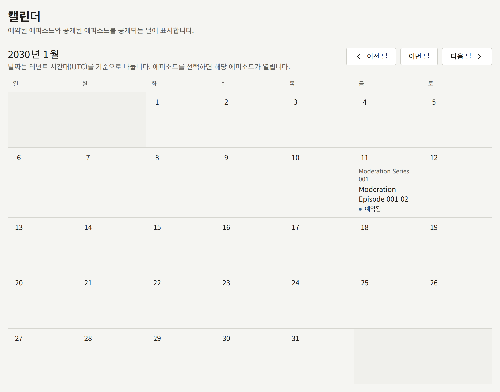

### 에피소드를 사이트에서 내리기

공개된 에피소드는 삭제할 수 없습니다. 사이트에서 내리려면 다음 중 하나를 합니다.

- **공개 설정**의 **필드를 비우고** 저장합니다. 에피소드는 **임시저장**으로 돌아갑니다.
- **미래의 시각을 입력하고** 저장합니다. 에피소드는 그때까지 사이트에서 내려가며, 그 시각에 다시 공개됩니다. 이때 팔로워에게 다시 알리지는 않습니다.
- 어디에도 표시되지 않도록 **표시 위치를 설정합니다**. 에피소드는 공개 상태로 남으며, 설정을 바꾸는 즉시 돌아옵니다.

어느 방법이든 에피소드를 구매한 독자는 에피소드가 돌아올 때까지 그 에피소드에 접근할 수 없습니다.
