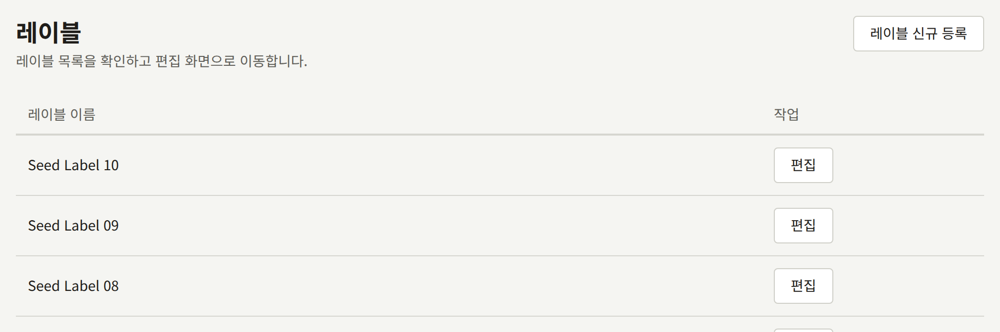
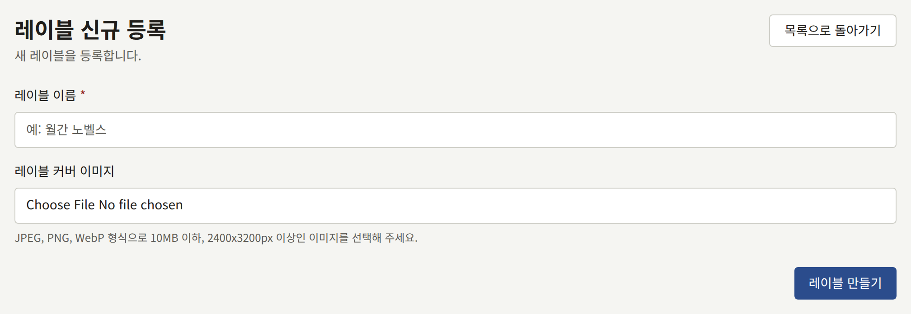
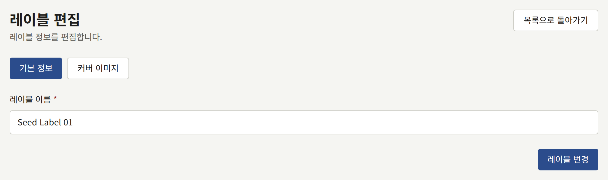

레이블은 브랜드(임프린트)입니다. 잡지나 총서처럼 출판사가 자신의 작품 계열에 붙이는 이름입니다. 모든 시리즈는 정확히 하나의 레이블에 속하며, 그래서 레이블이 존재하기 전에는 시리즈를 저장할 수 없습니다. 브랜드가 하나뿐인 출판사는 레이블을 하나 만들고 모든 시리즈를 그 레이블에 넣습니다.

사이드바의 **작품** 그룹에 있는 **레이블**은 레이블을 최신순으로 한 페이지에 20개씩 표시합니다.

## 레이블 만들기

**레이블 신규 등록**을 선택하고 **레이블 이름**을 입력한 뒤 **레이블 만들기**를 선택합니다. **레이블 커버 이미지**는 10 MB 이하, 2400 × 3200 픽셀 이상의 JPEG, PNG, WebP 이미지이며, 선택 사항이므로 나중에 추가해도 됩니다.

레이블 페이지에는 두 개의 탭이 있습니다. **기본 정보**에서는 이름을 바꾸고 **레이블 변경**으로 저장합니다. **커버 이미지**에서는 이미지를 교체하거나 삭제하고, 이미지에서 잘라 내는 네 가지 형태를 조정합니다. 방법은 시리즈의 경우를 설명한 [커버 이미지](./1-series.md#커버-이미지)와 같습니다.

두 레이블이 같은 이름을 가질 수 있고 레이블은 삭제할 수 없으므로, 만들기 전에 목록을 확인하세요.

## 사이트에서

- 사이트 헤더의 **레이블**은 모든 레이블을 공개 중인 시리즈 수와 함께 나열합니다.
- 각 레이블에는 이름, 넓은 배너로 표시되는 커버 이미지, 제목순으로 정렬된 공개 중인 시리즈가 있는 페이지가 있습니다.
- 시리즈 페이지는 그 시리즈의 레이블 이름을 표시하고 레이블 페이지로 링크합니다.
- 톱 페이지의 **주목할 레이블**은 공개 중인 시리즈가 있는 레이블 중 가장 최근에 만들어진 6개를, 전체 레이블로 가는 링크와 함께 보여 줍니다.

레이블은 만들어진 순간부터, 그 레이블의 시리즈가 하나도 공개되기 전이라도 **레이블**에 나열되고 레이블 페이지도 응답하며, "공개 중인 시리즈 0건"으로 표시됩니다. **주목할 레이블**에는 시리즈 중 하나가 공개된 뒤에야 나타나므로, 그 전에 이름과 커버 이미지를 정해 두세요.

공개 중인 시리즈가 모두 **표시 위치**에 의해 어느 한 곳에서 제외된 레이블은 그곳에 나열되지 않습니다.
