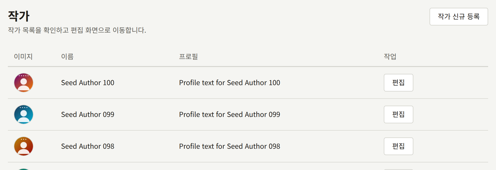
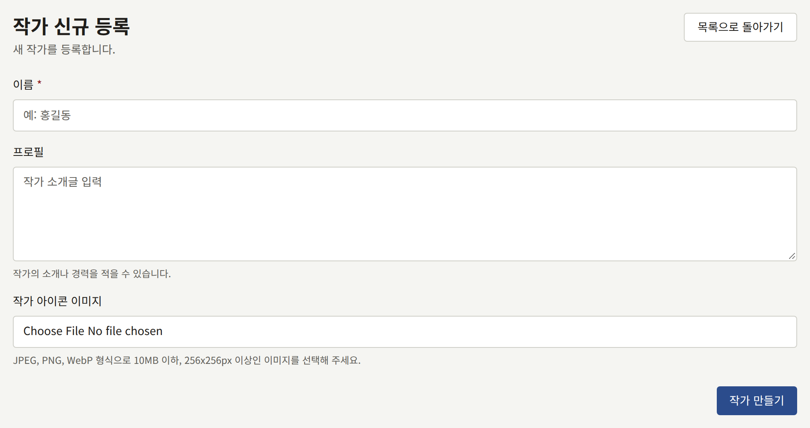
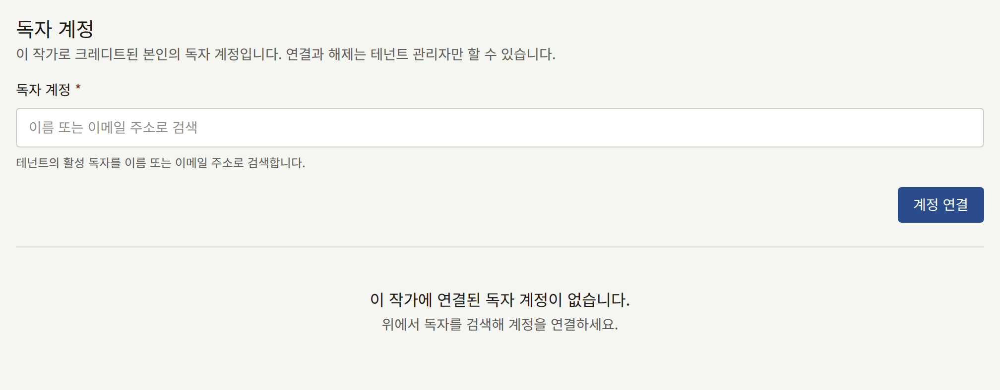
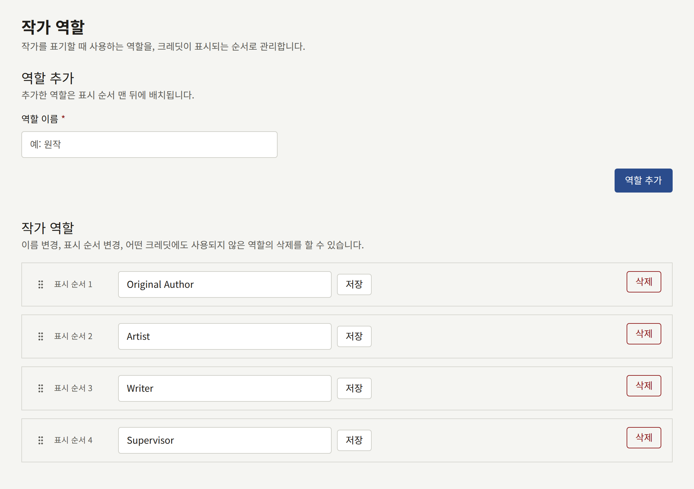
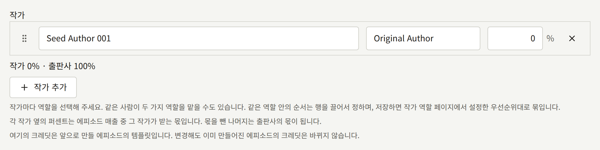

작가는 작품에 크레딧이 표시되는 사람입니다. 글 작가, 작화가, 각색 작품의 원작자 등이 여기에 해당합니다. 시리즈와 그 각 에피소드는 작가를 크레딧에 올리며, 작가는 저마다 하나의 작가 역할을 맡습니다. 이 크레딧은 독자가 제목 옆에서 보는 정보이자 인세를 지급하는 기준입니다.

## 작가

사이드바의 **작품** 그룹에 있는 **작가**는 테넌트의 작가를 최신순으로 한 페이지에 20명씩 표시합니다. **작가 신규 등록**을 선택하고 다음을 입력합니다.

- **이름**: 독자가 보는 이름입니다. 필명으로 활동하는 사람이라면 필명을 입력합니다.
- **프로필**: 선택 사항인 소개글로, 작가 페이지에 줄바꿈을 포함해 입력한 그대로 표시됩니다.
- **작가 아이콘 이미지**: 선택 사항으로, 10 MB 이하, 256 × 256 픽셀 이상의 JPEG, PNG, WebP 이미지입니다. **틀 조정**으로 이미지에서 잘라 낼 정사각형을 고릅니다.

**작가 만들기**를 선택해 저장합니다. 나중에 작가를 바꿀 때는 같은 양식에서 **작가 변경**을 사용합니다. 작가는 삭제할 수 없고 두 작가가 같은 이름을 가질 수 있으므로, 먼저 목록을 확인하세요.

두 개의 필명으로 활동하는 사람은 작가 두 명으로 등록합니다.

### 사이트에서

- 공개 중인 시리즈가 하나 이상 있는 작가에게는 아이콘, 이름, 프로필, 그리고 그 작가가 크레딧에 오른 시리즈가 제목순으로 표시되는 페이지가 있습니다. 독자는 그 페이지에서 작가를 팔로우할 수 있으며, 그 작가가 크레딧에 오른 새 에피소드가 나올 때마다 알림을 받습니다.
- 사이트의 작가 목록과 톱 페이지의 **주목할 작가**는 그런 작가를 이름순으로 보여 줍니다.
- 공개 중인 시리즈가 없는 작가에게는 페이지가 없습니다.

시리즈나 에피소드 페이지의 크레딧은 일반 텍스트이며, 작가 페이지로 링크되지 않습니다.

### 작가를 독자 계정에 연결하기

테넌트 관리자는 작가 페이지의 **독자 계정**에서 어떤 작가가 사이트의 특정 독자라는 것을 기록할 수 있습니다. 편집 담당과 감사 담당에게는 이 섹션이 보이지 않습니다.

**독자 계정**에서 이름이나 이메일 주소로 독자를 검색하고 **계정 연결**을 선택합니다. 그 독자는 이메일 주소가 확인된 사이트 계정을 이미 가지고 있어야 하며, 스태프 계정은 연결할 수 없습니다. 한 계정을 여러 작가에 연결할 수 있고, 한 작가에 여러 계정을 연결할 수도 있습니다.

연결되면 그 독자는 다음과 같이 됩니다.

- 에피소드 자체의 크레딧에 그 작가가 오른 모든 에피소드를 구매하지 않고 읽을 수 있습니다. 에피소드는 작가로서 열람할 수 있다고 독자에게 알려 줍니다. 시리즈에만 크레딧이 있는 경우에는 그 에피소드가 열리지 않으며, 시리즈의 연령 등급은 여전히 적용됩니다.
- 그 에피소드의 구매를 권유받지 않으며, 그 에피소드를 평가할 수 없습니다.
- 그 에피소드에 단 댓글에 **작가** 배지가 표시되며, 이름은 작가 페이지로 링크됩니다.

연결된 독자는 테넌트 관리자가 [설정](../3-setup/1-settings.md#작가-페이지)의 **작가 페이지**에서 **작가에게 자신의 페이지 표시**를 켜기 전까지는 작가에 대해 그 이상을 볼 수 없습니다. 이 설정이 켜지면 독자는 자신이 연결된 각 작가에 대해 다음을 볼 수 있습니다.

- 지금 그 작가를 팔로우하는 독자 수.
- 사이트에 공개된, 그 작가가 크레딧에 오른 각 에피소드와, 지난 28일 동안의 회원 조회 수와 완독 수. **애널리틱스**의 **에피소드**와 같은 방식으로 집계합니다. 비율도 그곳과 마찬가지로 두 값으로 계산합니다.
- **명세서와 매출 표시**도 켜져 있으면, 같은 28일 동안 그 각 에피소드의 판매 수와 환불을 뺀 매출, 그리고 마감된 모든 인세 명세서 중 그 작가에 해당하는 부분. [리포트와 인세](../6-reports-and-royalties.md#연결된-작가가-보는-명세서)에서 설명합니다.
- 사이트에 공개된, 그 작가가 크레딧에 오른 모든 에피소드의 공개된 댓글. 최신순으로 각각 에피소드와 함께, 모든 독자가 에피소드 아래에서 읽는 것과 똑같이 표시됩니다. 승인 대기 중인 댓글, 숨겨진 댓글, 작성자가 삭제한 댓글은 포함되지 않으며, 시리즈를 통해서만 그 작가가 크레딧에 오른 에피소드의 댓글도 포함되지 않습니다. 이 목록은 읽기 전용입니다. 답하려면 독자가 에피소드에 댓글을 달며, 그 댓글에는 **작가** 배지가 표시됩니다.

독자는 사이트에서는 **마이페이지**의 **작가 페이지 열기**로, 앱에서는 **계정** 탭의 **구매 목록** 아래에 있는 **작가 페이지**로 이 페이지들을 엽니다. 어느 쪽이든 열 수 있는 작가가 있을 때만 표시됩니다. 작가마다 자체 페이지가 있으며, 여러 작가에 연결된 독자는 맨 위의 탭으로 작가를 전환합니다. 작가 페이지의 **댓글**을 선택하면 그 작가의 에피소드에 달린 댓글이 열립니다.

독자는 자신이 연결된 작가만 볼 수 있으며, 자신의 작가와 함께 크레딧에 오른 작가라도 다른 작가의 수치나 항목은 볼 수 없습니다. 스태프 계정은 스태프가 되기 전에 연결된 계정이라도 아무것도 볼 수 없습니다.

**해제**는 연결을 없애며, 독자의 계정은 그대로 둡니다. 연결과 해제는 모두 감사 로그에 기록됩니다.

## 작가 역할

작가 역할은 작가가 어떤 역할로 크레딧에 표시되는지를 나타냅니다. 모든 크레딧에는 역할이 하나 있으며, 같은 작가가 한 시리즈에 두 가지 역할로 두 번 크레딧에 오를 수 있습니다.

새 테넌트에는 **Original Author**, **Artist**, **Writer**, **Supervisor**의 네 가지 역할이 있습니다. 이 이름은 영어 그대로 저장되며 독자에게도 쓰인 그대로 표시되므로, 다른 언어로 된 사이트에서는 이름을 바꿉니다.

**작가 역할**은 역할을 우선순위 순서로 나열합니다. 이 화면에서는 다음을 할 수 있습니다.

- **역할 추가**에서 **역할 이름**을 입력하고 **역할 추가**를 선택하면 역할이 추가됩니다. 이름은 최대 50자이며, 대소문자를 무시하고 중복될 수 없습니다. 새 역할은 순서의 맨 끝에 추가됩니다.
- 각 역할의 이름은 목록에서 바로 바꾸고 **저장**으로 저장할 수 있습니다. 그 역할의 모든 크레딧에 새 이름이 표시됩니다.
- 역할의 핸들을 드래그하면 순서가 바뀝니다.
- **삭제**는 어떤 크레딧에도 쓰이지 않는 역할을 삭제합니다. 아직 쓰이는 역할은 삭제할 수 없습니다. 콘솔이 그 역할을 쓰는 크레딧 수를 알려 주므로, 먼저 그 크레딧을 다른 역할로 옮겨야 합니다.

역할이 하나도 없으면 아무도 크레딧에 올릴 수 없습니다.

## 작가를 크레딧에 올리기

크레딧은 시리즈 양식과 각 에피소드 편집 화면의 **작가**에서 입력합니다. 각 행에는 **작가**, **역할**, 그리고 몫을 지정합니다. 몫은 매출 중 그 작가에게 인세로 지급하는 퍼센트입니다. 몫을 빼고 남은 부분은 출판사의 몫입니다. 몫의 합계는 100%를 넘을 수 없습니다.

저장하면 행이 역할의 우선순위 순서에 따라 역할별로 묶입니다. 한 역할 안의 작가 순서는 행을 드래그해 정합니다.

사이트도 크레딧을 같은 방식으로 표시합니다. 각 역할 뒤에 그 역할의 작가가 이어지며, 예를 들면 "Original Author Name1, Name2 / Artist Name3"과 같습니다. 시리즈 페이지에는 시리즈의 크레딧이, 에피소드 페이지에는 에피소드 자체의 크레딧이 표시됩니다.

시리즈의 크레딧은 새 에피소드의 템플릿입니다. 에피소드는 그 복사본과 함께 만들어지며, 시리즈의 크레딧이 바뀌어도 그 복사본을 유지합니다. 에피소드 하나 또는 여러 에피소드의 크레딧을 한꺼번에 바꾸는 방법은 [크레딧](./2-episodes.md#크레딧)에서, 몫이 인세가 되는 방식은 [리포트와 인세](../6-reports-and-royalties.md#작가가-받아야-할-금액)에서 설명합니다.
