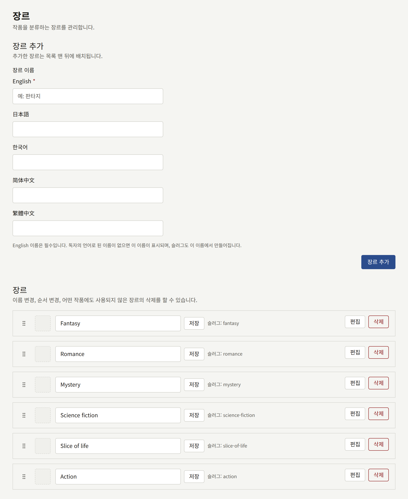
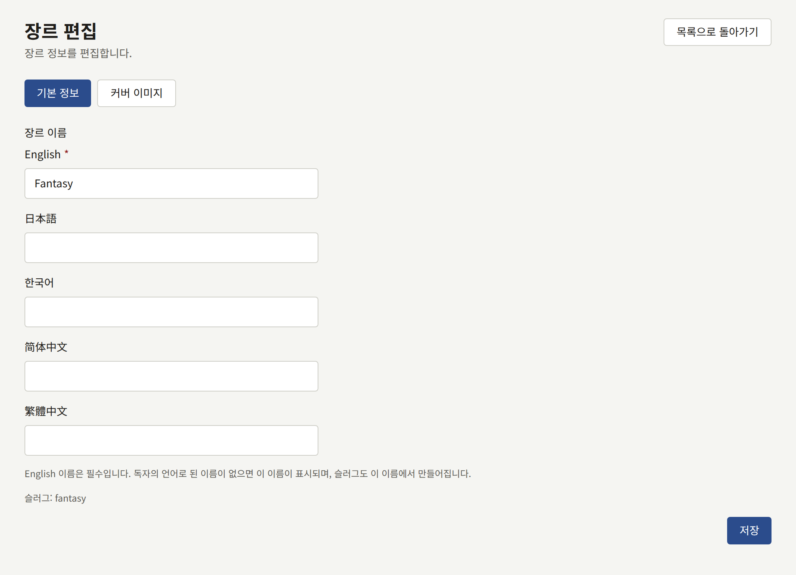

장르는 판타지나 로맨스처럼 테넌트가 시리즈를 분류하는 범주입니다. 시리즈는 장르를 몇 개든 가질 수 있으며 시리즈 양식에서 선택합니다. 독자는 장르별로 카탈로그를 둘러봅니다. 장르는 테넌트가 직접 정하는 것으로, 미리 정해진 장르는 없으며 장르 목록은 계층 없이 하나뿐입니다.

사이드바의 **작품** 그룹에 있는 **장르**는 전체 목록을 한 페이지에 표시합니다.

## 장르 관리하기

- **장르 추가**에서 **장르 이름**을 입력하고 **장르 추가**를 선택하면 장르가 하나 추가됩니다. **장르 이름**에는 사이트가 제공하는 언어마다 필드가 있으며, 자세한 내용은 [언어별로 장르 이름 짓기](#언어별로-장르-이름-짓기)에서 설명합니다. 이름은 최대 50자이며, 기본 언어의 이름은 중복될 수 없습니다. 새 장르는 목록의 맨 뒤에 추가됩니다.
- 각 장르의 기본 언어 이름은 목록에서 바로 바꾸고 **저장**으로 저장할 수 있습니다.
- 장르의 핸들을 드래그하면 위치가 바뀝니다. 이 순서는 사이트가 장르를 나열하는 순서이자, 시리즈의 장르가 표시되는 순서입니다.
- **편집**을 선택하면 장르 페이지가 열립니다. **기본 정보** 탭에는 사이트가 제공하는 모든 언어로 된 장르 이름이 있고, **커버 이미지** 탭에서는 장르에 이미지를 지정합니다. 방법은 시리즈의 경우를 설명한 [커버 이미지](./1-series.md#커버-이미지)와 같습니다.
- **삭제**는 어떤 시리즈에도 쓰이지 않는 장르를 삭제합니다. 아직 쓰이는 장르는 삭제할 수 없으므로, 먼저 모든 시리즈에서 제외하세요.

## 언어별로 장르 이름 짓기

장르는 사이트가 제공하는 언어마다 이름을 가질 수 있으며, 제공하는 언어는 테넌트 관리자가 [**설정**](../3-setup/1-settings.md#언어)에서 선택합니다. **장르 추가**와 장르의 **기본 정보** 탭에 있는 **장르 이름**에는 그 언어마다 필드가 있습니다. 각 필드에는 해당 언어로 쓴 언어 이름이 붙어 있고, 사이트의 기본 언어가 맨 앞에 옵니다.

- 기본 언어의 이름은 필수입니다. 장르에 이름이 없는 언어의 독자에게는 이 이름이 표시됩니다.
- 이름과 함께 표시되는 장르의 슬러그는 기본 언어의 이름에서 만들어집니다. 두 장르가 비슷한 이름을 갖지 못하게 하는 것이 이 슬러그입니다. 대소문자나 공백만 다른 이름은 같은 슬러그가 되므로, 두 번째 이름은 거부됩니다.
- 사이트에서 장르의 주소는 슬러그가 아니라 공개 ID이므로, 장르 이름을 바꿔도 주소는 바뀌지 않으며 모든 언어에서 같습니다.
- 다른 언어의 이름은 선택 사항입니다. 필드를 채우면 그 언어의 이름이 추가됩니다. 장르의 **기본 정보** 탭에서 필드를 비우고 **저장**을 선택하면 그 이름이 삭제됩니다.
- 사이트가 제공하지 않는 언어에는 필드가 없습니다. 그 언어로 이미 저장된 이름은 유지되며, 그 언어를 다시 제공하면 필드가 다시 나타납니다.

## 사이트에서

- 톱 페이지의 **장르로 찾기**는 모든 장르를 목록의 순서대로, 공개 중인 시리즈 수와 함께 보여 줍니다. 테넌트에 장르가 하나도 없으면 이 섹션은 숨겨집니다.
- 사이트 헤더의 **장르**는 모든 장르를 타일로 보여 줍니다. 타일에는 커버 이미지가, 커버 이미지가 없으면 그 장르에 속한 시리즈 몇 개의 표지가 표시됩니다.
- 각 장르에는 이번 주에 그 장르에서 인기 있는 작품과, 독자가 상태 등의 필터로 좁힐 수 있는 시리즈 목록이 있는 페이지가 있습니다.
- 시리즈 페이지는 그 시리즈의 각 장르로 링크합니다.
