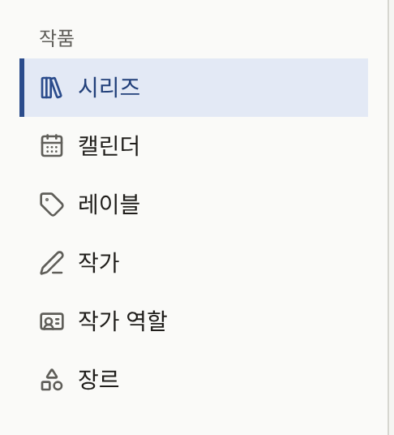

독자가 사이트에서 열 수 있는 것은 모두 시리즈의 에피소드이며, 시리즈는 레이블에 속하고 작가를 크레딧에 올립니다. 사이드바의 **작품** 그룹에는 이것들을 만드는 화면과, 언제 공개되는지를 보여 주는 캘린더가 있습니다.

| 화면 | 담고 있는 것 |
| --- | --- |
| **시리즈** | 작품과 그 에피소드 |
| **캘린더** | 예약되었거나 공개된 모든 에피소드를 공개되는 날짜에 표시 |
| **레이블** | 시리즈가 출간되는 브랜드 |
| **작가** | 시리즈와 에피소드에 크레딧이 표시되는 사람들 |
| **작가 역할** | **Original Author**나 **Artist**처럼 작가가 어떤 역할로 크레딧에 표시되는지 |
| **장르** | 독자가 카탈로그를 둘러볼 때 쓰는 분류 |

테넌트 관리자와 편집 담당은 이 화면들에서 모든 것을 만들고 변경할 수 있습니다. 다만 작가에 연결된 **독자 계정**은 테넌트 관리자만 보고 변경할 수 있습니다. 감사 담당은 모든 화면을 열 수 있지만 양식은 읽기 전용이며, 무언가를 만드는 버튼은 보이지 않습니다. 카탈로그에서 삭제할 수 있는 것은 에피소드의 페이지, 그리고 아무 데서도 쓰이지 않는 작가 역할과 장르뿐입니다. 따라서 더 이상 읽히면 안 되는 시리즈나 에피소드는 삭제하는 대신 사이트에서 내립니다.

## 빈 카탈로그에서 첫 에피소드까지

아래 순서는 콘솔이 요구하는 순서입니다. 시리즈는 레이블 없이 저장할 수 없고, 작가는 이미 존재하는 작가 목록에서 골라 크레딧에 올리며, 에피소드는 시리즈에 속합니다. 첫 에피소드를 준비하는 동안 시리즈는 숨겨진 상태로 두고, 마지막 단계에서 시리즈와 에피소드가 함께 독자에게 공개됩니다.

1. **레이블을 만듭니다.** **레이블**에서 **레이블 신규 등록**을 선택하고 **레이블 이름**을 입력한 뒤 **레이블 만들기**를 선택합니다. 브랜드가 하나뿐인 출판사는 레이블을 이것 하나만 만들고, 이후의 시리즈도 시리즈마다 레이블을 만들지 않고 모두 이 레이블에 넣습니다. [레이블](./3-labels.md)을 참고하세요.
2. **작가를 만듭니다.** **작가**에서 크레딧에 올릴 사람마다 **작가 신규 등록**을 선택하고, **이름**과, 있다면 **프로필**과 **작가 아이콘 이미지**를 입력합니다. [작가와 작가 역할](./4-authors.md)을 참고하세요.
3. **작가 역할을 확인합니다.** 새 테넌트에는 **Original Author**, **Artist**, **Writer**, **Supervisor**의 네 가지 역할이 영어로 들어 있습니다. 독자는 각 이름 옆에서 이 역할을 보게 되므로, 사이트가 다른 언어로 되어 있다면 **작가 역할**에서 이름을 바꾸세요.
4. 사이트를 둘러볼 때 쓸 장르가 있다면 **장르**에서 **장르를 만듭니다.** 시리즈는 장르 없이 저장할 수 있으며, 장르는 나중에 지정해도 됩니다. [장르](./5-genres.md)를 참고하세요.
5. **시리즈를 만듭니다.** **시리즈**에서 **시리즈 신규 등록**을 선택합니다. **제목**, **줄거리**, **레이블**을 입력하고, **작가**에서 작가를 크레딧에 올리고, **커버 이미지**를 선택합니다. 작업하는 동안 시리즈가 숨겨진 상태로 있도록 **공개 일시**는 비워 둡니다. **시리즈 만들기**를 선택합니다. [시리즈](./1-series.md)를 참고하세요.
6. **첫 에피소드를 만듭니다.** **시리즈** 목록에서 해당 시리즈 행의 **에피소드**를 선택한 다음 **신규 등록**을 선택합니다. **제목**과 **가격**을 입력하고, **공개 일시**를 현재 시각으로 설정합니다. 그러면 에피소드는 만들어지는 즉시 공개됩니다. 시리즈가 아직 숨겨져 있으므로 아직은 읽을 수 없습니다. **에피소드 등록**을 선택합니다. [에피소드](./2-episodes.md)를 참고하세요.
7. **페이지를 추가합니다.** 에피소드 편집 화면의 **만화 페이지 추가**에서 페이지 이미지를 추가한 다음, **등록된 페이지 이미지**에서 순서를 확인합니다.
8. **시리즈를 공개합니다.** 시리즈로 돌아가 **공개 일시**를 현재 시각으로 설정하고 **시리즈 변경**을 선택합니다. 이제 시리즈와 첫 에피소드가 사이트에 올라갑니다.
9. **독자로서 열어 봅니다.** 로그아웃하거나 시크릿 창을 사용해, 사이트의 톱 페이지나 **레이블**에서, 또는 제목으로 검색해 시리즈를 찾습니다. 에피소드를 열고 페이지를 넘겨 봅니다. 유료 에피소드는 대신 가격이 표시되며, [에피소드 판매](../4-selling-episodes.md)에서 설명하는 방법으로 엽니다.

그 뒤의 에피소드는 이미 공개된 시리즈에 추가되므로, 임시저장으로 준비해 두었다가 페이지가 갖춰지면 공개 시각을 지정합니다. 자세한 내용은 [에피소드 공개하기](./2-episodes.md#에피소드-공개하기)에서 설명합니다.

## 이 섹션의 내용

- [시리즈](./1-series.md): 시리즈 만들기, 시리즈를 표시하는 곳과 시기, 연령 등급, 읽는 방향, 댓글, 커버 이미지, **기다리면 무료**.
- [에피소드](./2-episodes.md): 에피소드 만들기, 페이지 추가, 가격과 열람 가능 기간, 페이지 레이아웃, 크레딧, 표시하고 판매하는 곳, 무료 공개 기간, 예약 공개, 무엇이 언제 공개되는지 보여 주는 캘린더.
- [레이블](./3-labels.md): 시리즈가 출간되는 브랜드와, 독자가 보는 레이블 페이지.
- [작가와 작가 역할](./4-authors.md): 작품에 크레딧이 표시되는 사람들, 그들이 어떤 역할로 표시되는지, 사이트에서 크레딧이 어떻게 보이는지, 작가를 그 사람의 독자 계정에 연결하기.
- [장르](./5-genres.md): 독자가 둘러볼 때 쓰는 분류와 그 순서.
