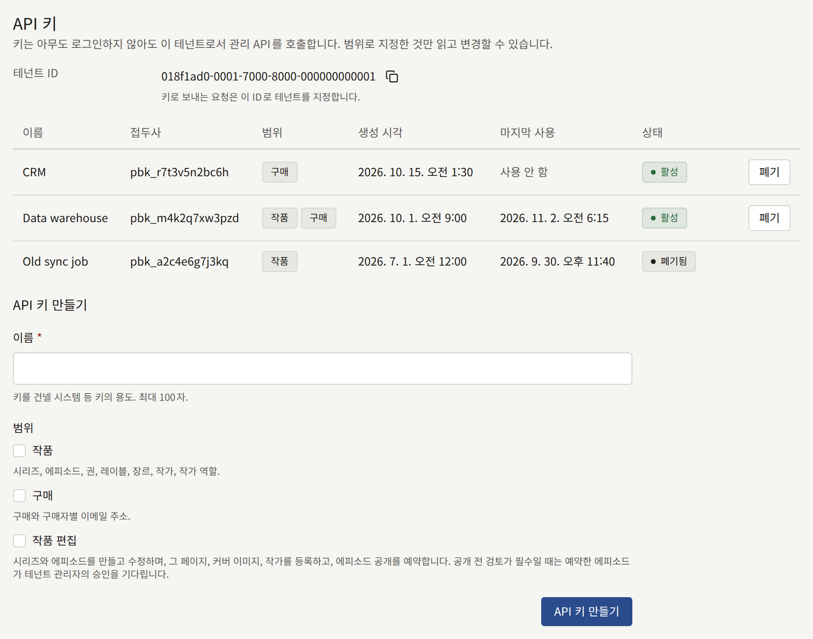
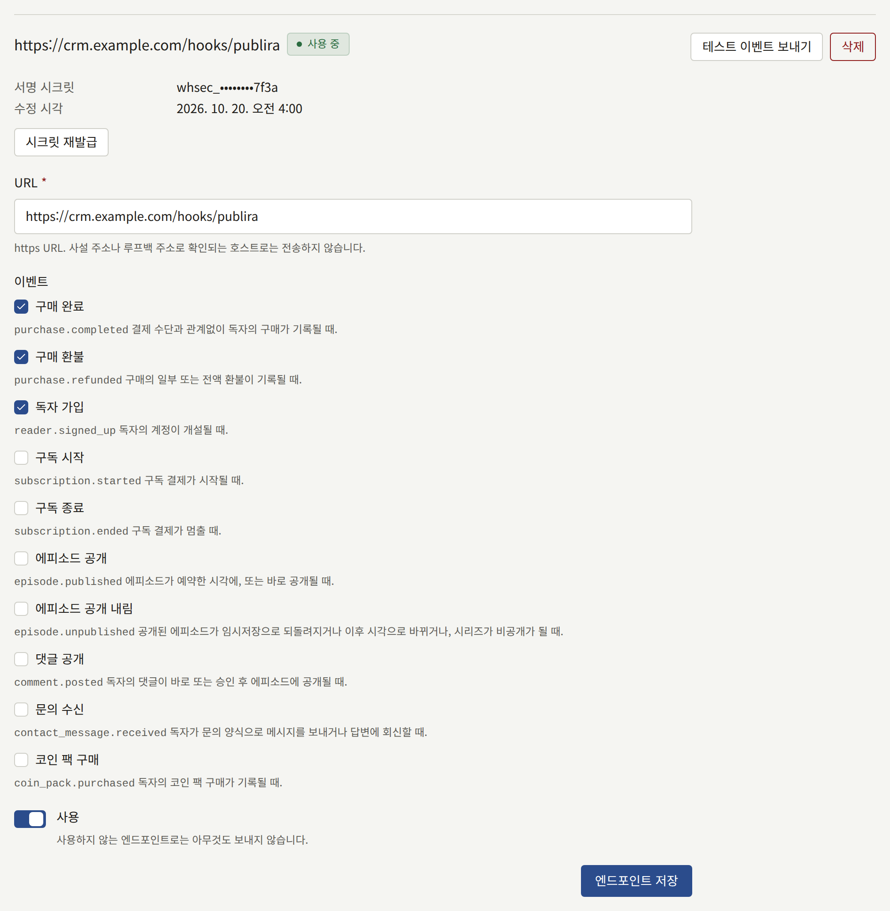
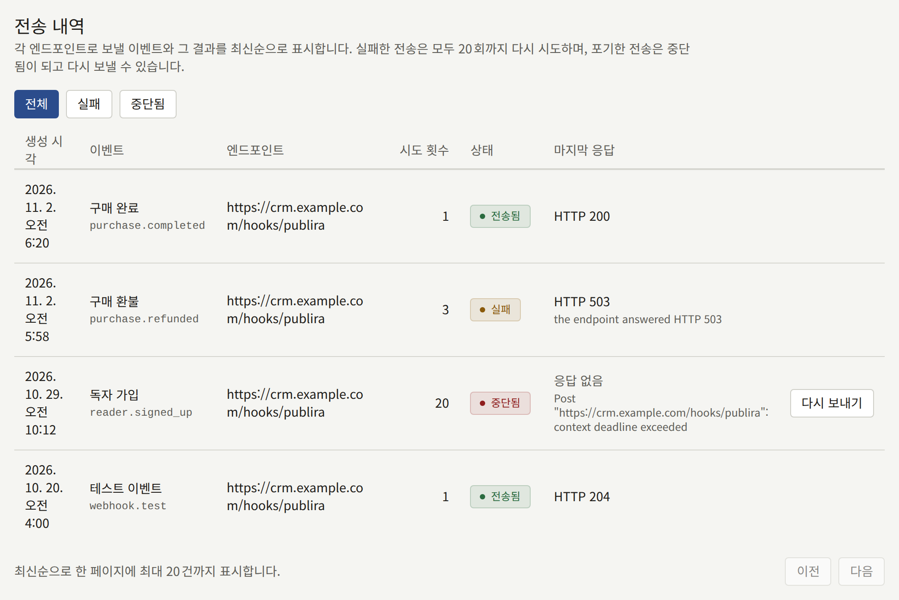

**연동** › **API 키와 웹훅**은 CRM, 데이터 웨어하우스, 회계 시스템처럼 출판사가 직접 운영하는 시스템과 테넌트를 연결합니다. 시스템은 **API 키**로 테넌트의 카탈로그와 구매를 읽고, 각 이벤트를 받을 시스템 자체의 URL인 **웹훅 엔드포인트**를 통해 판매, 환불, 새 독자, 구독을 일어나는 즉시 알게 됩니다. **전송 내역**에는 각 엔드포인트로 보낸 것과 포기한 것이 나열됩니다.

**API 키와 웹훅**은 테넌트 관리자에게만 보이며, 이곳에서 한 변경은 모두 **감사 로그**에 기록됩니다. **API 키 생성**, **API 키 폐기**, **웹훅 엔드포인트 생성**, **웹훅 엔드포인트 수정**, **웹훅 엔드포인트 삭제**, **웹훅 서명 시크릿 재발급**, **웹훅 전송 재시도**입니다.

## API 키



키는 아무도 로그인하지 않은 상태에서 이 테넌트의 관리 API를 읽습니다. 범위로 지정한 것만 읽으며, 어떤 키로도 아무것도 변경할 수 없습니다.

### 키 만들기

1. **API 키 만들기** 아래에서, 키를 건넬 시스템처럼 키의 용도를 나타내는 **이름**을 최대 100자로 입력합니다.
2. **범위**를 하나 이상 선택합니다.

   | 범위     | 키가 읽는 것                                              |
   | -------- | --------------------------------------------------------- |
   | **작품** | 시리즈, 에피소드, 권, 레이블, 장르, 작가, 작가 역할       |
   | **구매** | 테넌트 전체 또는 독자 한 명의 구매와 구매자별 이메일 주소 |

   시스템에 필요한 것만 선택하세요. **구매**를 선택하면 모든 구매자의 주소가 시스템에 넘어갑니다.

3. **API 키 만들기**를 선택합니다.

키는 **새 API 키** 아래에 복사 컨트롤과 함께 한 번만 표시됩니다. 지금 복사해서 키를 사용할 시스템이 읽을 수 있는 곳에 보관하세요. 키는 해시만 보관되므로 다시 표시할 수 없으며, 페이지를 벗어나거나 새로고침하면 화면에서 사라집니다. 복사하지 못한 키는 폐기하고 새 키로 교체합니다.

그 뒤 목록에는 키가 **접두사**, 즉 시스템이 가진 키의 앞부분인 `pbk_`와 그 뒤의 12자로 표시되며, **마지막 사용** 시각이 분 단위로 함께 표시됩니다.

### 요청 보내기

시스템은 관리 API에 키를 `Authorization: Bearer <key>`로 보내고, 테넌트의 시리즈를 요청하는 다음 예처럼 목록 위에 표시된 **테넌트 ID**로 테넌트를 지정합니다.

```bash
curl <server>/rpc/publira.admin.v1.AdminSeriesService/ListSeries \
  -H "Authorization: Bearer pbk_…" \
  -H "Content-Type: application/json" \
  -d '{"tenant": {"tenantId": "<Tenant ID>"}}'
```

설치 환경 앞의 엣지는 관리 API를 전달하지 않으므로, 키는 웹 앱이 `publira server`를 호출하는 네트워크에서 `publira server`에 직접 접근하는 시스템이 사용합니다. 그 주소는 설치 환경의 운영자에게 문의하세요.

프로시저와 그 필드는 [관리 API의 정의](https://github.com/publira/publira/tree/main/proto/publira/admin/v1)에 있습니다. 키로 보낸 요청에는 다음과 같이 응답합니다.

- **`unauthenticated`**: 키가 폐기되었거나 알 수 없는 키일 때, 또는 요청이 다른 테넌트를 지정할 때.
- **`permission_denied`**: 키의 어느 범위도 허용하지 않는 프로시저일 때. 모든 쓰기가 여기에 해당합니다.
- **`resource_exhausted`**: 키로 보내는 요청에 대한 설치 환경의 제한을 넘었을 때이며, `Retry-After`가 붙습니다. 운영자가 따로 정하지 않았다면 제한은 1분에 600건, 하루 100,000건입니다.

### 키 폐기

키 옆의 **폐기**를 선택한 다음 **키 폐기**를 선택합니다. 그때부터 그 키로 보낸 요청은 모두 거부되며, 키는 목록에 **폐기됨**으로 남습니다. 폐기한 키는 다시 사용할 수 없습니다.

공백 없이 키를 교체하려면 새 키를 만들고, 시스템이 새 키를 쓰도록 바꾼 다음, 이전 키의 **마지막 사용**으로 이전 키가 더 이상 쓰이지 않는 것을 확인한 뒤 이전 키를 폐기하세요.

## 웹훅 엔드포인트



엔드포인트는 출판사가 직접 운영하는 https URL로, 구독한 이벤트마다 서명된 `POST`를 받습니다. 테넌트당 최대 다섯 개까지 둘 수 있으며, 엔드포인트마다 별도의 양식이 있습니다.

### 엔드포인트 추가

**엔드포인트 추가** 아래에서 다음과 같이 합니다.

1. **URL**을 입력합니다. `https`이고 호스트 이름이 있으며, 사용자 이름, 비밀번호, 프래그먼트가 없는 2048자 이내의 URL이어야 합니다. `http` URL은 거부됩니다.
2. 엔드포인트로 보낼 **이벤트**를 하나 이상 선택합니다. 이벤트는 [이벤트](#이벤트)에서 설명합니다.
3. 바로 전송을 시작하려면 **사용**을 켠 채로 둡니다.
4. **엔드포인트 추가**를 선택합니다.

엔드포인트의 서명 시크릿은 **엔드포인트의 서명 시크릿** 아래에 한 번만 표시됩니다. 지금 복사해서 수신 측에 전달하세요. 수신 측은 [전송 검증](#전송-검증)에서 설명하듯이 이 시크릿으로 각 전송의 서명을 확인합니다. 그 뒤로 엔드포인트의 **서명 시크릿** 아래에는 `whsec_`, 마스크, 시크릿의 마지막 네 글자로 된 힌트만 표시됩니다.

사설, 루프백, 링크 로컬, 공유 주소로 확인되는 호스트로는 설치 환경의 운영자가 [그 주소를 허용](../3-operations/12-security/index.md#자체-네트워크로-보내는-웹훅)하지 않는 한 전송하지 않으며, 리디렉션은 따라가지 않습니다. 호스트가 어디로 확인되는지는 전송할 때마다 검사하므로, 나중에 다른 곳으로 확인되는 URL은 그때 거부됩니다.

### 엔드포인트 변경, 테스트, 삭제

- **엔드포인트 저장**은 엔드포인트 자체의 양식, 즉 URL, 이벤트, **사용**을 저장합니다. 사용하지 않는 엔드포인트로는 아무것도 보내지 않습니다. 그동안 일어난 이벤트는 그 엔드포인트로 보낼 대상이 되지 않으며, 끌 때 아직 대기 중이던 전송은 포기됩니다.
- **테스트 이벤트 보내기**는 엔드포인트를 사용하는지와 무엇을 구독하는지에 관계없이 그 엔드포인트로 `webhook.test` 이벤트를 보냅니다. 테스트는 다른 전송과 함께 **전송 내역**에 표시되므로, 실제 이벤트가 도착하기 전에 이것으로 새 수신 측을 확인할 수 있습니다.
- **시크릿 재발급**에 이어 다시 **시크릿 재발급**을 선택하면 서명 시크릿이 교체되고, 새 시크릿이 **새 서명 시크릿** 아래에 한 번만 표시됩니다. 그때부터 모든 전송은 이전 전송의 재시도를 포함해 새 시크릿으로 서명되며, 아직 이전 시크릿으로 확인하는 수신 측은 이를 거부합니다. 수신 측을 즉시 업데이트하고, 그동안 수신 측이 거부한 것은 다시 보내세요.
- **삭제**에 이어 **엔드포인트 삭제**를 선택하면 엔드포인트와 그 엔드포인트로 보낼 모든 전송이 삭제됩니다.

## 이벤트

| 이벤트 | 보내는 때 | `data` |
| --- | --- | --- |
| **구매 완료** (`purchase.completed`) | 결제 제공자, 앱 스토어, 테넌트의 코인, 또는 가격 전액을 할인한 프로모션 코드 등 무엇으로 결제했든 독자의 구매가 기록될 때 | 구매 |
| **구매 환불** (`purchase.refunded`) | 구매의 일부 또는 전액 환불이 기록될 때. 일부 환불은 하나하나가 별도의 이벤트입니다 | 환불 후 상태의 구매 |
| **독자 가입** (`reader.signed_up`) | 주소와 비밀번호로, 또는 Apple이나 Google로 로그인해 독자의 계정이 개설될 때 | 독자 |
| **구독 시작** (`subscription.started`) | 구독 결제가 시작될 때 | 구독 |
| **구독 종료** (`subscription.ended`) | 구독 결제가 멈출 때 | 구독 |
| **테스트 이벤트** (`webhook.test`) | **테스트 이벤트 보내기**를 선택했을 때 | 비어 있음 |

### 본문

모든 전송은 JSON 객체입니다.

```json
{
  "id": "evt_…",
  "type": "purchase.completed",
  "created_at": "2026-11-02T06:20:00Z",
  "tenant_id": "<the tenant's public ID>",
  "data": {}
}
```

`id`는 이벤트의 ID입니다. 이벤트가 가는 모든 엔드포인트와 모든 시도에서 같으므로, 수신 측은 이 값을 보관해 두고 이미 처리한 이벤트는 버립니다. 이전 시도에 대한 응답이 사라지면 이벤트가 두 번 이상 도착할 수 있기 때문입니다. `type`은 위의 이벤트 이름이고, `created_at`은 이벤트가 일어난 시각입니다.

`data`는 레코드를 데이터베이스 자체의 ID가 아니라, 관리 API가 응답할 때 쓰는 ID로 가리킵니다.

| 객체 | 필드 |
| --- | --- |
| 구매 | `GetPurchase`가 받는 `purchase_id`, `purchase`, `rental`, `tip` 중 하나인 `kind`, `episode`, `volume`, `series_bundle`, `coin_pack` 중 하나인 `item`과 해당하는 경우의 `series_public_id`, `episode_public_id`, `volume_public_id`, 독자가 계정을 삭제하면 둘 다 비는 `reader_public_id`와 `reader_email`, 통화의 최소 단위로 나타낸 독자가 지불한 금액 `price`와 프로모션 코드 할인 전 금액 `list_price`, 그리고 `currency`, `refunded_amount`, `purchased_at`, `expires_at`, `refunded_at`, 결제 제공자 또는 `coins`인 `provider`와 `app_store` 또는 `google_play`인 `store`(프로모션 코드로 부여된 구매에서는 둘 다 비어 있음), 그리고 `test` |
| 독자 | `reader_public_id`, `email`, `name`, 독자가 주소를 확인하기 전까지 false인 `email_verified`, `signed_up_at` |
| 구독 | `plan_public_id`와 `plan_name`, 독자가 계정을 삭제하면 둘 다 비는 `reader_public_id`와 `reader_email`, `stripe`, `app_store`, `google_play` 중 하나인 `provider`, `status`, `current_period_end`와 `cancel_at_period_end`, `started_at`, 그리고 `test` |

모든 전송에는 다음 헤더도 붙습니다.

| 헤더                  | 값                                            |
| --------------------- | --------------------------------------------- |
| `X-Publira-Event`     | 이벤트 이름                                   |
| `X-Publira-Delivery`  | 전송의 ID. 같은 전송의 모든 시도에서 같습니다 |
| `X-Publira-Signature` | 아래에서 설명하는 서명                        |
| `Content-Type`        | `application/json`                            |
| `User-Agent`          | `Publira-Webhooks/` 뒤에 설치 환경의 버전     |

## 전송 검증

`X-Publira-Signature`는 `t=<unix seconds>,v1=<hex>` 형식이며, hex는 타임스탬프, 마침표, 받은 그대로의 본문을 이어 붙인 값을 엔드포인트의 서명 시크릿으로 계산한 HMAC-SHA256입니다. 수신 측은 이 값을 다시 계산해, 서명이 다르거나 타임스탬프가 자기 시계와 몇 분 넘게 차이 나는 전송을 거부합니다. 리플레이된 전송은 타임스탬프가 그만큼 차이 납니다.

```js
import { createHmac, timingSafeEqual } from "node:crypto";

// body is the raw request body, before any JSON parsing.
const verify = (secret, header, body, toleranceSeconds = 300) => {
  const parts = new Map(header.split(",").map((part) => part.split("=")));
  const timestamp = Number(parts.get("t"));
  const signature = Buffer.from(parts.get("v1") ?? "", "hex");
  const expected = createHmac("sha256", secret)
    .update(`${timestamp}.${body}`)
    .digest();

  return (
    Math.abs(Date.now() / 1000 - timestamp) <= toleranceSeconds &&
    signature.length === expected.length &&
    timingSafeEqual(signature, expected)
  );
};
```

수신 측이 받아들인 전송에는 `2xx` 상태로 응답하고, 전송이 요구하는 작업은 그 뒤에 하세요. 10초보다 오래 걸린 응답은 응답이 없는 것으로 취급됩니다.

## 재시도와 다시 보내기



전송이 어떻게 진행되는지는 엔드포인트의 응답에 따라 다릅니다.

- **`2xx`**: **전송됨**이 됩니다.
- **`408`과 `429`를 제외한 그 밖의 `4xx`**: 수신 측은 몇 번을 보내도 받지 않으므로 즉시 포기됩니다.
- **그 밖의 경우**: `3xx`, `408`, `429`, `5xx`를 포함한 그 밖의 응답, 시간 초과, 응답 없음이면 **실패**가 되고 다시 시도됩니다. 시도할 때마다 대기 시간이 1초부터 최대 1시간까지 두 배로 늘어납니다. 모두 20회를 시도하면, 즉 처음 시도한 지 약 8시간이 지나면 포기됩니다.

포기된 전송은 **중단됨**이 됩니다. **전송 내역**은 모든 전송을 최신순으로 나열하며, **실패**와 **중단됨**은 목록을 그런 전송으로 좁힙니다. 각 전송에는 생성 시각, 이벤트, 엔드포인트, 시도 횟수, 상태, 그리고 엔드포인트의 마지막 응답이나 응답이 없었던 이유가 표시됩니다.

중단된 전송 옆의 **다시 보내기**는 같은 본문과 이벤트 ID로 전송을 다시 보내며, 그 전송에는 새로 20회의 시도가 주어집니다. **시도 횟수**는 이전 값에서 이어서 셉니다. 먼저 수신 측이 전송을 거부한 원인을 고치세요. 그러지 않으면 다시 보낸 전송도 같은 방식으로 포기됩니다.
