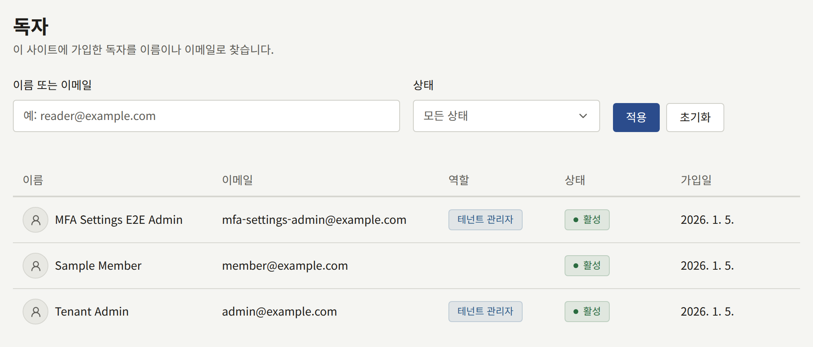
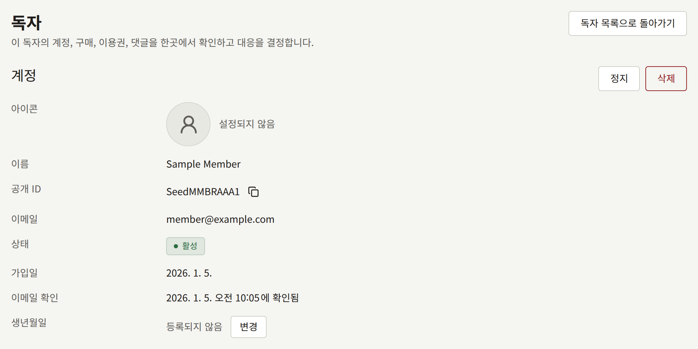

**독자**는 테넌트 사이트의 모든 계정을 가입일 최신순으로 한 페이지에 20개씩 나열합니다. 콘솔 계정은 사이트의 계정이기도 하므로 스태프도 여기에 포함됩니다. **역할**에는 스태프가 가진 가장 높은 역할이 표시되며, 독자의 경우 비어 있습니다. 이 화면은 테넌트 관리자만 볼 수 있습니다.

사람을 찾으려면 **이름 또는 이메일**에 이름이나 이메일 주소의 일부를 입력하고 **적용**을 선택합니다. 검색은 둘 중 어느 쪽이든 어느 위치에서든 일치하는 것을 찾으며 대소문자를 무시하므로, `tanaka`로 `Tanaka Hanako`와 `h.tanaka@example.com`을 찾을 수 있습니다. **상태**로 목록을 한 가지 상태로 좁힐 수 있습니다.

| 상태 | 의미 |
| --- | --- |
| **활성** | 계정으로 로그인할 수 있습니다 |
| **비활성** | 독자가 가입했지만 아직 이메일 주소를 확인하지 않았습니다. 확인할 때까지 로그인할 수 없습니다 |
| **정지됨** | 테넌트 관리자가 계정을 정지했습니다. 정지가 해제될 때까지 로그인할 수 없습니다 |

각 행의 맨 앞에는 독자가 계정에 고른 아이콘이 표시되며, 아이콘을 고르지 않은 독자는 기본 윤곽으로 표시됩니다. **댓글**에도 작성자가 같은 방식으로 표시됩니다. 목록에서 독자의 이름을 선택하면 그 독자의 페이지가 열립니다. 테넌트 관리자의 경우 **댓글**의 작성자 이름과, 작성할 때 로그인해 있던 문의 발신자도 마찬가지입니다.

## 독자 페이지

**계정**에는 독자의 **아이콘**, 이름, 복사 버튼이 있는 **공개 ID**, 이메일 주소, 상태, 가입일, 이메일 주소를 확인했는지와 언제 확인했는지, 그리고 **생년월일**이 표시됩니다.

그 아래의 세 섹션은 독자가 가진 것을 최신순으로 한 페이지에 20개씩 나열합니다.

| 섹션 | 나열하는 것 |
| --- | --- |
| **구매** | 독자가 구매한 모든 것. 구매 대상인 에피소드, 권, 시리즈의 나머지, 코인 팩과 금액, 결제 수단, 그리고 그 구매로 지금도 볼 수 있는지가 표시됩니다. 제목을 선택하면 구매한 것이 열리고, **보기**를 선택하면 **구매**에서 그 구매가 열리며, 그곳에서 환불할 수 있습니다 |
| **이용권** | 스태프가 독자에게 발급한 이용권과, 그 에피소드와 이용권의 상태. **취소**와 **이용권 발급**은 [이용권](./4-access-tickets.md)에서와 같이 작동하며, 페이지를 떠나지 않고 쓸 수 있습니다 |
| **댓글** | 독자가 작성한 모든 댓글. 독자가 직접 삭제한 댓글도 완전히 삭제될 때까지 포함되며, [댓글](./2-comments.md)에서와 같은 조치를 할 수 있습니다 |

## 생년월일 정정하기

독자는 한 번 저장한 생년월일을 바꿀 수 없으므로, 잘못 입력한 독자는 사이트에 정정을 요청해야 합니다. [연령 확인](../3-setup/1-settings.md#연령-확인)에서 정한 연령 확인은 저장된 생년월일을 따릅니다. 정정하려면 **생년월일** 옆의 **변경**을 선택하고 날짜를 입력한 뒤 **저장**을 선택합니다. 날짜를 비워 두면 생년월일이 지워지며, 그 뒤 독자는 연령 제한이 있는 시리즈에서 생년월일을 다시 입력하도록 요청받습니다. 새 날짜는 독자가 다음에 읽을 때부터 적용됩니다.

## 독자의 아이콘 삭제하기

독자의 아이콘은 사이트를 읽는 모든 사람에게 그 독자의 댓글 옆에 표시되므로, 사이트의 규칙을 어기는 아이콘은 여기서 내립니다. **아이콘** 옆의 **아이콘 삭제**를 선택하고 **삭제**로 확인합니다. 이미지는 사이트와 콘솔에서 즉시 표시되지 않게 되며, 계정에는 그 자리에 기본 윤곽이 표시됩니다. 독자는 자신의 아이콘을 직접 삭제했을 때와 마찬가지로, 그 뒤에 다른 아이콘을 고를 수 있습니다.

**아이콘 삭제**는 계정에 아이콘이 표시되어 있을 때만 나타납니다.

독자가 아이콘을 업로드할 수 있는지, 테넌트가 준비한 아이콘 중에서 고를 수 있는지, 아니면 아이콘을 전혀 표시하지 않는지는 **설정**에서 정하며, [독자 아이콘](../3-setup/1-settings.md#독자-아이콘)에서 설명합니다.

## 독자 정지하기

**정지**는 모든 기기에서 독자를 로그아웃시키고, 정지가 해제될 때까지 비밀번호로든 Apple이나 Google로든 로그인을 거부합니다. 계정의 다른 부분은 바뀌지 않습니다. 공개된 댓글은 사이트에 남으며, 구매와 이용권도 독자의 것으로 남습니다. 로그인할 수 없는 동안에만 쓸 수 없습니다.

같은 페이지의 **정지 해제**는 계정을 **활성**으로, 이메일 주소를 한 번도 확인하지 않은 경우에는 **비활성**으로 되돌립니다. 독자는 다시 로그인합니다. 정지로 끝난 세션은 끝난 상태로 남습니다. 정지된 독자를 찾으려면 **상태**를 **정지됨**으로 설정하세요.

## 독자가 내려받는 자신의 데이터

독자는 사이트의 **계정 설정**이나 앱의 계정 화면에서 사이트가 자신에 대해 보관하고 있는 모든 것의 사본을 내려받을 수 있습니다. 따라서 APPI나 GDPR에 따라 사이트가 보관하는 자신의 데이터를 보여 달라는 요청에, 스태프가 직접 데이터를 모으지 않고도 응할 수 있습니다. 스태프가 독자를 대신해 요청할 수는 없으므로, 그런 문의를 보낸 독자에게는 계정 설정을 안내하세요.

독자가 요청하면 사본은 1분 정도 안에 준비됩니다. 준비되었다는 사실은 알림 설정과 관계없이 사이트의 알림과 이메일로 독자에게 알려지며, 독자는 같은 곳에서 7일 동안 몇 번이든 사본을 내려받을 수 있습니다. 그 뒤에는 사본이 삭제되며, 다시 요청할 수 있습니다. 운영자가 더 많이 허용하지 않는 한 독자는 하루에 한 번 요청할 수 있으며([플랫폼 정책](../../3-operations/9-platform-policies.md) 참고), 이전 요청이 아직 준비 중인 동안에는 요청할 수 없습니다. 사본은 설치 환경의 오브젝트 스토리지에 보관되므로, 운영자가 오브젝트 스토리지를 설정하지 않은 동안에는 독자가 사본을 요청할 수 없습니다.

사본은 레코드 종류마다 JSON 파일이 하나씩 들어 있고, 독자가 이미 내려받을 수 있는 구매 내역 CSV가 함께 들어 있는 ZIP 파일입니다.

| 파일 | 담고 있는 것 |
| --- | --- |
| `account.json` | 이름, 이메일 주소, 상태, 생년월일, 가입일과 이메일 주소 확인일 |
| `sign_in_methods.json` | 계정에 비밀번호와 2단계 인증 수단이 있는지, 계정에 연결된 Apple 및 Google 계정, 패스키 |
| `follows.json` | 팔로우하는 시리즈, 에피소드, 작가 |
| `reading_positions.json`, `reading_history.json` | 각 에피소드에서 읽다가 멈춘 위치와, 읽은 모든 에피소드 |
| `ratings.json` | 에피소드에 매긴 평가 |
| `comments.json`, `comment_reports.json` | 작성한 모든 댓글(현재 상태와 관계없이)과, 신고한 댓글 |
| `purchases.json`, `purchases.csv` | 구매한 모든 것 |
| `coin_transactions.json` | 지급받은 코인과 사용한 코인 |
| `subscriptions.json` | 사이트와 앱에서의 구독 |
| `preferences.json` | 저장한 적이 있다면 알림 설정과 뷰어 설정 |
| `legal_page_consents.json` | 동의한 이용약관과 개인정보 처리방침의 각 버전 |
| `access_tickets.json` | 스태프가 발급한 이용권 |
| `contact_messages.json` | 로그인한 상태에서 보낸 문의와 각 문의에 대한 답변 |

독자가 아니라 스태프에 속하는 정보는 빠져 있습니다. 이용권이나 문의에 스태프가 남긴 메모, 어떤 스태프가 무언가를 승인하거나 숨기거나 처리했는지, 결제 제공자와 스토어가 테넌트의 기록을 관리하는 데 쓰는 ID가 그렇습니다. 비밀번호나 2단계 인증의 비밀 정보도 들어 있지 않으며, 사이트는 이를 누구도 읽을 수 있는 형태로 보관하지 않습니다.

## 독자 삭제하기

**삭제**는 독자가 직접 탈퇴했을 때와 똑같이 계정을 삭제하며, 되돌릴 수 없습니다.

| 독자가 가지고 있던 것 | 처리 |
| --- | --- |
| 댓글과 독자가 접수한 신고 | 삭제됩니다 |
| 구매 | 구매자 정보 없이 유지되므로, 매출과 인세는 바뀌지 않습니다 |
| 플랜 구독 | 독자에게 다시 청구되지 않도록 테넌트의 Stripe 계정에서 즉시 해지됩니다. 이미 지불한 기간은 환불되지 않습니다. 독자가 앱에서 구매한 구독은 App Store나 Google Play가 청구하며, 그곳에서는 독자만 해지할 수 있습니다. 이런 구독은 구독자 정보 없이 유지되며, 독자가 스토어에서 해지합니다 |
| 이용권, 팔로우, 읽은 기록, 평가, 알림, 연결된 Apple 및 Google 로그인 | 삭제됩니다 |
| 문의 | 유지되며, **게스트**가 보낸 것으로 표시됩니다 |
| 스태프 역할 | 제거됩니다 |
| 독자가 요청한 데이터 사본 | 1시간 안에 삭제됩니다 |

나중에 되돌리고 싶을 수 있다면 삭제 대신 정지하세요.

로그인한 계정 자신과, 테넌트의 마지막 활성 테넌트 관리자는 정지하거나 삭제할 수 없습니다. 먼저 다른 사람을 테넌트 관리자로 지정하세요. 정지, 정지 해제, 삭제, 생년월일 변경과 삭제, 아이콘 삭제는 [감사 로그](../3-setup/8-audit-log.md)에 각각 **독자 정지**, **독자 정지 해제**, **독자 삭제**, **독자 생년월일 변경**, **독자 생년월일 삭제**, **독자 아이콘 삭제**로 기록됩니다.
