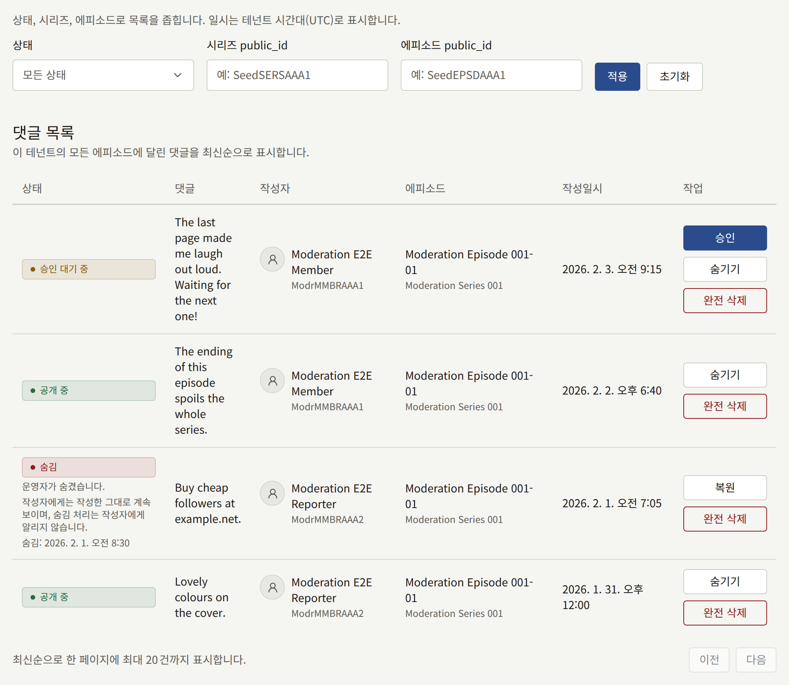
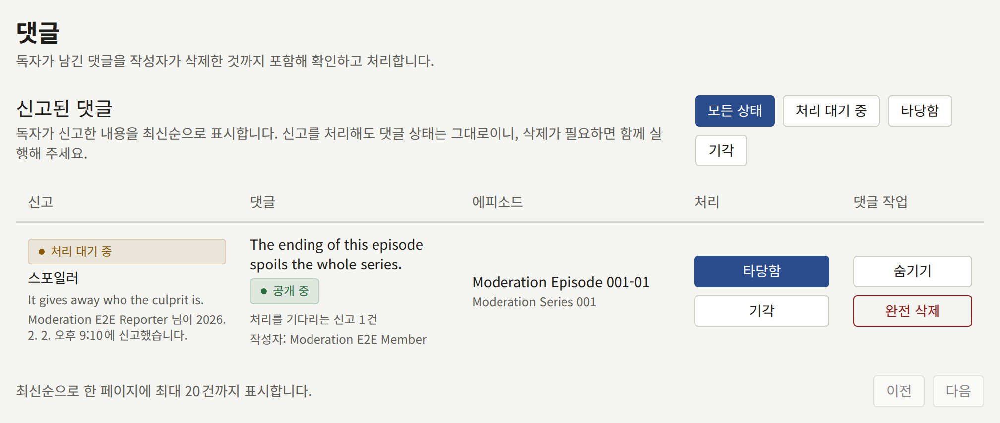

독자는 댓글이 켜져 있을 때만 에피소드에 댓글을 달 수 있습니다. 테넌트 전체는 **설정** › **독자 댓글**에서, 시리즈별로는 시리즈 양식에서 켭니다. [독자 댓글](../3-setup/1-settings.md#독자-댓글)에서 세 가지 선택지인 **받지 않음**, **바로 공개**, **승인 후 공개**와, 댓글을 자동으로 숨기는 신고 건수를 설명합니다.

댓글은 로그인한 독자만 달 수 있으며, 하나에 최대 1000자입니다. 댓글은 에피소드에 속합니다. 답글이나 스레드가 없으므로, 댓글 하나에 대한 조치는 다른 댓글에 영향을 주지 않습니다.

**댓글**에는 두 개의 목록이 있습니다. 먼저 **신고된 댓글**이 있고, 그다음에 테넌트 에피소드의 모든 댓글이 최신순으로 있습니다. 감사 담당에게는 두 목록이 조치 없이 표시됩니다.

## 댓글 상태의 의미

| 상태 | 댓글을 볼 수 있는 사람 |
| --- | --- |
| **승인 대기 중** | 작성자만 볼 수 있으며, **승인 대기 중**으로 표시됩니다 |
| **공개 중** | 모든 사람 |
| **숨김** | 작성자만 볼 수 있으며, 작성자에게는 작성한 그대로 보입니다 |
| **작성자가 삭제** | 사이트에서는 작성자를 포함해 아무도 볼 수 없습니다. 스태프는 완전 삭제될 때까지 여기서 볼 수 있습니다 |

## 각 조치가 하는 일

| 조치 | 나타나는 상태 | 하는 일 |
| --- | --- | --- |
| **승인** | **승인 대기 중** | 댓글을 공개하고, 작성자에게 댓글이 공개되었다고 알립니다 |
| **숨기기** | **승인 대기 중**, **공개 중** | 작성자를 제외한 모든 사람에게서 댓글을 사이트에서 내립니다. 입력한 **이유(선택)** 내용은 감사 로그에 기록됩니다 |
| **복원** | **숨김** | 댓글을 원래대로 되돌립니다. 공개되어 있던 댓글은 다시 공개되고, 그렇지 않았다면 **승인 대기 중**으로 돌아갑니다. 그 댓글에 대해 처리를 기다리던 신고는 모두 기각됩니다 |
| **완전 삭제** | 모든 상태 | 댓글과 그 신고를 영구히 삭제합니다. 감사 로그 기록만이 그 댓글의 유일한 흔적이 되므로 **이유**가 필수입니다 |

숨겨진 댓글의 작성자에게는 모더레이터가 숨겼든 독자의 신고로 숨겨졌든 알리지 않습니다. 작성자에게는 댓글이 작성한 그대로 계속 보이므로, 댓글란을 어지럽히려고 글을 올리는 사람이 다시 올리도록 자극할 만한 것이 아무것도 없습니다.

목록을 불러온 뒤 다른 모더레이터가 같은 댓글을 처리했다면, 여러분의 조치는 "다른 운영자가 이 댓글을 이미 처리했습니다. 목록을 새로 고쳐 현재 상태를 확인해 주세요."라는 메시지와 함께 거부됩니다.

## 승인 대기열 처리하기

승인을 기다리는 댓글이 있는 동안 메뉴의 **댓글**에 그 수가 표시됩니다. 또한 모든 스태프는 콘솔에서 "승인을 기다리는 댓글이 있습니다"라는 알림을 에피소드마다 최대 1시간에 한 번 받습니다. 이 알림을 열면 그 에피소드의 승인 대기 중 댓글로 걸러진 목록이 열립니다.

1. **댓글**을 열고 **상태**를 **승인 대기 중**으로 설정한 다음 **적용**을 선택합니다.
2. 각 댓글을 읽고, 공개하려면 **승인**을, 사이트에 올리지 않으려면 **숨기기**를 선택합니다.
3. 목록이 빌 때까지 페이지를 넘기며 처리합니다.

승인되기 전까지는 작성자 외에 아무도 댓글을 볼 수 없으므로, 대기열을 처리하지 않고 두면 댓글란은 계속 비어 있습니다. 대기열에서 숨긴 댓글은 작성자에게 계속 **승인 대기 중**으로 보입니다.

## 신고된 댓글

로그인한 독자는 자신의 것이 아닌 공개된 댓글을 신고할 수 있으며, **스팸 또는 광고**, **비방 또는 괴롭힘**, **스포일러**, **기타** 중에서 이유를 고르고 메모를 선택적으로 덧붙입니다. 각 독자는 한 댓글을 한 번 신고하며, 다시 신고해도 아무것도 바뀌지 않습니다. 작성자에게는 알리지 않습니다.

한 댓글에 대해 처리를 기다리는 신고가 **댓글을 숨기는 신고 건수**에 이르면, 스태프를 기다리지 않고 댓글이 자동으로 숨겨지며 작성자에게는 알리지 않습니다. 그러면 댓글에 "신고가 기준을 넘어 자동으로 숨겨졌습니다."라고 표시되고, 감사 로그에는 **자동 처리**를 실행자로 하여 **신고에 따른 댓글 자동 숨김**이 기록됩니다. 모든 스태프는 콘솔에서 "댓글이 신고되었습니다"라는 알림을 에피소드마다 최대 1시간에 한 번 받습니다.

**신고된 댓글**은 신고마다 한 행씩 최신순으로 나열하며, 이유, 메모, 신고자, 댓글, 작성자를 보여 줍니다. 신고는 처리될 때까지 **처리 대기 중**입니다.

- **타당함**은 신고가 옳았다고 기록합니다. 댓글은 그대로 둡니다. 공개된 댓글을 내리려면 **숨기기**도 선택하세요.
- **기각**은 신고가 잘못되었다고 기록합니다. 자동으로 숨겨진 댓글을 되돌리지는 않으므로, 되돌리려면 **복원**을 선택하세요.

대기열을 처리하려면 필터를 **처리 대기 중**으로 설정한 다음, 댓글마다 남길지 정합니다. 내린다면 댓글을 **숨기기**하고 그 신고를 **타당함**으로 처리합니다. 남긴다면 숨겨진 댓글은 **복원**하고(처리를 기다리던 신고가 한꺼번에 기각됩니다), 숨겨지지 않은 댓글은 각 신고를 **기각**합니다. 신고를 처리하면 자동 숨김까지의 건수가 줄어들므로, 기각한 신고 때문에 나중에 댓글이 기준을 넘는 일은 없습니다.

## 작성자가 삭제한 댓글

독자는 언제든 자신의 댓글을 삭제할 수 있습니다. 삭제한 댓글은 즉시 사이트에서 사라지며, 작성자를 포함해 모든 사람에게 보이지 않고, 스태프가 복원할 수도 없습니다. 작성자가 내린 뒤에도 누군가 신고하거나 불만을 제기한 댓글을 스태프가 읽을 수 있도록, **댓글**에는 그 댓글이 삭제 시각과 완전 삭제 예정 시각과 함께 **작성자가 삭제**로 계속 표시됩니다. 그 댓글에 대한 신고도 대기열에 남으며 계속 처리할 수 있습니다.

작성자가 삭제한 댓글은 **설정** › **제한 및 보존** › **보존 기간** › **철회된 댓글**에서 정한 기간이 지나면 신고와 함께 완전 삭제됩니다. `publira worker`가 1시간마다 완전 삭제하며, 행에는 지금 설정된 기간을 기준으로 "며칠 뒤인 (날짜)에 완전히 삭제됩니다"라고 표시됩니다. 더 일찍 삭제하려면 **완전 삭제**를 선택하세요. 숨겨진 댓글은 저절로 완전 삭제되지 않으며, 모더레이터가 완전 삭제할 때까지 남습니다.

## 댓글 찾기

댓글 목록은 **상태**, **시리즈 public_id**, **에피소드 public_id**로 좁힐 수 있습니다. 공개 ID는 콘솔에서 시리즈나 에피소드 주소의 마지막 부분이며, `/series/<series public ID>/episodes/<episode public ID>`와 같은 형태입니다. 각 댓글의 **에피소드**는 그 주소로 링크됩니다. 일치하는 것이 없는 ID를 입력하면 빈 목록이 표시됩니다.

에피소드에 크레딧이 표시된 작가에 연결된 계정의 댓글에는 사이트와 여기 모두에서 **작가** 배지가 붙습니다. 이 배지는 댓글 관리 방식에 아무 영향도 주지 않습니다.

작가는 독자가 자신의 작품에 대해 하는 말을 읽기 위해 콘솔을 쓸 필요가 없습니다. 작가에 연결된 독자는 [작가](../1-catalog/4-authors.md#작가를-독자-계정에-연결하기)에서 설명하듯 자신의 작가 페이지에서 그 작가가 크레딧에 오른 모든 에피소드의 공개된 댓글을 읽습니다. 승인 대기 중이거나 숨겨진 댓글은 그곳에 나타나지 않으므로, 숨김은 작성자에게 그렇듯 모든 사람에게 조용히 이루어집니다.

댓글의 승인, 숨기기, 복원, 완전 삭제와, 신고의 타당함 처리와 기각은 입력한 이유와 함께 감사 로그에 기록됩니다.
