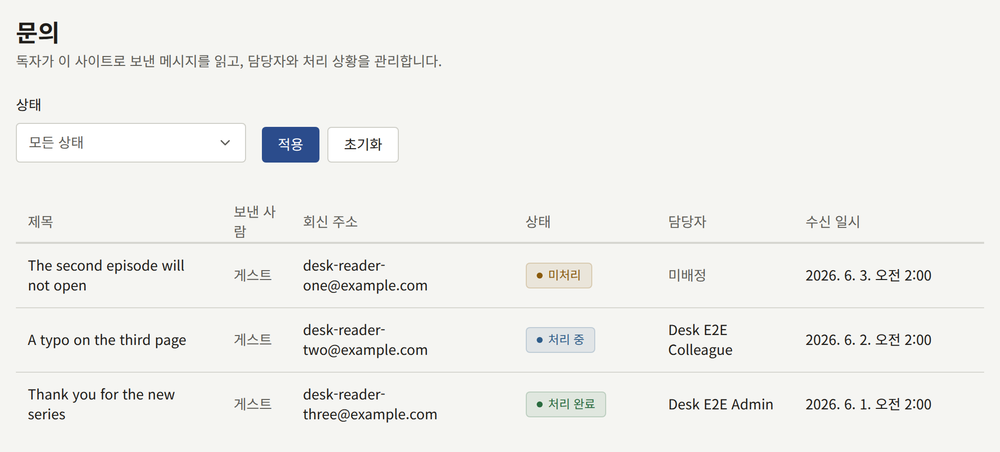
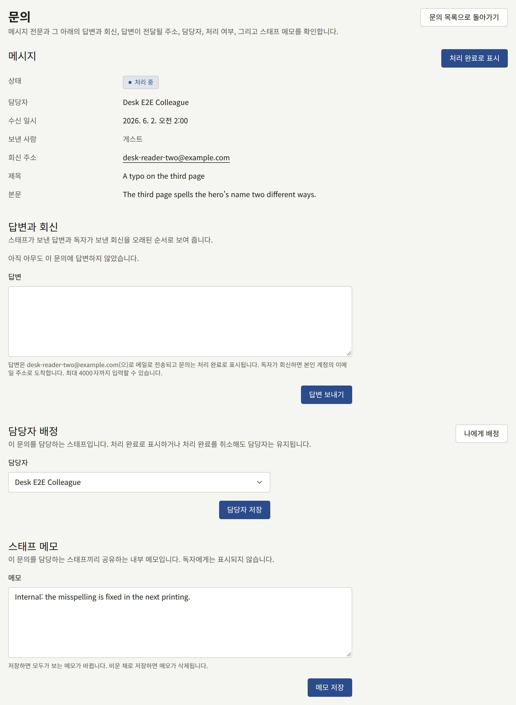

독자는 로그인 여부와 관계없이, 사이트의 모든 페이지 하단과 앱에 링크된 **문의하기**에서 사이트에 메시지를 보냅니다. 독자는 답변을 받을 이메일 주소, 최대 200자의 선택 사항인 제목, 최대 4000자의 메시지를 입력합니다. 로그인한 독자의 주소는 자동으로 채워지며, 바꿀 수 있습니다.

새 메시지는 모든 활성 테넌트 관리자에게 각자의 계정 주소로 메일로 전송되며, 독자의 주소, 제목, 메시지 전문이 함께 들어 있습니다. 편집 담당과 감사 담당은 **문의**를 열 수 없으므로 메일을 받지 않으며, 정지된 계정도 받지 않습니다. 활성 테넌트 관리자가 없는 테넌트는 누구에게도 메일을 보내지 않지만, 메시지는 여전히 **문의**에서 기다립니다. 콘솔 자체는 새 메시지의 수나 알림을 표시하지 않으므로, **문의**를 확인하거나 그 메일을 주시하세요.

**문의**는 메시지를 최신순으로 한 페이지에 20개씩 나열하며, **제목**, **보낸 사람**, **회신 주소**, **상태**, **담당자**, **수신 일시**를 보여 줍니다. **보낸 사람**에는 독자가 로그인해 있었다면 그 독자의 계정이, 그렇지 않으면 **게스트**가 표시됩니다. **상태**는 메시지의 상황에 따라 정해지며, 직접 설정하지 않습니다.

| 상태          | 조건                                             |
| ------------- | ------------------------------------------------ |
| **미처리**    | 처리되지 않았고, 담당자가 없음                   |
| **처리 중**   | 처리되지 않았고, 테넌트 관리자가 담당자로 지정됨 |
| **처리 완료** | 처리 완료로 표시되었거나, 답변함                 |

## 메시지에 답변하기

1. **문의**에서 메시지를 엽니다.
2. 다른 사람들이 처리 중이라는 것을 알 수 있도록, **담당자 배정**에서 **나에게 배정**을 선택하거나, 테넌트 관리자를 골라 **담당자 저장**을 선택합니다. 담당자로 지정할 수 있는 것은 테넌트 관리자뿐입니다.
3. **답변**에 최대 4000자로 답변을 쓰고 **답변 보내기**를 선택합니다.

답변은 **답변과 회신**에 저장되고, 메시지는 **처리 완료**가 되며, `publira worker`가 메시지의 **회신 주소**로 답변을 메일로 보냅니다.

- [메일](../3-setup/7-email.md)에서 설정한 메일 서버를 통해 그 주소에서 보내며, 테넌트에 자체 메일 서버가 생기기 전까지는 플랫폼의 메일 서버를 통해 보냅니다.
- 제목은 "Re:" 뒤에 독자가 쓴 제목을 붙인 것이며, 독자가 제목을 쓰지 않았다면 "Re: (사이트 이름)에 보낸 문의"입니다.
- 답변 아래에 독자의 메시지가 인용됩니다.
- 독자가 어떤 언어로 썼든 테넌트의 기본 언어로 보냅니다.

콘솔에는 메일이 전달되었는지 표시되지 않습니다. 메일 설정이 잘못되어 있으면 답변은 저장되고 메시지는 **처리 완료**가 되지만 메일은 전송되지 않습니다. 따라서 테넌트가 자체 서버로 메일을 보내는 경우에는, 독자에게 답변하기 전에 **발신 메일**의 **연결 테스트**로 서버를 확인하세요. 한 주소로 보내는 답변은 콘솔이 보내는 다른 모든 메일과 마찬가지로 시간당, 일당 건수가 제한됩니다.

## 독자가 회신할 때

독자의 회신이 어디로 가는지는 **연동** › **메일**의 **수신 메일** 섹션이 **사용 가능**인지에 따라 다릅니다. 설정 방법은 [문의 메시지에 대한 독자의 회신](../3-setup/7-email.md#문의-메시지에-대한-독자의-회신)에서 안내합니다.

- **사용 가능이 되기 전까지는** 답변의 회신 주소가 여러분 자신의 계정 이메일 주소입니다. 독자의 회신은 여러분의 메일함에 도착합니다. 콘솔에는 기록되지 않으며 메시지는 **처리 완료** 상태로 남습니다. 메일로 답하거나, 콘솔에서 다시 답변하세요.
- **사용 가능이 되면** 회신 주소는 그 메시지를 위해 만든 사이트 자체의 주소가 됩니다. 독자의 회신은 **답변과 회신**에 그 독자 주소에서 온 회신으로 기록되고, 메시지는 다시 열리며, 새 메시지와 마찬가지로 테넌트 관리자에게 메일이 전송됩니다.

**답변** 아래의 안내에 테넌트에 어느 쪽이 적용되는지 표시됩니다.

## 처리 상황 관리하기

- **스태프 메모**는 테넌트 관리자들이 메시지에 대해 공유하는 하나의 메모로, 최대 4000자입니다. 독자에게는 절대 표시되지 않습니다. 저장하면 모든 사람에게 메모가 바뀌며, 비운 채로 저장하면 메모가 삭제됩니다.
- **처리 완료로 표시**는 스팸처럼 답변하지 않고 처리한 메시지를 처리 완료로 표시합니다. **처리 완료 취소**는 메시지를 **처리 중** 또는 **미처리**로 되돌립니다. 어느 쪽도 담당자는 바꾸지 않습니다.

메시지는 삭제되지 않으며, 보존 기간도 없습니다. 나중에 계정을 삭제한 독자의 메시지도 유지되며, **게스트**가 보낸 것으로 표시됩니다. 처리 완료로 표시, 처리 완료 취소, 담당자 지정, 메모 편집, 답변은 감사 로그에 기록됩니다. 답변의 본문은 기록되지 않습니다.
