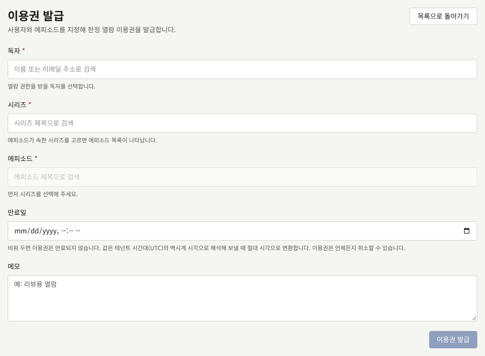
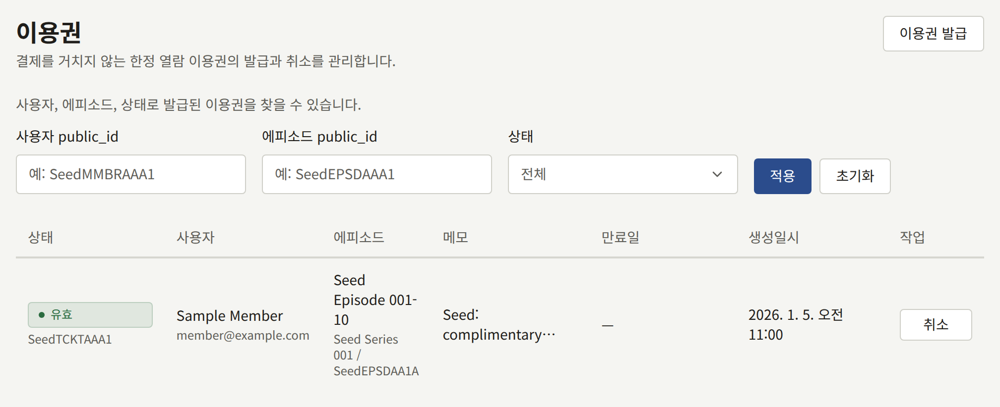

이용권은 에피소드 하나를 독자 한 명에게 결제 없이, 사이트와 앱에서, 만료되거나 취소될 때까지 열어 줍니다. 독자가 구매하지 않고 읽어야 하는 경우에 사용하세요. 리뷰어나 언론 관계자, 경품, 또는 구매에 문제가 생겨 환불과 재구매를 기다리게 해서는 안 되는 독자 등이 그런 경우입니다. **이용권**은 테넌트 관리자만 볼 수 있습니다.

이용권은 판매가 아닙니다. 어떤 작가에게도 인세가 발생하지 않으며, 에피소드는 독자의 **구매 목록**에 나타나지 않습니다. 연령 확인도 풀어 주지 않으므로, 시리즈를 보기에 너무 어린 독자는 이용권이 있어도 볼 수 없습니다. 이용권은 공개된 에피소드만 열며, 무료 에피소드에는 아무 효과가 없습니다. 독자에게는 이용권이 생겼다는 사실이 알려지지 않으므로, 직접 알려 주세요.

## 이용권 발급하기

1. **이용권**을 열고 **이용권 발급**을 선택합니다.
2. **독자**에 독자의 이름이나 이메일 주소의 일부를 입력하고 독자를 고릅니다. **활성** 독자만 후보로 나옵니다.
3. **시리즈**를 고른 다음 **에피소드**를 고릅니다.
4. 필요하면 테넌트의 시간대로 **만료일**을 설정합니다. 비워 두면 이용권은 만료되지 않습니다.
5. 필요하면 이용권을 발급한 이유 등을 최대 1000자의 **메모**로 남깁니다.
6. **이용권 발급**을 선택합니다.

열어 둔 독자 페이지의 독자에게 이용권을 발급하려면 [독자 페이지](./1-accounts.md#독자-페이지)의 **이용권**에서 **이용권 발급**을 선택합니다. 같은 양식이 **독자** 없이 페이지 위에 열리며, 발급된 이용권은 페이지의 목록에 나타납니다.

한 독자와 한 에피소드에는 스태프가 발급한 이용권이 한 번에 하나만 있을 수 있습니다.

- 이미 유효한 이용권이 있으면 새로 발급되지 않으며, 기존 이용권의 만료일과 메모는 그대로 유지됩니다. 콘솔이 그렇다고 알리며 그 이용권을 알려 줍니다. 이용권의 만료일이나 메모를 바꾸려면 목록에서 취소하고 새로 발급하세요.
- 기한이 만료된 이용권이 있으면, 콘솔이 먼저 목록에서 그 이용권을 취소하라고 요청합니다.

## 이용권 취소하기

목록이나 독자 페이지에서 유효한 이용권의 **취소**를 선택하면, 독자에게 열려 있던 에피소드가 즉시 닫힙니다. 이 작업은 되돌릴 수 없으므로, 다시 열어 주려면 새 이용권을 발급하세요. 취소된 이용권은 취소된 시각과 함께 **취소됨**으로 목록에 남습니다.

## 목록 읽기

목록에는 스태프가 발급한 이용권만 들어 있습니다. 독자가 [**기다리면 무료**](../4-selling-episodes.md#무료-공개-기간과-기다리면-무료)로 직접 받는 이용권은 목록에 없으며 여기서 취소할 수도 없습니다. 그 이용권은 스태프가 나누어 준 것이 아니라 시리즈의 규칙에 따라 독자가 받을 자격이 있는 무료 열람이며, 같은 독자와 에피소드에 대한 스태프의 이용권은 그것을 대체하지 않고 그와 별도로 발급됩니다.

목록에는 각 이용권의 **상태**, **사용자**, **에피소드**, **메모**, **만료일**, **생성일시**가 최신순으로 한 페이지에 20개씩 표시됩니다. **상태**는 **유효**, **기한 만료**, **취소됨** 중 하나이며, 필터의 **유효한 것만**은 기한이 만료된 것과 취소된 것을 모두 제외합니다. **사용자 public_id**와 **에피소드 public_id**에는 독자 페이지나 콘솔의 에피소드 주소에서 복사한 공개 ID 전체를 입력합니다. ID의 일부나 이름으로는 아무것도 찾을 수 없습니다.

발급과 취소는 감사 로그에 **이용권 발급**과 **이용권 취소**로 기록됩니다.
