**관리** 아래의 **설정**에는 탭이 세 개 있습니다. **기본 정보**에는 테넌트가 자기 사이트에 대해 정하는 항목이 있습니다. **제한 및 보존**에는 운영자가 모든 테넌트에 설정하는 값이 있으며, 테넌트는 정해진 범위 안에서 이 값을 바꿀 수 있습니다. **독자 아이콘**에는 독자가 아이콘으로 표시할 수 있는 것과, 테넌트가 독자에게 고를 수 있도록 제공하는 아이콘이 있습니다.

이 탭들의 각 카드에는 저장 버튼이 따로 있고, 그 카드의 필드만 저장합니다. 따라서 다음 카드로 넘어가기 전에 지금 카드를 저장하세요. 스태프는 누구나 **설정**을 열 수 있지만, 저장할 수 있는 사람은 테넌트 관리자뿐입니다. 편집 담당이나 감사 담당에게는 각 카드에 "이 설정은 테넌트 관리자만 변경할 수 있습니다. 현재는 읽기 전용입니다."가 표시됩니다.

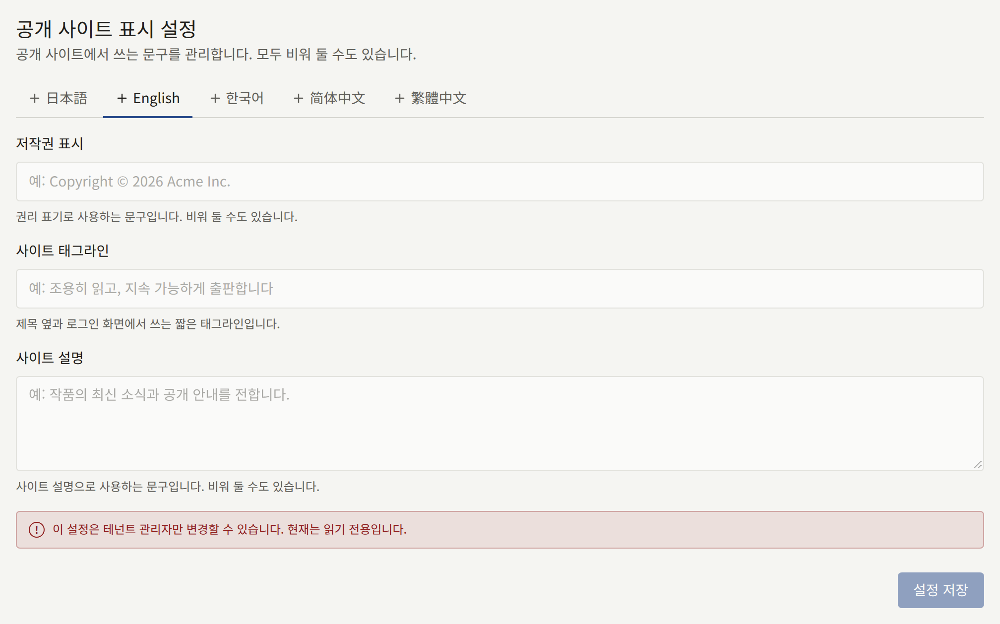

## 기본 정보

### 공개 사이트 표시 설정

세 가지 문구가 있으며, 각각 비워 둘 수 있습니다.

- **저작권 표시**: 사이트의 모든 페이지와 로그인 화면 하단에 표시됩니다.
- **사이트 태그라인**: 로그인, 회원가입, 비밀번호 화면과, 사이트 홈페이지 링크를 공유할 때 함께 표시되는 이미지에 들어가는 짧은 한 줄입니다([링크 미리보기](./2-branding.md#링크-미리보기) 참고).
- **사이트 설명**: 사이트 푸터에 표시되며, 검색 엔진과 링크 미리보기에 사이트 설명으로 전달됩니다.

[언어](#언어)에서 선택한 대로 사이트가 제공하는 각 언어에는 **언어** 아래에 탭이 있으며, 탭마다 세 가지 문구를 따로 가집니다. 카드는 기본 언어의 탭으로 열리고, 자체 문구가 없는 언어에는 **(추가되지 않음)** 표시가 붙습니다. **설정 저장**은 열려 있는 탭의 세 필드를 저장하며, 다른 언어의 문구는 그대로 둡니다. 탭을 바꾸기 전에 저장하세요. 저장하지 않은 수정 내용은 유지되지 않습니다. 세 필드를 모두 비우고 저장하면 그 언어의 문구가 삭제됩니다.

사이트는 독자가 읽고 있는 언어의 문구를 보여 주고, 그 언어의 문구가 없으면 기본 언어의 문구를 보여 줍니다. 자체 문구가 있는 언어에서는 그 문구만 표시됩니다. 해당 탭에서 비워 둔 필드는 기본 언어의 문구를 보여 주지 않고 빈 채로 남습니다.

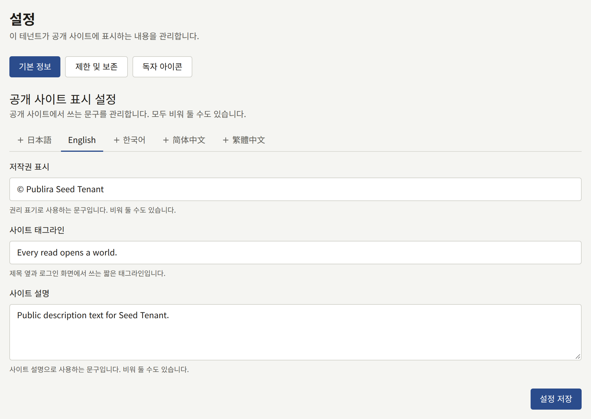

### 시간대

**시간대**는 콘솔과 공개 사이트 모두에서 모든 날짜와 시각을 표시하고 입력하는 기준이 되는 시간대입니다. 시리즈나 에피소드에 입력한 공개 시각도, 배너가 끝나는 시각도 이 시간대로 해석되며, 리포트와 감사 로그가 집계하는 날짜도 이 시간대를 따릅니다. 인세 계산에서 한 달의 매출이 끝나고 다음 달이 시작되는 경계와, 독자의 나이를 계산하는 날짜도 이 시간대로 정해집니다. 도시나 지역 이름을 입력해 목록을 좁히고, **시간대 저장**을 선택하세요.

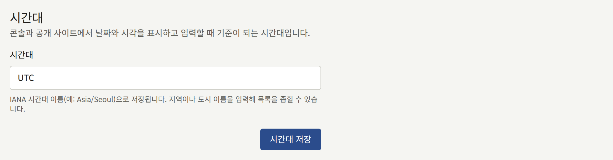

첫 매출이 생기기 전에 설정하세요. 나중에 바꾸면 아직 마감되지 않은 달의 경계가 옮겨집니다. 인세 정산을 위해 이미 마감된 달은 마감할 때의 시간대를 유지합니다.

새 테넌트는 플랫폼의 기본 시간대로 시작합니다. 운영자가 다른 시간대를 선택하지 않았다면 `UTC`입니다.

### 언어

**언어**에서는 사이트가 독자에게 제공하는 언어와, 그중 처음에 사용할 언어를 정합니다.

**제공하는 언어**에는 Publira가 번역된 각 언어의 체크박스가 있습니다. 日本語, English, 한국어, 简体中文, 繁體中文입니다. 독자가 사이트에서 사용할 수 있는 언어에 체크하세요. 언어를 끄면 그 언어로 작성된 페이지 번역이 삭제되지 않고 숨겨지며, [번역](./3-pages.md#번역)에서 설명하듯이 그 언어를 다시 켜면 돌아옵니다.

독자에게는 체크한 언어만 보입니다. 사이트의 **표시 언어** 메뉴에도, 사이트맵과 검색 엔진이 읽는 언어 링크에도 이 언어들만 나열됩니다. 북마크나 검색 결과에서 꺼진 언어의 주소로 들어오면, 같은 페이지가 기본 언어로 열립니다.

테넌트의 앱도 같은 선택을 따릅니다. 앱에는 **표시 언어** 메뉴가 없고, 대신 독자의 기기에 설정된 언어를 읽습니다. 그중 사이트가 제공하는 첫 번째 언어로 열리고, 사이트가 그중 어느 언어도 제공하지 않으면 기본 언어로 열립니다.

**기본 언어**는 언어를 아직 선택하지 않은 사람에게 사이트와 이 콘솔이 처음 사용하는 언어입니다. 이미 언어를 선택한 독자나 스태프는 그 언어를 유지합니다. 기본 언어는 다음에도 사용됩니다.

- 새 스태프 초대를 포함해, 테넌트가 보내는 메일의 언어
- 새 페이지를 처음 작성하는 언어

기본 언어는 항상 제공됩니다. 체크박스는 체크된 채로 해제할 수 없으며, 체크하지 않은 언어를 기본 언어로 선택하면 그 언어에 체크됩니다. 기본 언어는 운영자가 테넌트를 만들 때 선택했으며, 운영자가 더 선택하지 않았다면 새 테넌트는 그 언어만 제공합니다. **언어 저장**으로 둘 다 저장합니다.

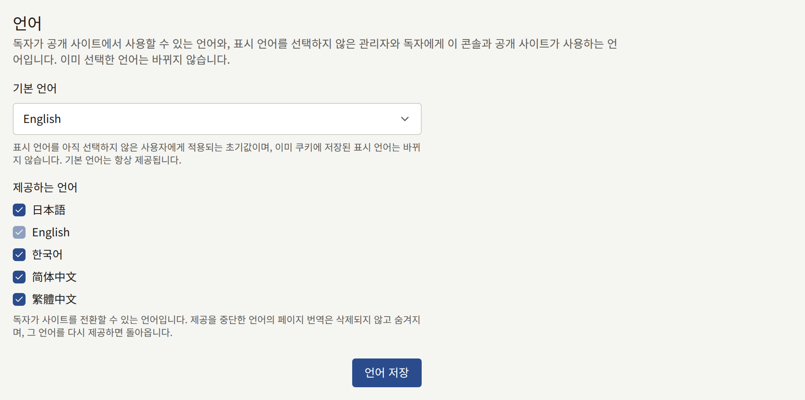

### 독자 댓글

**댓글 공개 방식**은 독자가 에피소드에 댓글을 달 수 있는지, 그리고 다른 사람이 댓글을 언제 볼 수 있는지를 정합니다.

| 선택지 | 동작 |
| --- | --- |
| **받지 않음** | 에피소드 페이지에 댓글 영역이 표시되지 않으며, 댓글을 게시할 수 없습니다. 새 테넌트는 이 설정으로 시작합니다 |
| **바로 공개** | 댓글은 게시된 순간부터 모든 사람이 읽을 수 있습니다 |
| **승인 후 공개** | [승인 대기열 처리하기](../2-readers/2-comments.md#승인-대기열-처리하기)에서 설명하듯이 모더레이터가 **댓글**에서 승인할 때까지 댓글은 작성자에게만 보입니다 |

**댓글을 숨기는 신고 건수**는 스태프를 기다리지 않고 댓글이 숨겨지려면 서로 다른 독자 몇 명이 그 댓글을 신고해야 하는지입니다. 숨겨진 댓글은 **댓글**의 [신고 대기열](../2-readers/2-comments.md#신고된-댓글)에서 처리를 기다리며, 작성자에게는 계속 보이고, 스태프가 되돌릴 수 있습니다. 처음 값은 `3`이며, `0`으로 하면 모든 삭제를 모더레이터에게 맡깁니다.

시리즈는 양식에서 자체 **댓글** 선택지를 설정할 수 있으며, 그러면 그 시리즈에는 이 설정 대신 그 선택지가 적용됩니다. **테넌트 설정을 따름**으로 둔 시리즈는 이후 여기에서 바뀌는 내용도 따릅니다. 저장하려면 **댓글 설정 저장**을 선택하세요.

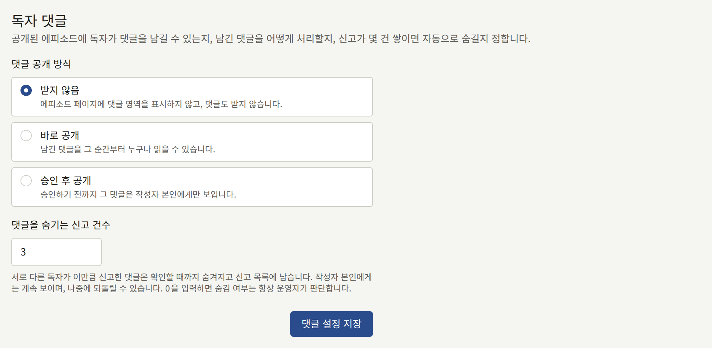

### 공개 전 검토

**공개 전 검토 필수**는 새 테넌트에서 꺼져 있으며, 켜면 모든 에피소드가 공개되기 전에 테넌트 관리자의 승인을 기다리게 됩니다. 켜져 있으면 에피소드의 공개 시각을 저장할 때 에피소드가 검토에 제출되고, 테넌트 관리자가 승인해야만 그 시각에 공개됩니다. 테넌트 관리자는 고칠 점을 적은 코멘트와 함께 에피소드를 반려할 수도 있습니다. 에피소드 편집 화면에서 이루어지는 이 과정은 [공개 전 검토](../1-catalog/2-episodes.md#공개-전-검토)에서 설명합니다.

켜면 예약된 모든 에피소드가 검토에 제출되므로, 승인될 때까지 어느 에피소드도 공개되지 않습니다. 끄면 예약된 모든 에피소드가 검토 중이든, 반려되었든, 승인되었든 예정된 시각에 공개됩니다. 저장하려면 **검토 설정 저장**을 선택하세요.

### 작가 페이지

체크박스가 두 개 있으며, 새 테넌트에서는 둘 다 꺼져 있습니다. **작가에게 자신의 페이지 표시**를 켜면, [작가를 독자 계정에 연결하기](../1-catalog/4-authors.md#작가를-독자-계정에-연결하기)에서 설명하듯이 작가와 연결된 독자가 그 작가의 페이지를 열 수 있습니다. 이 설정이 꺼져 있는 동안에는 두 번째 체크박스가 켜져 있어도 그 페이지는 숨겨진 채로 남습니다.

**명세서와 매출 표시**는 각 에피소드의 매출과, 마감된 모든 인세 명세서 중 작가의 몫을 그 페이지에 추가합니다. 페이지가 꺼져 있는 동안에도 저장할 수 있으며, 페이지를 켜면 적용됩니다. 페이지가 켜져 있고 이 체크박스가 꺼져 있으면, 독자는 팔로워 수와 각 에피소드의 조회 수 및 완독 수는 볼 수 있지만 매출과 명세서는 볼 수 없습니다.

저장하려면 **작가 페이지 설정 저장**을 선택하세요.

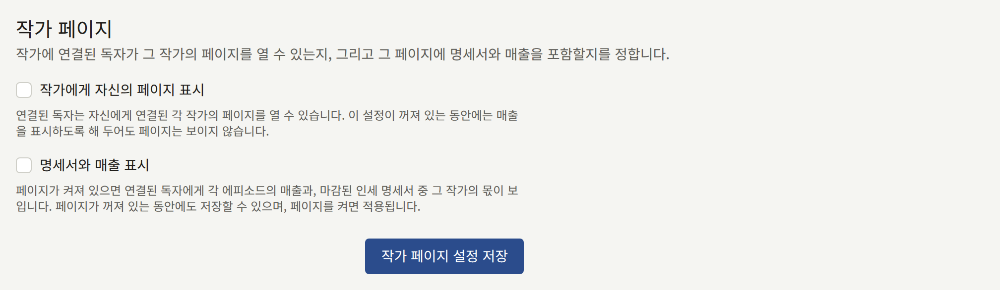

### 연령 확인

모든 시리즈에는 **연령 등급**이 있습니다. **전체 이용가**, **R15**, **R18** 중 하나입니다. **나이 증명이 필요한 연령 등급**은 사이트가 독자에게 이 등급을 얼마나 엄격하게 적용할지 정합니다.

| 선택지 | R15 시리즈 | R18 시리즈 |
| --- | --- | --- |
| **나이를 확인하지 않음** | 독자가 15세 이상임을 확인합니다 | 독자가 18세 이상임을 확인합니다 |
| **R18만 확인** | 독자가 15세 이상임을 확인합니다 | 생년월일로 18세 이상임이 확인되는 독자에게만 공개됩니다 |
| **R15와 R18 확인** | 생년월일로 15세 이상임이 확인되는 독자에게만 공개됩니다 | 생년월일로 18세 이상임이 확인되는 독자에게만 공개됩니다 |

새 테넌트는 **나이를 확인하지 않음**으로 시작합니다. **전체 이용가** 시리즈에는 제한이 걸리지 않습니다.

"확인"은 독자가 **15세 이상입니다** 또는 **18세 이상입니다**를 누르는 것이며, 브라우저가 그 사이트에 대해 이를 기억합니다. 나이를 "증명"하려면 독자가 로그인하고 계정에 생년월일이 저장되어 있어야 합니다. 독자는 회원가입할 때나 나중에 설정에서 생년월일을 입력할 수 있으며, 한 번 저장하면 바꿀 수 없습니다. 생년월일이 없는 독자에게는 **생년월일 등록하기**가 표시되고, 나이가 부족한 독자에게는 그 작품을 해당 연령에서 이용할 수 없다고 안내됩니다. 생년월일을 잘못 입력한 독자는 사이트에 문의하고, 테넌트 관리자가 **독자** 아래의 해당 독자 페이지에서 바로잡습니다.

저장하려면 **연령 확인 저장**을 선택하세요.

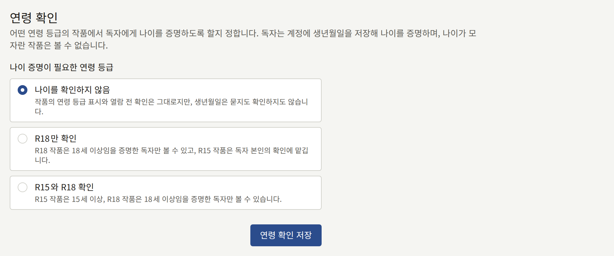

### 이용약관 및 개인정보 처리방침

**이용약관**과 **개인정보 처리방침**은 각각 테넌트의 공개된 페이지 하나를 지정합니다. 사이트와 앱은 이 페이지로 링크하며, 독자는 계정을 만들 때 이에 동의하고, [새 버전 공개하기](./3-pages.md#새-버전-공개하기)에서 설명하듯이 어느 한쪽의 새 버전이 독자에게 동의를 요청할 때 다시 동의합니다. [페이지](./3-pages.md#이용약관과-개인정보-처리방침)에서 설명하는 대로 먼저 페이지를 작성해 공개한 다음, 여기에서 선택하고 **이용약관 및 개인정보 처리방침 저장**을 선택하세요. **없음**을 선택하면 해당 항목은 지정되지 않습니다.

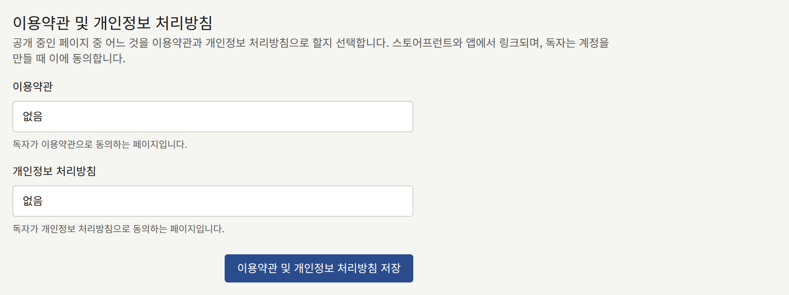

여기에서 선택한 페이지가 나중에 사이트에서 내려가면, 카드에 그 페이지로 연결되는 링크가 더 이상 없다고 표시되고, 회원가입 시 독자에게 그 페이지에 대한 동의를 더 이상 요청하지 않습니다. 페이지를 다시 공개하거나 다른 페이지를 선택하세요.

### 독자 회원 가입

방문자가 사이트에서 독자 계정을 만들 수 있는지를 정합니다. 회원가입을 닫으면 새 독자를 받지 않으면서 기존 독자에게는 사이트를 계속 제공할 수 있습니다. 출시 전에 초대한 사람들에게만 사이트를 열 때나, 원치 않는 가입이 몰려 이를 처리하는 동안에 사용합니다. 이미 계정이 있는 독자는 계속 로그인하고, 구매하고, 읽을 수 있습니다.

- **새 독자 받기**는 끄기 전까지 켜져 있습니다. 꺼져 있는 동안에는 이메일 주소로든, Apple이나 Google로 처음 로그인하는 방식으로든 누구도 사이트에서 계정을 만들 수 없습니다. 사이트의 회원가입 페이지에는 양식 대신 **회원 가입을 받지 않습니다**와 여러분의 메시지가 표시되고, **로그인** 화면에도 **회원가입**을 안내하던 자리에 같은 안내가 표시됩니다.
- **회원 가입 중지 중에 표시할 메시지**는 방문자에게 보이는 문구로, 최대 1000자이며 줄바꿈을 포함해 입력한 그대로 표시됩니다. 비워 두면 사이트에 "이 사이트는 현재 새 계정 가입을 받지 않습니다."가 표시됩니다. 메시지는 회원가입이 열려 있는 동안에도 보관되므로, 다시 닫으면 같은 문구가 표시됩니다.

저장하려면 **회원 가입 설정 저장**을 선택하세요. 회원가입이 닫혀 있는 동안에는 카드의 스위치 위에 "회원 가입을 중지했습니다. 다시 열 때까지 이메일 주소로도 Apple이나 Google로도 사이트에서 새 독자 계정을 만들 수 없습니다."라고 표시됩니다. 스위치를 다시 켜고 저장하면 즉시 회원가입이 열립니다.

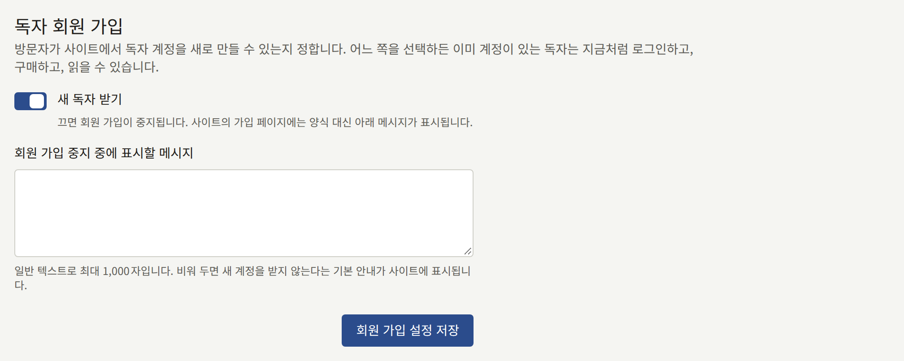

저장한 내용은 [감사 로그](./8-audit-log.md)에 **독자 회원가입 설정 변경**으로 기록됩니다.

### 받지 않는 이메일 주소

독자가 회원가입에 사용하거나 이메일 주소를 변경할 때 사용할 수 없는 주소입니다. 이런 주소를 사용하려는 독자에게는 "이 사이트에서는 이 이메일 주소를 사용할 수 없습니다. 다른 이메일 주소를 입력해 주세요."가 표시됩니다.

- **일회용 이메일 도메인 받지 않기**는 플랫폼이 관리하는 목록을 바탕으로 일회용 메일 서비스의 도메인을 받지 않습니다. 운영자가 목록을 설정하지 않았다면, 스위치에 효과가 없다는 안내가 표시됩니다.
- **받지 않을 주소와 도메인**은 한 필드에 하나씩, 최대 1000개까지 입력합니다. `@`가 들어간 항목은 하나의 주소이며, 그 주소에 `+tag`를 붙인 주소도 받지 않습니다. 그 밖의 항목은 `example.net` 같은 도메인이며, 그 하위 도메인도 받지 않습니다. 여러 줄을 한 필드에 붙여 넣으면 줄마다 필드가 추가됩니다. 와일드카드는 없습니다.

저장하려면 **받지 않는 이메일 주소 저장**을 선택하세요. 목록은 다음 회원가입이나 주소 변경부터 적용됩니다. 이미 받지 않는 주소로 가입한 독자는 계정을 유지합니다.

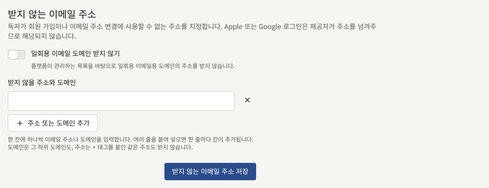

Apple 또는 Google 로그인은 제공자가 주소를 넘겨주므로 여기에서 거부되지 않습니다. 이 카드의 내용은 테넌트 관리자만 볼 수 있습니다.

### 크롤러 제외

사이트의 `robots.txt`가 크롤러에게 접근하지 말도록 요청하는 대상입니다. `robots.txt`를 따르는 크롤러는 여기에서 제외한 대상을 가져가지 않습니다. 독자에게서 숨겨지는 것은 없으며, 이 파일을 무시하는 크롤러는 여전히 모든 페이지를 가져갈 수 있으므로, 페이지를 비공개로 유지하는 방법이 아닙니다.

- **사이트 전체에서 제외할 크롤러**에는 Publira가 알고 있는 크롤러가 페이지를 가져가는 목적별로 묶여 있습니다. **AI 학습**, **AI 어시스턴트**, **이미지 검색**입니다. 각 크롤러는 그 운영사가 `robots.txt`용으로 공개한 토큰으로 표시되며, 그 아래에 운영사가 표시됩니다. 체크한 크롤러에게는 사이트의 어떤 페이지도 가져가지 않도록 요청합니다. 목록은 Publira가 정하며, 목록에 없는 크롤러는 추가할 수 없습니다.
- **모든 크롤러에서 제외할 경로**는 `/drafts`처럼 한 필드에 경로를 하나씩, 최대 100개까지 입력합니다. 경로는 `/`로 시작하며, 그 아래의 모든 것도 포함합니다. 여러 줄을 한 필드에 붙여 넣으면 줄마다 필드가 추가됩니다. 와일드카드는 없으며, 경로에는 공백, `*`, `$`, `?`, `#`을 넣을 수 없습니다. `/robots.txt`, `/sitemap.xml`, `/sitemap`은 크롤러가 사이트를 읽는 데 필요하므로 제외할 수 없습니다.

저장하려면 **크롤러 제외 저장**을 선택하세요. 각 경로는 끝의 `/` 없이 저장되며, 목록은 알파벳순으로 표시됩니다.

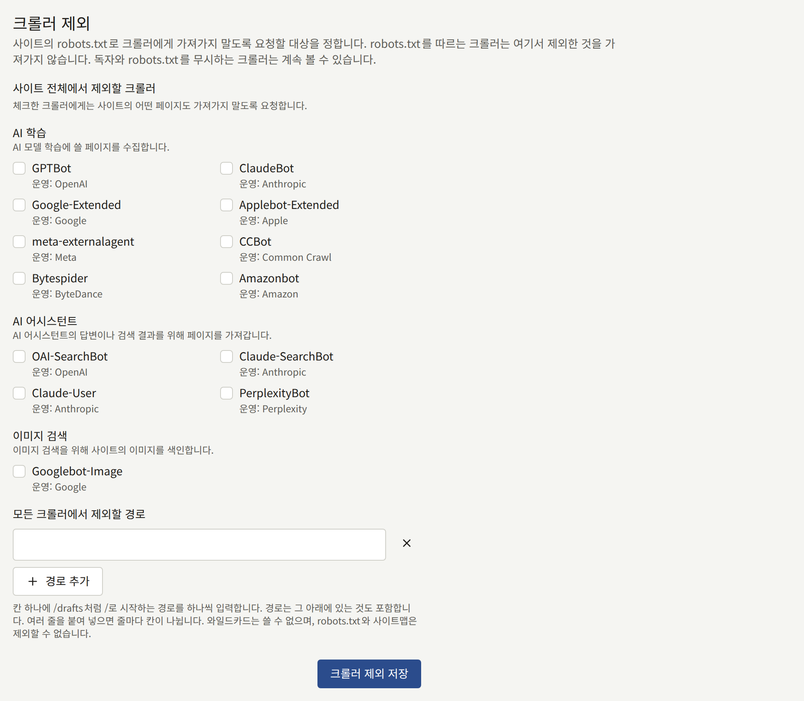

저장한 내용은 [감사 로그](./8-audit-log.md)에 **크롤러 제외 변경**으로 기록됩니다.

### 검색 엔진 소유권 확인

Google Search Console과 Bing Webmaster Tools가 사이트의 소유자임을 증명하도록 발급하는 코드입니다. 설정된 각 코드는 `<meta>` 태그로 사이트의 모든 페이지에 추가됩니다. 두 서비스에서 **HTML tag** 또는 **HTML Meta Tag**라고 부르는 방법입니다.

- **Google Search Console**에는 사이트를 URL 접두어 속성으로 추가할 때 Search Console이 보여 주는 태그를 입력합니다. 예를 들면 `<meta name="google-site-verification" content="…" />`입니다.
- **Bing Webmaster Tools**에는 Bing Webmaster Tools가 보여 주는 태그를 입력합니다. 예를 들면 `<meta name="msvalidate.01" content="…" />`입니다.

태그 전체를 붙여 넣거나 `content` 값만 붙여 넣으세요. 저장되는 것은 값뿐이며, 필드에서 벗어나면 필드에 그 값이 표시됩니다. 다른 서비스에서 복사한 태그는 거부됩니다. 필드를 비워 두면 사이트에서 그 태그가 삭제됩니다.

저장하려면 **소유권 확인 코드 저장**을 선택한 다음, 해당 서비스에 사이트 확인을 요청하세요.

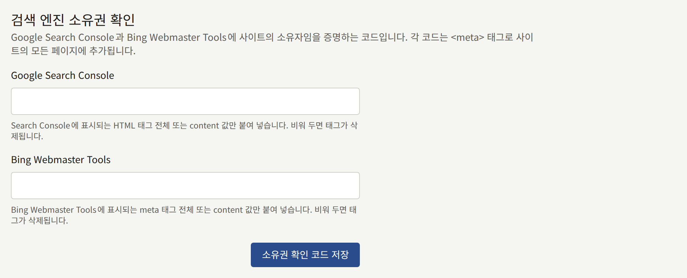

이 카드의 내용은 테넌트 관리자만 볼 수 있습니다. 저장한 내용은 [감사 로그](./8-audit-log.md)에 **검색 엔진 소유권 확인 변경**으로 기록됩니다.

## 제한 및 보존

**제한 및 보존**에는 양식이 두 개 있습니다.

- **커뮤니티 제한**: 독자 한 명이 댓글을 게시하거나 신고하고, 에피소드를 평가하고, 문의 양식으로 연락하고, 뷰어 레이아웃을 저장하고, 알림 설정을 저장할 수 있는 빈도와, 같은 댓글을 다시 게시하는 독자를 얼마 동안 거부할지입니다.
- **보존 기간**: 철회된 댓글, 콘텐츠 이벤트, 일간 및 주간 랭킹 스냅샷을 삭제하기 전까지 보관하는 기간입니다.

이 양식들의 각 그룹은 **플랫폼 기본값 사용**에 체크된 상태로 시작하며, 옆에 운영자가 설정한 값이 표시됩니다. 기본값을 사용하는 테넌트는 운영자가 나중에 바꾸는 값도 따릅니다. 테넌트 자체 값을 설정하려면 체크를 해제하고 값을 입력한 다음, **커뮤니티 제한 저장** 또는 **보존 기간 저장**으로 양식을 저장하세요. 플랫폼의 값으로 되돌리려면 다시 체크하고 저장하세요.

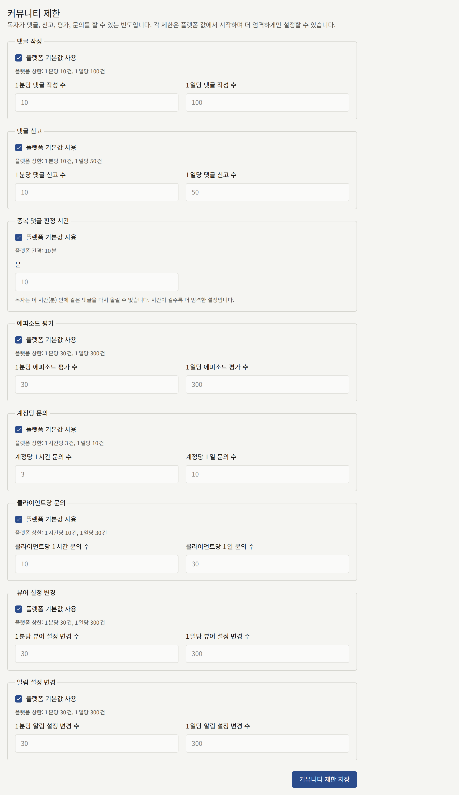

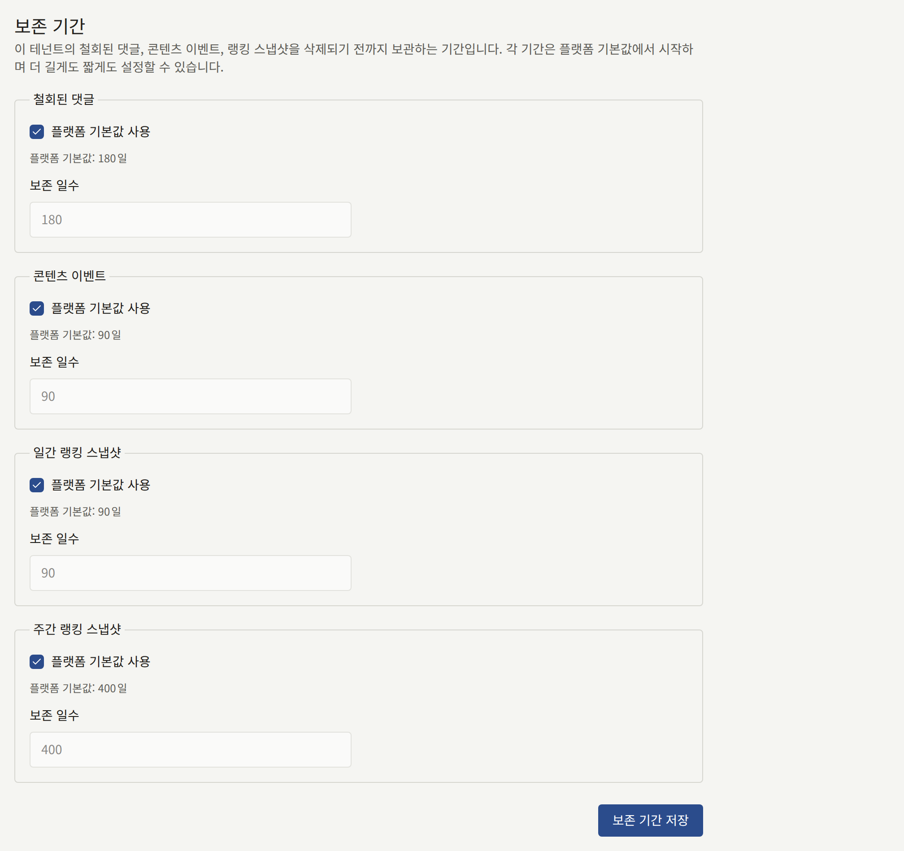

- 커뮤니티 제한은 플랫폼의 제한보다 엄격하게만 할 수 있습니다. 더 낮은 횟수나 더 긴 중복 댓글 기간입니다. 더 느슨한 값은 해당 설정을 명시한 메시지와 함께 거부됩니다. 운영자가 나중에 플랫폼의 제한을 테넌트의 값보다 엄격하게 바꾸면 플랫폼의 제한이 적용됩니다.
- 보존 기간은 플랫폼 기본값보다 길게도 짧게도 할 수 있으며, 1일부터 36500일까지입니다. 단, **콘텐츠 이벤트**는 30일부터 시작하며 이보다 짧은 기간은 거부됩니다. 사이트의 추천이 최근 28일 전체의 콘텐츠 이벤트로 만들어지기 때문입니다.

이 페이지를 연 뒤에 다른 사람이 같은 양식을 저장했다면, 저장이 "이 페이지를 열어 둔 사이에 다른 곳에서 이 설정이 변경되었습니다. 페이지를 새로 고친 뒤 다시 입력해 주세요."와 함께 거부됩니다.

각 제한과 기록이 무엇인지, 각 삭제 작업 후에 무엇이 남는지는 운영자 관점에서 [플랫폼 기본값과 정책](../../3-operations/9-platform-policies.md#커뮤니티)에 설명되어 있습니다. 이 탭에서 저장한 내용은 [감사 로그](./8-audit-log.md)에 **커뮤니티 제한 변경**과 **보존 기간 변경**으로 기록됩니다.

## 독자 아이콘

### 독자 아이콘 설정

**독자가 표시할 수 있는 것**은 독자가 댓글과 계정에서 이름 옆에 아이콘으로 표시할 수 있는 것을 정합니다.

| 선택지 | 동작 |
| --- | --- |
| **직접 이미지 업로드** | 독자가 원하는 이미지를 업로드합니다. 새 테넌트는 이 설정으로 시작합니다 |
| **프리셋에서 선택** | 독자는 [프리셋 아이콘](#프리셋-아이콘)에 있는 아이콘 중 하나를 고르며, 이미지를 업로드할 수 없습니다 |
| **아이콘 없음** | 어떤 독자도 아이콘을 표시하지 않으며, 사이트에는 모두에게 기본 이미지가 표시됩니다 |

저장하려면 **독자 아이콘 설정 저장**을 선택하세요. **프리셋에서 선택**이나 **아이콘 없음**을 저장하면 그 선택이 허용하지 않는 아이콘이 내려가므로, 콘솔이 먼저 "독자의 아이콘을 삭제할까요?"라고 묻습니다.

- **프리셋에서 선택**은 독자가 업로드한 이미지를 모두 삭제합니다. 프리셋을 고른 독자는 그 아이콘을 유지합니다.
- **아이콘 없음**은 독자가 표시하는 아이콘을 모두 삭제합니다.

계속하려면 **저장하고 삭제**를 선택하세요. 페이지를 연 뒤에 다른 테넌트 관리자가 설정을 바꿨을 수 있으므로, 콘솔은 카드에 저장된 것으로 표시된 설정이 무엇이든 확인을 요청합니다. 삭제된 아이콘은 복원할 수 없으므로, 설정이 다시 아이콘을 허용하게 되면 각 독자가 아이콘을 다시 골라야 합니다. **직접 이미지 업로드**는 아무것도 삭제하지 않으며, 확인 없이 저장됩니다.

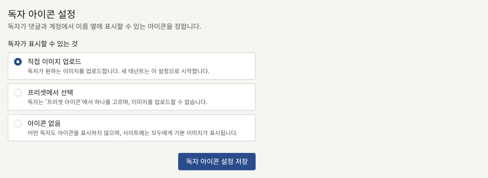

### 프리셋 아이콘

**프리셋에서 선택**에서 독자가 고르는 아이콘으로, 최대 50개입니다. 프리셋은 어떤 설정에서든 추가할 수 있으므로, 그 설정으로 바꾸기 전에 아이콘을 채워 두세요. 비어 있는 동안에는 독자가 고를 것이 없습니다.

추가하려면 **아이콘 이미지**에서 10MB 이하의 JPEG, PNG, WebP 이미지를 선택하고 **아이콘 추가**를 선택하세요. 이미지의 중앙에서 정사각형이 잘려 나가며, 그 크기는 최소 128 × 128px이어야 합니다. 각 프리셋은 사이트가 아이콘을 그리는 모양으로, 저장된 크기와 함께 표시됩니다.

삭제하려면 해당 아이콘 아래의 **삭제**를 선택하고 **삭제**로 확인하세요. 그 아이콘을 고른 독자는 아이콘이 없어지며, 다른 아이콘을 고를 때까지 기본 이미지가 표시됩니다.

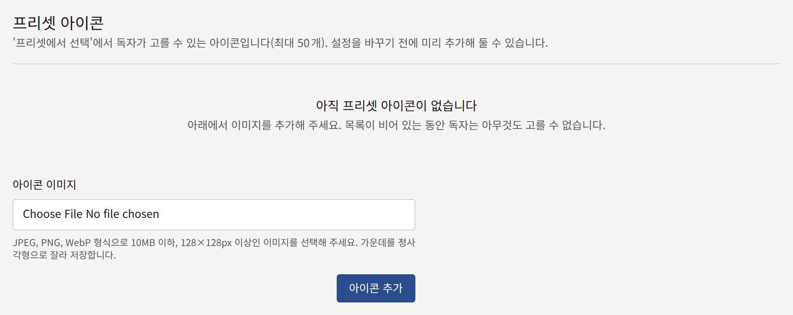

이 탭에서 저장한 내용은 [감사 로그](./8-audit-log.md)에 **독자 아이콘 설정 변경**, **독자 아이콘 프리셋 추가**, **독자 아이콘 프리셋 삭제**로 기록됩니다.
