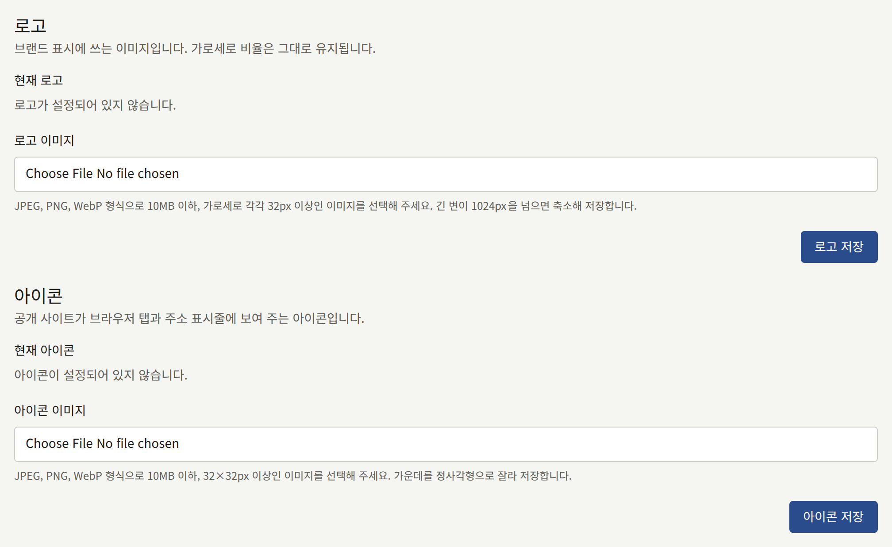
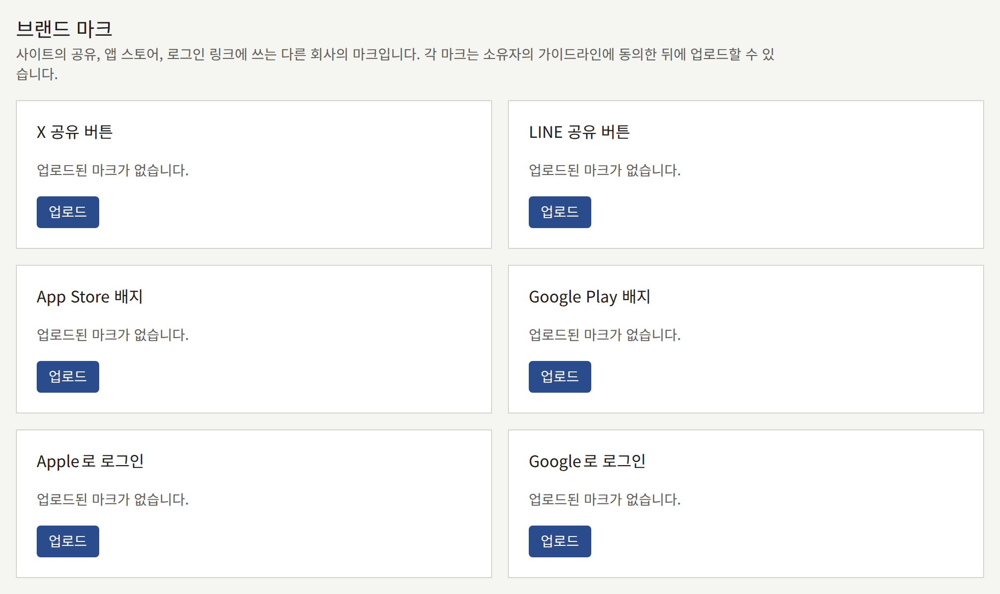
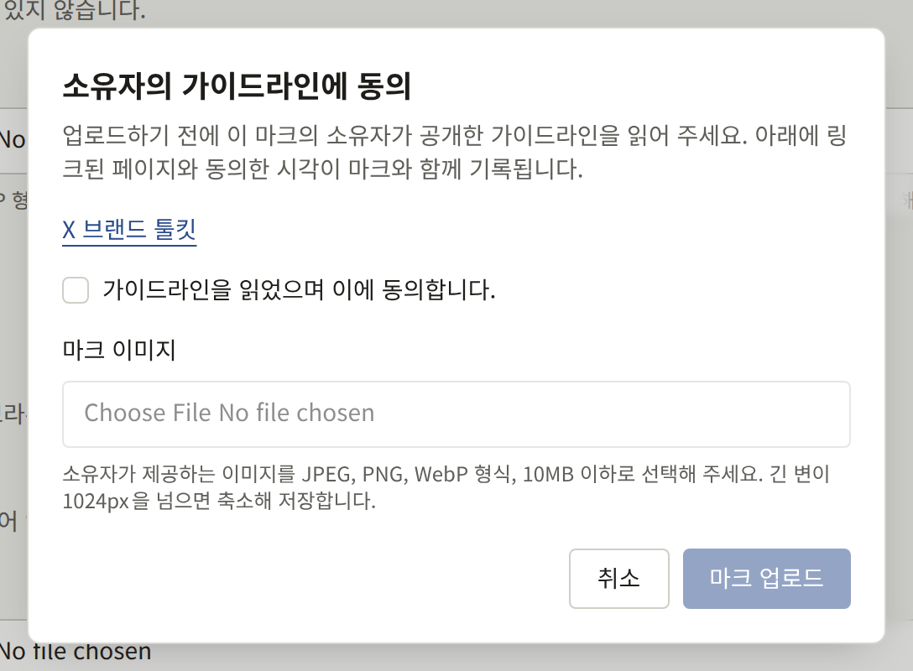
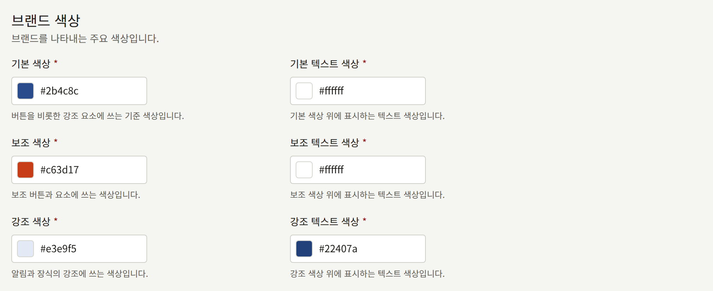
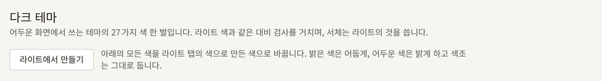
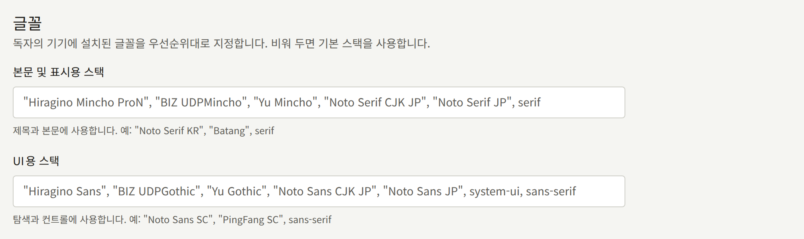
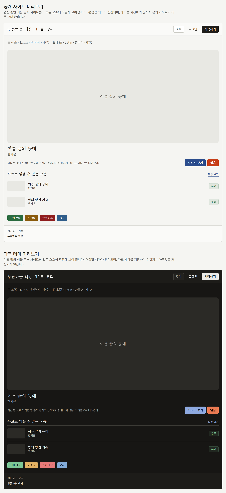

**관리** 아래의 **브랜딩**에서는 사이트의 모양을 정합니다. 헤더의 로고, 브라우저 탭의 아이콘, 로그인 양식 옆의 이미지, 다른 회사의 마크, 색상, 텍스트에 쓰는 글꼴입니다. 화면에는 **로고**, **아이콘**, **로그인 화면 이미지**, **브랜드 마크**, 그리고 테마의 색상과 글꼴이 있고, 그 옆에 다크 테마가 있습니다. 각각 따로 저장되며, 하나를 저장해도 나머지는 그대로입니다.

브랜딩을 변경할 수 있는 사람은 테넌트 관리자뿐입니다. 편집 담당과 감사 담당에게는 같은 화면이 컨트롤이 비활성화된 채로 보입니다.

## 로고, 아이콘, 로그인 화면 이미지

세 가지 모두 10MB 이하의 JPEG, PNG, WebP 이미지를 받습니다. 로고와 아이콘은 PNG로 저장되므로 투명한 배경은 투명한 채로 유지됩니다. 로그인 화면 이미지는 JPEG는 JPEG로 유지하고, 그 밖의 형식은 PNG로 저장합니다.

|  | **로고** | **아이콘** | **로그인 화면 이미지** |
| --- | --- | --- | --- |
| 표시되는 곳 | 사이트와 이 콘솔의 모든 페이지 상단에서 사이트 이름 대신 표시됩니다. 테넌트의 앱은 카탈로그 화면에서 이름 대신 이 로고를 표시합니다 | 브라우저의 탭과 주소 표시줄, 그리고 독자가 사이트를 홈 화면에 추가할 때 휴대폰이 사용하는 아이콘으로 표시됩니다 | 너비가 1024px 이상인 화면에서 사이트의 로그인 화면과 회원가입 화면의 양식 옆에 표시됩니다. 더 좁은 화면에서는 양식만 표시됩니다. 테넌트의 앱은 로그인 화면에 이 이미지를 표시합니다. 너비가 840px 이상인 화면에서는 양식 옆에, 더 좁은 화면에서는 양식 위에 표시됩니다 |
| 모양 | 그대로 유지됩니다 | 중앙에서 정사각형으로 잘립니다 | 그대로 유지됩니다. 사이트와 앱은 양식 옆이나 위의 공간을 채우도록 이미지를 자르며, 이 공간의 모양은 창에 따라 달라집니다 |
| 크기 | 너비나 높이가 1024px을 넘는 이미지는 축소되며, 축소한 뒤에도 각 변이 32px 이상이어야 합니다 | 최소 32×32px입니다. 512×512px보다 큰 이미지는 축소됩니다 | 너비나 높이가 2560px을 넘는 이미지는 축소되며, 축소한 뒤에도 짧은 변이 512px 이상이어야 합니다 |
| 없을 때 | 사이트에 테넌트의 이름이 표시됩니다 | 브라우저의 기본 아이콘이 표시됩니다 | 사이트와 앱 모두에서 해당 공간이 테마 색으로 채워집니다 |

**로고 이미지**, **아이콘 이미지**, **로그인 화면 이미지 파일**에서 파일을 선택한 다음 **로고 저장**, **아이콘 저장**, **로그인 화면 이미지 저장**을 선택하세요. 다시 저장하면 이미지가 교체됩니다. **삭제**는 확인을 거친 뒤 이미지를 삭제합니다.

아이콘에는 마크가 가운데에 있는 정사각형 이미지를 사용하세요. 가운데 정사각형 밖은 잘려 나갑니다. 로고에는 마크 주위에 여백이 거의 없는 이미지를 사용하세요. 사이트의 헤더는 로고를 높이 32px, 최대 너비 144px로 표시하므로, 너비가 높이의 4.5배를 넘는 로고는 그보다 낮게 표시됩니다.

로그인 화면 이미지에는 가장자리가 잘려도 괜찮은 그림을 사용하세요. 중요한 부분은 가운데 가까이에 두고, 독자가 읽어야 하는 텍스트는 넣지 마세요. 로고나 시리즈의 이미지가 이 이미지를 대신하지는 않으므로, 두 곳에 같은 그림을 쓰려면 여기에도 같은 그림을 업로드하세요.

운영자가 설치 환경에 오브젝트 스토리지를 설정하지 않았다면, [오브젝트 스토리지](../../3-operations/5-object-storage.md)에서 설명하듯이 세 가지 중 어느 것을 업로드하든 "플랫폼에 아직 이미지 저장소가 설정되지 않아 이미지를 업로드할 수 없습니다. 플랫폼 운영자에게 설정을 요청해 주세요."와 함께 거부됩니다.

테넌트의 메일은 Publira 자체의 색으로 보내지므로, 세 가지 모두 메일에는 사용되지 않습니다. 로고는 [링크 미리보기](#링크-미리보기)에서 설명하듯이 사이트 링크를 공유할 때 표시되는 이미지에 사용되지만, 아이콘과 로그인 화면 이미지는 사용되지 않습니다.

## 링크 미리보기

사이트의 어떤 페이지든 그 링크를 채팅이나 게시물에서 공유하면 이미지와 함께 펼쳐집니다. **링크 미리보기 (1200:630)** 이미지가 있는 시리즈나 에피소드는 [시리즈](../1-catalog/1-series.md#커버-이미지)에서 설명하듯이 업로드한 그대로 그 이미지를 보여 줍니다. 그 밖의 모든 페이지와 이 이미지가 없는 시리즈나 에피소드는 사이트가 그려 주는 카드를 보여 줍니다.

- 페이지 자체의 이름이 크게 표시됩니다. 시리즈나 에피소드의 제목, 레이블, 장르, 태그, 작가의 이름, 또는 **페이지**에 있는 페이지의 제목입니다. 에피소드의 카드에는 그 위에 시리즈의 제목이, 레이블, 장르, 작가의 카드에는 그것이 속한 목록의 이름이 표시됩니다. 홈페이지와 랭킹처럼 자체 이름이 없는 모든 페이지에는 [설정](./1-settings.md)의 **사이트 태그라인**이 표시되고, 태그라인이 없으면 사이트 이름이 표시됩니다.
- 아래쪽에 로고가 표시되며, 로고를 업로드하지 않았다면 그 자리에 사이트 이름이 표시됩니다.
- 라이트 색의 배경색과 텍스트 색을 사용하며, 위쪽 가장자리를 따라 기본 색상의 띠가 그려집니다.

카드는 링크된 페이지의 언어로 표시됩니다. 이모지처럼 사이트가 그릴 수 없는 텍스트는 이미지에서 빠지지만, 함께 공유되는 제목에는 남아 있습니다. 새 로고, 색상 변경, 시리즈 이름 변경은 페이지에 반영되는 것과 같은 방식으로 카드에도 반영됩니다. 다만 이미 링크를 표시한 서비스는 각자 사본을 보관하므로, 한동안 이전 이미지를 계속 보여 줄 수 있습니다.

## 브랜드 마크

**브랜드 마크**에는 사이트의 공유, 앱 스토어, 로그인 링크에 쓰는 다른 회사의 마크가 있습니다. **X 공유 버튼**, **LINE 공유 버튼**, **App Store 배지**, **Google Play 배지**, **Apple로 로그인**, **Google로 로그인**입니다. Publira는 이 그림을 하나도 포함하지 않습니다. 각 마크는 그 소유자의 것이며, 소유자가 사용 조건을 공개하므로, 테넌트가 그 조건에 동의한 뒤 소유자가 제공하는 그림을 업로드합니다.

각 마크에는 카드가 따로 있습니다. 아무것도 업로드하지 않은 카드에는 "업로드된 마크가 없습니다."와 **업로드**가 표시됩니다. **업로드**를 누르면 **X 브랜드 툴킷**처럼 소유자의 가이드라인 페이지로 링크하는 대화 상자가 열립니다. "가이드라인을 읽었으며 이에 동의합니다."에 체크할 때까지 **마크 이미지** 필드와 **마크 업로드**는 비활성화되어 있습니다. 체크는 대화 상자가 열려 있는 동안에만 유지되므로, 교체를 포함해 업로드할 때마다 다시 체크해야 합니다.

이미지에는 최소 크기를 제외하고 로고와 같은 제한이 적용됩니다. 10MB 이하의 JPEG, PNG, WebP이며, PNG로 저장되고, 너비나 높이가 1024px을 넘으면 축소됩니다. 높이에 비해 너비가 훨씬 넓은 배지도 받습니다. 로고와 마찬가지로, 운영자가 오브젝트 스토리지를 설정하지 않은 동안에는 거부됩니다.

마크를 업로드하면 카드에 그 마크와, 누가 언제 가이드라인에 동의했는지, 그리고 그때 대화 상자에 표시된 페이지인 **동의한 가이드라인** 링크가 표시됩니다. Publira는 그 페이지를 마크와 함께 기록하므로, 이후 Publira 릴리스에서 대화 상자의 링크가 다른 페이지로 바뀌더라도 이미 업로드된 마크는 동의할 때의 페이지를 유지합니다. 동의한 계정이 그 뒤에 삭제되었다면, 카드에는 계정 이름 대신 삭제되었다는 사실이 표시됩니다. **교체**는 새로 동의를 받아 다른 이미지를 업로드하고, **삭제**는 확인을 거친 뒤 마크와 그 동의 기록을 삭제합니다.

사이트는 업로드된 X 또는 LINE 마크를 공유 메뉴에서 해당 서비스 행의 맨 앞, 그 행에 이미 있는 텍스트 옆에 그립니다. 업로드된 App Store 또는 Google Play 배지는 앱에서 판매하는 에피소드에서 그 스토어의 버튼 대신 이미지 자체의 비율로 표시됩니다. 업로드된 Apple로 로그인 또는 Google로 로그인 마크는 로그인 화면과 회원가입 화면에서 해당 제공자 버튼의 맨 앞, 버튼에 이미 있는 텍스트 옆에 이미지 자체의 비율로 표시됩니다. 마크를 업로드하지 않은 곳에서는, 아무것도 업로드하기 전과 마찬가지로 사이트에 텍스트만 표시됩니다.

Publira는 업로드한 이미지에 무엇이 담겨 있는지 확인하지 않습니다. 그것이 소유자의 최신 그림인지, 가이드라인이 허용하는 방식으로 사용되는지는 테넌트의 책임입니다.

## 테마 색상과 글꼴

테마에는 탭이 세 개 있습니다. 색상과 글꼴이 있는 **라이트**, 다크 테마가 있는 **다크**, 그리고 **미리보기**입니다.

### 색상

**라이트** 탭에는 테마의 색 27가지가 있으며, 각각 `#RRGGBB`로 입력하거나 옆의 색상 견본으로 선택합니다. 색은 네 그룹으로 나뉩니다.

- **브랜드 색상**: **기본 색상**, **보조 색상**, **강조 색상**이며, 각각 그 위에 그려지는 텍스트 색이 있습니다. 기본 색상은 버튼과 그 밖의 강조 요소에 쓰입니다.
- **배경과 텍스트 색상**: 페이지의 배경과 텍스트, 그리고 그 위에 그려지는 서피스, 카드, 팝오버, 흐린 영역이며, 각각 텍스트 색이 있습니다.
- **UI 요소 색상**: 테두리, 입력 필드, 그리고 키보드 포커스가 있는 컨트롤을 나타내는 링입니다.
- **상태 색상**: 성공, 경고, 오류, 정보 알림의 색이며, 각각 텍스트 색이 있습니다.

각 색과 그 위에 그려지는 텍스트 색은 일반 텍스트에 대한 WCAG AA 수준인 4.5:1 이상의 대비를 가져야 합니다. 이보다 낮은 조합은 "텍스트가 읽기 쉽도록 색 조합을 확인해 주세요." 아래에 도달한 대비 비율과 함께 표시되며 거부됩니다. 테두리, 입력 필드, 포커스 링의 색은 그 위에 텍스트가 그려지지 않으므로 검사하지 않습니다.

### 다크 테마

**다크** 탭에는 어두운 화면용으로, 같은 그룹으로 나뉜 같은 27가지 색이 한 벌 더 있습니다. 같은 4.5:1 대비 검사를 거치며, 자체 글꼴은 없고 **라이트** 탭의 글꼴을 사용합니다. **다크 테마 저장**은 라이트 색과 따로 저장하며, 어느 한쪽을 저장해도 다른 쪽은 그대로입니다.

테넌트는 다크 테마 없이 시작합니다. 다크 테마를 저장하기 전까지 탭에는 "저장된 다크 테마가 없습니다."가 표시되고, 필드는 저장된 라이트 색에서 만든 색으로 채워져 있어 바로 조정하고 저장할 수 있습니다.

**라이트에서 만들기**는 탭의 모든 색을, 아직 저장하지 않은 색을 포함한 **라이트** 탭의 색으로 만든 색으로 바꿉니다. 각 색은 색조를 유지하고 밝기를 반대로 바꾸므로, 배경은 어두워지고, 텍스트는 밝아지며, 브랜드 색의 옅은 색조는 짙은 색조가 됩니다. 그 결과 대비가 4.5:1 미만이 되는 조합은 텍스트가 흰색이나 검은색으로 바뀌므로, 결과를 그대로 저장할 수 있습니다. 라이트 색에서 다시 시작하려면 다시 선택하세요.

다크 테마를 저장하면 **다크 테마 저장** 옆의 **삭제**로 확인을 거친 뒤 다크 테마를 삭제할 수 있으며, 그러면 탭에 다시 만들어진 색이 표시됩니다.

테넌트에 다크 테마가 생기기 전까지 사이트의 색은 한 벌뿐입니다. 다크 테마가 생기면 독자의 기기가 다크 모드일 때 사이트가 다크 테마로 그려지고, 헤더에 **테마**가 추가되어 독자가 **라이트**, **다크**, **시스템 설정에 맞춤** 중에서 고를 수 있습니다. 이 선택은 [사이트가 독자의 브라우저에 저장하는 것](./3-pages.md#사이트가-독자의-브라우저에-저장하는-것)에 나열된 대로 독자의 브라우저에 보관되며, 모든 페이지가 그 선택대로 열립니다.

테넌트의 앱은 독자의 기기가 다크로 설정되어 있는 동안 다크 테마로 표시됩니다. 다크 테마가 없으면, 다크 테마를 저장하기 전과 마찬가지로 앱의 다크 모드는 **기본 색상**에서 색을 만듭니다.

### 글꼴

**글꼴**에는 필드가 두 개 있습니다.

- **본문 및 표시용 스택**: 제목과 본문에 쓰는 글꼴입니다.
- **UI용 스택**: 탐색과 컨트롤에 쓰는 글꼴입니다.

각각 `"Noto Serif KR", "Batang", serif`처럼 CSS와 같은 방식으로 쓴, 쉼표로 구분한 글꼴 패밀리 이름 목록입니다. 독자의 기기는 목록에서 설치되어 있는 첫 번째 글꼴을 사용합니다. 글꼴을 내려받지 않으므로 독자의 기기에 있는 글꼴을 지정하고, 목록 끝에 `serif` 또는 `sans-serif`를 두세요. 필드를 비워 두면 플레이스홀더로 표시되는 Publira의 기본 목록이 사용되며, 이 목록은 일본어 글꼴을 우선합니다. 다른 문자를 쓰는 독자를 위한 사이트라면 그 문자용 글꼴을 먼저 지정해야 합니다.

테넌트의 앱은 테마의 색상은 사용하지만 글꼴은 사용하지 않습니다.

### 미리보기와 저장

**라이트** 탭을 편집하는 동안에는 콘솔 자체에 새 색이 적용되므로, 저장하기 전에 색을 확인할 수 있습니다. 콘솔은 밝은 색으로 그려지므로 다크 테마는 미리보기에서만 표시됩니다. **미리보기** 탭은 사이트를 이루는 요소에 라이트 색을 적용해 보여 줍니다. 헤더, 추천 시리즈, 에피소드 목록, 배지, 푸터이며, 두 스택 모두로 일본어, 라틴 문자, 한국어, 중국어 텍스트가 한 줄씩 표시됩니다. 그 아래의 **다크 테마 미리보기**는 **다크** 탭의 색을 같은 요소에 적용해 보여 줍니다. 미리보기에는 로고, 아이콘, 로그인 화면 이미지가 표시되지 않습니다.

**테마 저장**을 선택할 때까지 사이트에는 아무것도 반영되지 않습니다. 저장하면 독자의 브라우저와 사이트의 캐시가 새 테마를 가져가면서, 약 1분 30초 안에 독자에게 새 테마가 보입니다.

콘솔에는 테마를 Publira의 기본값으로 되돌리는 버튼이 없습니다. 각 색의 기본값은 새 테넌트에서 필드에 표시되는 값이므로, 바꾸기 전에 기록해 두세요.
