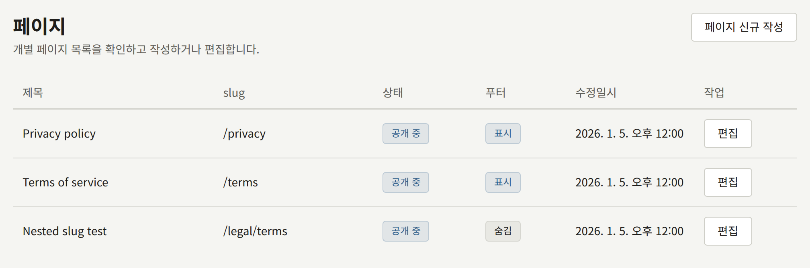
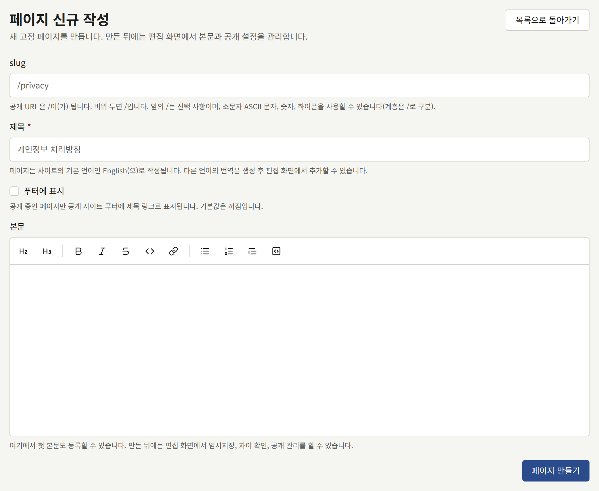
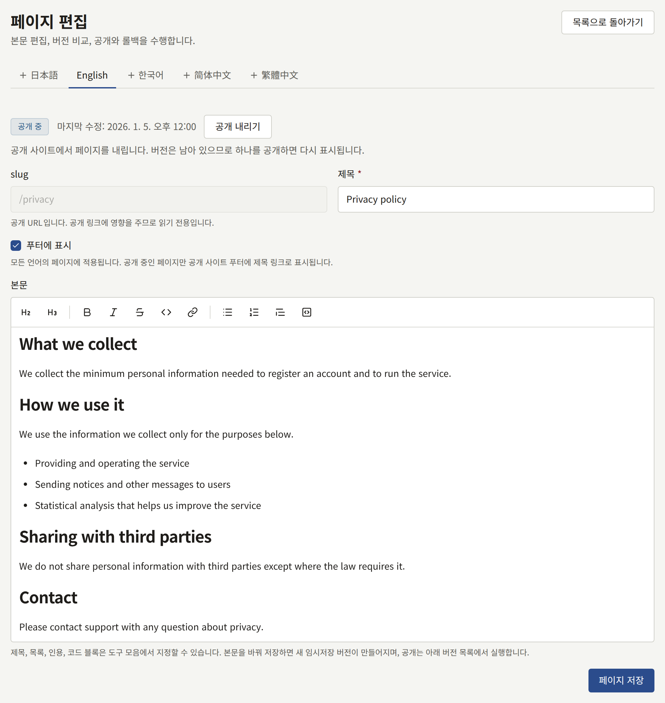
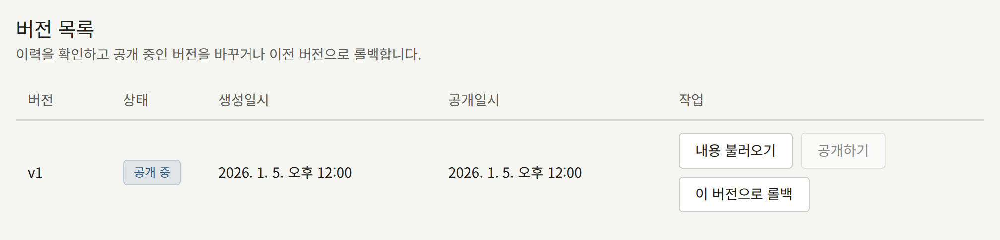

**사이트** 아래의 **페이지**에는 출판사가 사이트를 위해 작성하는 페이지가 있습니다. 이용약관, 개인정보 처리방침, 출판사 소개 페이지, 투고 안내, 그 밖에 시리즈가 아닌 모든 것입니다. 페이지는 리치 텍스트 편집기로 작성하며, 버전으로 관리되고, 사이트의 각 언어로 번역할 수 있습니다.

테넌트 관리자와 편집 담당은 페이지를 만들고, 편집하고, 공개하고, 번역할 수 있습니다. 감사 담당은 아무것도 변경하지 않고 페이지를 열어 볼 수 있습니다.

## 페이지 만들기

**페이지 신규 작성**을 선택하고 다음을 입력하세요.

- **slug**: 사이트에서 페이지의 주소입니다. `privacy`는 페이지를 `https://comics.example.com/privacy`에서, `legal/terms`는 `https://comics.example.com/legal/terms`에서 제공합니다. 소문자, 숫자, 하이픈을 사용하고, 중첩된 경로는 부분 사이를 `/`로 구분합니다. 페이지로 연결되는 링크가 깨지므로, 페이지를 만든 뒤에는 slug를 바꿀 수 없습니다. 로그인 페이지나 계정 페이지처럼 사이트가 직접 사용하는 경로는 거부됩니다.
- **제목**: 페이지 상단과, 페이지가 링크되는 모든 곳에 표시됩니다. 페이지는 사이트의 기본 언어로 만들어집니다.
- **푸터에 표시**: 페이지가 공개되면, 사이트의 모든 페이지 푸터에 이 페이지를 제목으로 나열합니다. 나중에 편집 화면에서 바꿀 수 있습니다.
- **본문**: 페이지 본문의 첫 버전으로, [작성과 공개](#작성과-공개)에서 설명하는 편집기로 작성합니다. 비워 두고 다음 화면에서 작성해도 됩니다.

**페이지 만들기**를 선택하면 페이지가 임시저장 상태로 만들어지고 편집 화면이 열립니다. 버전을 공개할 때까지 사이트에는 아무것도 나타나지 않습니다.

페이지는 삭제할 수 없습니다. 더 이상 읽히지 않아야 하는 페이지는 아래에서 설명하듯이 공개를 내립니다.

## 작성과 공개

편집 화면에는 작성하는 대로 서식이 적용된 모습을 보여 주는 편집기에 페이지 본문이 있습니다. 위쪽의 도구 모음은 선택한 텍스트나 커서가 있는 문단에 서식을 적용합니다. **제목**, **소제목**, **굵게**, **기울임꼴**, **취소선**, **코드**, **링크**, **글머리 기호 목록**, **번호 매기기 목록**, **인용**, **코드 블록**입니다. **링크**는 주소를 묻고, 아무것도 선택하지 않았다면 주소 자체를 링크로 넣습니다. 편집기에 입력한 Markdown은 입력하는 즉시 서식이 적용되므로, 줄 앞의 `## `은 제목이 되고 `- `은 글머리 기호 목록이 됩니다.

본문은 Markdown으로 저장됩니다. 편집기가 생기기 전에 Markdown으로 작성한 본문은 표, 작업 목록, 이미지를 포함한 채 편집기에서 열리며, 편집해도 그대로 유지됩니다. 각주와 HTML은 편집하면 유지되지 않고 일반 텍스트로 저장됩니다.

**페이지 저장**은 바뀐 제목과 **푸터에 표시**를 즉시 저장합니다. 바뀐 본문은 독자에게 보이지 않는 새 **임시저장** 버전으로 저장됩니다. 저장으로 공개되는 일은 없습니다.

**푸터에 표시**는 번역 하나가 아니라 페이지에 속하므로, 어느 언어의 탭에서 바꾸든 모든 언어에 적용됩니다. 페이지가 공개되어 있는 동안, 저장하고 잠시 뒤에 푸터에 반영됩니다.

**버전 목록**에는 `v1`, `v2`처럼 번호가 매겨진 페이지의 모든 버전이 상태와 함께 나열됩니다. 상태는 독자에게 보이는 버전인 **공개 중**, **이전 공개**, **임시저장** 중 하나입니다. 각 버전에서 다음을 할 수 있습니다.

- **공개하기**는 이전에 공개된 버전 대신 그 버전을 독자에게 보이는 버전으로 만듭니다.
- **내용 불러오기**는 그 버전의 본문을 편집기에 다시 넣어, 거기서부터 이어서 작성할 수 있게 합니다.
- **이 버전으로 롤백**은 그 버전의 본문을 새 임시저장 버전으로 복사합니다. 이전 텍스트를 사이트에 되돌리려면 그 임시저장 버전을 공개하세요.

페이지에 버전이 두 개 이상 생기면, **버전 비교**에서 임의의 두 버전 사이에 추가되고 삭제된 Markdown 줄을 볼 수 있습니다.

페이지 상태 옆의 **공개 내리기**는 사이트에서 페이지를 내립니다. 버전은 보관되며, 그중 하나를 공개하면 페이지가 다시 올라갑니다.

공개한 변경 사항은 잠시 뒤에 사이트에 표시됩니다.

## 번역

편집 화면에는 사이트가 제공하는 각 언어마다 **언어** 아래에 탭이 있으며, 이 언어는 테넌트 관리자가 [**설정**](./1-settings.md#언어)에서 고릅니다. 사이트가 더 이상 제공하지 않는 언어의 번역에는 탭이 없지만 번역은 보관되며, 그 언어를 다시 제공하면 번역이 그대로인 탭이 돌아옵니다. 그런 번역은 독자에게도 보이지 않습니다. 따라서 사이트가 더 이상 제공하지 않는 언어로만 공개된 페이지는, 그중 한 언어가 다시 제공되거나 사이트가 제공하는 언어로 페이지가 공개될 때까지 사이트와 사이트맵에서 빠집니다. 자체 번역이 없는 언어에는 **(추가되지 않음)** 표시가 붙으며, 그 언어로 사이트를 보는 독자에게는 페이지가 다른 언어로, 그 사실을 알리는 안내와 함께 표시됩니다. 번역을 추가하려면 그 언어의 탭을 열고, 제목을 입력하고, **번역 추가**를 선택하세요. 그런 다음 위에서 설명한 대로 본문을 작성하고 공개하세요.

번역마다 자체 제목, 버전, 공개 버전이 있으므로, 한 번역을 수정해도 다른 번역에서도 수정하기 전까지는 다른 번역에 반영되지 않습니다. **이 번역 삭제**로 번역을 삭제할 수 있지만, 마지막 번역은 삭제할 수 없습니다.

## 이용약관과 개인정보 처리방침

Publira에는 법적 문서를 위한 특별한 종류의 페이지가 없습니다. 이용약관과 개인정보 처리방침은 일반 페이지이며, 테넌트 관리자가 **설정** › **이용약관 및 개인정보 처리방침**에서 지정합니다.

1. 여기에서 각 페이지를 만들고 공개합니다. 독자가 자기 언어로 읽어야 한다면, 사이트가 제공하는 각 언어로 공개합니다.
2. **설정**에서 이 페이지들을 **이용약관**과 **개인정보 처리방침**으로 선택하고, **이용약관 및 개인정보 처리방침 저장**을 선택합니다.

그때부터 다음과 같이 동작합니다.

- 사이트와 앱은 푸터에 있든 없든 두 페이지로 링크합니다.
- 회원가입 양식에는 두 페이지로 연결되는 링크 위에 "아래 내용을 읽고 동의합니다."가 표시되며, 여기에 체크하지 않으면 계정을 만들 수 없습니다. Apple이나 Google로 처음 회원가입하는 독자에게는 **회원가입 완료**에서 같은 동의가 표시됩니다.
- 테넌트는 각 독자가 각 페이지의 어느 공개 버전에 언제 동의했는지 기록합니다.

선택했지만 공개되지 않은 페이지는 회원가입 시 동의를 요청하지 않습니다. 선택한 페이지가 없으면 회원가입 시 아무런 동의도 요청하지 않습니다.

### 새 버전 공개하기

어느 한 페이지의 새 버전을 공개하면, 그때부터 새 독자가 동의하는 내용이 바뀝니다. 공개하는 순간 독자가 회원가입 양식을 열어 두고 있었다면, 그 독자의 회원가입은 "동의할 페이지가 업데이트되었습니다. 내용을 읽고 다시 동의해 주세요."와 함께 거부되므로, 누구도 보지 않은 텍스트에 동의하지 않게 됩니다.

이미 계정이 있는 독자가 새 버전에 동의해야 하는지는 공개할 때 정합니다. 두 페이지 모두에서 테넌트 관리자가 **공개하기**를 누르면 먼저 확인을 요청하며, 두 가지 공개 방법을 제시합니다.

- **공개하고 독자에게 동의 요청**은 모든 독자에게 이 버전에 동의하도록 요청합니다. 독자가 동의하는 내용이 바뀌는 변경이라면 이것을 선택하세요.
- **동의 요청 없이 공개**는 오타나 깨진 링크 같은 수정으로 버전을 공개합니다. 이전 버전에 동의한 독자에게 다시 묻지 않습니다.

편집 담당이 **공개하기**를 누르면 항상 동의 요청 없이 공개됩니다. **버전 목록**에서는 공개할 때 독자에게 동의를 요청한 버전의 상태 아래에 **독자에게 동의 요청함**이 표시됩니다.

동의를 요청받은 독자는 다음에 로그인한 상태로 사이트의 페이지를 열 때 "아래 페이지가 업데이트되었습니다. 계정을 계속 이용하려면 내용을 읽고 동의해 주세요."라고 표시되는 화면으로 이동합니다. 이 화면은 바뀐 페이지로 링크하며, "아래 내용을 읽고 동의합니다."에 체크하도록 요청합니다. **동의하고 계속**은 독자에게 보여 준 버전에 대한 동의를 기록하고 원래 있던 페이지로 돌려보내며, 다른 버전이 동의를 요청할 때까지 다시 묻지 않습니다. 동의할 때까지 독자는 사이트와 자신이 보유한 에피소드를 계속 읽을 수 있지만, 에피소드 구매, 댓글 작성, 시리즈 팔로우처럼 계정으로 하는 대부분의 작업은 거부됩니다. 동의하고 싶지 않은 독자는 로그아웃하거나 **설정**에서 계정을 삭제할 수 있습니다.

번역마다 따로 동의를 요청합니다. 다른 언어로 된 페이지에 동의했고 그 번역이 바뀌지 않은 독자에게는 묻지 않으므로, 모든 언어에 적용되는 변경은 각 번역의 탭에서 **공개하고 독자에게 동의 요청**으로 공개합니다.

앱도 동의를 요청합니다. 앱에 로그인한 독자가 앱을 열 때, 앱으로 돌아올 때, 또는 동의하지 않았다는 이유로 앱이 무언가를 거부당하는 즉시, 앱의 나머지 화면 대신 같은 화면이 표시됩니다. 이 화면은 같은 페이지로 링크하며, 동의하는 대신 **로그아웃**과 **계정 삭제**를 제시합니다. **동의하고 계속**을 누르면 앱에서 원래 있던 곳으로 돌아갑니다. 앱이나 사이트에서 한 동의는 양쪽 모두에 적용되므로, 독자는 한 번만 요청받습니다.

### 사이트가 독자의 브라우저에 저장하는 것

개인정보 처리방침에는 사이트가 독자의 브라우저에 무엇을 보관하는지 적습니다. 아래는 사이트가 설정하는 모든 쿠키와 브라우저 저장소이므로, 추측하지 않고 개인정보 처리방침에 나열할 수 있습니다. 쿠키 이름은 모든 Publira 사이트에서 같습니다.

| 쿠키 | 설정되는 때 | 담는 내용 | 보관 기간 |
| --- | --- | --- | --- |
| `publira_web_storefront_auth` | 독자가 로그인할 때 | 사이트만 가진 키로 암호화한 독자의 세션 | 세션이 끝날 때까지. 로그인하고 하루가 지나거나, 독자가 로그아웃할 때 |
| `publira_web_storefront_signup_pending_email`, `publira_web_storefront_reset_password_email`, `publira_web_storefront_resend_verification_email` | 독자가 회원가입 양식을 제출하거나, 비밀번호 재설정을 요청하거나, 확인 링크를 다시 요청할 때 | 메시지를 보낸 이메일 주소. 페이지 주소에 넣지 않고 다음 페이지에서 그 주소를 보여 주기 위한 것입니다 | 1분 |
| `publira_web_storefront_sign_in` | 독자가 **Apple로 계속하기** 또는 **Google로 계속하기**를 선택할 때 | 진행 중인 로그인을 암호화한 것으로, Apple이나 Google의 응답을 이것과 대조합니다 | 10분 또는 응답이 도착할 때까지 |
| `publira_web_storefront_sign_up` | Apple이나 Google로 처음 로그인하는 독자에게 **회원가입 완료**가 표시될 때 | 독자가 약관에 동의할 때까지, Apple이나 Google이 독자에 대해 돌려준 내용을 암호화한 것 | 4분 |
| `publira_web_storefront_mfa` | 2단계 인증을 켠 독자가 비밀번호를 입력하거나 Apple이나 Google로 로그인한 뒤 코드를 요청받을 때 | 코드 입력을 기다리는 로그인을 암호화한 것 | 5분, 또는 코드가 받아들여질 때까지 |
| `publira_web_storefront_dismissed_announcement` | 독자가 **이 공지사항 닫기**를 선택할 때 | 독자가 닫은 공지사항의 식별자 | 1년 |
| `publira_resolved_locale` | 방문할 때, 쿠키에 사이트의 기본 언어가 아직 담겨 있지 않을 때마다 | `en` 같은 사이트의 기본 언어 코드이며, 독자에 관한 정보는 없습니다 | 1년 |
| `publira_web_storefront_view_actor` | 로그인하지 않은 독자가 시리즈나 에피소드를 열 때. 사이트가 먼저 묻는 경우에는 동의 배너에서 동의한 뒤 | 조회 수를 세는 데만 쓰는 무작위 식별자. 계정과 연결되지 않으며, 사이트의 어떤 것도 이 식별자로 개인화되지 않습니다 | 180일 |
| `publira_web_storefront_analytics_consent` | 독자가 동의 배너에서 **동의** 또는 **동의 안 함**을 선택할 때. 이 배너는 **연동** › **Google 태그**의 **독자 동의**가 **독자에게 먼저 묻기**일 때만 표시됩니다 | 응답인 `granted` 또는 `denied`이며, 그 밖의 내용은 없습니다 | 6개월 |

| 브라우저 저장소 | 설정되는 때 | 담는 내용 | 보관 기간 |
| --- | --- | --- | --- |
| `localStorage`의 `publira.age-rating.confirmation.<tenant ID>` | 독자가 연령 등급이 있는 시리즈나 에피소드를 열기 전에 **15세 이상입니다** 또는 **18세 이상입니다**로 나이를 확인할 때 | 확인한 가장 높은 등급, `r15` 또는 `r18` | 독자가 사이트 데이터를 지울 때까지 |
| `localStorage`의 `publira.payment-provider.<tenant ID>` | 독자가 결제하기 전에 **결제 수단**에서 결제 제공자를 고를 때. **결제 수단**은 테넌트가 둘 이상의 결제 제공자로 결제를 받을 때만 표시됩니다 | 고른 결제 제공자, 예를 들어 `stripe` | 독자가 사이트 데이터를 지울 때까지 |
| `localStorage`의 `publira.theme` | 독자가 사이트 헤더의 **테마**에서 **라이트**, **다크**, **시스템 설정에 맞춤**을 선택할 때. **테마**는 테넌트에 다크 테마가 있을 때만 표시됩니다 | 선택한 값, `light`, `dark`, `system` | 독자가 사이트 데이터를 지울 때까지 |
| `sessionStorage`의 `publira.wide-viewer` | 독자가 에피소드 뷰어를 창 너비로 넓히거나 다시 좁힐 때 | 뷰어가 넓은지 여부 | 탭을 닫을 때까지 |
| 푸시 구독 | 독자가 **설정**에서 **브라우저 알림**을 켜고, 브라우저 자체의 확인 창에서 알림을 허용할 때 | 브라우저의 푸시 서비스가 사이트의 알림을 전달하는 주소 | 독자가 알림을 끄거나 로그아웃할 때까지 |
| 사이트의 서비스 워커 | 푸시 구독과 같은 때 | 사이트의 알림을 표시하는 스크립트. 페이지도, 독자에 관한 정보도 보관하지 않습니다 | 독자가 사이트 데이터를 지울 때까지. 알림을 끄거나 로그아웃하면 구독이 끝나며, 워커는 전달할 것이 없는 상태로 남습니다 |

이 중 어느 것도 사이트 자체 외의 다른 곳으로 보내지지 않습니다. 아래에서 설명하듯이 사이트가 Google 태그를 불러오지 않는 한, 사이트는 자체 쿠키를 설정하거나 독자에 대해 알 수 있는 다른 회사의 것을 아무것도 불러오지 않으며, 개인정보 처리방침에 다음과 같은 문장으로 그렇게 밝힐 수 있습니다. "당사 사이트는 여기에 나열된 쿠키와 브라우저 저장소만 저장하며, 그 내용을 다른 어떤 회사에도 보내지 않습니다."

독자의 브라우저가 다른 회사에 접속하는 것은 독자가 그 회사를 필요로 하는 일을 할 때뿐입니다. **Apple로 계속하기** 또는 **Google로 계속하기**를 선택하면 로그인을 위해 Apple이나 Google로 이동하고, **X에 공유**와 **LINE에 공유**는 해당 서비스를 열며, 브라우저 알림은 독자의 브라우저를 만든 회사의 푸시 서비스를 통해 전달되지만, 그 서비스가 읽을 수 없도록 암호화됩니다.

이 목록은 Publira 자체가 저장하는 것을 다룹니다. [Google 태그](../8-google-tag.md)에서 설명하듯이 **연동** › **Google 태그**에 Google Analytics 또는 Google Tag Manager ID를 입력하면, 독자가 로그인하거나, 회원가입하거나, 비밀번호를 재설정하거나, 계정 설정을 바꾸는 페이지를 제외한 모든 페이지에서 Google의 태그를 불러옵니다. 이 태그는 자체 쿠키를 가져오고, 수집한 내용을 Google이나 여러분의 서버 측 Tag Manager 컨테이너로 보내며, 컨테이너가 실행하는 모든 태그도 마찬가지입니다. 개인정보 처리방침은 Google 자체 문서와 컨테이너에 있는 각 태그의 문서를 바탕으로 이것들도 다루어야 합니다.
