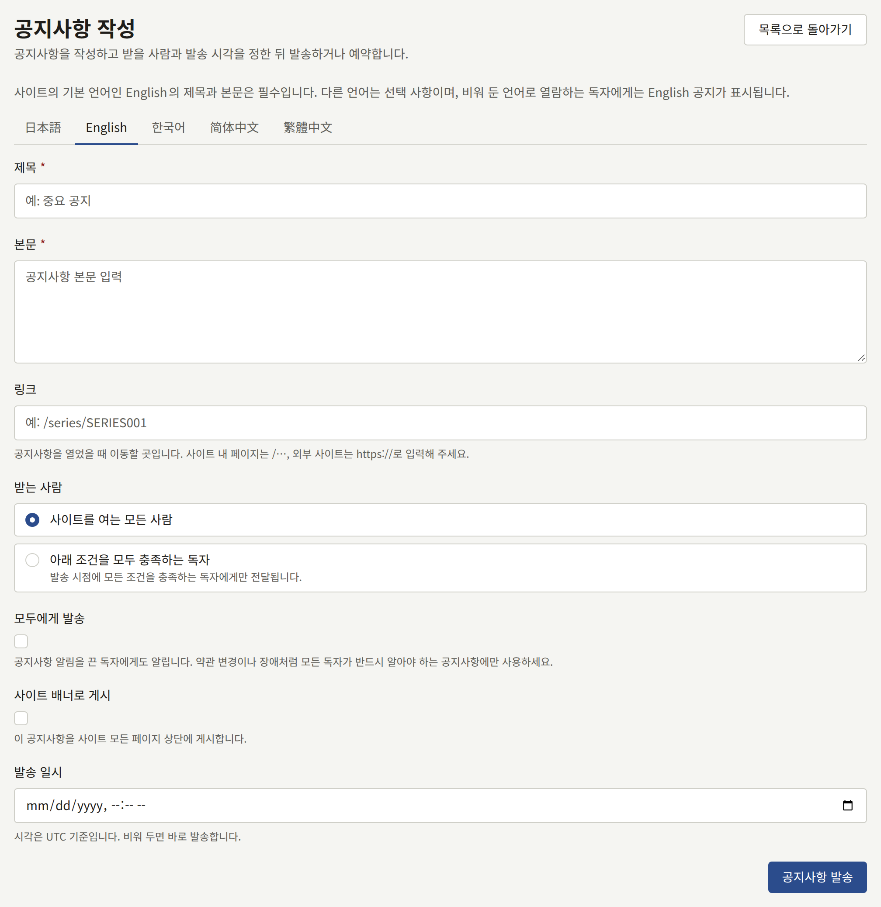
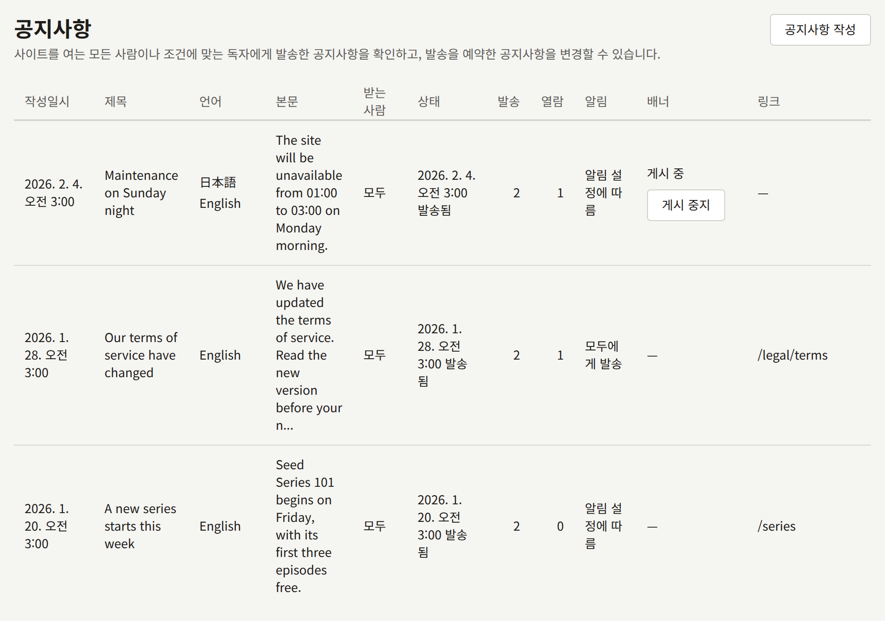

**사이트** 아래의 **공지사항**은 출판사가 모든 독자에게 한 번에 무언가를 알리는 수단입니다. 새 시리즈, 약관 변경, 점검 시간 같은 것입니다. 각 공지사항은 사이트의 **공지사항** 페이지에 나열되고 독자의 알림으로 전달됩니다. 공지사항은 특정 시리즈의 팔로워처럼 조건으로 고른 독자에게만 보낼 수도 있습니다. [받는 사람 정하기](#받는-사람-정하기)를 참고하세요. 또한 한 번에 하나의 공지사항을 사이트와 앱의 모든 페이지 위에 배너로 표시할 수 있습니다.

테넌트 관리자와 편집 담당은 공지사항을 작성하고, 예약된 공지사항을 변경하거나 삭제하고, 배너를 내릴 수 있습니다. 감사 담당은 목록만 볼 수 있습니다.

## 공지사항 작성하기

**공지사항 작성**을 선택하고 다음을 입력하세요.

- **제목**과 **본문**: 사이트가 제공하는 각 언어의 탭에 입력합니다. 제목은 최대 120자, 본문은 일반 텍스트 최대 2000자입니다. [여러 언어로 작성하기](#여러-언어로-작성하기)를 참고하세요.
- **링크**(선택 사항): 공지사항을 연 독자가 이동하는 곳입니다. 이 사이트의 페이지라면 `/series/SERIES001`이나 `/legal/terms`처럼 `/`로 시작하고, 다른 사이트라면 `https://` 또는 `http://`로 시작합니다.
- **받는 사람**: **사이트를 여는 모든 사람**(기본값) 또는 **아래 조건을 모두 충족하는 독자**입니다. [받는 사람 정하기](#받는-사람-정하기)를 참고하세요.
- **모두에게 발송**(기본값은 꺼짐): 알림 설정에서 공지사항을 끈 독자를 포함해, 계정이 있는 모든 독자에게 알립니다. [모두에게 발송하기](#모두에게-발송하기)를 참고하세요.
- **사이트 배너로 게시**: 공지사항을 모든 페이지 위에도 표시합니다. [사이트 배너](#사이트-배너)를 참고하세요.
- **발송 일시**(선택 사항): 공지사항이 발송되는 시각입니다. 비워 두면 바로 발송합니다. [공지사항 예약하기](#공지사항-예약하기)를 참고하세요.

**공지사항 발송**은 공지사항을 바로 발송합니다. **발송 일시**를 입력하면 버튼이 **공지사항 발송 예약**으로 바뀌고, 공지사항은 그 시각에 발송됩니다. 발송된 공지사항은 편집하거나 삭제할 수 없으므로, 발송하기 전에 다시 읽어 보세요.

## 공지사항 예약하기

공지사항은 바로 발송하는 대신 발송할 시각을 정해 둘 수 있습니다. 예를 들어 금요일에 작성해 월요일 9시에 발송할 수 있습니다. **발송 일시**에 시각을 입력하고 **공지사항 발송 예약**을 선택하세요. 시각은 테넌트의 시간대 기준이며, 미래여야 합니다. 배너의 **게시 종료 일시**는 그보다 뒤여야 합니다.

그 시각까지 공지사항은 예약 상태이며 독자에게 보이지 않습니다. 사이트의 **공지사항** 페이지에도 앱에도 나타나지 않고, 어떤 독자에게도 알림이 가지 않으며, 배너도 표시되지 않습니다. 목록의 **상태** 열에는 그 시각과 함께 **발송 예정**이 표시됩니다. 테넌트 관리자나 편집 담당은 그 열의 **편집**을 선택해 시각을 포함한 모든 내용을 바꾸고 **저장**을 선택하거나, **삭제**를 선택하고 확인해 공지사항을 삭제할 수 있습니다. **발송 일시**를 비우고 저장하면 바로 발송됩니다.

정해진 시각에서 약 1분 안에 공지사항은 그 시각에 작성한 것과 똑같이 발송됩니다. 독자에게 알림이 가고, **공지사항** 페이지와 앱에 나타나며, 배너가 표시됩니다. 독자에게는 작성한 시각이 아니라 발송된 시각을 기준으로 다른 공지사항 사이에 표시됩니다. 조건이 있는 공지사항도 그 시점에 받을 독자를 고릅니다. 그 뒤로는 편집하거나 삭제할 수 없습니다.

## 여러 언어로 작성하기

양식에는 사이트가 제공하는 각 언어의 탭이 그 언어로 된 이름으로 있으며, 사이트의 기본 언어 탭으로 열립니다. 언어는 **설정**의 [언어](./1-settings.md#언어)에서 고른 언어이며, 사이트가 제공하지 않는 언어에는 탭이 없습니다.

- 기본 언어의 **제목**과 **본문**은 필수입니다. 비워 둔 언어로 사이트를 보는 독자에게는 기본 언어의 공지사항이 표시됩니다.
- 다른 탭은 모두 선택 사항입니다. **제목**과 **본문**을 둘 다 입력하거나, 둘 다 비워 두세요.

**공지사항 발송**은 작성한 모든 언어를 담아 공지사항을 한 번 보냅니다. 발송한 공지사항에는 언어를 추가할 수 없으므로, 발송하기 전에 모든 번역을 작성하세요.

목록에는 각 공지사항의 제목이 기본 언어로 표시되며, **언어** 열에는 작성한 모든 언어가 표시됩니다.

## 모두에게 발송하기

공지사항은 독자의 알림 설정이 공지사항을 받도록 되어 있을 때만 그 독자의 알림과 이메일로 전달됩니다. 따라서 알림을 끈 독자는 캠페인 소식을 받지 못합니다. **모두에게 발송**은 그 설정과 관계없이 계정이 있는 모든 독자에게 알리고, 주소가 확인된 모든 독자에게 이메일을 보냅니다. 푸시는 여전히 공지사항 푸시 설정을 켠 독자에게만 전달됩니다. 약관 변경이나 장애처럼 모든 독자가 반드시 봐야 하는 안내에만 사용하세요.

목록의 **알림** 열에는 각 공지사항이 어떻게 발송되었는지 표시됩니다. **모두에게 발송**이거나, 이 옵션 없이 발송한 공지사항이라면 **알림 설정에 따름**입니다.

## 받는 사람 정하기

공지사항은 모든 사람 대신 조건을 충족하는 독자에게 보낼 수 있습니다. **받는 사람**에서 **아래 조건을 모두 충족하는 독자**를 선택한 다음, **조건 추가**에서 조건을 고르세요. 조건마다 필요한 입력 항목이 있는 행이 추가되며, **빼기**로 다시 제거할 수 있습니다. 조건은 다음과 같습니다.

- **시리즈를 팔로우함**: 독자가 고른 **시리즈**를 팔로우하고 있습니다.
- **시리즈의 에피소드를 구매함**: 독자가 고른 **시리즈**의 에피소드를 단독으로, 권으로, 또는 묶음으로 구매해 보유하고 있습니다. 환불되거나 취소된 구매는 포함되지 않습니다.
- **구독**: 독자가 고른 **플랜** 또는 **모든 플랜**의 구독이 유효하거나(**구독 중**: 체험 기간, 활성, 또는 갱신 결제가 연체된 상태), 독자가 종료된 구독이 있고 유효한 구독이 없습니다(**구독이 종료됨**).
- **구매한 적 없음**: 독자가 사이트에서 아무것도 구매한 적이 없습니다. 결제 제공자의 테스트 모드에서 한 구매는 포함되지 않습니다.
- **읽지 않은 기간**: 독자가 입력한 **일수** 이상 에피소드를 열지 않았거나, 한 번도 연 적이 없습니다.
- **가입 후 기간**: 독자가 회원가입한 지 입력한 **일수** 이내입니다.
- **언어**: 독자가 사이트가 제공하는 언어 중 고른 언어로 사이트를 이용합니다. 독자가 마지막으로 사이트를 보거나 앱을 사용한 언어이며, 언어를 고른 적이 없는 독자는 사이트의 기본 언어입니다.
- **앱 푸시 알림을 등록함**: 독자가 사이트의 앱이 설치된 휴대폰을 푸시 알림용으로 등록했습니다.

일수는 1부터 3650까지입니다. 각 조건은 한 번만 사용할 수 있으므로 이미 추가한 조건은 다시 제시되지 않으며, 조건은 함께 적용됩니다. 독자는 공지사항이 지정한 모든 조건을 충족할 때만 공지사항을 받습니다.

모든 행을 채우면 양식이 조건으로 고른 독자를 세어 **독자 12명에게 전달됩니다**처럼 그 수를 보여 주며, 조건이 바뀔 때마다 다시 셉니다. 이 수는 그 시점의 수이고 참고용일 뿐입니다. 공지사항이 발송될 때 독자를 다시 고르며, 수를 세지 못했더라도 발송할 수 있습니다.

공지사항에 조건이 있는 동안에는 양식의 안내대로 **모두에게 발송**과 **사이트 배너로 게시**가 꺼진 채로 켤 수 없습니다. 조건을 모두 제거하면 다시 사용할 수 있습니다.

목록의 **받는 사람** 열에는 각 공지사항의 대상이 표시됩니다. **모두**이거나, **조건 2개**처럼 지정한 조건의 수입니다.

조건은 공지사항이 발송되는 순간 한 번만 평가됩니다. 예를 들어 하루 뒤에 시리즈를 팔로우하는 식으로 나중에 조건을 충족하게 된 독자는 공지사항을 받지 않으며, 조건을 더 이상 충족하지 않게 된 독자는 이미 받은 공지사항을 그대로 가집니다.

조건이 있는 공지사항은 고른 각 독자에게 그 독자의 알림 설정이 허용하는 대로 전달되며, 다음과 같이 되는 일은 없습니다.

- 모든 방문자가 보는 사이트 배너로 표시되는 일
- **모두에게 발송**으로 발송되는 일. 모든 독자가 반드시 봐야 하는 안내는 조건으로 일부 독자에게서 가려도 되는 안내가 아니기 때문입니다
- 로그인하지 않은 방문자나 공지사항을 받지 않은 로그인 독자에게 **공지사항** 페이지나 앱에서 나열되는 일. 공지사항 자체의 페이지는 이들에게 **페이지를 찾을 수 없습니다**를 표시합니다

## 독자에게 보이는 것

- **사이트에서는** 헤더의 **공지사항** 페이지에 모든 사람에게 보낸 공지사항이 최신순으로 나열되며, 누구나 읽을 수 있습니다. 로그인한 독자는 자신에게 전달된 조건이 있는 공지사항도 다른 공지사항 사이에서 보며, 로그인한 상태에서 다른 공지사항처럼 열 수 있습니다. 각 제목을 누르면 공지사항이 자체 페이지에서 열립니다. 로그인한 독자에게는 아직 읽지 않은 공지사항이 표시됩니다.
- **알림으로는** 알림 설정이 공지사항을 받도록 되어 있고 계정이 있는 모든 독자가 공지사항으로 이어지는 "새 공지사항"을 받으며, **모두에게 발송**으로 보낸 공지사항은 계정이 있는 모든 독자가 받습니다. 조건이 있는 공지사항은 고른 독자에게만 전달됩니다.
- **이메일로는** 알림 설정이 공지사항을 이메일로 받도록 되어 있고 주소가 확인된 모든 독자가 공지사항의 제목과 **공지사항** 페이지 링크가 담긴 메일을 받으며, **모두에게 발송**으로 보낸 공지사항은 주소가 확인된 모든 독자가 받습니다.
- **푸시 알림으로는** 알림 설정이 공지사항을 브라우저 알림으로 받도록 되어 있는 독자는 브라우저에서, 휴대폰으로 받도록 되어 있는 독자는 앱에서 알림을 받습니다. 알림의 제목은 독자의 언어로 된 공지사항의 제목이며, 알림을 열면 공지사항이 표시됩니다. 두 설정 모두 꺼진 상태로 시작하므로 아무것도 저장하지 않은 독자는 푸시 알림을 받지 않으며, **모두에게 발송**도 이 설정을 무시하지 않습니다.
- **앱에서는** **공지사항** 화면에 같은 공지사항이 같은 읽음 표시와 함께 나열됩니다.

독자는 각 공지사항을 자기 언어로 봅니다. 사이트에서는 사이트를 보는 언어로, 앱에서는 앱이 표시되는 언어로 봅니다. 그 언어로 작성하지 않았다면 기본 언어의 공지사항이, 표시되는 언어를 알리는 안내와 함께 보입니다.

공지사항이 발송되면 목록에 얼마나 전달되었는지 표시됩니다. **발송** 열은 공지사항이 전달된 독자 수를 셉니다. 모든 사람에게 보낸 공지사항이라면 계정이 있는 모든 독자이고, 조건이 있다면 발송 시점에 조건으로 고른 독자입니다. 알림 설정에서 공지사항이 알림에 들어오지 않도록 한 독자도 포함됩니다. **열람** 열은 사이트나 앱에서 공지사항을 연 독자 수를 셉니다. 공지사항이 예약 상태인 동안 두 열에는 —가 표시되며, 발송 직후에는 독자에게 알림이 갈 때까지 잠시 **발송**이 0으로 표시될 수 있습니다.

## 사이트 배너

**사이트 배너로 게시**를 선택해 작성한 공지사항은 로그인 여부와 관계없이 모든 방문자에게, 사이트의 모든 페이지 헤더 위와 앱의 카탈로그 화면 맨 위에 표시됩니다. 사이트에서 배너의 링크는 공지사항의 **링크**로, 링크가 없으면 공지사항 자체의 페이지로 이어집니다. 방문자는 배너를 닫을 수 있으며, 닫은 배너는 그 브라우저에서 계속 닫힌 상태로 유지됩니다.

배너는 한 번에 하나만 표시됩니다. 배너가 아직 게시 중인 공지사항 중 가장 최신 것입니다. 따라서 새 배너를 만들면, 새 배너가 내려갈 때까지 이전 배너는 숨겨집니다.

종료를 정하지 않으면 배너는 직접 내릴 때까지 게시됩니다.

- 배너 체크박스 아래의 **게시 종료 일시**는 테넌트의 시간대 기준으로 그 시각에 배너를 내립니다. 미래여야 합니다.
- 목록의 **배너** 열에 있는 **게시 중지**는 배너를 바로 내립니다.

어느 쪽이든 공지사항은 **공지사항** 페이지와 독자의 알림에 그대로 남습니다. 내려가는 것은 배너뿐입니다.
