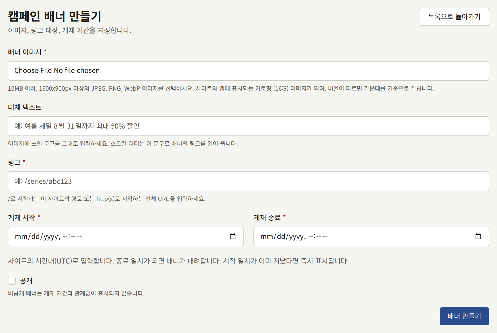
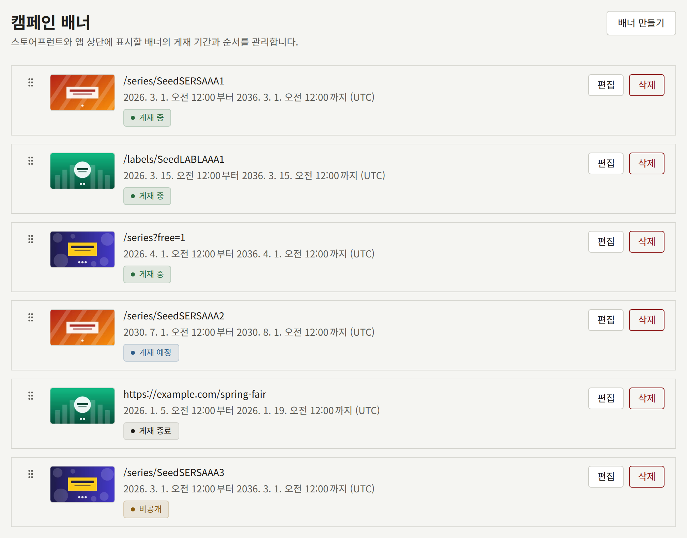

**사이트** 아래의 **캠페인 배너**는 캠페인을 찾아 나서지 않은 독자에게도 캠페인을 보여 줍니다. 시리즈 할인, 새 연재, 다른 사이트의 페어 같은 것입니다. 배너는 어딘가로 링크되는 이미지이며, 정한 기간 동안 표시됩니다. 사이트는 게재 중인 배너를 첫 페이지 상단에, 앱은 카탈로그 화면 상단에 표시합니다.

배너는 공지사항이 아닙니다. 누구의 알림으로도 전달되지 않고, 독자가 닫을 수 없으며, 이 두 화면에만 표시됩니다. 모든 독자에게 무언가를 알리거나 모든 페이지 위에 한 줄의 텍스트를 계속 보여 주려면 [공지사항](./4-announcements.md)을 사용하세요.

테넌트 관리자와 편집 담당은 배너를 만들고, 변경하고, 순서를 바꾸고, 삭제할 수 있습니다. 감사 담당은 목록을 보고 **보기**로 배너를 열 수 있지만 변경할 수는 없습니다.

## 배너 만들기

**배너 만들기**를 선택하고 다음을 입력하세요.

- **배너 이미지**: 10MB 이하, 1600 × 900픽셀 이상의 JPEG, PNG, WebP 이미지입니다. [이미지](#이미지)를 참고하세요.
- **대체 텍스트**: `Summer sale, up to 50% off through August 31`처럼 이미지에 쓰인 문구로, 최대 255자입니다. 스크린 리더는 그림 속 글자를 읽을 수 없으므로, 대신 이 문구로 배너의 링크를 읽어 줍니다. 이 필드는 선택 사항이지만, 비워 둔 배너는 링크 대상으로만 다른 배너와 구별할 수 있습니다.
- **링크**: 배너를 연 독자가 이동하는 곳으로, 최대 2048자입니다. 이 사이트의 페이지라면 `/series/SERIES001`이나 `/labels/LABEL001`처럼 `/`로 시작하고, 다른 사이트라면 `https://` 또는 `http://`로 시작합니다.
- **게재 시작**과 **게재 종료**: 배너가 게재되는 기간으로, 테넌트의 시간대로 입력하며 두 필드 아래의 안내에 그 시간대가 표시됩니다. [게재 기간](#게재-기간)을 참고하세요.
- **공개**: 배너를 표시할지 여부입니다. 새 배너는 비공개로 시작합니다. [공개](#공개)를 참고하세요.

**배너 만들기**를 선택하세요. 배너가 자체 화면에서 열리며, 대체 텍스트, 링크, 게재 기간, **공개**를 바꾸는 **기본 정보** 탭과 이미지를 바꾸는 **이미지** 탭이 있습니다.

## 이미지

사이트와 앱의 배너 띠는 **가로형 (16:9)** 한 가지 모양을 자르지 않고 그대로 그리며, 업로드한 이미지는 이 모양이 됩니다. 1920 × 1080 이미지처럼 배너 띠에 맞춰 만든 그림은 그대로 유지되고, 다른 모양의 이미지는 중앙에서 잘립니다. **이미지** 탭의 **비율별 이미지** 아래 **가로형 (16:9)** 칸에 그 결과가 표시됩니다. 그 옆의 **세로형 (3:4)**, **정사각형 (1:1)**, **링크 미리보기 (1200:630)** 칸은 비어 있는 채로 시작하며, 어디에도 표시되지 않습니다.

배너 띠의 구도를 바꾸려면 **가로형 (16:9)** 칸에서 **틀 조정**을 선택하거나, **교체**로 다른 그림을 업로드하세요. **교체**에는 1600 × 900픽셀 이상의 이미지가 필요합니다. **커버 이미지**에서 새 이미지를 업로드하고 **이미지 업데이트**를 선택해도 이미지가 교체되며, 채워져 있던 다른 칸은 비워집니다. 배너에는 항상 이미지가 있어야 하므로 이미지를 제거할 수는 없습니다. 각 칸에 대한 자세한 설명은 시리즈의 [커버 이미지](../1-catalog/1-series.md#커버-이미지)를 참고하세요.

휴대폰에서는 배너 띠가 화면 너비와 같으므로, 이미지 속 글자는 그 크기에서도 읽을 수 있어야 합니다. 문구가 다른 새 이미지를 올렸다면, **기본 정보** 탭에서 **대체 텍스트**도 그에 맞게 고쳐 써야 합니다.

## 게재 기간

**게재 시작**과 **게재 종료**는 [설정](./1-settings.md#시간대)에서 고른 테넌트의 시간대로 해석되며, 목록에도 모든 게재 기간이 그 시간대로 표시됩니다. 배너는 시작 시각부터 종료 시각까지 게재되고, 종료 시각이 되는 순간 내려가므로, 한 배너가 끝나는 순간 다음 배너가 시작되도록 할 수 있습니다.

- 종료는 시작보다 뒤여야 합니다.
- 새 배너의 종료는 미래여야 합니다. 시작이 이미 지났다면 공개하는 즉시 게재됩니다.
- 배너를 편집할 때도 게재 기간을 그대로 두지 않는 한 종료는 미래여야 합니다. 따라서 끝난 배너도 일정을 다시 잡지 않고 비공개로 바꾸거나 다른 링크를 지정할 수 있습니다.

사이트와 앱은 읽을 때마다 게재 기간을 현재 시각과 비교하므로, 독자가 어디에 있든 모든 독자에게 같은 순간에 배너가 바뀝니다. 사이트는 그려 둔 내용을 워커가 다음에 처리할 때까지 유지하며, 보통 정한 시각에서 1분 안에 반영됩니다. 게재 기간이 시작된 뒤에도 배너가 보이지 않거나 게재 기간이 끝난 뒤에도 배너가 남아 있다면, 설치 환경의 운영자가 [예약 작업](../../3-operations/10-scheduled-jobs.md)에서 설명하는 작업을 확인할 수 있습니다.

## 공개

**공개**는 배너를 표시할지 여부를 정합니다. 비공개 배너는 게재 기간과 관계없이 표시되지 않으므로, 배너를 미리 준비해 두고 준비가 끝날 때까지 비공개로 둘 수 있습니다. **기본 정보** 탭에서 **공개**의 체크를 해제하고 **배너 업데이트**를 선택하면 배너가 즉시 내려갑니다.

목록에는 각 배너의 현재 상태가 표시됩니다.

| 상태          | 의미                                                |
| ------------- | --------------------------------------------------- |
| **게재 중**   | 공개되어 있고, 게재 기간에 현재 시각이 포함됩니다   |
| **게재 예정** | 공개되어 있고, 게재 기간이 아직 시작되지 않았습니다 |
| **게재 종료** | 공개되어 있고, 게재 기간이 끝났습니다               |
| **비공개**    | 게재 기간과 관계없이 공개되어 있지 않습니다         |

각 행의 맨 위에는 배너의 대체 텍스트가 있고 그 아래에 링크가 있으며, 대체 텍스트가 없으면 링크만 있습니다.

## 순서 정하기

사이트와 앱은 게재 중인 배너를 목록 순서대로 표시합니다. 새 배너는 맨 끝에 추가됩니다. 배너를 옮기려면 핸들을 잡고 드래그하거나, 핸들에 포커스를 두고 화살표 키를 사용하세요. 배너를 놓는 즉시 순서가 저장됩니다.

다른 사람이 동시에 목록의 순서를 바꾸면, "다른 곳에서 배너 순서가 변경되었습니다. 페이지를 새로 고친 후 다시 시도하세요."와 함께 이동이 거부됩니다.

## 배너 삭제와 50개 제한

배너 행의 **삭제**는 확인을 요청한 뒤 배너와 그 이미지를 삭제합니다. 사이트는 즉시 그 배너를 표시하지 않게 됩니다.

테넌트는 게재가 끝난 배너를 포함해 최대 50개의 배너를 가질 수 있습니다. 그 이상 만들면 "등록할 수 있는 캠페인 배너 수의 상한에 도달했습니다. 게재가 끝난 배너를 삭제한 후 다시 시도하세요."와 함께 거부됩니다. 게재가 끝난 배너는 어디에도 표시되지 않으므로, 삭제해도 독자가 보는 것은 아무것도 사라지지 않습니다.

## 독자에게 보이는 것

- **사이트에서는** 게재 중인 배너가 첫 페이지 상단, 페이지 첫머리의 작품 위에 있습니다. 배너가 하나면 띠 하나로 표시됩니다. 두 개 이상이면 독자가 스와이프하거나 스크롤해서 넘기는 줄이 되며, **이전 캠페인**과 **다음 캠페인** 버튼, 그리고 그 아래에 `1 / 3` 같은 카운터가 있습니다. 줄은 마지막 배너에서 첫 배너로 이어지며, 저절로 넘어가지는 않습니다. 넓은 화면에서는 줄의 양쪽 가장자리에 이웃한 배너가 보입니다.
- **앱에서는** 같은 배너가 카탈로그 화면 상단, 사이트 배너가 있으면 그 아래, 그리고 책장 위에 있습니다. 두 개 이상이면 독자가 스와이프해서 넘기는 페이지가 되며, 다음 배너의 가장자리가 보입니다. 앱은 카탈로그 화면이 처음 표시될 때와 독자가 화면을 아래로 당겨 새로 고칠 때 배너를 읽어 옵니다.
- **독자가 배너를 열면** 사이트는 배너의 링크로 이동하며, 사이트의 페이지라면 독자의 언어를 유지합니다. 앱은 시리즈나 레이블처럼 자체 화면이 있는 사이트 페이지라면 그 화면을, 테넌트의 공개된 페이지라면 페이지 화면을 열고, 그 밖의 경우에는 브라우저를 엽니다.

게재 중인 배너가 없는 테넌트는 사이트에서도 앱에서도 배너 띠는 물론 그 자리도 표시하지 않습니다.
