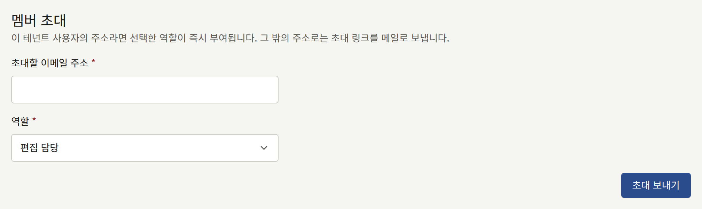
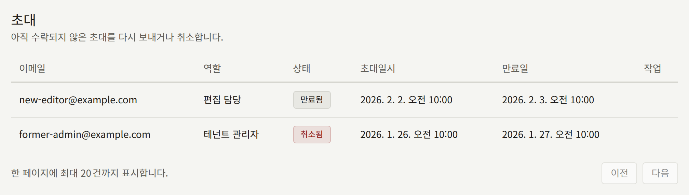
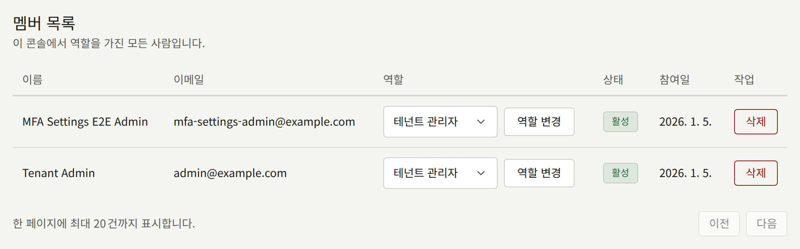

**관리** 아래의 **멤버**에는 이 콘솔에 로그인할 수 있는 모든 사람이 나열되며, 테넌트 관리자는 여기에서 스태프를 들이고, 역할을 바꾸고, 다시 내보냅니다. 이 화면은 테넌트 관리자에게만 보입니다.

스태프는 콘솔 역할도 가진 테넌트 사이트의 계정입니다. 스태프는 사이트에서 쓰는 것과 같은 이메일 주소와 비밀번호로 콘솔에 로그인하며, 역할을 빼앗아도 사이트의 계정은 그대로 남습니다. 운영자 관점의 설명은 [테넌트의 스태프](../../3-operations/3-tenant-staff.md#멤버와-사용자)에 있습니다.

## 역할

| 역할 | 할 수 있는 일 |
| --- | --- |
| **테넌트 관리자** | 이 화면을 포함해 콘솔의 모든 것 |
| **편집 담당** | 카탈로그, 사이트의 페이지와 공지사항, 댓글 관리 |
| **감사 담당** | 편집 담당이 작업하는 내용과 테넌트의 설정을 보되, 아무것도 변경하지 않음 |

각 역할이 다루는 범위는 [테넌트 콘솔](../index.md#역할)에 나열되어 있습니다. 테넌트 관리자의 수는 적게 유지하세요. 테넌트 관리자는 테넌트의 결제 및 메일 자격 증명을 교체하고, 독자의 계정을 정지하거나 삭제하고, 스태프를 바꿀 수 있습니다.

## 멤버 초대하기

**멤버 초대**에서 **초대할 이메일 주소**에 주소를 입력하고, **역할**을 고른 다음, **초대 보내기**를 선택하세요. 역할은 **편집 담당**으로 시작하므로, 그 사람에게 **테넌트 관리자**가 필요할 때 신중하게 고르세요.

- **사이트에 계정이 없는 주소**에는 선택한 역할로의 초대가 테넌트의 기본 언어로 메일로 전송됩니다. 메일의 링크는 이 콘솔로 이어지며, 초대받은 사람은 그곳에서 **이름**과 **비밀번호**를 입력하고 **초대 수락하기**를 선택합니다. 그러면 그 역할로 로그인합니다. 링크는 24시간 동안 유효합니다.
- **사이트에 이미 계정이 있는 주소**에는 즉시 역할이 주어지며, 메일은 보내지 않습니다. 이미 역할을 가진 계정은 이 방법으로 테넌트 관리자로 만들 수 있으며, 이 경우 기존 역할이 대체됩니다. 그 밖의 역할이라면 콘솔이 이를 거부하고 **멤버 목록**을 안내하며, 그곳에서 아래 설명대로 역할을 바꿉니다.

**초대**에는 각 초대가 부여하는 **역할**과 함께 **대기 중**, **수락됨**, **취소됨**, **만료됨** 중 하나의 상태로 나열됩니다. 대기 중인 초대에서 **다시 보내기**는 새 링크로 초대를 다시 메일로 보내며 그 링크는 다시 24시간 동안 유효하고, **초대 취소**는 초대를 철회합니다. 어느 쪽이든 이전 링크는 더 이상 작동하지 않습니다. 만료되거나 취소된 초대를 다시 시도하거나, 대기 중인 초대가 부여하는 역할을 바꾸려면, 같은 주소를 원하는 역할로 다시 초대하세요.

[메일](./7-email.md)에서 설명하듯이 테넌트가 자체 메일 서버로 보내지 않는 한, 초대는 플랫폼의 메일 서버로 전송됩니다. 초대가 도착하지 않으면, 초대받은 사람의 스팸 폴더를 확인한 다음 테넌트의 메일 설정을 확인하세요.

## 역할 바꾸기

**멤버 목록**에서 멤버의 **역할** 열에 새 역할을 고르고 **역할 변경**을 선택하세요. 변경은 멤버가 콘솔에서 하는 다음 동작부터 적용되며, 이미 열어 둔 콘솔에서도 마찬가지입니다.

## 멤버 삭제하기

멤버 행의 **삭제**를 선택하고 **삭제**로 확인하면 그 멤버의 모든 역할이 사라집니다. 그 멤버는 다음 동작부터 콘솔에 들어올 수 없습니다. 계정은 구매 내역과 이력을 그대로 가진 독자 계정으로 사이트에 남습니다.

읽기까지 막으려면, 목록의 멤버 이름에서 이어지는 **독자** 아래의 해당 독자 페이지에서 계정을 정지하거나 삭제하세요. 두 방법이 각각 무엇을 남기는지는 [독자 계정](../2-readers/1-accounts.md)에서 설명합니다.

## 마지막 테넌트 관리자

누군가 항상 스태프를 관리할 수 있도록, 콘솔은 자신을 포함해 테넌트의 마지막 활성 테넌트 관리자를 강등하거나 삭제하는 것을 거부합니다. 먼저 다른 사람을 테넌트 관리자로 만드세요.

그래도 마지막 테넌트 관리자가 출판사를 떠나거나 자기 계정에 접근할 수 없게 되었다면, [관리자가 없는 테넌트 복구](../../3-operations/3-tenant-staff.md#관리자가-없는-테넌트-복구)에서 설명하듯이 운영자가 다른 사람에게 역할을 줄 수 있습니다.

## 기록되는 내용

모든 초대, 다시 보내기, 취소, 수락, 역할 변경, 삭제는 이를 수행한 테넌트 관리자와 함께 [감사 로그](./8-audit-log.md)에 기록됩니다. 초대, 그 다시 보내기와 수락, 역할 변경에는 부여하는 역할도 기록됩니다.
