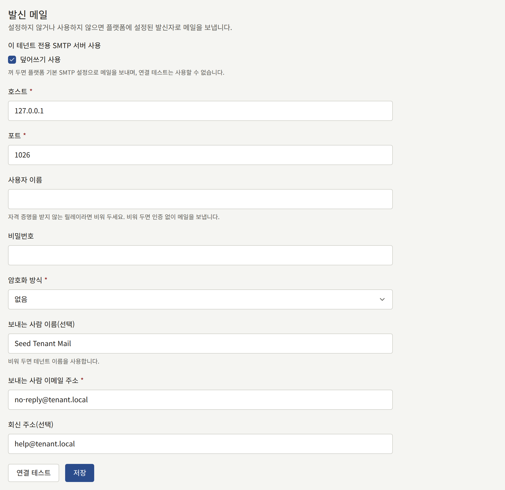
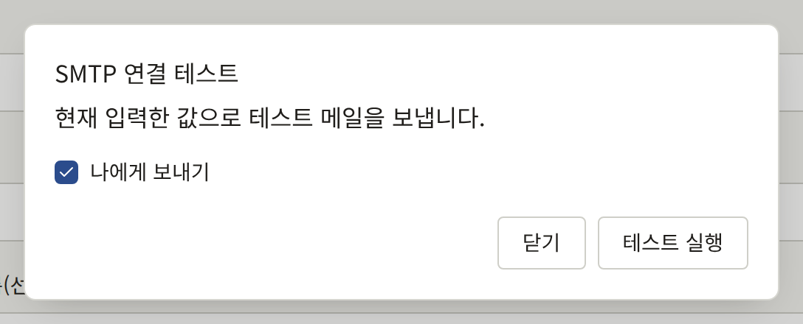
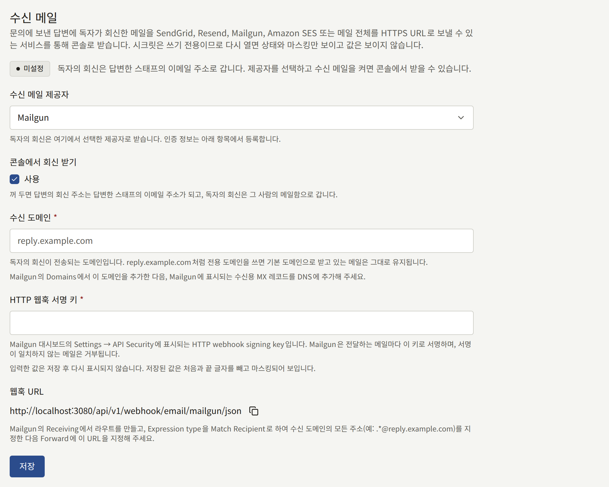

테넌트는 독자와 스태프에게 메일을 보냅니다. 주소 확인, 비밀번호 재설정, 구매 영수증, 초대, 문의 메시지에 대한 답변입니다. 테넌트 관리자가 테넌트 자체 서버를 설정하기 전까지는 이 메일이 모두 플랫폼의 메일 서버를 통해, 운영자가 정한 플랫폼의 주소로 발송됩니다. **연동** › **메일**을 사용하면 대신 출판사 자체 SMTP 서버를 통해, 출판사 도메인의 주소로 보냅니다.

이 화면은 테넌트 관리자에게만 보입니다. 운영자가 미리 허용해야 하는 것은 없습니다.

## 이 서버로 보내는 메일

테넌트 자체 서버를 켜면, 테넌트가 보내는 모든 메일이 이 서버로 발송됩니다.

- 독자에게: 회원가입 확인, 비밀번호 재설정과 비밀번호 변경 알림, 이메일 주소 변경 확인과 주소 변경 알림, 그리고 이미 계정이 있는 주소로 누군가 회원가입을 시도했다는 알림.
- 사이트에서 에피소드를 구매한 독자에게: 시리즈와 에피소드, 결제 금액, 구매 일시, 그리고 열람 기간이 있는 에피소드라면 언제까지 읽을 수 있는지를 적은 영수증과 독자의 구매 내역 링크. [설정 › 세금 및 청구서](./1-settings.md#세금-및-청구서)에서 **세율 (%)** 필드를 설정한 테넌트에서는, [에피소드 판매](../4-selling-episodes.md#가격에-포함된-세금)에서 설명하듯이 세금을 기록한 구매의 영수증에 "포함된 세금 (10%): ¥100"처럼 그 세금과 세율도 표시됩니다. 테넌트가 그곳에 입력하면, 모든 영수증에 테넌트의 **명의**가 "발행자"로, 그리고 **등록번호**가 표시됩니다.
- 사이트에서 에피소드의 작가에게 팁을 보낸 독자에게: 에피소드와 보낸 금액을 적은 영수증.
- 사이트에서의 구매나 팁이 전액 또는 일부 환불된 독자에게: [환불](../4-selling-episodes.md#환불)에서 설명하듯이 구매한 것, 환불 금액, 환불로 에피소드가 닫히는지를 적은 안내. 이 안내는 독자의 알림 설정과 관계없이 발송됩니다.
- 사이트에서 플랜을 구독한 독자에게: 첫 결제가 완료되면, 그리고 그 뒤의 결제로 플랜이 새 기간으로 갱신될 때마다, [독자에게 보이는 것](../5-subscription-plans.md#독자에게-보이는-것)에서 설명하듯이 플랜, 결제 금액, 그 결제가 대상으로 하는 기간을 적은 안내. 이 안내는 독자의 알림 설정과 관계없이 발송됩니다.
- 알림 설정에서 이메일로 받도록 한 독자에게: 팔로우하는 작품의 새 에피소드, 댓글이 공개되었다는 알림, 그리고 공지사항. 공지사항에 대해서는 [독자에게 보이는 것](./4-announcements.md#독자에게-보이는-것)에서 설명합니다.
- 독자의 문의 메시지에 대한 답변.
- 스태프에게: 새 테넌트 관리자 초대, 콘솔의 비밀번호 재설정과 이메일 주소 변경, 그리고 테넌트 관리자에게 보내는 새 문의 메시지 알림.

## 시작하기 전에

출판사의 메일을 관리하는 사람에게서 다음을 받아 두세요.

- SMTP 서버의 호스트 이름과 포트, 그리고 서버가 연결 처음부터 TLS를 기대하는지(보통 포트 465) STARTTLS를 기대하는지(보통 포트 587).
- 자격 증명 없이 메일을 릴레이하는 서버가 아니라면, 서버의 사용자 이름과 비밀번호.
- 메일을 보낼 주소. 서버가 그 주소로 보낼 수 있도록 허용되어 있어야 합니다. 도메인의 SPF와 DKIM 레코드가 이 서버를 포함하도록 하세요. 그렇지 않으면 독자의 메일 서비스가 테넌트의 메일을 스팸으로 분류할 가능성이 높습니다.

## 설정하기

1. **연동** › **메일**을 열고, **발신 메일** 섹션의 **이 테넌트 전용 SMTP 서버 사용** 아래에서 **덮어쓰기 사용**에 체크하세요. 그 아래의 필드가 열립니다.
2. 다음을 입력하세요.
   - **호스트**와 **포트**.
   - 서버가 로그인을 요구한다면 **사용자 이름**과 **비밀번호**. 플랫폼의 주소를 신뢰하는 릴레이처럼 자격 증명을 받지 않는 릴레이라면 **사용자 이름**을 비워 두세요. 그러면 로그인 없이 메일을 보내며, 비밀번호는 보관하지 않습니다. 사용자 이름 없이 비밀번호만 입력하면 거부됩니다.
   - **암호화 방식**: **TLS**, **STARTTLS**, **없음** 중 하나입니다. **TLS**와 **STARTTLS**는 둘 다 TLS 1.2 이상이 필요하며, **STARTTLS**는 서버가 이를 제공하지 않으면 암호화 없이 보내는 대신 실패합니다. **없음**은 사설 네트워크로 연결되는 서버에만 선택하세요.
   - **보내는 사람 이메일 주소**: 메일을 보내는 주소로, 예를 들면 `noreply@comics.example.com`입니다.
   - **보내는 사람 이름(선택)**: 독자가 그 주소 옆에서 보는 이름으로, 보통 사이트 이름입니다. 비워 두면 테넌트의 메일과 연결 테스트 모두에 테넌트 이름이 사용됩니다.
   - **회신 주소(선택)**: 지원 주소처럼 독자의 회신이 가는 곳입니다. 비워 두면 회신은 보내는 사람 주소로 갑니다. 문의 메시지에 대한 답변은 이 대신 자체 회신 주소를 유지합니다.
3. **연결 테스트**를 선택한 다음 **테스트 실행**을 선택하세요. 테스트는 양식의 값을 저장하지 않고 그 값으로 자신의 주소에 메시지를 보내며, **나에게 보내기**의 체크를 해제하면 다른 주소로 보냅니다. 테스트가 실패하면, 알 수 있는 경우 어느 단계에서 실패했는지 알려 줍니다. 연결, TLS 또는 STARTTLS, 로그인, 서버의 수신자 거부, 또는 서버의 응답 지연입니다.
4. **저장**을 선택하세요. 테넌트가 다음에 보내는 메일부터 새 서버를 통해 발송됩니다.





저장된 비밀번호는 다시 표시되지 않습니다. 필드에는 비밀번호가 저장되어 있다는 사실이 표시되며, **변경**으로 교체할 수 있습니다. **변경** 후 상자를 비운 채로 저장하면 비밀번호가 삭제되며, 테넌트가 자격 증명을 받지 않는 릴레이로 옮길 때 이 방법을 씁니다. 사용자 이름만 있고 비밀번호가 없으면 거부되므로 **사용자 이름**도 비우세요.

## 작동하지 않게 되었을 때

테넌트 자체 서버를 켜면 그 메일은 플랫폼의 서버로 대신 보내지지 않습니다. 서버가 메일을 거부하거나 서버에 연결할 수 없으면, 플랫폼은 간격을 늘려 가며 한동안 재시도한 다음 그 메일을 포기합니다. 콘솔에는 실패가 표시되지 않습니다. 독자가 확인 메일이나 비밀번호 재설정 메일이 오지 않는다고 하면, 저장된 설정으로 **연결 테스트**를 다시 실행하세요.

플랫폼의 메일 서버로 돌아가려면 **덮어쓰기 사용**의 체크를 해제하고 **저장**을 선택하세요. 나머지 설정은 다시 켤 때를 위해 보관됩니다.

모든 저장은 [감사 로그](./8-audit-log.md)에 **메일 설정 변경**으로, 모든 테스트는 성공 여부와 관계없이 **SMTP 연결 테스트**로 기록됩니다. 테넌트 메일에 대한 운영자 측의 설명은 [이메일](../../3-operations/6-email.md#테넌트의-자체-smtp-계정)에 있습니다.

## 문의 메시지에 대한 독자의 회신

문의 메시지에 대한 답변은 메일로 독자에게 전달됩니다. 테넌트가 자체적으로 메일을 받기 전까지는 답변의 회신 주소가 답변한 스태프의 주소이므로, 독자가 회신하면 그 사람의 메일함으로 가고 콘솔은 회신을 보지 못합니다. **연동** › **메일**의 **수신 메일** 섹션은 SendGrid, Resend, Mailgun, Amazon SES를 통해, 또는 Cloudflare Email Routing이나 출판사 자체 Postfix 서버처럼 메일 전체를 HTTPS URL로 보낼 수 있는 메일 서비스나 서버를 통해, 이 회신을 답변한 메시지 아래로 콘솔에 되돌려 줍니다.

### 시작하기 전에

- SendGrid, Resend, Mailgun 계정, 이메일을 수신하는 리전에서 Amazon SES를 사용할 수 있는 AWS 계정, 또는 받은 메일을 각각 직접 작성한 코드에 넘겨주는 메일 서비스나 서버(Cloudflare Email Routing 또는 Postfix 서버).
- `reply.comics.example.com`처럼 DNS를 변경할 수 있는 회신용 도메인. 이 도메인의 MX 레코드는 제공자를 가리키게 되므로, 이 도메인으로 보낸 메일은 다른 메일함에 도달하지 않습니다. 전용 하위 도메인을 쓰면 출판사의 기본 도메인이 이미 받고 있는 메일은 그대로 유지됩니다.
- 인터넷에서 접근할 수 있는 사이트. 제공자는 각 회신을 사이트 자체 도메인으로 보냅니다. 사이트 앞에 IP 허용 목록, 로그인 요구, 봇 확인이 있다면, 운영자를 위해 [웹훅](../../2-deployments/4-edge/index.md#웹훅)에서 설명하듯이 이 요청들을 통과시켜야 합니다.

### 설정하기

1. **연동** › **메일**을 여세요. **수신 메일** 섹션에서 **수신 메일 제공자**를 고르고, **콘솔에서 회신 받기** 아래의 **사용**에 체크하고, 회신용 도메인을 **수신 도메인**에 입력하세요.
2. 제공자를 설정하세요. 섹션에는 사이트 도메인의 **웹훅 URL**이 복사 버튼과 함께 표시됩니다.
   - **SendGrid**: 긴 무작위 문자열을 직접 만들어 **웹훅 토큰**에 입력하세요. DNS에서 도메인의 MX 레코드를 우선순위 10으로 `mx.sendgrid.net`에 연결하세요. SendGrid의 **Settings** › **Inbound Parse**에서 **웹훅 URL**을 대상 URL로 하여 도메인을 추가하되, `<token>` 자리에 토큰을 넣으세요. SendGrid는 아무것도 서명하지 않으므로, 사이트는 URL의 토큰으로 SendGrid의 요청을 다른 요청과 구별합니다.
   - **Resend**: **API Keys**에서 **Full access** 권한의 API 키를 만들어 **API 키**에 입력하세요. 회신은 이 키로 Resend에서 읽어 옵니다. **Domains**에서 도메인을 추가하고, 수신을 켜고, Resend가 보여 주는 MX 레코드를 DNS에 추가하세요. **Webhooks**에서 `email.received` 이벤트에 대해 **웹훅 URL**을 추가하고, Resend가 그 웹훅에 대해 보여 주는 서명 시크릿(`whsec_…`)을 **웹훅 서명 시크릿**에 입력하세요.
   - **Amazon SES**: 긴 무작위 문자열을 직접 만들어 **웹훅 토큰**에 입력하고, 메일이 게시되는 SNS 토픽의 ARN을 **SNS 토픽 ARN**에 입력하세요. AWS에서 도메인, 토픽, 수신 규칙을 설정한 뒤 저장하고, 아래 [Amazon SES로 받기](#amazon-ses로-받기)에서 설명하듯이 토픽이 **웹훅 URL**을 구독하도록 하세요.
   - **Raw MIME over HTTPS**: 긴 무작위 문자열을 직접 만들어 **웹훅 토큰**에 입력하세요. 도메인의 MX 레코드가 메일을 받는 서비스나 서버를 가리키도록 하고, 그 서비스나 서버가 도메인의 모든 메일을 변경 없이 통째로, 콘텐츠 유형 `message/rfc822`로, `<token>` 자리에 토큰을 넣어, 메일이 전달된 주소를 `X-Envelope-To` 헤더에 담아 **웹훅 URL**로 보내도록 하세요. 독자 쪽의 전달이나 별칭 때문에 회신의 **To**에 메시지 자체의 주소가 남지 않는 경우가 많은데, 그래도 회신을 메시지와 맞춰 주는 것이 이 헤더입니다. 아래의 [Cloudflare Email Routing](#cloudflare-email-routing에서-원본-메일-보내기)과 [Postfix](#postfix에서-원본-메일-보내기)가 이 모든 것을 수행합니다.
   - **Mailgun**: **Settings** › **API Security**에서 **HTTP webhook signing key**를 복사해 같은 이름의 필드(**HTTP 웹훅 서명 키**)에 입력하세요. Mailgun은 보내는 모든 회신에 이 키로 서명하며, 서명이 일치하지 않는 요청은 거부됩니다. 서브계정의 도메인이라면 서브계정의 키와 기본 계정의 키 모두 사용할 수 있습니다. **Domains**에서 도메인을 추가하고, Mailgun이 수신용으로 보여 주는 MX 레코드를 DNS에 추가하세요. **Receiving**에서 표현식 유형이 **Match Recipient**이고 `.*@reply.comics.example.com`처럼 도메인의 모든 주소를 포함하는 수신자로 라우트를 만들고, 표시된 그대로 `/json`으로 끝나는 **웹훅 URL**로 **Forward**에 체크하세요. Mailgun은 그렇게 끝나는 URL로 보낼 때만 메일 전체에 서명하며, 다른 URL로 보낸 요청은 거부됩니다. Mailgun의 EU 리전 계정에도 같은 단계가 적용됩니다.
3. **저장**을 선택하세요. 섹션이 **사용 가능**으로 바뀌고, 도메인 앞에 `contact+*@`가 붙은 **회신 주소**가 표시됩니다. 이후의 각 답변은 독자에게 이 형식의 주소로 회신하도록 요청하며(`*`는 메시지의 ID), 회신은 그 메시지 아래에 나타납니다.



섹션이 **사용 가능**이 될 때까지 답변은 답변한 스태프의 주소를 유지하며, 섹션에도 그렇게 표시됩니다. **미설정**은 아무것도 저장되지 않았다는 뜻이고, **사용 안 함**은 설정은 저장되어 있지만 **사용**의 체크가 해제되어 있다는 뜻이며, **설정 부족**은 켜져 있지만 도메인이나 제공자에 필요한 자격 증명이 빠져 있다는 뜻입니다.

토큰과 키는 저장하면 다시 표시되지 않습니다. 각 필드에는 마스킹된 값이 표시되며, **변경**으로 교체할 수 있습니다. 다른 제공자를 선택해 저장하면 이전 제공자에 저장된 자격 증명이 삭제됩니다.

회신 받기를 멈추려면 **사용**의 체크를 해제하고 **저장**을 선택하세요. 다음 답변부터는 다시 스태프의 주소가 지정되며, 설정은 다시 켤 때를 위해 보관됩니다. 모든 저장은 [감사 로그](./8-audit-log.md)에 **수신 메일 설정 변경**으로 기록됩니다.

### Amazon SES로 받기

Amazon SES는 도메인의 메일을 받아 각각 수신 규칙에 넘깁니다. 수신 규칙은 메일 알림을 Amazon SNS 토픽에 게시하고, 토픽은 HTTPS 구독을 통해 이를 **웹훅 URL**로 전달합니다. SNS는 모든 전달에 서명하지만, 어떤 AWS 계정이든 자기 토픽이 이 URL을 구독하도록 할 수 있으므로, 사이트는 URL의 토큰과 전달이 오는 토픽도 확인합니다.

SES는 일부 AWS 리전에서만 메일을 받으며, 이 리전은 [Email receiving endpoints](https://docs.aws.amazon.com/general/latest/gr/ses.html#ses_inbound_endpoints)에 나열되어 있습니다. 아래의 도메인, 토픽, 규칙에는 이 중 하나를 사용하세요. 버킷은 다른 리전에 있어도 됩니다.

1. SES의 **Identities**에서 수신 도메인을 확인하세요. DNS에서 도메인의 MX 레코드를 우선순위 10으로 `inbound-smtp.<region>.amazonaws.com`(예: `inbound-smtp.us-east-1.amazonaws.com`)에 연결하세요.
2. SNS에서 `publira-inbound` 같은 표준 토픽을 만드세요. 그 ARN을 콘솔의 **SNS 토픽 ARN**에 입력하세요.
3. SES의 **Email receiving**에서, 활성 규칙 세트에 수신 도메인을 수신자 조건으로 하는 규칙을 만들고 다음 작업 중 하나를 지정하세요.
   - **Deliver to Amazon S3 bucket**: **SNS topic**에서 SNS 토픽을 선택합니다. SES는 각 메일을 버킷에 쓰고 그 위치를 토픽에 알리며, 사이트는 거기서 메일을 읽습니다. 사용해야 하는 작업은 이것입니다. SES가 받는 최대 40MB까지의 어떤 크기의 회신이든 전달합니다. [Giving permissions to Amazon SES for email receiving](https://docs.aws.amazon.com/ses/latest/dg/receiving-email-permissions.html)에서 설명하듯이 버킷 정책이 SES의 쓰기를 허용해야 합니다. **Message encryption**은 체크하지 마세요. 체크하면 SES가 각 메일을 클라이언트 측에서 암호화하며, 사이트는 이를 풀 수 없습니다. 그런 다음 IAM에서 액세스 키가 있고 버킷의 객체에 대해 `s3:GetObject`를 허용하는 정책이 있는 사용자를 만들어, 그 키를 **AWS 액세스 키 ID**와 **AWS 시크릿 액세스 키**에 입력하세요. 사이트가 그 버킷에서만 읽도록 하려면 **S3 버킷**을 입력하고, 버킷이 토픽과 다른 리전에 있다면 **S3 버킷 리전**을 입력하세요.
   - **Publish to Amazon SNS topic**: 토픽과 인코딩 **Base64**를 지정합니다. Base64는 어떤 문자 집합의 메일이든 보낸 그대로 유지합니다. 메일이 알림 안에 담겨 전달되므로 버킷도 액세스 키도 필요 없지만, SES는 150KB를 넘는 모든 메일을 반송하며, 이미지나 첨부 파일이 있는 회신은 금방 이 크기를 넘습니다.
4. 콘솔에서 **저장**을 선택하세요. SNS가 사이트에 확인 요청을 보내면 구독이 확인되며, 사이트는 저장된 토큰과 토픽에 대해서만 확인합니다.
5. SNS에서 프로토콜 **HTTPS**, 엔드포인트는 `<token>` 자리에 토큰을 넣은 **웹훅 URL**로 토픽 구독을 만드세요. **Enable raw message delivery**는 체크하지 마세요. SNS 서명이 감싸지 않은 전달은 거부됩니다. 구독은 1분 안에 **Confirmed**가 됩니다. **Pending confirmation**에 머물러 있다면, 콘솔에서 토큰과 토픽을 확인하고 저장한 다음, 구독에서 **Request confirmation**을 선택하세요.

3단계의 사용자를 위한 IAM 정책입니다. `publira-inbound-mail` 자리에 버킷 이름을 넣으세요.

```json
{
  "Version": "2012-10-17",
  "Statement": [
    {
      "Effect": "Allow",
      "Action": "s3:GetObject",
      "Resource": "arn:aws:s3:::publira-inbound-mail/*"
    }
  ]
}
```

버킷이 기본적으로 KMS 키로 쓰기 내용을 암호화한다면, 그 키에 대한 `kms:Decrypt`도 추가하세요.

SNS는 사이트가 받을 수 없는 전달(사이트가 다운된 동안이나 버킷에서 메일을 읽을 수 없는 동안의 `5xx`)을 20초 간격으로 세 번 재시도한 뒤 버립니다. 구독에 [전달 정책](https://docs.aws.amazon.com/sns/latest/dg/sns-message-delivery-retries.html)을 두면 최대 1시간까지 재시도하게 할 수 있으며, 배달 못한 편지 대기열(dead-letter queue)은 버려진 전달을 보관합니다. 어느 경우든 S3 작업이 쓴 메일은 버킷에 남습니다.

### Cloudflare Email Routing에서 원본 메일 보내기

Cloudflare Email Routing은 각 메일을 Email Worker에 넘기고, Email Worker는 이를 **웹훅 URL**로 보냅니다. 수신 도메인의 DNS가 Cloudflare에 있어야 합니다.

1. Email Routing에서 수신 도메인의 라우팅을 켜세요. `reply.comics.example.com` 같은 하위 도메인은 **Settings** › **Subdomains**에서 추가합니다. Cloudflare가 MX 레코드를 직접 추가합니다. 같은 설정에서 **Subaddressing**을 켜서, `contact+<message ID>@`로 보낸 메일이 `contact@`의 규칙에 도달하도록 하세요.
2. Email Routing의 대상 주소에, 사이트가 받을 수 없을 때 도착한 회신을 위한 스태프 메일함을 추가하고 확인하세요.
3. 아래 코드로 Worker를 만드세요. `inbound:<token>@` 부분을 뺀 **웹훅 URL**을 변수 `WEBHOOK_URL`로, 토큰을 시크릿 `WEBHOOK_TOKEN`으로, 스태프 메일함을 변수 `FALLBACK_ADDRESS`로 지정하세요.
4. Email Routing의 라우팅 규칙에서, 수신 도메인에 사용자 지정 주소 `contact`를 만들고 작업은 **Send to a Worker**, 대상은 만든 Worker로 지정하세요.

```js
export default {
  async email(message, env) {
    let status;
    try {
      const response = await fetch(env.WEBHOOK_URL, {
        body: await new Response(message.raw).arrayBuffer(),
        headers: {
          Authorization: `Basic ${btoa(`inbound:${env.WEBHOOK_TOKEN}`)}`,
          "Content-Type": "message/rfc822",
          "X-Envelope-To": message.to,
        },
        method: "POST",
      });
      if (response.ok) {
        return;
      }
      status = response.status;
    } catch {
      // The site did not answer.
    }
    if (status === 400) {
      message.setReject("The site could not read this mail");
      return;
    }
    try {
      await message.forward(env.FALLBACK_ADDRESS);
    } catch {
      message.setReject(
        `The reply could not be delivered (${status ?? "no answer"})`
      );
    }
  },
};
```

`message.to`는 `+<message ID>`를 포함해 메일이 전달된 주소입니다.

Cloudflare는 Email Worker가 보낸 사람에게 나중에 다시 시도하도록 요청할 방법을 제공하지 않습니다. 메일 거부는 영구적이며, 독자는 반송 메일을 받습니다. 그래서 Worker는 사이트가 읽을 수 있는 메일이 아니라며 거부한 메일만 거부합니다. 사이트가 응답하지 않거나 메일을 받을 수 없을 때(사이트가 다운된 동안의 `5xx`, 콘솔에 저장된 토큰과 Worker의 토큰이 다른 동안의 `401`), Worker는 메일을 스태프 메일함으로 전달해 회신을 콘솔 대신 그곳에서 읽게 하며, 그것마저 실패할 때만 메일을 거부합니다. 메시지를 지정하지 않은 메일이나 **사용**의 체크가 해제된 동안 도착한 메일처럼, 사이트가 받아들인 뒤 버리는 메일은 받아들여진 것으로 응답되며 다른 어디로도 가지 않습니다.

### Postfix에서 원본 메일 보내기

수신 도메인의 메일을 받는 Postfix 서버는 `pipe` 전송을 통해 `curl`로 각 메일을 보낼 수 있습니다. 도메인의 MX 레코드가 서버를 가리키도록 하고, **웹훅 URL**을 토큰과 토큰을 뺀 URL로 나누어 다음 스크립트를 `/usr/local/bin/publira-inbound`로 저장하세요.

```sh
#!/bin/sh
# Posts the mail on standard input for the recipient named as $1, and tells
# Postfix whether a failure is worth retrying.
status=$(curl --silent --output /dev/null --write-out '%{http_code}' \
  --max-time 60 --user 'inbound:<token>' \
  --header 'Content-Type: message/rfc822' \
  --header "X-Envelope-To: $1" \
  --data-binary @- \
  https://comics.example.com/api/v1/webhook/email/mime)
case "$status" in
  2??) exit 0 ;;
  400) exit 65 ;; # EX_DATAERR: not a mail the site can read; bounce it
  *) exit 75 ;;   # EX_TEMPFAIL: keep it queued and try again later
esac
```

Postfix는 `curl`이 끝날 때 내는 상태처럼 알지 못하는 상태로 명령이 끝난 메일을 반송하므로, 스크립트는 Postfix가 아는 두 가지 상태로 응답합니다. 사이트가 메일이 아니라며 거부한 요청만 반송됩니다. 그 밖의 경우(응답 없음, 사이트가 다운된 동안의 `5xx`, 콘솔에 저장된 토큰과 스크립트의 토큰이 다른 동안의 `401`)에는 메일이 대기열에 남으며, Postfix는 대기열 수명이 다할 때까지 재시도합니다. 스크립트에 토큰이 담겨 있으므로, 전송을 실행하는 사용자만 읽을 수 있도록 하세요. `chown nobody /usr/local/bin/publira-inbound`와 `chmod 700 /usr/local/bin/publira-inbound`입니다.

`/etc/postfix/master.cf`에 전송을 추가하세요.

```text
publira   unix  -       n       n       -       -       pipe
  user=nobody argv=/usr/local/bin/publira-inbound ${recipient}
```

그런 다음 `${recipient}`가 주소 하나를 가리키도록 요청마다 수신자 하나씩, 도메인의 메일을 이 전송으로 보내세요. `/etc/postfix/main.cf`에는 다음을,

```text
relay_domains = reply.comics.example.com
transport_maps = hash:/etc/postfix/transport
publira_destination_recipient_limit = 1
```

`/etc/postfix/transport`에는 다음을 추가합니다.

```text
reply.comics.example.com  publira:
```

`postmap /etc/postfix/transport`와 `postfix reload`를 실행하세요.
