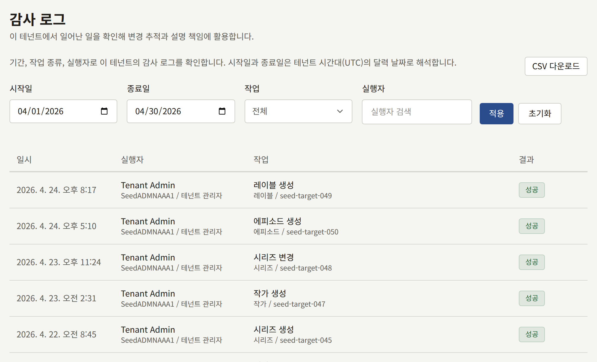

**관리** 아래의 **감사 로그**는 스태프가 콘솔에서 한 일에 대한 테넌트의 기록입니다. 누가 무엇을 언제 바꿨는지, 그리고 그것이 성공했는지를 보여 줍니다. 누가 독자를 정지했는지, 누가 결제 설정을 바꿨는지, 멤버에게 언제 역할이 주어졌는지 같은 질문에 답해 줍니다. 이 화면은 테넌트 관리자에게만 보입니다.

## 로그 읽기

각 항목에는 다음이 표시됩니다.

- **일시**: 테넌트의 시간대 기준입니다.
- **실행자**: 스태프와 그 공개 ID, 그리고 그때 가지고 있던 역할입니다. **자동 처리**는 충분한 수의 독자가 신고해 숨겨진 댓글처럼 플랫폼이 스스로 한 작업을 나타냅니다.
- **작업**: 그 아래에 작업 대상의 종류와 ID가 표시되며, 작업이 사유를 기록하는 경우 사유도 표시됩니다.
- **결과**: **성공** 또는 **실패**입니다. 2단계 인증 로그인에서 잘못 입력한 코드나 통과하지 못한 메일 서버 테스트처럼, 실패한 시도도 기록됩니다.

최신 항목이 먼저 오며, 한 페이지에 20개씩 표시됩니다. 목록을 좁히려면 테넌트의 시간대 기준으로 하루 단위인 **시작일**과 **종료일**, **작업**, 또는 **실행자**를 지정하고 **적용**을 선택하세요. **초기화**는 이 조건을 지웁니다.

항목은 삭제되지 않습니다. 계정이 나중에 삭제된 스태프의 항목도 이름과 공개 ID를 유지합니다.

## 로그 다운로드하기

필터 옆의 **CSV 다운로드**는 표시된 기간, **작업**, **실행자**의 항목을 오래된 순으로 하나의 CSV 파일에 저장합니다. 파일 이름은 `audit-log-<tenant>-2026-04-01--2026-04-30.csv`처럼 테넌트의 공개 ID와 기간을 따릅니다. 파일 하나는 최대 366일을 다룹니다. **종료일**이 없으면 기간은 오늘 끝나고, **시작일**이 없으면 **종료일**이나 오늘로 끝나는 366일이 됩니다. 이보다 긴 기간이나 **시작일**이 **종료일**보다 뒤인 기간은 좁힐 때까지 다운로드할 수 없습니다.

열의 구성과, 스프레드시트가 텍스트로 열 수 있도록 파일을 인코딩하는 방식은 [로그 내보내기](../../3-operations/12-security/3-audit-logs.md#로그-내보내기)에서 설명합니다. 각 다운로드 자체도 로그에 **감사 로그 CSV 다운로드**로 기록되므로, 누가 어느 기간의 사본을 가져갔는지 로그에서 알 수 있습니다.

## 기록되는 내용

| 영역 | 기록되는 내용 |
| --- | --- |
| 카탈로그 | 시리즈, 에피소드, 권, 작가, 작가 역할, 레이블, 장르의 생성과 변경, 권의 판매 시작, 판매 중지, 순서 변경, 특정 언어에서 시리즈와 에피소드의 제목 삭제, 작가 역할과 장르의 삭제, 이들의 이미지 업로드, 무료 열람 기간과 기다리면 무료의 변경 |
| 사이트 | 페이지의 생성과 변경, 페이지 버전의 생성, 공개, 롤백, 번역의 추가와 삭제, 페이지 공개 내리기, 공지사항 작성과 배너 내리기, 그리고 캠페인 배너의 생성, 변경, 순서 변경, 삭제와 이미지 업로드 |
| 댓글 | 댓글의 승인, 삭제, 복원, 완전 삭제, 신고 후 자동으로 이루어진 삭제, 신고의 인정 또는 기각 |
| 독자 | 독자의 정지, 복원, 삭제, 생년월일 변경 또는 삭제, 아이콘 삭제, 이용권 발급과 취소, 구매에 대한 환불 요청과 실행. 문의 메시지의 처리 완료, 다시 열기, 담당자 지정, 메모, 답변 |
| 인세 | 마감 설정 변경, 월 마감, 명세서 CSV 다운로드 |
| 애널리틱스 | **매출**, **독자 반응**, **이탈**에서의 리포트 CSV 다운로드 |
| 감사 로그 | 로그 CSV 다운로드와 그 대상 기간 |
| 스태프 | 멤버 초대, 초대 다시 보내기, 취소, 수락, 역할 변경, 멤버 삭제 |
| 브랜딩 | 테마 변경, 그리고 로고, 아이콘, 로그인 양식 옆 이미지, 브랜드 마크의 업로드와 삭제 |
| 설정 | **기본 정보** 탭의 공개 사이트 표시 설정, 시간대, 기본 언어, 독자 댓글, 연령 확인, 이용약관과 개인정보 처리방침, 받지 않는 이메일 주소, **제한 및 보존** 탭의 커뮤니티 제한과 보존 기간, 그리고 독자가 아이콘으로 표시할 수 있는 것과 프리셋 아이콘의 추가와 삭제 |
| 연동 | 메일 설정과 그 테스트, 결제 제공자 설정, **판매 위치**, 모바일 푸시 자격 증명, **앱 링크**에 지정한 앱, 로그인 제공자, Google 태그 |
| 2단계 인증 | 스태프의 설정, 끄기, 복구 코드 재발급, 그리고 2단계 인증이나 복구 코드를 사용한 로그인 |

멤버가 자기 이메일 주소를 바꾸는 것은 항목을 남기지 않으며, 독자가 사이트에서 하는 일도 마찬가지입니다.

운영자가 플랫폼 콘솔이나 `publiractl`에서 테넌트의 도메인이나 관리자의 역할처럼 테넌트에 대해 바꾸는 내용은 이 로그가 아니라 플랫폼 콘솔 자체의 로그에 기록됩니다.
